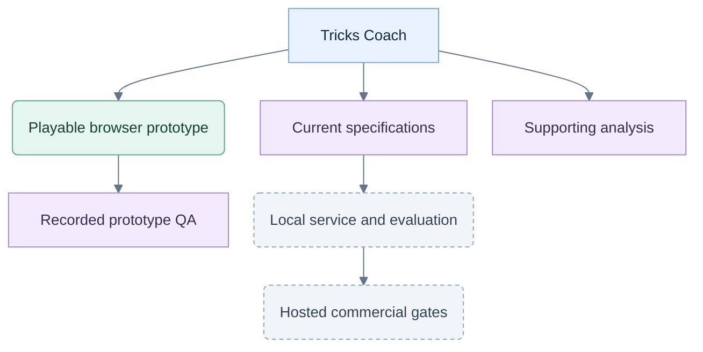

# Tricks Coach

**Product:** Tricks Coach · **Chosen domain:** `trickscoach.com`. Owner approved on 26 September 2026; the owner plans to add the domain to Vercel manually today. Setup completion is not yet verified. See the [brand and domain decision](planning/brand-and-domain.md). Jev remains the strategic model/provider name.

Working folder: C:/repos/test-jev. Stage: playable responsive UX build with V1 implementation specifications. Start with [the specifications and plan](planning/README.md) and [V1 setup](planning/05-v1-setup.md). See [the webapp](web/README.md) and [prototype verification](web/qa/VERIFICATION.md).

## Project map

Solid branches locate current artifacts; dashed-border stages remain planned. Domain setup is still unverified.

## Current owner direction

- Full games for players who know the basic rules: Hearts solo, Spades solo and Spades partnerships; four seats each.
- Combine established tactics, exact deductions, probability calculations and Jev. Give Jev a useful strategic shortlist.
- Coach with cues and highlights, concise optional explanations, and evidence of improvement.
- Prioritize the [coach](planning/04-coaching-and-evidence.md): shared strategy with bots, help before play, supported feedback after play, paused review and optional end-game review. Styling can change.
- Store every started game internally. No player-facing game archive or history library.
- Let players revisit hands/tricks within the current game; alternative practice never changes the original game.
- Unpaid visitors get only a fixed authored coached demo. Full games require membership; active members can continue ordinary play after exhausting coaching allowance.
- Proposed monthly offers: Practice and Learn 4.99 with four coaching sessions/day; Unlimited 9.99; Family 17.99 for three unlimited and two limited seats. Currency, prices and exact limits remain proposals. The pilot defines a session as one hand.
- Keep the engine, hidden state, coach, identity, grants and usage server-only for commercial play. Required records are committed server-side; optional analytics are not tamper detection. Mock grants are local testing only.
- Family members have separate accounts/private records linked to one payer. Worldwide sales are the target; incorporate after testing and before launch.
- Keep training progress separate from any later competitive rating. External assistance cannot be ruled out by browser telemetry.
- Stay web-first. A future mobile wrapper should reuse the web app and service rather than duplicate the game in native iOS/Android code.
- Keep artifacts concise. Build the game views for iPad and modern phones; small screens require landscape.

V1 targets a local app/service with optional Jev through OpenRouter. Start code-only; compare calibrated bidding with rollouts, then evaluate Jev in shadow before promoting requested suggestions. The [planning files](planning/README.md) define the next implementation and supersede conflicting v0.2 instructions. The current app still uses browser heuristics. Numerical pilot settings remain subject to validation.

## Commercial product and testing

Start with [the commercialization page](planning/06-commercialization.md), [hosted architecture](planning/07-hosted-architecture.md), [test gates](planning/08-commercial-testing.md) and [delivery/evidence](planning/09-delivery-and-evidence.md). These supersede the older free-play/per-decision allowance assumptions. The prototype is unchanged; its 38 existing tests passed, while the new commercial acceptance cases are not yet implemented or run.

## Supporting analysis

1. [Necessary changes](docs/REVIEW.md)
2. [Hybrid decision analysis](docs/HYBRID-DECISIONS.md)
3. [Coaching questions and scenario checks](docs/COACH-EXPERIENCE.md)
4. [Research evidence](docs/RESEARCH.md)

The original v0.2 pack remains unchanged for reference. Its no-pruning, no-runtime-simulation and user-history assumptions are superseded by the planning files. [Provenance](MIGRATION.md)
