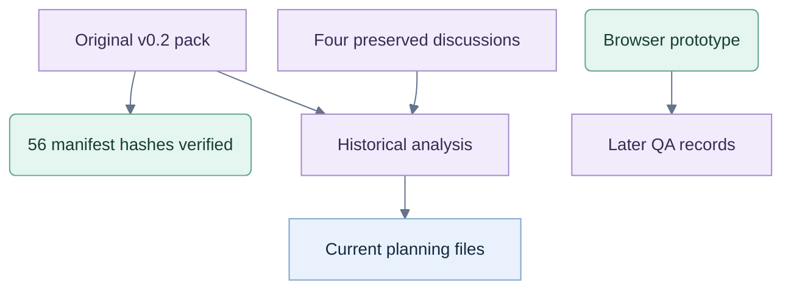

# Project provenance

Product: **Tricks Coach**. Legacy workspace name: **jev-test**. Location: **C:/repos/test-jev**. The owner selected **trickscoach.com** on 26 September 2026; the [brand and domain decision](planning/brand-and-domain.md) records the pending manual Vercel setup.

The owner extracted the original v0.2 specification here. Its 56 manifest-listed files were verified against their SHA-256 entries; the original files and manifest remain unchanged.

Four related discussions are preserved under [reference/chats](reference/chats/): the app plan, coaching methods, cost estimate and Jev card-game discussion. Exports preserve available text and original citation markers; those old citation targets were not exposed by the chat reader.

Current analysis starts at [JEV-TEST.md](JEV-TEST.md). New documents record later owner decisions separately from the original implementation baseline.

## Artifact provenance

Provenance map only; current planning specifications and later QA records govern implementation status. Package verification is separate from application testing.

No synced project files or original chats were modified or deleted. All retained artifacts from this work are in this folder. The Codex chat remains bound to the original ChatGPT project mirror; project files are accessed through the destination above.

Package integrity is verified. Application tests, a live Jev trial and a learning study have not been performed.
