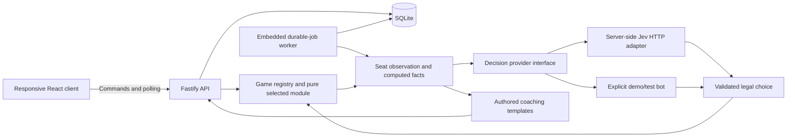

# 03 — Architecture and execution model

**Implementation update (6 October 2026):** The current owner-approved runtime is Go/PostgreSQL with the preserved React client on native Windows. Use the [backend readiness contract](../planning/implementation/multi-game/backend-readiness.md), [current platform contracts](../planning/implementation/multi-game/contracts.md) and [M04E evidence/activation gates](../qa/implementation/multi-game/m04e/status.md). The Node/Fastify/SQLite diagram and runtime below are the historical v0.2 design.

**Normative baseline:** v0.2.0. Code is the referee; Jev is a player and a source of recommendations; authored content is the teacher's vocabulary.

## A. Component boundaries

The diagram shows permitted responsibility paths, not permission to pass the complete game state to every module. The selected game module’s observation builder is the only decision-input component allowed to read the private aggregate. Shared orchestration treats private payloads as opaque module-owned data. The Jev adapter accepts an immutable `DecisionObservation`, never a `GameAggregate`.

| Module | Owns | Must not own |
|---|---|---|
| `packages/contracts` | Versioned JSON Schemas, generated TypeScript DTOs, API types | Strategic policy or database access |
| `packages/game-kernel` | Seat/competition contracts, lifecycle envelopes, deterministic event/replay dispatch, trusted module registry | Spades bids, trump, trick or scoring semantics; network, database |
| `games/spades` | Pure Spades state, rules, legal actions, trick resolution, scoring, safe observations, exact features, content and UI extensions | Network, clocks, persistence, direct provider calls |
| `packages/ui-table` | Accessible cards, four simple seat badges, public zones, hand/action controls, score rows and coach slot | Inferring teams from positions, universal bid/trump assumptions, authoritative game rules |
| `packages/observations` | Invoke module seat projections, validate observation envelopes, enforce serialization allowlist | Reading another seat’s view; deriving Spades facts in shared code |
| `packages/decision-policy` | Provider interface, Jev mapping/validation, demo policy, instruction versions | Mutation of game state; coaching prose generation |
| `packages/coaching` | Fact predicates, template rendering, advice comparison, skill mapping | Claiming that a legal difference is objectively wrong |
| `packages/content` | Catalog interfaces, skill namespaces, original-string infrastructure | Game-specific answer keys or lessons in shared code; unreviewed ground truth |
| `apps/server` | Authentication, commands, transactions, jobs, persistence, API, static serving | Exposing server secrets or other players' hands |
| `apps/web` | React views, keyboard/touch input, view state, fetching/polling | Authoritative legality, shuffle, scoring or hidden cards |

Use strict TypeScript, generated contract types, native `fetch` and `AbortController`. Use React component state and a small typed session-view hook; no global state framework is required for v1. CSS modules and semantic HTML are sufficient. Render original card faces with text, suit glyphs and CSS; do not scrape card or coaching assets.

## B. Runtime and persistence

One Node.js process runs Fastify and a bounded worker loop. SQLite uses WAL, foreign keys, migrations and short transactions on local durable storage. One production replica is a deliberate limit. A Vite development server proxies `/api` to the backend; production serves static assets and API from the same origin. No Redis, message broker, vector store, agent framework or search engine is needed.

The private aggregate includes shuffled deal, hands, events and rule/model versions. Persist the actual original deal, not just a random seed: replay must survive changes in shuffle implementations. Production deals use cryptographic randomness with unbiased Fisher–Yates sampling. Tests use a seeded source injected into the deal generator. The pure reducer itself neither chooses randomness nor reads time.

Store state transitions and a materialized current snapshot in one transaction. An accepted bid, play or next-hand command increments `stateVersion` exactly once. Derived events such as `TrickCompleted` and `HandScored` belong to the same commit and receive distinct event sequence numbers. Advice status changes do not increment the game version.

For the Spades module, the first dealt hand begins in `BIDDING`, `stateVersion=1`. Phases are `BIDDING`, `PLAYING`, `HAND_COMPLETE` and `MATCH_COMPLETE`. Single-hand sessions stop at `HAND_COMPLETE`; match sessions can advance explicitly unless `MATCH_COMPLETE`. A provider outage is a job status, not a new rule phase.

## C. Command and bot-turn sequence

1. Authenticate the guest, authorize session ownership, verify command UUID and expected state version. Reject an out-of-turn or illegal action before requesting any model work.
2. Run the reducer, persist events and snapshot, and enqueue the next needed bot/advice job atomically. Return an idempotent command receipt; the client refetches the human-safe view.
3. The worker leases the job, obtains its immutable seat observation, and exits the transaction before calling the provider.
4. Validate the returned choice and distribution against the exact submitted candidates. Re-enter a transaction and recheck version, phase, seat and legality. Apply once or discard the stale result.
5. Persist the decision record and derived events together. Schedule the following turn. Never let a delayed response play a card in a later position.

A unique key on `(session_id, branch_id, state_version, seat, purpose)` prevents duplicate logical jobs. `purpose` is `bot_turn` or `human_advice`. Lease expiry can cause duplicate provider requests, but never duplicate committed actions. Request digest plus command UUID makes client command retries idempotent; reusing a UUID for a different payload returns a conflict.

## D. Human advice sequence

At the start of each human decision, snapshot the human observation and enqueue one advice job. The request does not include the human's selected action or later outcomes. The human may play immediately; advice that finishes later attaches to that historical decision, not to the new turn.

Hints reuse that same job/result. There is no separate model invocation just because the user opens or closes a hint. Forced turns produce a code-generated `source=forced` decision without a model call. A human must still confirm the card: do not silently autoplay on their behalf.

Basic deterministic facts remain available while strategic advice is pending or unavailable. The app must be playable through human choices, but a live Jev bot turn cannot advance until a valid Jev choice is obtained or the user leaves that session. There is no covert substitution of a different strategy.

## E. Synchronization and lifecycle

Use REST and 750ms polling while a visible page has a pending bot turn or advice job; stop polling when idle or backgrounded. Resume with a fresh GET on focus or reconnect. Server-authoritative state means this does not require WebSockets. GET responses use `Cache-Control: no-store`: a game version alone cannot validate changing advice/job status.

Animations are presentation only. Controls are enabled according to the current version; confirmation submits that version. During network loss, allow reading the last view but disable game-changing controls. Retry the same command UUID after an ambiguous response. Never assume a timeout means the move was not committed.

Limit concurrency initially to four provider requests globally and one committed bot turn per session. Human-advice jobs may overlap a later bot job but must remain tied to their original state. Bot jobs take priority over speculative advice. Bound queue length, expire obsolete jobs and implement per-guest usage ceilings. Initial capacity target: ten active sessions, measured rather than advertised.

## F. Hidden-information boundary

Serialize only own hand, public bids, completed/current tricks, scores, counts and facts derived from those fields. No deal seed, future draw order, opponents' remaining card identities, partner hand, aggregate hashes, private identifiers or per-seat scratchpads enter a provider request. Known void suits may be inferred only from public failure to follow suit.

Each seat has an independent observation and request. Never combine different seats' private hands in one multi-question call. Never condition a bot on advice shown privately to the human. Build a separate human-facing view; do not send the full aggregate and hide it with CSS.

Server-side cache keys include session, branch, seat, frozen observation digest, rule profile, feature version, prompt version and pinned model. Digests are internal. Shared cross-session semantic caches are excluded from v1.

The requirement is identical serialized inputs for indistinguishable information sets, not identical outputs from separate model calls. Model nondeterminism is allowed; replay uses recorded choices. See research R10–R11 for why full-state simulations and incorrect information sharing are dangerous.

## G. Replay, retry and versions

Review reconstructs events up to a selected pre-action version. Advice is read from the original frozen observation and original model record. Optional post-hand reveal is clearly separated from this historical information set.

Retry creates a new session branch with an immutable `parent_session_id` and `fork_before_event_seq`; it materializes the original private state at that point and preserves the old branch. Subsequent bot choices are generated anew after divergent play. Never replay original future card actions blindly. A branch made after seeing future cards is marked `exposed_future=true` and cannot count as an unaided assessment.

Game ID, module version, competition configuration, rule profile, engine schema, content, feature, prompt and model versions are recorded independently. Existing sessions retain their versions. A migration must preserve historical interpretation or make the old session read-only; it must never reinterpret an old score under new rules.

## H. Deliberately deferred

Monte Carlo rollouts, ISMCTS/CFR opponents, sampled hidden deals, reinforcement learning and generative explanations are not required for v1. A later bounded simulator may supply code-computed features, but must disclose sampling assumptions and preserve each simulated actor's knowledge. It cannot quietly become the decision-maker while the product still claims Jev chooses the moves.

## I. Multi-game boundary

Document 12 is normative for the registry, generic action/observation envelopes, competition model and UI extension seams. Shared phase logic must use `awaiting_action`, `round_complete` and `session_complete` lifecycle states, not switches over `BIDDING`/`PLAYING`. Those are Spades module phase labels. A future module adds its own reducers and schema union members; it does not copy the app or edit generic Jev transport.

The existing Spades flow is an example of the shared orchestration, not a universal card-game model. Job purpose, human control, retries, confidentiality, versioning and data ownership remain shared.
