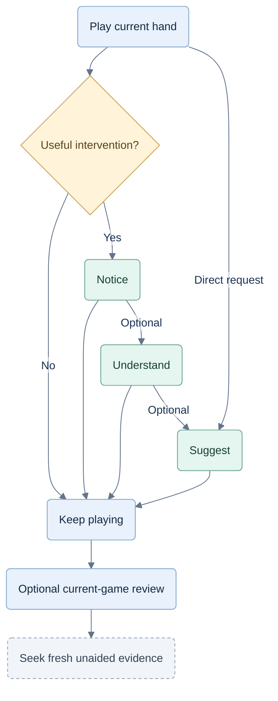

# Coaching analysis

Status: questions and recommendations before UI/UX specifications. Audience: players who know the basic rules.

## Experience to investigate

**Play → notice → decide → reflect → improve.**

The table leads. The coach points to the relevant seat, suit, card or objective, then offers a short explanation if requested. It stays quiet when no useful intervention exists.

Start a real game, keep coaching available, and offer one useful moment after the hand. A player can continue immediately. No mandatory lesson, focus selection, drill catalog or historical-game browser.

## Coaching journey to investigate

Historical experience analysis; current planning specifications govern access, help and assessment. This journey is a proposal, not a user-tested result.

## One control, progressive help

Investigate one Coach control with three behaviors: **after the hand**, **when asked**, or **occasional nudges**. These are candidate labels, not finalized screens.

Keep the existing three reveal levels:

| Level | Experience | Partnership example |
|---|---|---|
| Notice | Highlight relevant information. | Outline partner's current winning card. |
| Understand | Show an established fact or neutral consequence. | “Either card keeps this trick with your team.” |
| Suggest | Show a candidate and its supported tradeoff. | Highlight the low card; “Preserves your ace.” |

The example assumes the user plays last, partner has K♥, opponents played lower hearts, and the user holds A♥ and 2♥. Preserving the ace is a heuristic preference; needing the next lead can change it.

Let players request a recommendation directly. Treat any cue that effectively reveals the answer as recommendation-level assistance, even if it contains no card name.

Counting aids can be opened contextually. Record their exposure internally; avoid a separate grid of memory and strategy settings. Bot/provider choices belong in internal experiments initially.

## Decide when the coach should speak

Candidate triggers: a meaningful objective change, relevant overlooked evidence, a recurring assessable weakness, or a direct request. Avoid routine remarks after every card and assumptions based only on hesitation.

Show one cue at a time. Keep deeper explanations optional. Cancel advice when the position changes. Legal human play must remain responsive while analysis runs.

Do not fix a numerical cue budget yet. Test whether a nudge is timely, understood and useful. If several moves are reasonable, show the tradeoff or remain quiet.

## Storage is not a player archive

| Record | Purpose | Player experience |
|---|---|---|
| Every started game: state, events, decisions and analysis versions | Internal debugging and evaluation; preserve completed and abandoned runs. | No history library, old-game search or export feature. |
| Current game observation and remembered events | Reliable coaching and interruption recovery. | Relevant facts, counts, last trick and brief current-game review. |
| Aggregate skill evidence by game mode | Identify recurring needs and improvement. | A compact progress summary; no list of past games required. |

Keep access permissions and internal retention separate. The old 30-day guest cleanup is not a decision about how long we need internal evaluation records. Set that duration in operations later; “stored internally” does not imply unlimited retention.

Immediate review after the current hand/game remains useful. Reopening an old game is outside scope.

## Mistakes and progress

Use a small decision taxonomy: **information use, objective management, resource use, timing, risk/forecasting, and mode-specific coordination**.

Keep three judgments separate: what happened, how well the decision was supported at the time, and why the player may have chosen it. The last is usually unknown without asking.

Start with supported choice, reasonable alternative, review opportunity and not assessed. Reserve clear-mistake labels for independently supported cases. A move outside the shortlist is not automatically wrong.

Progress should reflect fresh first attempts, relevant opportunities, actual help shown and assessment certainty. Count-assisted strategy is distinct from unaided recall. A quiet move later in a guided hand does not make that hand independent.

Show one strength and one useful next focus, with evidence available on request. Keep detailed denominators, versions and coverage internally; avoid a false-precision overall rating. Wins remain game results, not the learning measure.

## Six scenario checks before specifications

| Scenario | What the analysis must establish |
|---|---|
| Hearts passing | Compare whole pass plans. Receiving a club after passing all clubs must undo any provisional void claim. Remember passed cards legitimately. |
| Solo Spades | The opposite seat is an opponent. Advice follows the player's own contract and bags. |
| Partnership Spades | Change only who needs the next lead. Does advice adapt instead of teaching “always preserve the ace”? |
| A good decision loses | Separate the risk accepted beforehand from the actual unseen trump; help the player revise the plan. |
| Help followed by a fresh opportunity | Distinguish assisted success from later independent improvement without making every turn a quiz. |
| Continuous play and interruption | The player can skip review, continue and recover the active game without managing saved games. |

These are proposed probes, not user-tested results. Use legal, complete scenario states and contrasting variations; check phone readability and keyboard access when testing interactions.

The first design milestone is a clear answer to these situations, including when the coach should do nothing. Detailed screens and development specifications follow that evidence.
