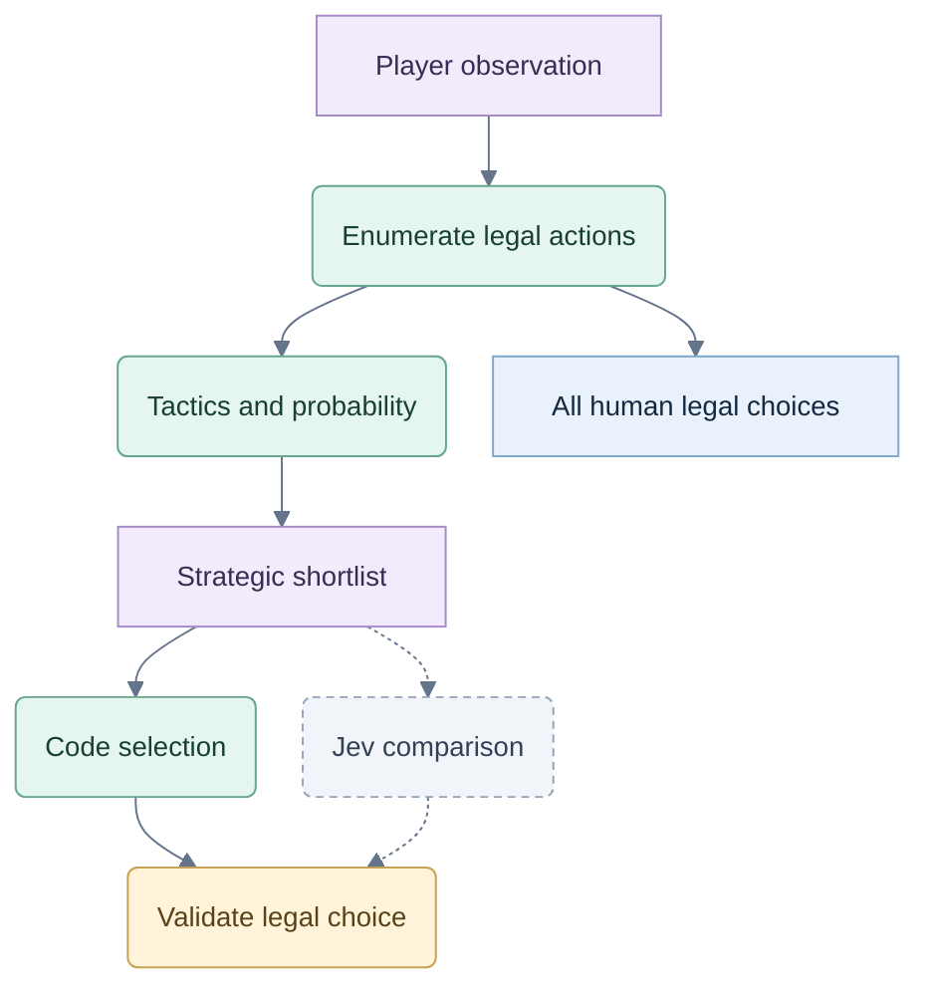

# Hybrid decision analysis

Status: owner-approved direction; algorithm details remain proposals to test. No code or live benchmark.

## The approach

**Player knowledge → legal actions → tactical plans → probability estimates → meaningful shortlist → Jev → validation.**

Established game knowledge should do substantial work before Jev. A commercial Spades study already combines inferred holdings, simulation and tactical guidance that can yield to stronger evidence. It supports the hybrid direction; it does not establish Jev's contribution. [Primary research](https://edpowley.com/academic/papers/aiide13.pdf)

The 286 Hearts passes are a local set of legal combinations. They do not all need to reach Jev. The harder question is how well we compare their consequences under unknown hands and incoming passes.

## Decision comparison

Historical analysis map; current planning specifications govern Jev modes and promotion. No evaluation result is implied.

## Responsibilities

| Stage | What it does | Important distinction |
|---|---|---|
| Exact state | Tracks cards, turns, bids, scores, voids and legitimate private observations. | The engine knows the deal; the decision pipeline only gets the acting player's information. |
| Legal set and deductions | Enumerates legal actions and removes impossible hidden-card assignments. | A failure to follow suit proves a void. A low bid does not prove missing high cards. |
| Tactical candidates | Applies known patterns with conditions and exceptions; generates competing plans. | A preferred tactic ranks an action. Only a proved dominance/equivalence can justify treating alternatives as redundant. |
| Probability evaluation | Compares likely outcomes and risk using game-specific objectives. | Exact calculations can still depend on uncertain assumptions about holdings and behavior. |
| Shortlist | Retains strong, close and strategically different alternatives. | Do not keep several nearly identical options while excluding a competing plan. |
| Jev selection | Chooses among candidates with compact facts, estimated tradeoffs and uncertainty. | Jev adds a judgment; it does not recompute card counts or certify probabilities. |
| Application and record | Validates the choice and saves method, estimates, candidates and result. | A one-option shortlist is a policy choice. It is only a forced move when the legal set has one action. |

Human players retain every legal action. The shortlist is for bot decisions and recommendations. An unexpected human choice must be evaluated on its merits, including when it was not shortlisted.

## Combine strategies by situation

| Situation | Candidate plans | What changes their value |
|---|---|---|
| Hearts pass | Create a short suit; shed dangerous cards; retain protection; preserve a credible moon plan. | Evaluate complete three-card bundles and the retained hand, passing direction, match objective and possible incoming cards. |
| Solo Spades bid | Compare realistic neighboring bids; evaluate Nil separately. | Contract penalty, bag exposure, uncertain side-suit winners and three opponents. Do not count a trump twice as both a winner and an extra ruff. |
| Partnership Spades play | Preserve partner's winner; secure a needed trick; take the lead; protect Nil. | Who still acts, outstanding cards, contract needs and bags. “Never overtake partner” is not an unconditional rule. |
| Later play | Recompute plans after each observed card or objective change. | Remaining resources and deductions narrow the possibilities; they do not reveal another player's intention. |

Use exact immediate/endgame evaluation where the information supports it. Use bounded sampling when future hidden cards matter. Sample feasible joint hands, respecting hand sizes, voids and known passed cards; use the same samples to compare actions. Tested bid/play likelihoods can refine a transparent baseline distribution.

Simulated players act from their own observations. During Hearts passing, no player sees another commitment or received cards early. Record seeds and assumptions for reproducibility; results remain estimates. [Imperfect-information search](https://eprints.whiterose.ac.uk/id/eprint/75048/1/CowlingPowleyWhitehouse2012.pdf)

Keep shortlist size adaptive. Widen it when tactics and estimated outcomes disagree. Skip Jev for forced moves or supported exact bot choices; do not auto-play the human's move. Its documented Choice limit applies only to submitted candidates. [API](https://docs.typesafe.ai/api)

## Checks that matter

1. **Do we discard strong options?** On held-out positions, inspect the full legal set with independent reviewers and a stronger reference evaluation. Measure missed strong alternatives and estimated loss from omissions. The pruning heuristic cannot validate itself.
2. **Does Jev improve the choice?** Compare the same pipeline and shortlist with code selection versus Jev selection. Separately compare unpruned and shortlisted code evaluation. Keep deals, seat rotations and budgets comparable; test candidate-order effects.
3. **Do probabilities hold up?** Check calibration for stated observable events on fresh deals. Test sensitivity to opponent assumptions and keep Jev confidence separate from outcome probability.
4. **Is it reliable and fast enough?** Verify legal outputs, hidden-information isolation, completion, recoverable failures and measured latency. Break results down by passing, bidding, Nil, bags and moon threats; overall wins can hide a weak category.

Next analysis output: a small collection of expert-reviewed contrasting positions and a decision on shortlist/compute budgets. A broader solver is unnecessary unless those checks reveal a concrete need.
