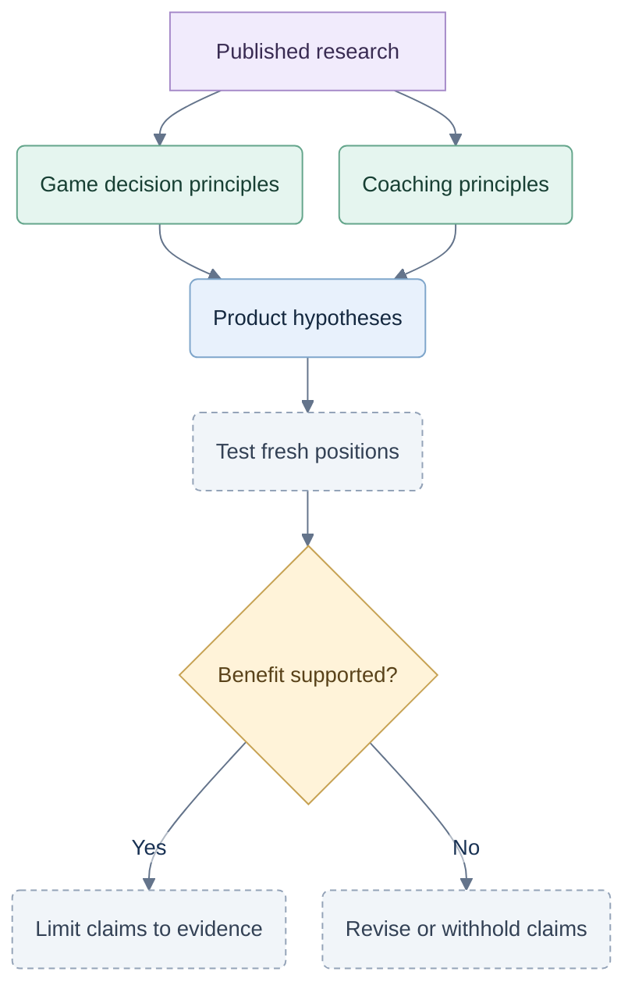

# Research notes

Checked 2026-09-26. These sources inform the analysis; none proves that our coach or Jev improves Hearts/Spades skill.

## From sources to evidence

Historical research map; current planning specifications govern. Testing and benefit remain to be established.

## Hybrid game decisions

| Primary source | Useful finding | Limit |
|---|---|---|
| [Whitehouse et al., commercial Spades hybrid](https://edpowley.com/academic/papers/aiide13.pdf) | Combines card inference, Monte Carlo evaluation and tactical knowledge. Guidance can be overruled; evaluates play quality as well as wins. | Different implementation and rules context; no Jev evidence. |
| [Cohensius et al., Bidding in Spades](https://arxiv.org/abs/1912.11323) | Treats bids through estimated utility and separates Nil. Evaluates bidding with the playing policy controlled. | Do not copy numerical tables into a different rule profile. |
| [Long et al., perfect-information sampling](https://ojs.aaai.org/index.php/AAAI/article/view/7562) | Examines why sampled hidden deals can work empirically in trick-taking games, including Hearts. | Approximation can work without being an optimal-move oracle. |
| [Cowling et al., information-set search](https://eprints.whiterose.ac.uk/id/eprint/75048/1/CowlingPowleyWhitehouse2012.pdf) | Describes pitfalls of hidden-information search, including strategy fusion. | Simulated players cannot be treated as knowing the sampled deal. |

Our inference: combine methods, keep heuristic exceptions, and audit options omitted from Jev's shortlist. Compare the pipeline with and without Jev to isolate its contribution.

## Coaching and measurement

| Source | Implication | Evidence limit |
|---|---|---|
| [Koedinger & Aleven, assistance dilemma](https://pact.cs.cmu.edu/koedinger/pubs/paper%20%2314.pdf) | Balance immediate help with opportunities to think independently. | No universally optimal hint frequency. |
| [Roll et al., help-seeking studies](https://www.cs.cmu.edu/~bmclaren/pubs/RollEtAl-ImprovingMetacogSkillsWithITS-LandI2010.pdf) | Progressive hints can change help use. | Improved help use did not establish improved geometry learning during the intervention. |
| [Soderstrom & Bjork, learning versus performance](https://bjorklab.psych.ucla.edu/wp-content/uploads/sites/13/2016/11/soderstorm_ra_learningvsperformance.pdf) | Assess later, fresh, unaided decisions. | Better assisted results do not establish durable learning. |
| [Baron & Hershey, outcome bias](https://bear.warrington.ufl.edu/brenner/mar7588/Papers/baron-hershey-jpsp1988.pdf) | Separate decision-time evidence from actual results. | A bias finding does not validate our proposed interface. |
| [Corbett & Anderson, knowledge tracing](https://perso.liris.cnrs.fr/pierre-antoine.champin/2014/m2iade-ia2/_static/893CorbettAnderson1995.pdf) | Use repeated evidence for particular skills. | A card choice can have several valid explanations; a mastery model is not required initially. |
| [Reisslein et al., transition to independence](https://onlinelibrary.wiley.com/doi/pdf/10.1002/j.2168-9830.2007.tb00914.x) | Prior knowledge can affect useful help-removal speed. | Publisher abstract checked; not a card-game study. |
| [Amershi et al., human–AI interaction](https://www.microsoft.com/en-us/research/publication/guidelines-for-human-ai-interaction/) | Offers evaluated general design guidance and a basis for testing interaction failures. | Practitioner evaluation establishes relevance, not card-coaching efficacy. |

## Product patterns

[Chess.com review](https://support.chess.com/en/articles/8584089-how-does-game-review-work) offers selected moments, visual feedback and retries. [GTO Wizard study guidance](https://help.gtowizard.com/tips-and-tricks-to-study-analyzed-hands/) distinguishes decision process from results and acknowledges reference-strategy assumptions. [BBO Bridge Master](https://news.bridgebase.com/bridge-master/) uses constructed hands and stepwise solutions.

Borrow useful interactions. Product features are not learning evidence, and their grading authority does not transfer automatically.

## Rules and Jev

- Keep the existing explicit partnership profile. New [Spades variants](https://www.trickstercards.com/help/spades-rules/) and [Hearts variants](https://www.trickstercards.com/help/hearts-rules/) need named rules and objectives. [Bicycle Hearts](https://bicyclecards.com/how-to-play/hearts) and [Bicycle Spades](https://bicyclecards.com/how-to-play/spades) provide additional rule references.
- [Jev API](https://docs.typesafe.ai/api): typed choices have a 255-option limit. This constrains the provider shortlist, not the game's legal actions.
- [Jev limitations](https://docs.typesafe.ai/model-jaggedness/jev-1.13): counting, numerical precision and generation favor keeping exact work in code and explanations in validated templates.
- [Jev confidence](https://docs.typesafe.ai/confidence) summarizes its answer distribution; it is not independently verified game-winning probability.
- [Jev quickstart](https://docs.typesafe.ai/introduction/quickstart) describes hosted inference. The application can run on one machine; offline model hosting is not established.
- Future [UNO](https://service.mattel.com/instruction_sheets/UNO%20Basic%20IS.pdf) requires different actions and private observations. Preserve the small module boundary; do not implement it now.

The number of cues, shortlist size, compute budget and progress labels remain product hypotheses. No live API, gameplay, user study or latency result is claimed.
