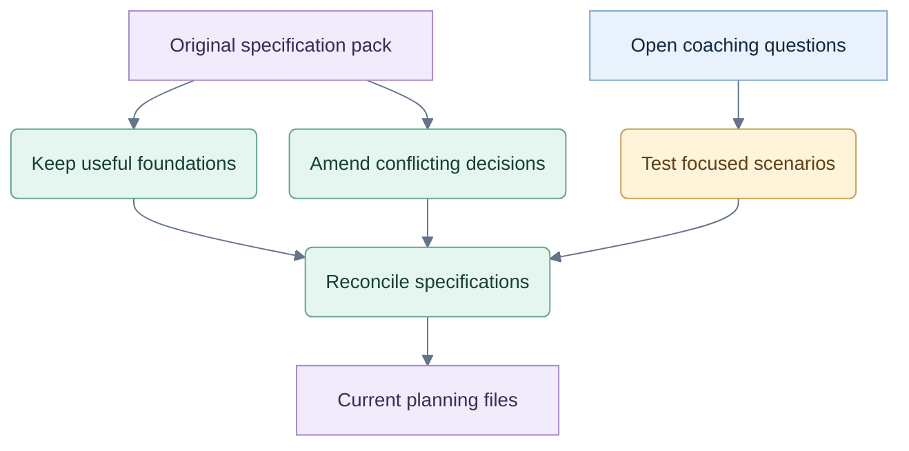

# Necessary changes

Status: analysis, 2026-09-26. Current owner decisions are recorded in [JEV-TEST](../JEV-TEST.md). No UI/UX specification, application or live Jev benchmark has been produced.

## Review map

Historical analysis only; current planning specifications govern. The map does not report completed scenario testing.

## Keep the foundation

The original pack already provides full matches, exact rules, fair player observations, event records, replay, three-stage hints and independent evaluation. Keep the small game-module boundary, TypeScript stack, single-process storage and minimal table.

The main product challenge is choosing the smallest useful intervention and measuring whether it helps the player improve. Factual coaching can work immediately; strategic mistake labels require a validated assessment method.

## Amend these decisions

| Existing direction | Necessary change |
|---|---|
| Beginner-first default; eight of twelve required drills teach legality/scoring. [01](01-product.md), [05](05-coaching.md) | Start with normal games. Keep contextual rules help; make targeted practice optional. |
| Partnership Spades only; a test-only solo module. [12](12-multi-game-extensibility.md) | Design and validate real Hearts solo, Spades solo and Spades partnership play. Deliver incrementally; preserve the existing partnership rules. |
| All legal actions sent to Jev; heuristic pruning forbidden; runtime simulation excluded. [04 §C](04-jev-integration.md), [ADR-012](11-decisions-risks.md) | Use tactics and probability to produce a strategic shortlist. This hybrid direction is now authorized. Keep the game's complete legal set independent of the provider shortlist. |
| Code policy is demo/test-only; live completion depends on Jev. [03](03-architecture.md), [09 §F](09-testing-evaluation.md) | Promote the existing baseline into a supported policy. Compare the same hybrid pipeline with and without Jev to measure its contribution. |
| Guided, practice and match are mutually exclusive modes. [API](../contracts/openapi.yaml) | Separate game length from coach behavior internally. Keep player controls simple. |
| Progress is based on authored exercises. [05 §F](05-coaching.md) | Add assessable decisions from ordinary play, with assistance and uncertainty recorded. No grading merely by shortlist membership or agreement with Jev. |
| Player session catalog and old-game review; guest expiry controls retained data. [07 §E/H](07-data-api.md) | Remove the user archive. Preserve every started game internally for analysis. Separate internal retention from browser access and aggregate skill evidence. |

## Hearts-specific work

- Collect passes privately; exchange only when all four seats have committed. Hidden sequential collection is sufficient.
- Preserve legitimate knowledge of cards the player passed.
- Keep Jev's option limit at the provider boundary. The 286 legal three-card combinations can be evaluated locally; Jev receives selected bundles. This is routine candidate selection, not a product blocker.
- Do not remove human legal choices because the coach prefers other actions.

The existing partnership profile is explicit, including its failed-Nil convention. It needs no rules rewrite. Hearts and solo Spades need separate profiles and objectives.

## Important refinement

A best practice is a conditional strategy. Use exact deductions to exclude impossible states; use heuristics and probability to rank plausible choices. Check exceptions, preserve competing plans and evaluate an unexpected human move even when it was omitted from Jev's shortlist.

No new memory database, general rules language, cloud account system, model cascade or elaborate graphics is needed.

## Before writing specifications

Resolve the six [coaching scenarios](COACH-EXPERIENCE.md), assess [shortlist quality](HYBRID-DECISIONS.md), and choose the smallest useful help control. Then reconcile the existing documents, contracts and work packets together. The original files remain reference material until that revision.

Evidence: the recovered pack has 56 manifest-listed files, all verified against their hashes, plus four [related discussions](../reference/chats/). This is a static review; no implemented game or tested learning effect is claimed.
