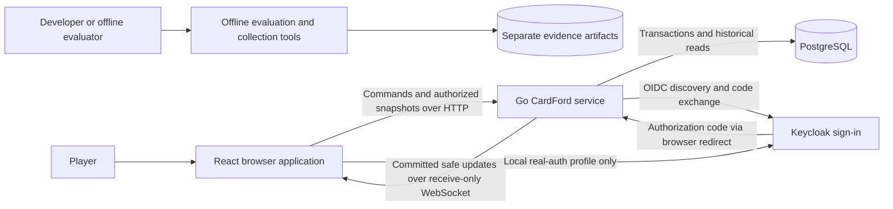
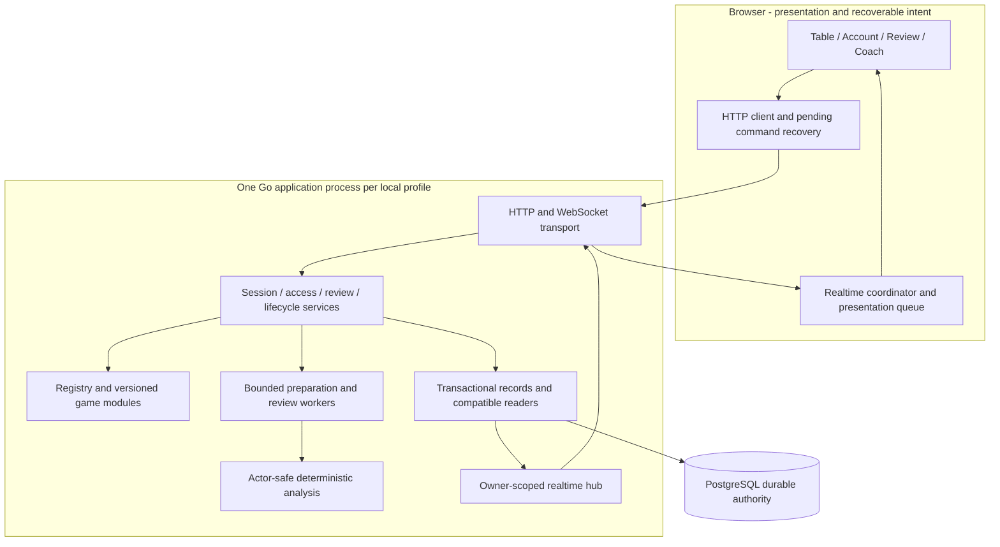

# 01 — High-level reference architecture

[Index](README.md) · [Components](02-components.md) · [Setup](04-stack-and-setup.md)

## System context

CardFord currently runs independent practice tables: one human in the South/seat-zero position and three deterministic computer players. Four seats do not imply online human multiplayer. Installed game families are Hearts Solo, Spades Solo/Partners, and Trix Basic/Complex Solo/Partners. The browser presents the human's permitted information; the service owns the full private state.

The identity arrows describe the authentication profile. The fixture profile substitutes locally issued test identity. The exact deployment processes, ports and database isolation are shown in [04](04-stack-and-setup.md). Offline tools are not called by the normal gameplay request path; their existence does not activate a collection campaign.

## Logical reference architecture

The backend is a modular monolith, not a set of game microservices. Durable work and outbox records live in PostgreSQL; the current scheduler, socket hub and active runners are in process. This distinction matters for later multi-instance design: durable data alone does not make the current dispatch and connection routing distributed.

## Runtime families

| Family | Current role | Boundary |
|---|---|---|
| Go fixture application | Local gameplay, account/access fixtures, deterministic coaching and review | Loopback; explicit `local-test` identity, fixture billing and Jev off |
| Go real-auth development application | Keycloak OIDC and native gameplay through HTTPS development gateways | Separate executable, database/schema and browser build configuration; not a public production deployment |
| TypeScript/Node reference | Preserved implementation, comparison tools and historical behavior | `npm start` / `start:reference`; not an additional authority behind the Go application |
| Offline evaluation / Trix discovery | Candidate evaluation and evidence collection, including separately authorized model-assisted discovery | Own entrypoints, artifacts and admission rules; never a production bot fallback |
| Hosted-release plans | Paddle, production identity/operations and distributed capacity work | Planning material; excluded from the current runtime diagram |

## Trust and information boundaries

1. The browser may request an action but cannot authorize itself, grant Paid access, shuffle authoritatively or decide a score.
2. The selected module constructs seat-scoped observations. Bot and coaching analysis consume permitted information, not opponents' hands or future events.
3. Commands are checked against authenticated ownership, control, revisions, access and applicable lifecycle authority. Saved receipts identify accepted outcomes; a timeout does not prove rejection.
4. WebSocket delivery is an output channel. Incoming gameplay commands remain HTTP. Public projections and messages are allowlisted contracts, not raw persisted aggregates.
5. Keycloak authenticates an external identity; CardFord owns the internal account, game data, access grants and application session. Billing is not inferred from identity or browser state.

**Source anchors:** [fixture composition](../../../server/cmd/cardford/main.go), [real-auth composition](../../../server/cmd/cardford-auth/main.go), [service](../../../server/internal/service/service.go), [registry](../../../server/internal/sessions/registry.go), [Trix installation](../../../server/internal/games/trix/), [transport](../../../server/internal/http/realtime.go), [deterministic runtime decision](../../../planning/decisions/CR-STRAT-011-deterministic-feedback-lab.md).
