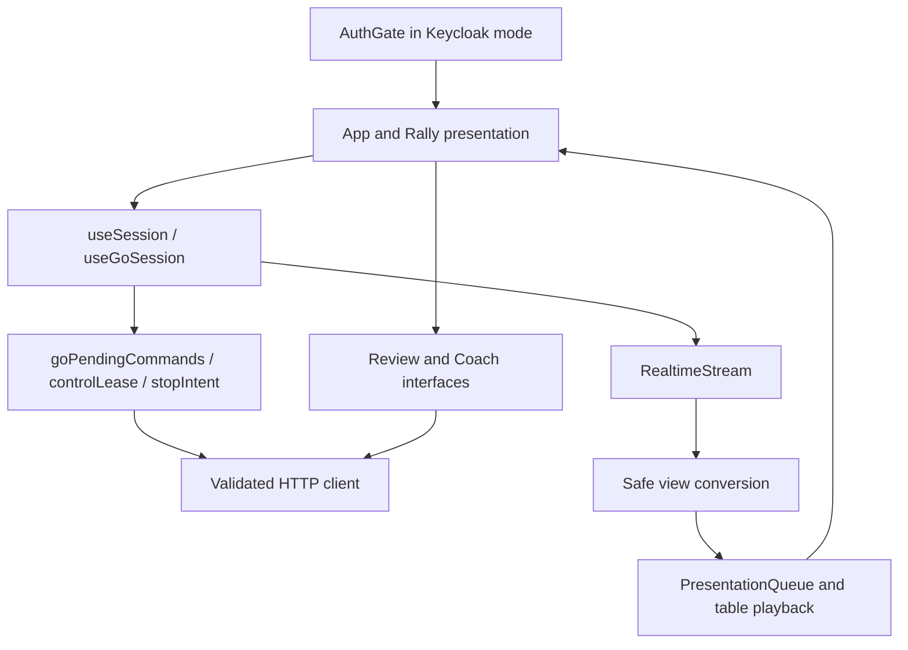
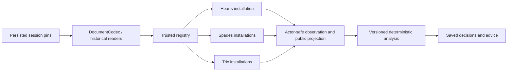

# 02 — Component architecture

[Index](README.md) · [Data](03-data-and-state.md) · [Sequences](05-gameplay-sequences.md)

## Browser components

| Component | Responsibility and boundary | Source |
|---|---|---|
| App/Rally/table | Routes, responsive table, card gestures, settings, account and coach/replay presentation | [App.tsx](../../../web/src/App.tsx), [table](../../../web/src/table/), [rally](../../../web/src/rally/) |
| Auth gate/coordinator | Bootstrap identity, clear private mounted state on invalidation, reverify visible authenticated pages | [auth](../../../web/src/auth/), [authLifecycle](../../../web/src/api/authLifecycle.ts) |
| Session adapter | Convert Go contracts to client models, coordinate control, work, playback and recovery | [useGoSession](../../../web/src/api/useGoSession.ts), [sessionModel](../../../web/src/api/sessionModel.ts) |
| Pending commands | Persist exact unresolved intent before sending; reconcile before retry; bind owner/game and original control material | [goPendingCommands](../../../web/src/api/goPendingCommands.ts), [controlLease](../../../web/src/api/controlLease.ts) |
| Stream coordinator | Negotiate/open socket, buffer during snapshot, validate and order frames, bound retry and recover gaps | [realtimeStream](../../../web/src/api/realtimeStream.ts) |
| Presentation queue | Animate already committed views, retain completed-trick display; synthetic history frames have no action authority | [presentationQueue](../../../web/src/api/presentationQueue.ts) |

React owns animation timing; backend bot progression is independent of animation speed. The latest authoritative revision and the frame currently displayed are distinct. Controls must obey the current session/control/lifecycle conditions even when presentation is catching up.

## Go components

| Package / component | Owns | Boundary |
|---|---|---|
| `server/cmd/cardford`, `cardford-auth` | Configuration, registry/codec composition, storage startup, transport lifecycle | Explicit fixture versus authenticated construction |
| `internal/http` | HTTP route mapping, schema admission, origins/cookies, WebSocket transport; auth wrapper in real-auth mode | Does not implement game rules |
| `internal/service` | Session creation, commands, preparation, access orchestration, review, playback, realtime, lifecycle sweeper | Rechecks durable authority when publishing work |
| `internal/records` | SQL transactions, immutable receipts/decisions, current and historical state, controls, access, work, outbox and auth sessions | PostgreSQL authority; compatible versioned readers |
| `internal/gamekernel`, `internal/sessions` | Shared turn/lifecycle interfaces, trusted registry, exact installed pins and capabilities | No universal Spades bid/trump/team semantics |
| `internal/games/hearts`, `spades`, `trix` | Rules, legal actions, state transitions, scoring, actor-safe observations and game-specific reasoning | Trusted compiled code, not user-supplied rules |
| `internal/strategy`, game reasoning, `internal/coaching` | Deterministic analysis and explanation facts/templates | Production actions do not depend on runtime model calls |
| `internal/access` | Versioned offers/grants, entitlement and allowance interpretation | Local fixture and real-auth access paths differ; no connected Paddle lifecycle |
| `internal/authn` | OIDC discovery, authorization URL, code/refresh exchange and signed provider proof/logout verification | Provider tokens stay server-side; adapter does not own application authority |
| `internal/authsession` | Full login, remembered refresh, status, logout and provider-event orchestration | Provider RPC outside SQL; encrypted custody, durable refresh fence, post-commit invalidation |
| `internal/coachui` | Deterministic preview content for the newer Coach experience | `MockProvider` is scaffolding, not a trained coach or a measured skill rating |
| `internal/contracts` + `web/shared` | Generated Go/TypeScript public contracts and validation | Private domain documents remain separate from public transport schemas |

The service currently creates a preparation scheduler with two workers and a queue argument of sixteen, and a review scheduler with one worker and a queue argument of four; both have a twenty-second default work deadline. These are code configuration facts, not demonstrated throughput. See [service.New](../../../server/internal/service/service.go) and [scheduler](../../../server/internal/service/scheduler.go).

## Game extension and history compatibility

New-session policy selection and historical-reader availability are separate. Changing a startup experiment does not reinterpret saved games under the latest rules or policy. The registry resolves installed versions; unknown versions are not permission to choose a convenient successor. [Registry](../../../server/internal/sessions/registry.go), [codec](../../../server/internal/records/codec.go), [installation](../../../server/internal/sessions/installation.go).

## Offline and reference components

`server/cmd/coachlab`, `server/cmd/trixcollection`, `server/internal/evaluation`, and `scripts/trix-scenario-collection/` support offline evidence work. The collector may use model players/reviewers under its own decision and campaign controls. That exception does not change the deterministic gameplay architecture. This review neither invokes the collector nor establishes permission to resume it.

`web/server/` retains the Node reference and shared canonical SQL migration files. Its presence does not mean that Fastify or Stripe executes behind the Go entrypoints. See [CR-ARCH-003](../../../planning/decisions/CR-ARCH-003-backend-stack-and-system-readiness.md), [CR-STRAT-012](../../../planning/decisions/CR-STRAT-012-offline-trix-scenario-collection.md), and [collector runbook](../../../planning/implementation/coach-lab/trix-scenario-collection/README.md).
