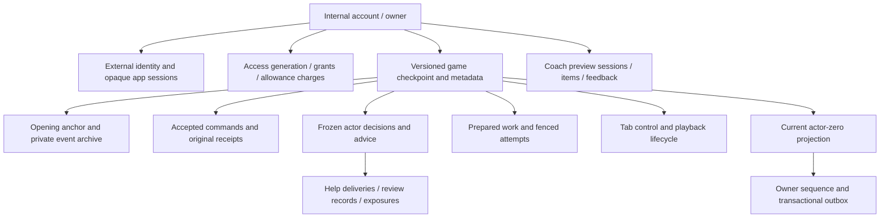
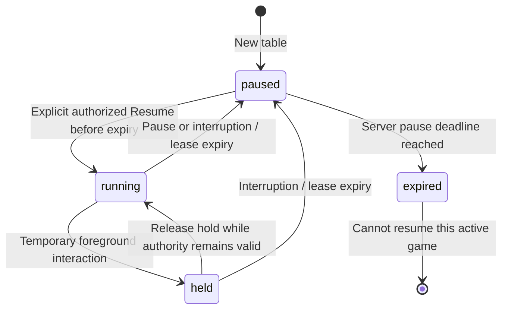

# 03 — Data, authority and lifecycle state

[Index](README.md) · [Components](02-components.md) · [Gameplay sequences](05-gameplay-sequences.md)

## Durable data responsibilities

PostgreSQL is the durable authority. A current game checkpoint is stored separately from its private event archive, opening chance material, accepted commands and immutable decision records. This is a checkpoint-plus-history architecture; the browser does not reconstruct authoritative state from its own stored actions.

This diagram shows ownership and provenance, not every SQL foreign key. Actual table families are defined in the canonical migrations:

| Migration | Main responsibilities |
|---|---|
| [007](../../../web/server/records/migrations/007-versioned-platform-records.sql) | `m03_games`, anchors/events, commands/decisions, access, grants/charges/admissions, work and attempts |
| [008](../../../web/server/records/migrations/008-local-go-service.sql) | `m04_sessions`, tab controls and public service-command receipts |
| [009](../../../web/server/records/migrations/009-configured-access.sql) | Configured coaching unlocks |
| [010](../../../web/server/records/migrations/010-platform-client.sql) | Profiles, fixture billing/family, help delivery and review jobs |
| [011](../../../web/server/records/migrations/011-realtime.sql) | Realtime streams, sequenced delivery, current projection and playback |
| [012](../../../web/server/records/migrations/012-coach-ui.sql) | Coach preview records |
| [013](../../../web/server/records/migrations/013-session-lifecycle.sql) | Foreground lease, pause/expiry metadata and indexed lifecycle work |
| [014](../../../web/server/records/migrations/014-real-auth.sql) | External identities, login attempts and operator-test grants |
| [015](../../../web/server/records/migrations/015-renewable-player-sessions.sql) | Stable login families, encrypted provider bundles, refresh fences and bounded auth events |
| [016](../../../web/server/records/migrations/016-provider-logout-fence.sql) | Provider SID logout fence, including callbacks verified before logout |

Go uses this migration directory even though it is under `web/server`. Migration application validates the canonical checksum ledger under an advisory transaction lock. Historical tables in earlier migrations do not imply that the old Node service is part of the Go runtime. [Migration reader](../../../server/internal/records/store_migrations.go).

## Commit and history invariants

- Compute and stage transitions outside the database publish transaction. Persist only after checking current ownership, access, control, game revision, window, exact source and applicable playback authority.
- Publish checkpoint, events, decision associations, accepted receipt and safe projection atomically. SQL outbox triggers capture sequenced delivery changes; notification follows commit.
- Reusing a command identity with different intent is a conflict. A matching accepted retry returns the original receipt. That receipt is historical acknowledgement, not a replacement for a fresh current snapshot.
- Preserve module/rule/schema/policy/budget pins with records. Unsupported execution tuples can remain readable without being silently upgraded for execution.
- Historical replay uses saved opening material and accepted commands; readers verify sequence, revision and digest integrity. Future-state disclosure is distinct from the original actor information set.

**Sources:** [Commit/Create](../../../server/internal/records/store_documents.go), [staged transition](../../../server/internal/records/staged_transition.go), [work fencing](../../../server/internal/records/work.go), [history](../../../server/internal/records/store_history.go), [codec](../../../server/internal/records/codec.go), [projection](../../../server/internal/records/realtime_projection.go).

## State that must remain separate

| State | Authority | Meaning |
|---|---|---|
| Authentication | App session record, optionally bound to Keycloak issuer/subject | Who is making the request; session may expire/revoke independently of a game |
| Access entitlement | Server grants, allowances and access generation | Whether a game/coaching operation is permitted; not a browser Paid flag |
| Tab control | Durable tab/control generation and retained token | Which tab can issue controlling commands |
| Connection | Socket and connection admission | A transport exists; it does not prove foreground attention or Resume |
| Foreground permission | SQL-time lease and matching instance/generation | Current authority to progress an active table |
| Playback | Durable phase and generation | Running, held, paused or expired; independent of game phase |
| Game state | Module checkpoint/revision and journal | Legal next action, scores, round/session outcome |
| Display state | React presentation queue | Which committed frame is visible during animation |
| Retained history | SQL records and explicit retention/erasure paths | Replay/audit data may remain after resumability expires |

This is the resumability lifecycle, not the game's rules state machine. Game completion is another condition; see module lifecycle handling. Resume increments the playback generation and initially grants a fifteen-second foreground lease. The client renews eligible foreground presence every five seconds. Late renewal cannot revive an expired lease. Pausing pins a deadline; repeat pause, reload and reconnect do not extend it. Defaults are Free five minutes and Paid one hour, selected from server access. Expiry cancels active work and clears the active-game reference while preserving historical records. [Playback](../../../server/internal/records/realtime_playback.go), [retention](../../../server/internal/records/session_retention.go), [sweeper](../../../server/internal/service/session_lifecycle.go), [client coordinator](../../../web/src/api/useGoSession.ts).

## Browser storage and disclosure

| Location | Current purpose | Limit |
|---|---|---|
| HttpOnly cookies | Fixture session or secure real-auth application/login binding | Provider access/refresh tokens are not browser application state |
| `sessionStorage` / volatile fallback | Tab ID, owner/game-bound control tokens, retained invitation tokens | Tab control is still verified server-side |
| `localStorage` | Exact unresolved command intents, stop intent, Coach pending intent; UI preferences | Pending envelopes omit raw control/invitation tokens and reference their hashes |
| Memory | Authorized snapshots, stream ID/cursor, buffers, CSRF, displayed frames | Authentication invalidation clears private mounted state and fences late results |
| Server-side; durable in PostgreSQL | Opponents' hands, chance material, private aggregate/history, authoritative grants and receipts | Public outputs are independent allowlisted projections; private state is never browser storage |

Pending command storage enables recovery, not offline gameplay. The client refuses relevant mutations if it cannot preserve recoverable intent. Safe display state can be temporarily stale after a disconnect; actions still require current server authority. [Pending commands](../../../web/src/api/goPendingCommands.ts), [leases](../../../web/src/api/controlLease.ts), [stop intent](../../../web/src/api/stopIntent.ts), [Coach intent](../../../web/src/rally/coachCommands.ts), [auth cleanup](../../../web/src/api/authLifecycle.ts).
