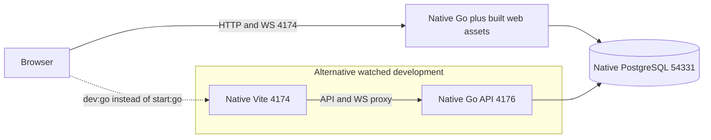
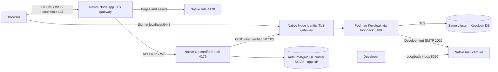
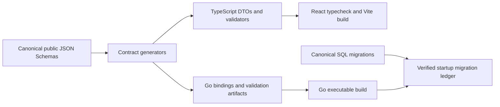

# 04 — Stack and local deployment

[Index](README.md) · [Reference architecture](01-reference-architecture.md) · [Identity](06-identity-sequences.md)

## Versions in this checkout

These are repository pins/resolutions, not claims about globally latest releases or running process versions. JavaScript versions below come from the lockfile rather than dependency ranges.

| Layer | Current technology | Source / use |
|---|---|---|
| Native development | Windows x64; Node 24.19.0, Go 1.26.8, PostgreSQL 16.15 | [windows-tools.json](../../../scripts/windows-tools.json), [native wrapper](../../../scripts/windows-env.mjs) |
| Browser | React / React DOM 19.3.0, TypeScript 5.9.3, Vite 6.4.3 | [package-lock](../../../package-lock.json), [web manifest](../../../web/package.json) |
| Go HTTP | Standard `net/http`; coder/websocket 1.8.15 | [go.mod](../../../go.mod), [transport](../../../server/internal/http/) |
| Go SQL | pgx/v5 5.11.0 with a bounded pool | [go.mod](../../../go.mod), [store](../../../server/internal/records/store.go) |
| Contracts | JSON Schema; Go jsonschema/v6 6.0.3, Ajv 8.20.0, json-schema-to-typescript 15.0.4 | [generation](../../../web/scripts/generate-contracts.mjs), [auth generation](../../../web/scripts/generate-auth-contracts.mjs) |
| Identity client | coreos OIDC 3.21.0, go-jose 4.1.4, oauth2 0.37.0 | [go.mod](../../../go.mod), [authn](../../../server/internal/authn/) |
| Local identity server | Keycloak 26.8.1, pinned container digest; Phase Two email OTP 0.91 plus local policy wrapper | [pins](../../../infra/keycloak/pins.json), [wrapper](../../../infra/keycloak/otp-policy/) |
| Verification tooling | Go tests, Node test runner, fast-check 4.10.2, Playwright 1.63.0 | Existing repository lanes; not rerun by this review |
| Retained Node reference | Fastify 5.12.5, pg 8.23.0, Stripe SDK 22.6.2 | Legacy/reference runtime dependencies; Stripe SDK presence is not Paddle integration |

Keycloak is the persistent application container in the auth profile. The OTP wrapper build also uses a temporary pinned JDK build container; Java is not an added native runtime prerequisite. See [local-auth guide](../../development/local-auth.md) for provenance, licensing and setup details.

## Fixture deployment



Use either built-client or watched-client mode for the 4174 origin. Both use the Go backend; Node supplies build/watch tooling. The Go store uses schema `cardford_go_local`. Fixture guards require loopback, local/test environment, local-test identity, fixture billing and Jev off. They must not be weakened to create a hosted profile. [Configuration](../../../server/internal/http/local_config.go), [start](../../../scripts/start-go.mjs), [watch](../../../scripts/dev-go.mjs).

Existing setup commands, shown for reference only:

```powershell
npm run pg:start
npm run start:go
# Or use npm run dev:go for watched frontend development.
```

## Real-auth local deployment



The application database is `cardford_auth_local_dev` with schema `cardford_auth_local`; tests use the separate auth test database. Keycloak uses `cardford_auth_keycloak`. These are isolated from the fixture game cluster. Only the required WSL/VM route is admitted for the container's database/SMTP access. Gateways remove caller-supplied forwarding metadata; the Keycloak gateway supplies its own proxy metadata. [Service topology](../../../scripts/auth-services.mjs), [setup](../../../scripts/auth-setup.mjs), [auth store](../../../server/internal/records/auth.go).

The ports 4443 and 8443 are different origins on the same hostname. This setup does not establish regional, cross-host cookie isolation or cloud deployment readiness. `.local/auth/` contains ignored private credentials, certificates and captured mail; it is deliberately excluded from this documentation snapshot.

Follow the [human and agent local-auth guide](../../development/local-auth.md), including prerequisites and certificate trust decisions:

```powershell
npm run dev:auth:setup
npm run dev:auth
npm run dev:auth:status
npm run dev:auth:stop
```

Setup and start are distinct. Ordinary starts preserve identities and games. Certificate trust is an explicit development action; reset is a destructive separate workflow and is not required for ordinary use. This review executed none of these commands.

## Build and contract path



Browser backend/auth selection is build configuration (`VITE_BACKEND`, `VITE_AUTH_MODE` and authorized API origin), not a runtime user input. Do not serve a Node-targeted bundle with the Go authority or use query/storage values to choose an API host. `npm start` still selects the Node reference; current Go startup is explicit. [Manifest](../../../package.json), [web platform](../../../web/src/platform/web.ts), [auth transport](../../../web/src/auth/transport.ts).
