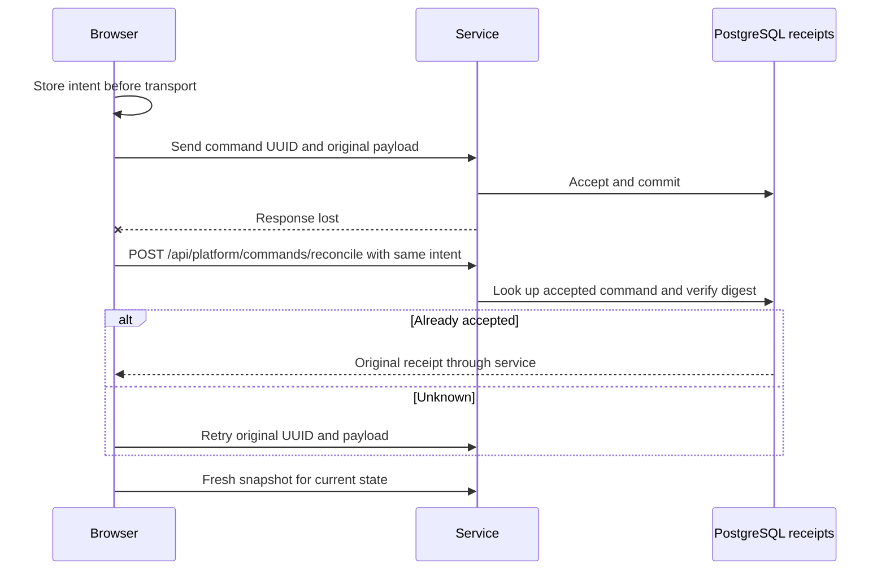

# 05 — Gameplay, delivery and recovery sequences

[Index](README.md) · [State model](03-data-and-state.md) · [Identity sequences](06-identity-sequences.md)

These diagrams describe the current Go path. They omit routine validation/error serialization to keep the authority and transaction boundaries visible. Failure branches retain the original intent or require a fresh authorized snapshot; they never allow the browser to assume a move committed.

## Create a game

```mermaid
sequenceDiagram
  actor Player
  participant UI as Browser
  participant API as HTTP and service
  participant Module as Registry and codec
  participant DB as PostgreSQL
  Player->>UI: Choose installed game/variant
  UI->>UI: Save command ID and exact recoverable intent
  UI->>API: POST /api/sessions
  API->>DB: Authenticate and reconcile command identity
  API->>Module: Resolve exact pins; create shuffled opening state
  Module-->>API: Checkpoint, chance anchor and opening events
  API->>DB: Transaction: recheck access/control; persist game/history
  API->>DB: Set active game/control; initialize paused lifecycle; receipt/projection
  DB-->>API: Commit
  API-->>UI: Original accepted receipt
  UI->>API: Recover current safe snapshot
  API-->>UI: Table remains paused until explicit Resume
```

The server chooses chance material. Replacement of an existing active game has its own expected-session/control checks. A creation receipt and the current game view are separate outputs. [Service.create](../../../server/internal/service/service.go), [CreateAccepted](../../../server/internal/records/service_commands.go), [Create](../../../server/internal/records/store_documents.go).

## Human action and atomic publication

```mermaid
sequenceDiagram
  actor Player
  participant UI as Browser
  participant API as Service
  participant Worker as Deterministic preparation
  participant DB as PostgreSQL
  participant RT as Realtime publisher
  UI->>API: Prepare exact revision/actor window
  API->>DB: Persist or reuse logical work and claim fenced attempt
  API->>Worker: Actor-safe input, exact pins and cancellation
  Note over Worker,DB: Computation holds no SQL transaction
  Worker-->>API: Frozen analysis/advice and selected candidate
  API->>DB: Recheck source/lease; publish prepared result
  Player->>UI: Confirm legal candidate
  UI->>UI: Preserve exact command intent
  UI->>API: POST /api/session/actions with revision/control/preparation
  API->>API: Validate bindings and stage legal transition
  API->>DB: Transaction: authority checks and revision comparison
  API->>DB: Checkpoint, events, decision links, receipt and projection
  Note over DB: Final SQL-time playback check before commit
  DB-->>API: Commit
  API-->>UI: Accepted receipt
  API->>RT: Postcommit wake
  RT-->>UI: Safe committed view over WebSocket
```

The human may choose a different legal candidate from the recommendation. The bot uses its prepared selection. Sealed windows prepare required actors under the module's visibility rules. A stale source or revoked authority prevents publication/commit even if computation finished. [Preparation](../../../server/internal/service/preparation.go), [mutation](../../../server/internal/service/mutations.go), [work](../../../server/internal/records/work.go), [commit](../../../server/internal/records/store_documents.go).

## Server-owned bot progression

```mermaid
sequenceDiagram
  participant UI as Browser
  participant S as Playback service
  participant DB as PostgreSQL
  participant R as In-process runner
  participant W as Bounded preparation scheduler
  UI->>S: Explicit Resume with current control
  S->>DB: New playback generation and foreground lease
  S->>R: Wake current game
  R->>DB: Read durable playback and game node
  alt Computer actor needs preparation
    R->>W: Queue or reuse deterministic work
    W->>DB: Claim attempt; publish only under original fences
    W-->>R: Completion wake
    R->>DB: Commit prepared candidate with generation-bound command ID
  else Automatic node
    R->>DB: Commit one legal automatic transition
  else Human or chance/round boundary
    R->>R: Become dormant; await authorized progress
  end
  DB-->>UI: Committed view via realtime delivery
  Note over UI,R: Animation completion is not a server progression signal
```

A human forced move still needs human confirmation. The runner can be awakened by subsequent commits. Durable work attempts can be reclaimed after lease expiry, but process-local queues/runners are not durable worker infrastructure. Restart/reopen must not be interpreted as permission to Resume. [Bot playback](../../../server/internal/service/bot_playback.go), [scheduler](../../../server/internal/service/scheduler.go), [work](../../../server/internal/records/work.go).

## Connect, snapshot and stream recovery

```mermaid
sequenceDiagram
  participant C as RealtimeStream
  participant H as HTTP / WebSocket transport
  participant S as Service and publisher
  participant DB as PostgreSQL
  C->>H: POST /api/realtime/negotiate
  H-->>C: Bound one-use stream ID and URL
  C->>H: Open receive-only socket with app cookie
  H->>H: Validate Origin/Host/session/tab binding
  C->>C: Buffer incoming frames
  C->>H: GET /api/realtime/snapshot with stream ID
  H->>S: Authorized snapshot request
  S->>DB: Cursor before; session/work/playback; cursor after
  Note over S,DB: Bounded retry if a concurrent commit changes cursor
  S-->>C: Consistent snapshot and sequence
  C->>C: Install snapshot; drain frames newer than cursor
  loop Committed owner updates
    S->>DB: Lease next undelivered owner-sequenced outbox row
    S->>H: Allowlisted message
    H->>DB: Reauthorize before delivery
    H-->>C: session.view / work.updated / control.changed / access.changed
  end
  alt Gap, invalid frame, overflow or reconnect
    C->>H: Bounded snapshot recovery
  else Duplicate frame
    C->>C: Ignore frame at or below current sequence
  end
```

Socket opening precedes the snapshot so concurrent commits are buffered. The current reconnect protocol uses snapshots; the existence of a `ReadRealtimeEvents` store API does not mean replay-from-cursor is wired into the client. Outbox wakeup has a one-second recovery timer for missed notifications. Network send is outside SQL transaction ownership. Queue limits and slow-consumer closure bound delivery resources.

When `CARDFORD_REALTIME=off`, authorized HTTP snapshots remain available. The client HTTP-only fallback runs only while eligible/unpaused, with 1.5-second active-playback and ten-second other intervals. Hidden/offline state suspends work; a paused stream is suspended after thirty seconds. Automatic recovery has a bounded retry window and exposes retry state. Connection recovery does not grant playback permission. [Client stream](../../../web/src/api/realtimeStream.ts), [hub](../../../server/internal/service/realtime.go), [transport](../../../server/internal/http/realtime.go), [outbox](../../../server/internal/records/realtime_outbox.go).

## Ambiguous response and exact retry



Recovery restores the original control/invitation material from tab storage using the stored hash. If it is unavailable, the intent remains unconfirmed; inventing a new token or UUID would change the request. Owner/game binding and expiry prevent unrelated intent reuse. [Pending commands](../../../web/src/api/goPendingCommands.ts), [platform recovery](../../../server/internal/service/platform_recovery.go), [service receipts](../../../server/internal/records/service_commands.go).

## Interruption, pause and expiry

```mermaid
sequenceDiagram
  participant UI as Browser lifecycle coordinator
  participant S as Service
  participant DB as PostgreSQL lifecycle
  participant Sweep as Shared sweeper
  UI->>UI: Away, connection loss or explicit Pause: stop local interaction
  UI->>UI: Preserve stop intent
  UI->>S: Playback pause request when transport permits
  S->>DB: Fence generation; pin pausedAt and expiry
  S->>S: Cancel relevant queued/running game work
  opt Client cannot deliver final pause
    Sweep->>DB: Detect foreground lease deadline using server time
    Sweep->>DB: Materialize pause and its fixed expiry
    Sweep->>S: Cancel/reap local work
  end
  UI->>S: Reconnect and recover snapshot
  S-->>UI: Current paused or expired state
  alt Explicit Resume before expiry
    UI->>S: Resume with current control
    S->>DB: Revalidate access/deadline; new generation and presence lease
  else Pause deadline elapsed
    Sweep->>DB: Expire active runtime; retain historical records
  end
```

Fresh SQL-time checks at acceptance/publication enforce deadlines even if a sweeper is delayed. Connection heartbeat, login verification, tab control and presence are distinct. A repeated pause cannot restart the retention clock. Temporary `held` state stops mutations while allowing eligible foreground Coach/Why work; an interruption during hold prevents an automatic return to running. [Lifecycle](../../../server/internal/service/session_lifecycle.go), [playback records](../../../server/internal/records/realtime_playback.go), [frontend pause](../../../web/src/api/useGoSession.ts).

## Advice, historical review and Coach preview

```mermaid
sequenceDiagram
  participant UI as Browser
  participant S as Review/help service
  participant DB as Saved decisions and history
  UI->>S: Request advice level for original decision
  S->>DB: Check saved delivery or frozen original decision
  S->>DB: Check entitlement; record unlock/delivery if needed
  S-->>UI: Progressive actor-safe advice
  UI->>S: Open historical review
  S->>DB: Validate/replay original history and pins
  S-->>UI: Actor-zero frames, saved advice, assistance and not-assessed status
  opt Eligible Hearts/Spades recorded play alternative
    UI->>S: Request illustrative alternative
    S->>S: Sample feasible deal; original policy; stop after one trick
    S-->>UI: Labelled possible continuation
  end
```

Opening a hint does not run a fresh strategic model: it uses the original saved output. Trix selected review limits public frame construction to the selected request while preserving surrounding history validation. Alternative trials are unavailable for Trix; the Hearts/Spades illustration is not the actual hidden deal or a move-quality grade. [Review/help](../../../server/internal/service/platform_review.go), [Trix review](../../../server/internal/service/platform_trix.go), [trials](../../../server/internal/service/platform_review_trials.go).

The newer Coach experience is a separate flow: capture an authorized current selection or committed action/public frames, invoke `coachui.MockProvider`, then persist preview items and feedback. Its content and fictional rating are scaffolding. Do not merge this with the verified existence of frozen deterministic gameplay analysis or claim a trained coaching system. [Coach service](../../../server/internal/service/platform_coach.go), [provider](../../../server/internal/coachui/provider.go).
