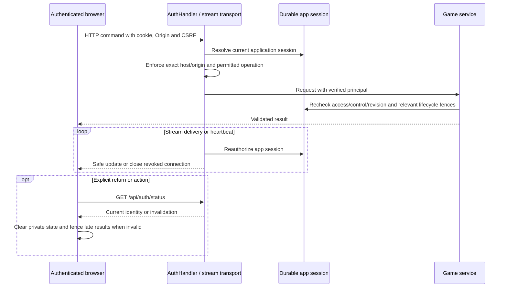

# 06 — Identity and account boundaries

[Index](README.md) · [Deployment](04-stack-and-setup.md) · [Gameplay](05-gameplay-sequences.md)

## Two explicit authentication profiles

Fixture mode uses local test sessions and fixture account/billing behavior. Real-auth development uses the separate `cardford-auth` executable, Keycloak OIDC and an isolated application database. It wraps shared gameplay transport with authenticated principal/CSRF/origin checks and excludes fixture operations. [Fixture configuration](../../../server/internal/http/local_config.go), [auth executable](../../../server/cmd/cardford-auth/main.go), [AuthHandler](../../../server/internal/http/auth.go).

The current split is concrete: `authn.Client` verifies OIDC and performs provider refresh; `authsession.Service` owns the login/refresh/logout/provider-event lifecycle; `http.AuthHandler` handles cookie/Origin/CSRF contracts; records own durable authority and encrypted provider credentials. Shared game services own gameplay and configured access. Provider calls occur outside SQL transactions.

## Sign-in and account binding

```mermaid
sequenceDiagram
  participant UI as Browser AuthSession
  participant Go as Go auth handler
  participant DB as Application PostgreSQL
  participant KC as Keycloak
  UI->>Go: GET /api/auth/status
  Go-->>UI: Validated anonymous/authenticated bootstrap
  UI->>Go: GET /auth/login
  Go->>DB: Save one-use state/binding, verifier and nonce; 5 minute expiry
  Go-->>UI: Secure login-binding cookie and authorization redirect
  UI->>KC: Authorization code flow with S256 PKCE, state, nonce
  Note over UI,KC: Email OTP; prompt=login and max_age=0
  KC-->>UI: Redirect callback with code and state
  UI->>Go: Callback plus browser-binding cookie
  Go->>DB: Consume valid bound attempt once
  Go->>KC: Exchange code and verify OIDC proof
  Note over Go,DB: Provider exchange occurs outside app SQL transaction
  Go->>DB: Map exact issuer + subject to immutable owner
  Go->>DB: Revoke prior app sessions; clear controls; pause active playback
  Go->>DB: Insert stable family, hashed cookie and encrypted provider bundle
  Note over Go,DB: Access <=15m; qualifying refresh idle 90d; absolute 180d
  Go-->>UI: Set opaque secure app cookie; redirect home
  UI->>Go: Fresh auth bootstrap before mounting private hooks
```

OIDC verification covers signature, issuer, client/audience, subject, nonce, authorized party and recent authentication time. The database maps `(issuer, subject)`; email is not an account-merge key. The current unique owner constraint permits one external identity per owner, so multi-provider linking is not implemented. [OIDC client](../../../server/internal/authn/oidc.go), [auth records](../../../server/internal/records/auth.go), [migration 014](../../../web/server/records/migrations/014-real-auth.sql).

Keycloak's local email OTP wrapper adds a five-minute absolute code lifetime, five attempts and a sixty-second resend interval. These are local profile rules. Google/Facebook/Apple are not connected by the existence of this OIDC flow. [Local-auth guide](../../development/local-auth.md), [OTP policy](../../../infra/keycloak/otp-policy/).

## Request authorization and revocation



The application cookie uses Secure, HttpOnly, SameSite=Strict and a `__Host-` name, Path `/`, no Domain. The short callback binding cookie stays Lax. Duplicate or malformed cookies are rejected. Browser POST operations require the configured Origin and session-derived CSRF, with the public demo frame's explicit exception to CSRF while retaining Origin validation. Cookie-free signed provider logout uses its own verification boundary. Provider access/refresh tokens remain encrypted in Go/PostgreSQL and never enter browser application storage. [Auth handler](../../../server/internal/http/auth.go), [browser transport](../../../web/src/auth/transport.ts).

Untouched non-playing pages have no recurring auth/game polling or sockets. Focus/restoration/visibility return performs a coalesced status read without extending refresh eligibility; a local access deadline removes private content. Explicit Continue/private actions can renew remembered access. Near-expiry proactive renewal requires current foreground interaction and accepted gameplay activity. Durable session checks remain authoritative despite browser throttling. Active game sockets reauthorize delivery and enforce an exact access deadline, re-reading durable authority to survive a lost successful-renewal notification. Renewal retains family/control identity; actual expiry closes and pauses play. [AuthSession](../../../web/src/auth/session.ts), [session service](../../../server/internal/authsession/service.go), [realtime transport](../../../server/internal/service/realtime.go).

## Logout, replacement and return

```mermaid
sequenceDiagram
  actor Player
  participant UI as Browser
  participant Go as Auth handler
  participant DB as PostgreSQL
  Player->>UI: Log out
  UI->>UI: Clear private display authority and pending private state
  UI->>Go: POST /auth/logout with CSRF
  Go->>DB: Revoke owner app sessions; delete controls; bump generation; pause playback
  Go-->>UI: Confirm revocation; retain inert cookie to avoid stale-response clobber
  Note over Go,UI: No provider logout call in this path
  Player->>UI: Sign in later
  UI->>Go: Fresh login flow
  Note over UI,Go: Recover snapshot and claim control as needed; Resume stays explicit
```

A fresh successful login similarly replaces older app sessions. Browser refresh or socket reconnect reuses the current login; it is not another authentication event. Another tab still needs explicit control takeover. Public-demo entry discards cached display authorization/CSRF; returning requires a new bootstrap before private hooks mount.

Full sign-in starts the fixed 180-day limit and initial ninety-day refresh idle deadline. Only successful qualifying provider renewal extends idle eligibility, within the hard/provider limits. New logins revoke the previous family's refresh/access/control; stale refresh completion cannot resurrect it. A remembered cookie can log out after access expires. Existing twelve-hour real-auth sessions need one full sign-in after migration because they contain no stored refresh proof.

Verified OIDC backchannel logout revokes families with the matching issuer/provider `sid`; a valid shared-`sid` event revokes a replacement sharing it. Different old `sid` events remain isolated, and duplicate event IDs are ignored. App-originated provider revoke is conservatively skipped because grant-specific cleanup cannot yet be proven safe against a concurrent shared-`sid` replacement. Local logout remains immediate and durable, and new login forces fresh provider authentication. External account-disable/delete delivery and app account deletion/erasure orchestration remain separate release gates. [Auth handler](../../../server/internal/http/auth.go), [session records](../../../server/internal/records/auth_sessions.go), [browser coordinator](../../../web/src/auth/session.ts).

## Access plans are not payment or staff identity

The real-auth entrypoint issues server-owned development Free grants. Its current coaching budgets use existing hand/request units; the separate Coach preview also has its own daily allowance. These are implementation terms for development, not finalized public pricing or quotas.

An executable operator seam can issue short-lived `operator-test` Paid grants to an existing account with a reason. It is not an HTTP entitlement switch or payment integration. Fixture billing/family/trial/delete operations are blocked by `forbiddenAuthOperation`. Paddle is not connected, and Free/Paid are access plans rather than administrator roles. [Auth entrypoint](../../../server/cmd/cardford-auth/main.go), [operator seam](../../../server/cmd/cardford-auth/grant.go), [auth filter](../../../server/internal/http/auth.go).

Recorded local authentication evidence and remaining acceptance gates are summarized in [08](08-review-and-evidence.md), with the authoritative details in [auth-local STATUS](../../../qa/implementation/auth-local/STATUS.md).
