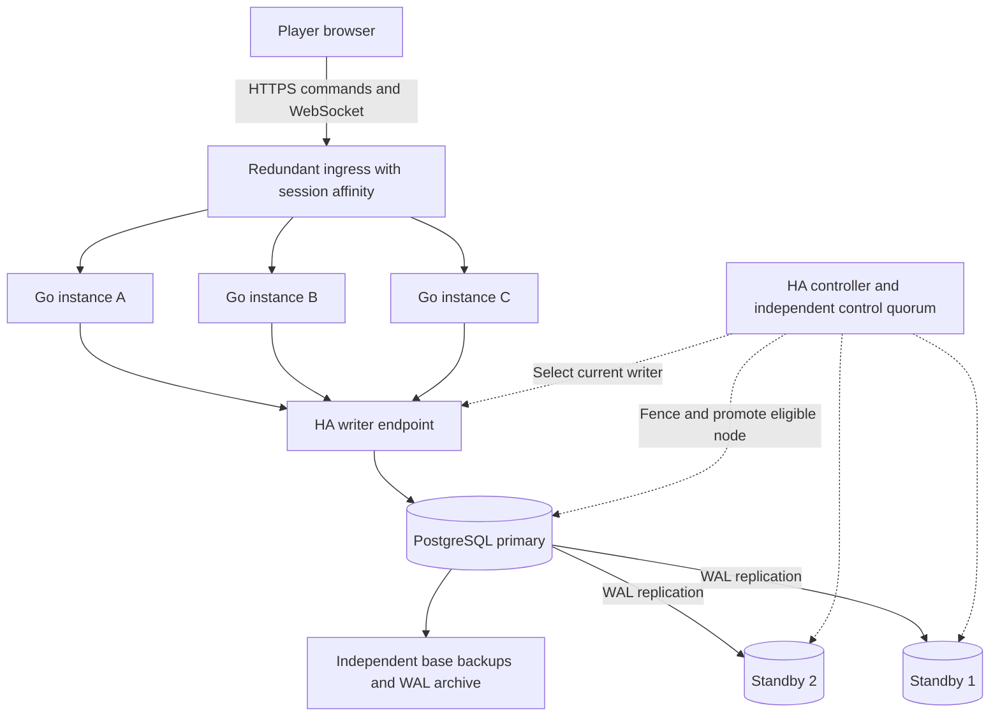
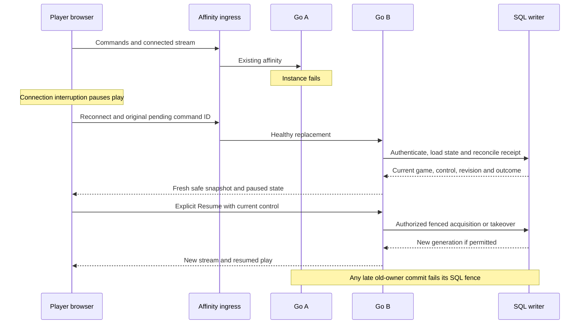
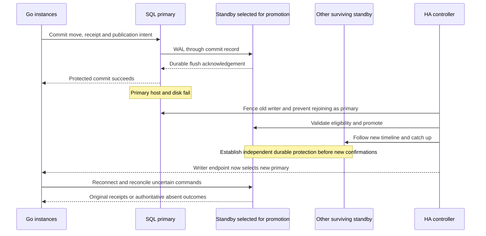

# PostgreSQL recovery and Go instances with player affinity

[Architecture index](../README.md) · [Accepted PostgreSQL-only decision](../../../planning/decisions/CR-ARCH-007-postgresql-only-game-authority.md) · [Current architecture](../current-state/README.md)

18 October 2026. **Architecture exploration, not an implementation plan or deployed topology.** The owner has excluded Redis and selected three database nodes as the exploration baseline, so gameplay can recover using the survivors of a node failure. PostgreSQL remains the single authority for gameplay, history and archive. Retention policy is deferred.

**Consolidated planning update:** use the [planned specification](../../superpowers/specs/2026-10-18-regional-postgresql-architecture-design.md) and [implementation guide](../../superpowers/plans/2026-10-18-regional-postgresql-architecture.md) for future delivery. This exploration remains rationale. The owner has since confirmed that affected players wait during whole-region outage; automatic cross-region game failover is excluded.

The later [regional routing exploration](2026-10-18-regional-routing-and-gameplay-consolidation.md) applies this HA unit within each serving region, following the owner's stable home-region decision. It distinguishes local HA from whole-region disaster recovery and global reporting.

## Recommended direction to explore

Use one PostgreSQL writer and two standby data nodes, multiple Go instances behind a redundant affinity-capable ingress, and an HA controller that fences the old writer and promotes a safe standby. Preserve a durable copy on the writer and at least one independent standby before confirming a move. Following one node failure, the remaining two nodes must establish the same protection before accepting new moves.

This separates three concerns: Go replicas provide application capacity; PostgreSQL replication provides durable copies and recovery; player affinity reduces routine movement of connections and runtime work. None of these alone proves the other two.

The working failure requirement is zero loss of confirmed moves after losing one database machine and its disk. A brief recovery interruption is allowed; no numerical recovery-time target has been selected. A whole availability-zone failure also requires independent placement of data nodes, Go capacity, ingress and the failover control plane. Whole-region disaster recovery is a separate scope. These boundaries must be explicit in the eventual deployment design.

## High-level reference architecture

The ingress and writer endpoint are logical services with their own redundancy, not single proxy processes. The diagram is vendor-neutral. It does not require Go A to use database A: **every Go instance uses the current SQL writer for authoritative operations**. Database placement and application affinity are independent.

## PostgreSQL replication and promotion

### Why three data nodes

| Layout | One data-node failure | Limitation |
|---|---|---|
| Primary plus asynchronous standby | May lose recently confirmed writes on promotion | Does not satisfy the carried-forward durability requirement |
| Primary plus one synchronous standby | Can retain confirmed moves on the survivor | New protected writes must wait for another durable copy; lower-cost alternative not chosen as the exploration baseline |
| Primary plus two standby candidates | Two survivors can provide a writer and durable standby after safe recovery | Requires correct promotion/membership rules and sufficient surviving capacity; not zero interruption |

Three nodes do not mean three writers. The replication policy would normally require the primary's WAL and at least one eligible standby's WAL to reach durable storage before reporting success. With PostgreSQL, this is the distinction between a configured synchronous standby with `synchronous_commit=on` and asynchronous or merely local commit. `remote_write` is weaker than remote durable flush; `remote_apply` additionally waits for replay and is not necessary just to establish durable storage. [PostgreSQL synchronous replication](https://www.postgresql.org/docs/16/warm-standby.html#SYNCHRONOUS-REPLICATION), [commit settings](https://www.postgresql.org/docs/16/runtime-config-wal.html#GUC-SYNCHRONOUS-COMMIT)

Acknowledgement count and safe promotion are separate. If only one standby has the latest confirmed WAL, promoting the other would violate the requirement. Use an HA system that tracks valid promotion candidates and safely changes membership; do not treat a static `ANY 1` setting as an election algorithm. A newly promoted writer must bring a surviving standby to the required state before protected writes resume. If safe promotion or independent durability cannot be established, writes pause.

The host/disk failure assumption requires independent storage, not three processes on one host or one shared disk. For availability-zone recovery with the three-node model, evaluate one data node per zone and a control quorum that can survive losing the same zone. Correlated storage failures and network partitions belong in the fault tests.

### Managed or self-operated HA

My recommendation is to evaluate a managed PostgreSQL HA service first, provided its documented durability, promotion, standby placement and degraded-operation rules meet this contract. A label such as “HA” or “Multi-AZ” is insufficient evidence by itself. No provider is selected here.

Self-operated PostgreSQL is possible, with more operating responsibility. A representative stack is PostgreSQL plus Patroni, a three-member consensus service such as etcd, redundant writer routing and tested fencing. Those control-plane members are distinct from the three SQL data-node roles; a two-node data cluster does not remove the need for a fault-tolerant election service. [Patroni architecture](https://patroni.readthedocs.io/en/latest/README.html)

For a Patroni evaluation, examine synchronous/quorum mode together with strict durability. Non-strict mode can allow local-only writes when no suitable standby exists, which is outside our intended contract. Promotion eligibility and membership changes must be validated as part of the chosen HA configuration. [Patroni replication modes](https://patroni.readthedocs.io/en/latest/replication_modes.html)

PostgreSQL supplies replication and promotion primitives, but does not itself supply the complete failure detector and orchestrator. The former primary must be fenced so it cannot continue accepting writes on a divergent timeline. An isolated node is not necessarily dead. [PostgreSQL failover](https://www.postgresql.org/docs/16/warm-standby-failover.html), [Patroni fencing/watchdog](https://patroni.readthedocs.io/en/latest/watchdog.html)

### Reads and capacity

Keep gameplay reads, authorization, leases, current scores and receipt reconciliation on the writer initially. Replicas may lag in applying WAL even when a commit has reached their disks. Moving such reads to a standby would require an explicit freshness barrier. [Hot standby](https://www.postgresql.org/docs/16/hot-standby.html)

Historical replay and reports may later use replica reads if their freshness contract permits it. That is an optimization to measure, and heavy reporting should not starve a standby needed for failover. Replicas do not distribute primary write CPU, WAL generation or lock contention. Connection pooling, bounded transactions, query/index work and reducing unnecessary lifecycle writes remain relevant regardless of node count.

## Go instances, affinity and ownership

### Normal routing

Use cookie-based affinity for related HTTP commands, recovery requests and the WebSocket handshake. An established WebSocket is already attached to one backend connection; reconnection may select another backend. A new Go instance primarily receives new or reassigned sessions, so adding a node does not instantly rebalance all existing players. Load-balancer products vary in affinity, health, draining and routing-algorithm compatibility. [Load-balancer behavior example](https://docs.aws.amazon.com/elasticloadbalancing/latest/application/edit-target-group-attributes.html#sticky-sessions)

Affinity is a routing preference. It is not authentication, an exclusive table lock or durable game state. A browser cookie also does not necessarily put another browser/device for the same player on the same backend. Retain server-side account/tab/control checks. A request reaching a non-owning instance must follow an explicit rerouting or authorized takeover path; it must not start a competing game runner.

Keep one valid execution owner for an active game, represented by SQL-backed instance identity, generation/fence and lease. The exact schema is a later design detail; the required behavior is that acquisition/takeover is serialized and every automated commit checks the current fence. Old Go processes must fail those checks after takeover, even if their computation finishes late. A cached ownership decision or local mutex is insufficient.

### Go failure and player recovery

This diagram preserves the current explicit-Resume policy; reconnecting does not authorize automatic bot progression. Takeover requires valid control and either expired/released ownership or a safe explicit revocation. It must not seize authority merely because a socket is missing. The replacement reconstructs from SQL and pinned game/module versions, rather than requiring memory from the failed Go node. All eligible replicas need compatible codecs and access to the required shared authentication secrets/configuration.

During planned scale-down, stop admitting new sessions/work, drain bounded in-flight requests, hand off or release ownership safely, then close connections for recovery. Do not wait indefinitely for a long game to finish. Preserve command IDs, original receipts and game identity across the move.

### SQL-only realtime and work distribution

A Redis-free application can use its existing SQL outbox and leased work records. It still needs a delivery topology. The simplest candidate to evaluate is delivery restricted to the instance that currently owns the player's connection/active game, with a SQL-backed routing generation and reconnect snapshot/cursor recovery. Account-wide invalidation must also reach every affected connection; a single game owner must not suppress logout or control changes on another instance.

Outbox processing is at least once: duplicate delivery and worker replacement are normal recovery cases. Persist authoritative changes and publication intent together; clients deduplicate by sequence and recover gaps. Durable receipts and game history outlive transient socket delivery rows. An outbox row being claimed by an instance with no relevant socket must not silently discard the event for another active connection.

PostgreSQL `LISTEN/NOTIFY` could reduce polling as a wakeup hint; it would not replace durable SQL work/outbox records or reconnect recovery. Listening is connection/session-bound, so failover requires re-registration and a durable catch-up pass. Connection-pool mode must support any dedicated listener. [LISTEN](https://www.postgresql.org/docs/16/sql-listen.html)

Start by evaluating multiple instances of the existing Go modular monolith. If measurements later show CPU-heavy bot/coaching work dominating, a separate Go worker pool can claim SQL jobs, compute outside transactions and submit results with the original revision/access/ownership fences. Splitting services is not required just to introduce replicas.

## SQL failure sequence

The order is a logical safety sequence, not a selected controller implementation. A write whose response was lost may already have committed. On reconnect, use the same command ID and payload to retrieve its original receipt; only an authoritatively absent command can be considered for execution under fresh authorization/revision checks. Never silently rebase a human move onto a different turn.

Existing database connections and transactions do not migrate to the new server. Go pools must discard broken connections and rediscover the writer through the selected endpoint, with bounded retries and jitter. Suspend new acceptance when the writer/protected commit path is unavailable. Database loss can expire foreground permission even if the WebSocket stays open; preserve pause and explicit Resume semantics instead of extending leases from browser memory.

The old primary rejoins as a standby after an appropriate rebuild or rewind and catch-up. Do not automatically make it primary again merely because it restarted. `pg_rewind` can help reconcile divergent timelines when its prerequisites and necessary WAL are available. [PostgreSQL failover](https://www.postgresql.org/docs/16/warm-standby-failover.html), [pg_rewind](https://www.postgresql.org/docs/16/app-pgrewind.html)

### Confirmation includes more than the HTTP commit response

The future HA tests must cover snapshots, matched retries and WebSocket publication as well as the original HTTP response. PostgreSQL cancellation during a synchronous replication wait can leave locally visible changes that have not yet reached a safe standby. Those changes must not be presented as a protected acceptance merely because another connection can read them. [Patroni's documented cancellation caveat](https://patroni.readthedocs.io/en/latest/replication_modes.html)

This is a design/verification obligation for adding HA, not a claim that a new mechanism is necessarily required everywhere. The current outbox claims themselves commit a SQL write, which may provide the needed WAL durability barrier under the selected configuration; read-only snapshot and duplicate-receipt paths need their own assessment. Keep timeouts as unknown outcomes, and prove publication/recovery against the actual replication policy before claiming no confirmed-move loss.

## Current-source gaps

| Area | Existing foundation | Required distributed work |
|---|---|---|
| Game acceptance | SQL revision checks, access/control checks, immutable receipts and transactionally saved history/projection | Confirm HA commit settings and all public acknowledgement paths; retry safely after ambiguous failure |
| Playback | Stored generation, instance ID and foreground deadline | Explicit owner acquisition, recovery/takeover and stale-instance rejection across replicas |
| Realtime | Durable outbox, per-owner ordering and snapshot recovery | Connection-aware claiming/delivery; invalidation across every affected instance |
| Compute | Durable work records and attempt fences | Recoverable claiming/wakeup/admission beyond local queues and callbacks |
| Connectivity | Bounded pgx pool and local startup behavior | Hosted writer discovery, pool replacement, global connection budgets and reconnect backoff |
| Deployment | Explicit local/test profiles and guards | Dedicated hosted composition, shared key/config management, health/drain and compatible rolling releases |

Sources rechecked for this exploration: [transaction wrapper and local profile restrictions](../../../server/internal/records/store.go), [game commit](../../../server/internal/records/store_documents.go), [outbox claiming](../../../server/internal/records/realtime_outbox.go), [hub publication](../../../server/internal/service/realtime.go), [playback fencing](../../../server/internal/records/realtime_playback.go), [bot runners](../../../server/internal/service/bot_playback.go), [scheduler](../../../server/internal/service/scheduler.go).

In particular, the current outbox query can claim work regardless of socket location, and the local hub can return successfully with no matching bindings. Foreground renewal checks the current instance ID. These source facts mean load-balancer affinity alone does not make current binaries interchangeable. The local-only store guards should be preserved; hosted support needs its own reviewed composition, not relaxed development checks.

## Backups, operations and cost

Replication handles node loss; it also propagates unwanted updates and deletes. Keep independent base backups plus archived WAL, monitor the backup chain, and test point-in-time restoration. These recovery backups are distinct from product game-history retention, which remains deferred. Restore into an isolated target for verification before considering a traffic switch. [PostgreSQL PITR](https://www.postgresql.org/docs/16/continuous-archiving.html)

Expected cost includes three data-node allocations, replication traffic, backup storage, ingress, writer routing and HA operations/control-plane services. Synchronous commits add remote durable-write latency; no measured CardFord latency or throughput result exists. A managed service may reduce operating work without necessarily reducing the invoice. Retention eventually affects primary storage, replicas and backups together.

Capacity must be planned for the surviving Go and SQL nodes, not only the healthy-cluster total. Track commit latency, synchronous-standby health, WAL flush/replay lag, pool waits, locks, CPU/I/O, connection totals, outbox/work age, active runners and reconnect rate. A stalled replica or backup can also retain WAL and exhaust disk; monitor that independently of product retention.

The current deployment is not a production HA installation. Database replica configuration, automated promotion, restored backups, workload capacity and recovery times are unverified here.

## Decisions still open and next evidence

The storage authority and exclusion of Redis are decided. The owner selected three database nodes for exploration. Remaining deployment choices are managed versus self-operated HA, provider and placement, exact synchronous/promotion contract, recovery-time target, ingress affinity semantics, and application ownership/outbox design. No game-history or score-retention policy is selected here.

The next useful validation scope is two Go instances behind affinity routing plus the proposed three-node SQL topology in an isolated environment. Exercise loss of each data node, primary/standby partition, ambiguous commit and retry, cancellation during synchronous wait, Go-owner death, old-owner late completion, cross-instance invalidation, interrupted outbox/work delivery, scale-down and a separate backup restore. Require no missing confirmed moves, no duplicate effects, coherent actor-safe recovery and no unsolicited gameplay resume. Measure recovery time rather than promising it.

This document contains source inspection and vendor-documentation research only. No services, data nodes or infrastructure were changed, and no fault/load/runtime tests were run.
