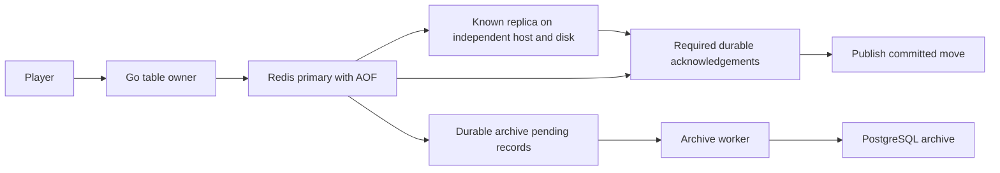
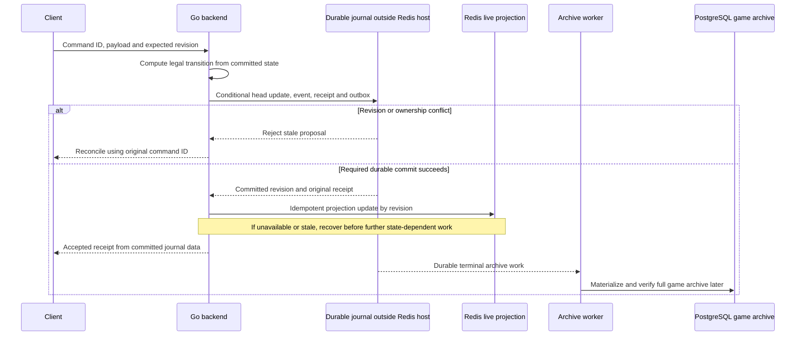
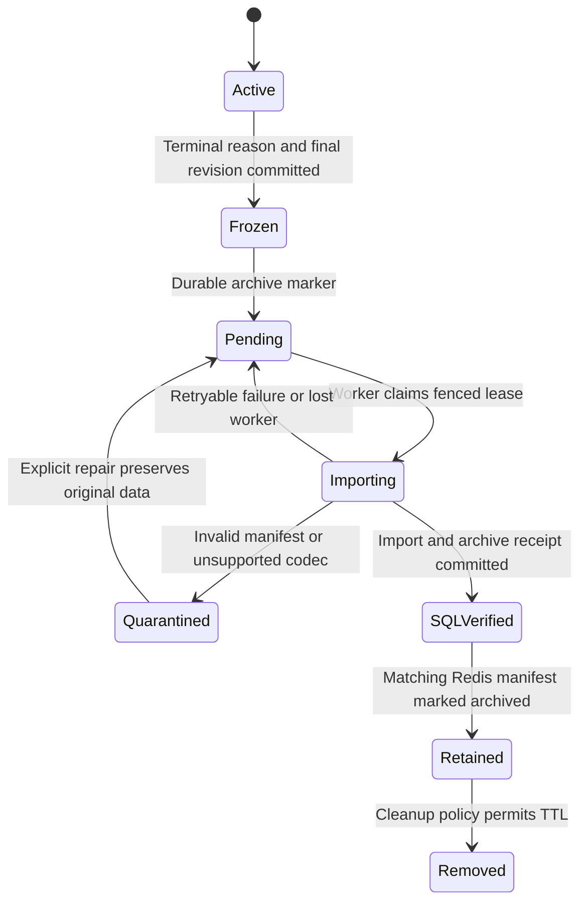

# Redis live games and durable persistence: design review

[Architecture index](../README.md) · [Current data architecture](../current-state/03-data-and-state.md)

Reviewed against the working checkout and primary vendor documentation on 18 October 2026. **Closed exploration: the owner subsequently selected PostgreSQL-only authority and excluded Redis in [CR-ARCH-007](../../../planning/decisions/CR-ARCH-007-postgresql-only-game-authority.md).** The analysis below is retained as historical evaluation; its candidate recommendations and open choices are not active architecture direction. No implementation was authorized or changed by this review. It originally reconsidered an alternative set aside in [CR-ARCH-006](../../../planning/decisions/CR-ARCH-006-pause-presence-and-expiry.md).

## Requirement and proposal

The owner's requirement is that **every confirmed move survive destruction of the Redis machine and its disk**. Here, confirmation includes an accepted HTTP receipt or any WebSocket, reconnect, history or coaching response that presents the move as committed. A temporary pause during recovery is different from losing an accepted move. Region-wide destruction and simultaneous destruction of every durable copy are outside this stated failure case.

The proposal is to keep active tables and their history in Redis, use game-specific data structures, archive completed games asynchronously to PostgreSQL, and expire Redis data only after archival. Redis would support live play, previous tricks, review, replay and coaching. These responsibilities are compatible in principle, provided durability, acceptance and archival are explicit protocols.

**Main finding:** RDB plus AOF on one machine does not satisfy the requirement. Before confirmation, a recoverable copy must exist outside that machine and disk. There are two candidate ways to provide it: independently durable Redis replicas with controlled recovery, or a separate durable acceptance journal. Completion-only archival cannot protect a move whose game has not yet completed.

## What RDB and AOF contribute

RDB provides snapshots; AOF records writes for recovery. Combining them is reasonable for backups and recovery operations, but does not create an off-host copy. With both enabled, Redis normally loads AOF on restart because it is more complete. The default AOF `everysec` policy can lose about a second of writes; `always` adds a synchronous flush cost. Background saves and rewrites also consume CPU and memory. These are storage-policy choices, not a promise of free durability. [Redis persistence](https://redis.io/docs/latest/operate/oss_and_stack/management/persistence/)

Redis gets its fast reads and mutations primarily from operating on memory. Neither a snapshot schedule nor a periodic off-host backup can prove that the latest confirmed move survives disk loss. A persistent container volume only helps against container replacement if the underlying storage survives; a volume on the destroyed disk does not help this requirement.

## Comparison at the same confirmation boundary

Here, **Redis-only** means Redis is the live acceptance authority; PostgreSQL still receives the later archive. **Journal** means a synchronous, recoverable record of accepted transitions, not an asynchronous analytics copy. PostgreSQL is the reference journal because it is already present, not a newly selected deployment.

| Dimension | One Redis host, RDB + AOF | Redis-only with independent durable replicas | Redis plus authoritative durable journal |
|---|---|---|---|
| Survives the stated Redis host/disk loss | No | Potentially, with the acknowledgement and recovery restrictions below | Yes, if the journal is durable outside the Redis failure domain before confirmation |
| Move confirmation | Local mutation/flush policy | Mutation, remote replication and required AOF flush acknowledgements | Conditional journal transaction and durable commit; Redis projection updated by revision |
| Expected latency | Lowest durability work, but fails the requirement | Network and disk flushes are on the path; cannot use a plain `SET` benchmark | Transaction, network and disk flushes are on the path; extra projection work |
| Live reads | In-memory | In-memory, with a committed-visibility gate | In-memory when caught up; explicit recovery/fallback when stale |
| Recovery authority | Lost with the host in the stated failure | A proven surviving copy; promotion must preserve confirmed history | Journal history and head; Redis can be rebuilt |
| Main complexity | Insufficient protection | Membership, safe promotion, tentative visibility, retries, ownership and cross-store access checks | Journal concurrency/idempotency, projection lag, replay and archive materialization |
| Main recurring cost | RAM, disk and backups | Replicated full live/history RAM, AOF/RDB disk, replication traffic and recovery operations | Journal WAL/storage/HA plus Redis RAM; retention and projection capacity still matter |
| SQL during live play | Existing account/access dependencies remain unless redesigned | Same caveat; “all SQL deferred” is a separate migration | At least one compact acceptance write per accepted move |

No throughput, latency or dollar winner has been established. Compare equal acknowledgement guarantees, payloads, failure tests and service availability. The existing PostgreSQL implementation is a necessary baseline: it already separates a checkpoint from appended records.

### Candidate A: Redis is the live authority

An illustrative fixed-pair protocol would atomically write state, events, command receipt and ownership metadata; then use `WAITAOF 1 1 timeout` on the **same physical connection**, checking both returned counts before confirmation. `WAITAOF` is connection-scoped and cannot perform its blocking wait inside a script or transaction. A timeout does not undo the mutation. Redis explicitly warns that this does not provide strong consistency. [WAITAOF](https://redis.io/docs/latest/commands/waitaof/)

That can support a bounded single-host-loss argument only with additional engineering: independent disks, a fixed known pair, recovery exclusively from a valid survivor, no stale owner still accepting commands, and no new confirmations until the required independent copies exist again. Ordinary automatic failover is not that proof. With several replicas, a count of one does not identify which one is safe to promote. Redis Cluster can lose acknowledged writes because replication is asynchronous and failover selection is best effort. [Cluster specification](https://redis.io/docs/latest/operate/oss_and_stack/reference/cluster-spec/)

An alternative would protect every member of a fixed eligible promotion set, or prove a promotion protocol that selects a copy containing all confirmed history. Membership changes must establish the replacement's complete history before making it eligible; they cannot silently reduce the durability threshold. These are candidate protocol requirements, not a validated Redis deployment recipe.

Additional gaps to resolve:

- **Tentative visibility:** the mutation becomes visible before the durability barrier completes. Reads, sockets, bot progression and archive workers must not treat that tentative state as committed. A stream entry alone does not provide this gate.
- **Retry evidence:** finding an existing receipt does not prove the original durability wait succeeded. On a new connection, a read followed by `WAITAOF` does not establish the original connection's barrier. Recovery needs trustworthy confirmation evidence or a fresh durable write tied to the original receipt and current history.
- **Unknown outcomes:** a disconnected acknowledgement may have committed. Retry the same command ID with the same payload; resolve it against authoritative history. Do not create a replacement move or reverse it blindly.
- **Fencing:** an ownership epoch restored from an older dataset can admit an old worker again. Recovery must preserve the authority history or quarantine old owners before accepting new work. Session stickiness supplies neither of these guarantees.

### Candidate B: a durable journal accepts the move

The journal must own acceptance: check expected revision and ownership, advance the game head, append recovery data, and store the original receipt in one transaction. Two backends computing from revision `r` cannot both accept competing successors. The losing proposal returns a stale-revision conflict after receipt reconciliation. A subsequent authorized proposal may use refreshed state; the server must not silently rebase a human-confirmed command. A lost commit response is resolved by command ID.

After that commit, Redis is updated idempotently. If Redis fails, the committed move remains accepted and Redis is rebuilt; subsequent commands must not compute from an older projection. Publishing can use the committed journal result, or wait for Redis to catch up as an availability choice. A Redis-first write followed by an asynchronous journal copy does **not** meet the requirement.

The journal can contain compact, versioned transition records and periodic checkpoints; it need not populate every final replay/analytics table on every move. Nevertheless, this option deliberately retains synchronous persistence during gameplay. “No SQL write until completion” and “use PostgreSQL as the acceptance journal” cannot both hold.

A PostgreSQL journal on a different host/disk survives loss of the Redis host. If the failure contract also covers loss of the journal host, it needs an independent durable copy and safe promotion. PostgreSQL streaming replication is asynchronous by default; configured synchronous replication can wait for standby WAL flush. `synchronous_commit=on` without a configured synchronous standby only supplies local durability. [PostgreSQL synchronous replication](https://www.postgresql.org/docs/16/warm-standby.html#SYNCHRONOUS-REPLICATION), [commit settings](https://www.postgresql.org/docs/16/runtime-config-wal.html#GUC-SYNCHRONOUS-COMMIT)

## Redis data representation

There are three different choices behind “update the whole string”: rewrite the entire game including history; overwrite only a compact current-state payload; or update individual native fields. The first has growing write amplification. The other two should be compared with actual Go serialization and Redis workloads.

| Representation | Benefit | Complication |
|---|---|---|
| One string containing state and all history | Simple complete fetch and replacement | Every move resends and rewrites old history; concurrency still needs a revision check |
| Bounded current-state value plus append-only history | Keeps module encoding simple; avoids rewriting the archive | State, new history and receipt must share an acceptance boundary |
| Native hashes/streams/lists throughout | Partial updates, range reads and indexes | More fields, keys, invariants and coherent-read requirements; not automatically smaller or faster |

For an illustration only, 1,000 moves adding 1 KiB each produce about 489 MiB of cumulative history payload when the entire growing history is rewritten each time, versus about 0.98 MiB when appended once. This excludes current state, indexes, protocol overhead and replication; it is arithmetic, not a benchmark. More generally, growing-history writes scale as `e*n*(n+1)/2`, versus `e*n` for append-only history.

A candidate layout worth evaluating is:

| Logical key family | Candidate representation and responsibility |
|---|---|
| Common metadata | Hash: owner, module/schema/rule/policy pins, revision, lifecycle and watermarks |
| Current module state | Separate bounded, versioned value; game-specific codec |
| Private events and accepted commands | Append-only stream or list with explicit sequence and revision |
| Receipts and original decisions | Immutable ID-addressed records with payload digests and provenance |
| Display and trick indexes | Rebuildable, actor-safe projections pinned to a committed revision |
| Work and ownership | Fenced records and partition-local due indexes |
| Archive state | Frozen manifest, lease/fence, retry deadline and verified SQL receipt |

Under journal-first, these Redis records are projections: the durable acceptance head, original receipts and authority fences remain in the journal. Under Redis authority, the corresponding records themselves need the protected durability and recovery protocol.

This preserves one platform envelope and typed game codecs. Hearts passing, Spades bidding and Trix contracts/layouts should not become mandatory shared fields. Game-specific schemas need versions, validation, bounds and SQL mapping versions. An archive worker must remain able to decode records created by older deployed code.

Redis hashes support field updates, but that alone does not settle total serialization, memory or network cost. An unconditional `SET` is atomic for one key, yet two Go workers can still overwrite each other's read/modify/write results. Conditional revision checks remain necessary. Short scripts can group updates atomically, but they block other Redis activity while running; execute game/coaching computation in Go. [HSET](https://redis.io/docs/latest/commands/hset/), [SET](https://redis.io/docs/latest/commands/set/), [scripting](https://redis.io/docs/latest/develop/programmability/eval-intro/)

### Live history, replay and coaching

Persist the actual opening/chance material, ordered accepted actions/events, exact version pins, original command receipts and original decision/advice bytes needed by the existing recovery contract. A final score or latest object is insufficient. An AOF rewrite can remove overwritten intermediate values, so Redis's recovery log is not the product's replay archive. [AOF rewriting](https://redis.io/docs/latest/operate/oss_and_stack/management/persistence/)

Use bounded range reads and round/trick indexes; optional verified checkpoints can shorten replay. Multi-key reads must describe one committed revision. Keep private recovery events separate from player-visible history. The Go module must project each actor's permitted information, including the information available at the historical decision; do not expose the raw table to browsers or a coach. Preserve original advice rather than regenerating it with a newer policy. Production bots and coaching remain within the repository's deterministic-code boundary.

Current loading validates the complete bounded event archive, and Trix reconstructs and checks state from events. Some module state also contains growing histories. Merely changing SQL reads into Redis reads does not remove that CPU work. A trusted checkpoint/import path would be a separate compatibility and integrity decision. [Record loading](../../../server/internal/records/store_documents.go), [codec](../../../server/internal/records/codec.go), [Trix storage](../../../server/internal/games/trix/session.go), [actor-safe projections](../../../server/internal/records/realtime_projection.go)

## Gaps in the current acceptance and scaling boundary

1. **SQL and Redis would split a transaction that currently protects gameplay.** `Store.Commit` checks access/control/lifecycle and exact source revision, then writes state, events, decisions, receipts and safe publication in one SQL transaction. A SQL permission check followed by a Redis mutation introduces a revocation race. Quota charging and owner-wide command deduplication also need a defined acceptance point. Journal-first can retain these fences in SQL; Redis authority needs an explicit cross-store protocol or a wider migration. [Commit](../../../server/internal/records/store_documents.go), [access](../../../server/internal/records/access.go)

2. **Completion-only insertion conflicts with existing live SQL relationships.** Work, commands, decisions, admissions, help/review and Coach records reference games; readers also check live revisions. An early SQL identity row could help foreign keys, but a stub alone does not satisfy current readers or atomicity. Decide which records move together and how their readers locate authoritative state. [Core schema](../../../web/server/records/migrations/007-versioned-platform-records.sql), [review schema](../../../web/server/records/migrations/010-platform-client.sql), [Coach schema](../../../web/server/records/migrations/012-coach-ui.sql), [work](../../../server/internal/records/work.go), [Coach records](../../../server/internal/records/coach_ui.go)

3. **One Redis key layout cannot make every relationship local.** A `{gameId}` hash tag can co-locate table keys for atomic multi-key operations; it does not co-locate owner-wide limits, another active game or a global archive stream. An owner tag aligns more closely with current owner serialization, while concentrating that owner's retained games. A partition tag can include a partition queue. Select locality against the actual transaction boundary. For work outside it, use durable markers and reconciliation or an explicit cross-partition protocol. Redis transactions do not offer SQL-style rollback for execution-time errors; validate mutation inputs and failure paths. [Cluster specification](https://redis.io/docs/latest/operate/oss_and_stack/reference/cluster-spec/), [transactions](https://redis.io/docs/latest/develop/using-commands/transactions/)

4. **Sticky sessions do not establish table ownership or delivery.** Adding Go replicas still requires stale-owner rejection, recoverable work discovery, socket-aware delivery and ownership transfer. Current sockets, runners and reservations are process-local; foreground/playback authority includes an instance ID, and a competing outbox consumer can lack the owner's socket. Redis storage alone does not fix those boundaries. [Realtime](../../../server/internal/service/realtime.go), [outbox](../../../server/internal/records/realtime_outbox.go), [playback](../../../server/internal/records/realtime_playback.go)

5. **Storage scale and compute scale remain separate.** Sharding distributes different games; it does not automatically speed one CPU-heavy coaching task or split one table across workers. More replicas do not add primary write capacity. Redis shard movement, Go owner migration and WebSocket reconnection require coordinated recovery. Redis containers are only disposable once another verified authority can reconstruct their contents.

## Completion, archive and cleanup

The proposed order, archive first and TTL later, is the right starting condition. It needs a durable handoff, not a worker watching transient notifications.

The frozen state and archive-pending marker must become durable together; they are separate diagram labels only to explain the lifecycle. Freeze a manifest containing terminal reason/revision, record counts, integrity hashes, version pins and required receipts. Fence late game workers. Archive complete games, and define separate treatment for abandoned/replaced/expired games: the current expiry path does not turn every game into a rules-level completed session. Account erasure must not be undone by an in-flight archive retry. [Retention](../../../server/internal/records/session_retention.go), [erasure](../../../server/internal/records/erasure.go)

Archive workers should consume durable pending work, recover abandoned claims, and retry idempotently. A global queue cannot participate in an arbitrary game-slot transaction. A partition-local queue or an atomic per-table marker with reconciliation avoids a lost handoff. Keyspace notifications are transient and unsuitable as the only discovery mechanism. [Keyspace notifications](https://redis.io/docs/latest/develop/pubsub/keyspace-notifications/)

SQL import may use one bounded transaction or staged chunks with a final visibility/verification transaction. In either case, only a durable archive-complete receipt for the exact manifest permits cleanup. If a worker crashes after SQL commit but before updating Redis, retry verifies that receipt instead of duplicating scores or rewriting history. Later coaching annotations need their own revisioned records or a new manifest; they cannot silently alter the frozen archive.

Apply TTL to disposable game data only after that handoff. Do not expire the last copy of command receipts, ownership/security records or unarchived history. Read routing must switch to SQL after eviction/expiry, and late command retries must still resolve the original receipt. Never reuse game IDs. Ordinary `SET` clears an existing TTL unless expiry is explicitly preserved or set, which matters if any retained blob can still be rewritten. [SET expiry behavior](https://redis.io/docs/latest/commands/set/)

“Archival can take its time” must mean eventual work within a capacity budget. A broken mapper or prolonged SQL outage otherwise grows the Redis dataset without bound. Use pending bytes/age, retries, quarantine and admission backpressure. Reserve capacity for already admitted games; protect authoritative keys from eviction. If capacity is exhausted, stop new admissions or pause progression safely instead of deleting confirmed history. Long-lived paused games and post-game review retention also consume this budget.

Bound each archive job's byte/CPU work and schedule fairly across owners, large games and retries. A large or repeatedly failing archive must not starve other games. Quarantined records remain protected and count against backlog capacity.

## Performance and cost model

Use measurements for the deployed payloads and durability mode. Useful estimates before benchmarking are:

- `logical hot bytes = live games * average live footprint + awaiting-archive games * average retained footprint`.
- `aggregate Redis RAM ≈ logical hot bytes * representation overhead * copy count / target utilization`, plus replication buffers and snapshot/rewrite headroom.
- `extra archive backlog bytes ≈ completion rate * average archive bytes * outage duration`.
- Per-move write/replication volume depends on whether current state, growing history or only appended records are transmitted. Counting commands alone hides this difference.

Redis-only must retain all recovery-critical unarchived material in the protected Redis copies. RAM replication, persistent disks, backups, cross-host traffic and operational time remain costs even with community containers. Journal-first adds durable transaction/WAL volume and journal retention, but can make more Redis data rebuildable. Redis availability still matters to response times; rebuilding a large dataset may require more than one live cache node. Keeping journal and archive in the same PostgreSQL cluster also requires resource limits so large archive imports do not starve move commits.

Do not assume native hashes are always smaller than compact values: Redis encoding and key overhead depend on size and configuration. Snapshot/rewrite activity can add fork latency and copy-on-write memory pressure. [Memory optimization](https://redis.io/docs/latest/operate/oss_and_stack/management/optimization/memory-optimization/), [latency](https://redis.io/docs/latest/operate/oss_and_stack/management/optimization/latency/)

The first benchmark should compare the present SQL path, compact-state-plus-history Redis with the required remote durability barrier, and journal-first Redis. Measure end-to-end p50/p95/p99 accepted-move latency, bytes per move, CPU/replay cost, RAM per live/paused/unarchived game, backlog age, and recovery time. Include real game sizes, concurrent coaching, backups/rewrites and archive backlog. These are proposed measurements, not results.

## Review conclusions and decisions still open

- Keep the proposed separation of live data and slower archive materialization as an option. Keep explicit application history and a common versioned envelope with game-specific payloads.
- Do not count single-machine RDB+AOF, asynchronous replication or completion-only SQL as satisfying the stated durability requirement.
- Evaluate a compact current-state value with append-only history before committing to either one giant blob or a fully decomposed native schema.
- **Journal-first is the more straightforward reference design for proving acceptance against Redis host loss**, especially given existing SQL authorization/receipt boundaries. This is an engineering assessment, not a performance result or selection. It retains synchronous journal writes during play.
- Redis authority follows the proposed completion-only game archive more closely, but requires substantially more work on confirmation visibility, failover eligibility, cross-store admission and recovery. It is still a candidate under a bounded failure model.

Before choosing: settle the acceptance authority; how SQL access/receipts remain atomic with moves; the archive and live-read contract; and the availability/cost target during loss of a durable copy. This review is not an implementation plan.

Future validation must kill the Redis host and remove its disk after confirmation; exercise failure between mutation/barrier/response and journal/projection steps; retry on another backend; attempt stale-owner writes; recover interrupted archives; and verify contiguous revisions, original receipts, actor-safe history and scores. A two-backend correctness exercise comes before a capacity claim. No such runtime, load or failover tests were run for this review.
