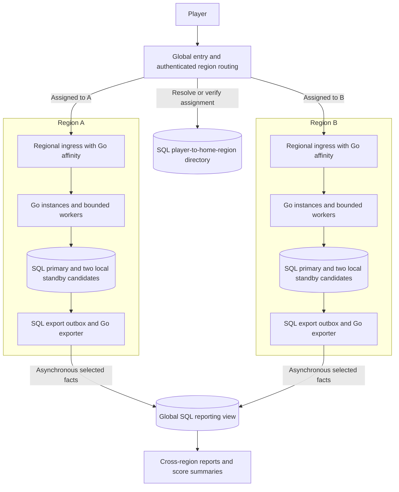
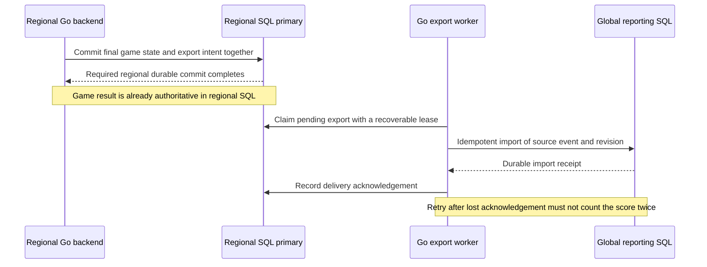

# Regional routing and gameplay consolidation

[Architecture index](../README.md) · [Stable home-region decision](../../../planning/decisions/CR-ARCH-008-stable-player-home-region.md) · [Regional SQL HA and Go affinity](2026-10-18-postgresql-ha-and-go-affinity.md)

18 October 2026. **Exploration only.** The owner has selected a stable home region per player across logins and no region changes during an active game. PostgreSQL remains authoritative and Redis is excluded. History and score-retention policy is deferred. This document does not authorize deployment or implementation.

**Consolidated planning update:** the owner confirmed the whole-region failure behavior below. Affected players wait for home-region recovery; other regions serve their own players. Use the [planned specification](../../superpowers/specs/2026-10-18-regional-postgresql-architecture-design.md) and [implementation guide](../../superpowers/plans/2026-10-18-regional-postgresql-architecture.md) for delivery; this document retains the supporting exploration.

## Recommendation

Repeat the application deployment in each serving region, with each region owning a disjoint set of players and games. Keep their active state, receipts, history and archive in that region's PostgreSQL cluster. Use a global entry point and a durable player-to-region directory to reach the correct region, followed by backend affinity within it. Consolidate selected reporting data asynchronously into a global SQL read model.

This means **replicate a region's data for that region's HA; do not copy every live game into every serving region**. PostgreSQL remains the sole gameplay storage authority, with one writer per game. It need not mean one physical database or one writer for the entire world. The proposed global reporting database is a derived view, never another authority for accepting moves.

The general deployment pattern is independently operated application/data units serving different user subsets. It supports regional placement and incremental expansion, but adds routing, deployment and operating costs. [Deployment stamps pattern](https://learn.microsoft.com/en-us/azure/architecture/patterns/deployment-stamp)

## Reference architecture

These are logical roles, not a prescribed microservice count. Routing can begin in the Go application. The directory and reporting store need separate authority and resource boundaries but need not automatically mean two new application products. Their deployment/HA topology remains to be selected. Neither needs Redis.

The previous three-data-node baseline applies **per independent regional gameplay cluster**. For example, two such regions imply six gameplay database nodes, plus whatever infrastructure is chosen for global services and backups. Within a region, use independent hosts/disks and evaluate separate availability zones. An availability zone is not another geographic region. Merely spreading three nodes across regions changes the write-latency and failure contract; that is not the baseline proposed here.

## Routing: region first, backend second

1. **First account assignment:** after verifying identity, select an allowed region using the chosen initial-placement policy, potentially latency/location and available capacity. Create one durable assignment for the canonical player ID. Simultaneous signups/logins must converge on that same assignment.
2. **Returning login:** resolve the saved home region, even if the player is travelling, changes IP or uses another browser. Geography is an initial placement hint, not ongoing ownership authority.
3. **Regional session:** establish the application session in that region and apply local Go affinity to related HTTP requests and the WebSocket handshake. A lost backend can be replaced within the same region using the SQL recovery protocol.
4. **Subsequent requests:** a regional hostname or an authenticated routing hint can avoid a global directory lookup on every move. A hint only selects a destination; the regional backend still authenticates the caller and verifies that the player/game belongs there.

The directory would minimally bind the canonical player ID to a home region and an assignment version/status. The assignment must be durable before the regional account becomes usable, with idempotent provisioning to recover if either step fails. Uniqueness must hold across regions, not just inside each region's database. Provider identity should retain the existing verified issuer/subject basis; email and a browser-supplied region are not sufficient binding evidence.

An ordinary DNS traffic manager can select a bootstrap endpoint using geography, latency and health. It cannot inspect an authenticated player's assignment. Azure Traffic Manager, for example, is DNS-based, is not in the HTTP request path, and cannot implement individual-client stickiness. It is an example of the distinction, not a selected vendor. [How Traffic Manager works](https://learn.microsoft.com/en-us/azure/traffic-manager/traffic-manager-how-it-works), [stickiness limitation](https://learn.microsoft.com/en-us/azure/traffic-manager/traffic-manager-faqs)

The account-aware portion therefore needs application/HTTP routing or explicit region endpoints. DNS health failover may move a stateless bootstrap entry, but must not silently route an assigned player's game to a different independent data cluster. A wrong-region request should be safely routed or rejected before any account/game creation or mutation.

Global routing and the directory are a control dependency. Existing authenticated regional sessions should continue during a directory outage when their valid assignment is already established. New account assignment, unresolved logins and region changes must fail closed instead of inventing another owner. The identity provider's own availability and the authorization-expiry rules remain separate dependencies; this is not permission to extend expired sessions while disconnected.

## What lives where

| Data or responsibility | Authoritative location | Copies or consolidation |
|---|---|---|
| Game rules, application code and static assets | Versioned release artifacts | Deploy compatible builds in each region; distribute public assets through an edge/CDN if selected |
| Canonical player ID and home assignment | Global directory/identity binding authority | HA and read distribution as needed; serialized assignment, no independent registration in each region |
| Application sessions, control, active game, access/grant checks and usage charges | Player's home-region SQL | Regional HA copies; keep gameplay admission transactional with its related records |
| Events, original receipts, scores, advice and replay archive | Home-region SQL | Regional HA; independently designed backups; no full worldwide copy by default |
| Billing provider linkage and verified entitlement events | One explicit commercial authority, still to be designed for regions | Deliver idempotent, versioned updates to the correct region; never infer paid access from the reporting copy |
| Global score summaries, usage reports and game index | Derived global SQL read model | Asynchronous regional exports with visible freshness and reconciliation |

Keeping all of one player's gameplay in one region avoids cross-region transactions for ordinary moves. Shared family allowances, global quotas and billing changes are exceptions: they need one consumption authority or explicitly reserved regional budgets. An eventually consistent report is unsuitable for enforcing those limits. Regionalizing the existing identity/billing plan must preserve revocation and entitlement ordering, not add a global network call to every move by accident.

## Consolidating gameplay, scores and history

There are two different reads to support:

- **The player's own history:** route to their home region, where complete history already exists in SQL. The player sees one history without a global copy of every move.
- **Cross-region product/operational views:** combine selected game summaries and score facts in a separate global SQL read model. A global game index can point authorized drill-down requests to the home region for detailed replay.

The first export candidate is a completed-game fact: source region, globally unambiguous player/game identifiers, source revision, completion time, game/variant/rule version, score facts and a schema version. More detailed coaching/replay exports are separate needs; do not broadcast private deals or original analysis everywhere merely to count games. A live dashboard can use separately defined periodic metrics without turning the reporting store into gameplay authority.

Aggregation must preserve game, variant and scoring-version distinctions; this design does not imply one comparable score scale across different games.

The completion event is an export trigger, not the first time the game becomes durable. Every move continues to be persisted through the regional SQL acceptance path.

Export eligibility must honor the protected-commit rules in the [HA exploration](2026-10-18-postgresql-ha-and-go-affinity.md), including ambiguous commits and synchronous-wait cancellation. Seeing a row locally is not by itself evidence that its move is protected on the required surviving copies.

Use at-least-once delivery with deduplicated effects: event IDs and source revisions prevent duplicates and stale exports from overwriting newer facts. Score totals should derive from one current contribution per game or an equivalently idempotent ledger; blindly incrementing on each retry would be incorrect. Corrections, deletion/suppression and account erasure need ordered handling so delayed exports cannot recreate removed data. This defines propagation correctness, not a new retention duration.

Keep export progress, retry leases and receipts durable across SQL/Go failover. A reporting outage must not block ordinary regional gameplay while the export backlog remains within its capacity budget. Track backlog age/bytes, bounded worker load and per-region watermarks; report delayed or unavailable regions rather than treating them as zero activity. Reconciliation/backfill must use an explicit source snapshot/watermark boundary so it cannot miss or double-count concurrent changes. Do not purge the only export evidence before delivery or a proven rebuild path exists.

For the initial design, SQL outbox tables and Go exporters are a reasonable candidate with the existing stack. PostgreSQL logical replication/CDC is another option for later evaluation: it can consolidate selected source tables, but overlapping writes can conflict and schema changes need coordination. A subscriber is not automatically a safe global multi-writer merge system. [Logical replication](https://www.postgresql.org/docs/16/logical-replication.html), [conflicts](https://www.postgresql.org/docs/16/logical-replication-conflicts.html), [schema restrictions](https://www.postgresql.org/docs/16/logical-replication-restrictions.html)

Do not reuse the existing realtime outbox's delivery/cleanup contract unchanged for this purpose. [PurgeRealtimeEvents](../../../server/internal/records/realtime_outbox.go) deliberately removes old delivered **and undelivered** events because clients can fetch a fresh snapshot. A cross-region export needs its own delivery evidence, backlog policy and reconciliation contract. No new broker is selected by this exploration.

## Failure and recovery boundaries

| Failure | Proposed behavior |
|---|---|
| One Go instance | Recover on another Go instance in the same home region; fence old execution and preserve explicit Resume |
| One regional SQL node | Use the previously explored three-node HA recovery; establish safe durable copies before new confirmations |
| Global reporting store or exporter | Regional play continues within the backlog budget; reports show lag and catch up idempotently |
| Global directory | Valid established regional sessions can continue; unresolved login/assignment waits for authoritative resolution |
| Entire home region | Other regions keep serving their own players; affected games wait for regional recovery under this baseline |

Whole-region recovery is not provided merely by having another live serving region. Region B does not possess Region A's active games in this design. Optional cross-region backups or a dedicated recovery replica are separate from normal serving-region ownership and from summary exports.

The no-loss target reviewed so far covers a single database machine/disk failure with regional synchronous protection. An asynchronous cross-region copy can lag and does not guarantee preservation of every confirmed move after destruction of the whole region. Extending that guarantee across regions would require a different durability/availability/latency contract and safe ownership transfer. No such extension is selected here. Global reporting is not a disaster-recovery source for live games.

A future account relocation would also be a deliberate migration: prevent conflicting admissions, transfer required account/history/receipt state, verify it, fence the old assignment and publish a new assignment generation. It is not triggered by travel or a load-balancer cookie. The owner has not requested that feature, and it is outside this exploration's implementation scope.

## Current-source implications and remaining choices

The inspected records and migrations have owner/game identity, SQL access/control fences and private versioned history, but no home-region directory/routing contract. The existing [external identity mapping](../../../server/internal/records/auth.go) serializes issuer/subject registration within one database; running that code independently in two regions does not establish global uniqueness. [Identity schema](../../../web/server/records/migrations/014-real-auth.sql), [core owner/game relationships](../../../web/server/records/migrations/007-versioned-platform-records.sql), [record metadata](../../../server/internal/records/types.go).

Regional scope therefore requires a reviewed provisioning/identity binding protocol, explicit region ownership checks and globally unambiguous export identifiers. Keep the current acceptance checks together in home-region SQL. Do not split authoritative gameplay admission between a global directory and a regional transaction without defining failure and revocation semantics.

The recommendation is to build toward regional independence, stable assignment and asynchronous consolidated views, while initially launching only as many regions as justified. Multiple regions can increase aggregate write capacity by assigning different players to different writers; that is partitioning the workload, distinct from adding standby replicas. It also multiplies minimum HA infrastructure and operating work. The previous bounded single-region launch plan is not replaced with an immediate worldwide rollout.

The implementation guide makes initial regions/placement policy, global directory and identity availability, routing mechanism, regional entitlement/usage boundaries, and reporting contents/freshness first-phase inputs. Whole-region outage behavior is now confirmed: affected players wait, with no automatic relocation or zero-loss cross-region promise. Detailed restore procedures and recovery-time targets remain open. History/score-retention policy stays deferred. No latency, capacity or recovery-time result is claimed.

Future validation should include concurrent first login from different regions, travel/new-browser routing, a stale or forged region hint, wrong-region game commands, directory/reporting outages, duplicate and reordered score exports, deletion followed by delayed export, export-worker/SQL failover, and region loss without accidental creation of a second authority. This review performed source/documentation inspection only; no runtime or infrastructure tests were run.
