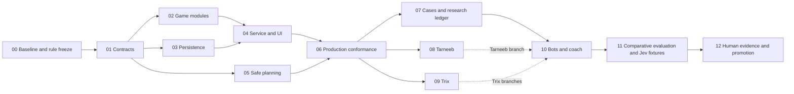

# Multi-game Bots and Coaching Implementation Plan

> **For agentic workers:** REQUIRED SUB-SKILL: Use superpowers:subagent-driven-development (recommended) or superpowers:executing-plans to implement this plan task-by-task. Steps use checkbox (`- [ ]`) syntax for tracking.

**Goal:** Make the real application support game-owned rules and information-faithful reasoning, preserve current play, and provide maintainable cases/evaluation for Spades, standard Tarneeb Partners and Jawaker Trix Solo/Complex Partners.

**Architecture:** Migrate the production service to typed, versioned registered modules inside the existing monorepo. Retain storage/access/command infrastructure and original evidence; replace the world-consuming, round-only planning boundary while retaining useful budget/pairing arithmetic. Bots and coach consume the same game-owned analysis; strategic improvements require independent evidence.

**Tech Stack:** Existing Node 24, strict TypeScript, React/Vite, Fastify, PostgreSQL, JSON Schema/Ajv, Node test runner and Playwright; retain the installed lockfile. Current package declarations use TypeScript 5.9 and React 19.1, rather than the original speculative dependency floors. No dependency upgrade is required by this plan.

**Spec:** [Interview/research packet](../../../planning/research/2026-10-04-card-game-architecture-interview/README.md), [platform contract](../../12-multi-game-extensibility.md), [current reasoning](../../../planning/12-spades-reasoning.md), CR-STRAT-006–010 and the owner's recorded [Jawaker rule selection](../../../planning/research/2026-10-04-card-game-architecture-interview/08-standard-rule-reconciliation.md).

## Global Constraints

- “All supported games have four seats.” Competition is four individuals or two teams of two; controllers and visibility are separate.
- “Jev is the only runtime strategic model.” Later CR-IMPL-001/CR-STRAT-009 allow explicit deterministic code policies; no other runtime LLM/framework/cascade.
- “Rules, arithmetic, legal actions, trick winners, score, features, permissions and state transitions are code.”
- “No hidden-hand leakage.” Build allowlisted seat inputs; never pass the aggregate, actual concealed deal, fixture labels or teammate memory to a policy/provider.
- “All state changes are authorized, version checked, idempotent and persisted.” Never keep a transaction open across provider/expensive policy work.
- Public schemas generate DTOs/validators; strict validation rejects unexpected sensitive fields. Private domain types stay independent.
- Existing rules, policy snapshots and original advice remain immutable. Versions travel with records; unavailable/ambiguous history fails closed or read-only.
- Preserve the current minimal table, coaching preferences and three playable modes. Standard Tarneeb only; selected Jack-centered Jawaker Trix only. Hosted rollout, real-player multiplayer, ratings, admin editor, reinforcement learning and ISMCTS implementation are excluded.

## Review Focus

1. Legacy resume with missing/ambiguous versions must not acquire a different policy or rescore history — M02/M03.
2. A reveal after a decision must not alter its earlier knowledge/advice — M05/M09.
3. Hearts sealed choices must remain frozen and atomic; 286 legal choices must not be truncated for Jev — M04/M06/M11.
4. Layout pass, finished seats, all-pass auctions and fresh deals must not become fake trick phases or endless automatic loops — M05/M08/M09.
5. A short-hand gain, familiar deal, model agreement or changed coach wording must not become a strength/learning claim — M07/M10/M12.

---

## Status, scope and reading map

**Plan created 4 October 2026 from `c5980b9` plus the existing uncommitted Jawaker-selection documentation. No implementation or new gameplay was performed while writing it.** The interview verified 706 text decisions and 672 browser decisions; those archives are development evidence. Existing module seam tests exercise a counter only, and `plan-genericity.test.ts` is absent. The full application suite must be rerun at implementation start; its historical passing report is not current acceptance.

**Concurrent work reconciled:** main advanced to `7aee013` with a [bounded Spades evaluation/blind-review pack](../../../qa/experiments/2026-10-04-spades-evaluation-pack/README.md). Reuse its 32 pending cases, source index, label validator, match pilot and immutable manifests through adapters in M07/M11. Keep its development estimand, review exposure controls and human-review deferral; no second editable label source, pilot relabeling as confirmation or automatic rerun. Its active pilot outputs belong to that work and remain untouched by this planning pass.

| Packet | Contents |
|---|---|
| [Contracts](../../../planning/implementation/multi-game/contracts.md) | Exact module/facade, persistence/transport, actor-policy, horizon and provider interfaces |
| [Cases and evaluation](../../../planning/implementation/multi-game/cases-and-evaluation.md) | Typed catalog, source ledger, blind labels, experiments, Jev/human gates |
| [Game packets](../../../planning/implementation/multi-game/game-packets.md) | Standard rule freeze, state/actions, arithmetic fixtures, new-game integration |
| [Compatibility and requirements](../../../planning/implementation/multi-game/compatibility-and-requirements.md) | Migration/rollback, requirements and task/test map |

These packets define the referenced future exports. `Create` paths and tests are future work; `Modify` paths were inspected. Code snippets below are proposed assertions, not executed tests. All MG requirements are proposed acceptance requirements, not fulfilled behavior.

## Dependency and ownership order

M02 and M03 can run independently after contract freeze. M05 can progress beside them. After M06, game engines and catalog/import work can run in parallel. Only the integrator edits registry/generated unions/service boundaries. No parallel consumer invents a DTO. Rule gaps block the affected M08/M09 transition, not M01–M07. Spades case work in M10 can finish without waiting for a new game.

Each task ends with a focused commit and evidence under `qa/implementation/multi-game/`. Record passed/failed/blocked/not-run, exact commands, versions/hashes and next unfinished task. Never mark a checkbox from planned assertions. Use the existing distinct `_test` database guard and local server environment; no key printing or new infrastructure.

## M00 — Baseline, decisions and execution manifest

**Owner:** integrator. **Requirements:** MG-01, MG-12. **Dependencies:** none.

**Create:** `planning/decisions/CR-ARCH-001-multi-game-production-boundary.md`, `qa/implementation/multi-game/status.md`, `qa/implementation/multi-game/baseline.json`, `docs/rules/tarneeb-partners.md`, `docs/rules/trix-solo.md`, `docs/rules/trix-complex-partners.md` during execution. **Modify:** `planning/implementation/requirements-and-tests.md` only to index adopted MG IDs.

- [ ] Inspect Git changes/worktrees; preserve and attribute other work. Record source/lockfile/schema/policy/archive hashes, installed versions and existing journal behavior in baseline.json.
- [ ] Run `npm run contracts:check`, `npm run typecheck`, `npm run test:all`, `npm run build`; save actual results. If `TEST_DATABASE_URL` is unavailable, run pure tests and mark durable acceptance blocked; do not substitute the saved-games database.
- [ ] Record CR-ARCH-001 reason, alternatives, compatibility and owner authority for this migration. Preserve the earlier flat-contract freeze as V1; record proposed V2 changes before depending on them.
- [ ] Freeze Jawaker's specified Trix mechanics. Resolve its narrow opening/doubling/tie omissions from sources; explicitly record interpretation/fixtures. Record the selected Tarneeb lead/scoring profile and Solo meaning when the pending owner answers arrive. No invented individual Tarneeb profile or alternate Trix layout.
- [ ] Commit the baseline and decision dossier. Gate: shared migration may proceed; each new-game rule branch requires a complete named profile before reducer implementation.

## M01 — Freeze module, packet and V2 document contracts

**Owner:** contracts/integrator. **Requirements:** MG-01–03. **Dependencies:** M00 baseline.

**Create:** `web/server/game/kernel/seats.ts`, `module.ts`, `session.ts`; `web/server/records/game-document.ts`; `web/shared/games/hearts.schema.json`, `spades.schema.json`; `web/server/tests/module-contract.test.ts`, `game-document.test.ts`. **Modify:** `web/server/game/kernel/registry.ts`, `web/shared/contracts.schema.json`, `web/scripts/generate-contracts.mjs`.

**Interfaces:** the [contracts packet](../../../planning/implementation/multi-game/contracts.md) defines `Module`, `bindSession`, `BoundSession`, `Codec`, `Pin`, `Node`, `Operation`, generated registered public unions and V2 discriminator.

- [ ] Add schema/codec tests rejecting mixed game payloads, extra private fields, invalid competitor partitions and uninstalled versions. Example assertion: `assert.throws(() => decodeDocument({documentVersion:'2.0.0', pin:{gameId:'uninstalled'}}));` Export `decodeDocument(raw: unknown): BoundSession` from `game-document.ts`.
- [ ] Run `node --test --test-isolation=none web/server/tests/module-contract.test.ts web/server/tests/game-document.test.ts`; record real initial failure.
- [ ] Implement pure typed declarations/codecs, registration descriptors/new-session factory and exhaustive registered branch decoding. Bundle only registered public fragments; create strict private validators independently. No heterogeneous unchecked casts or arbitrary public JSON.
- [ ] Generate and check contracts; rerun targeted tests and typecheck. Keep V1 bodies stable; add mixed V1-action/V2-candidate rejection and >255-candidate eligibility assertions.
- [ ] Commit `feat: define versioned game module contracts`. Gate: signatures/schema pins frozen for parallel work, existing modes still build/play through V1.

## M02 — Extract current game-owned modules and legacy readers

**Owner:** engine. **Requirements:** MG-02, MG-04, MG-09. **Dependencies:** M01.

**Create:** `web/server/games/registrations.ts`, `web/server/game/legacy/v1.ts`; `web/server/games/spades/module.ts`, `state.ts`, `engine.ts`, `observation.ts`, `schema.json`; equivalent five files under `games/hearts/`; `web/server/tests/module-parity.test.ts`, `web/server/tests/support/module-parity.ts`. **Modify:** `web/server/game/index.ts`, `kernel/types.ts`, `observations/index.ts`, `game/replay.ts` into explicit compatibility exports/adapters.

- [ ] Add parity tests over saved legal action logs and frozen goldens, including Hearts passing, collection revisions, Nil/bags and both Spades competitors. Assert `assert.deepEqual(replayThroughModule(saved), replayV1(saved));`; define these test helpers in `tests/support/module-parity.ts` and compare state, events, revision, original safe packets and selected baseline actions.
- [ ] Run the new parity test and existing `frozen-baseline.test.ts`, `replay.test.ts`, `observations.test.ts` before changes; preserve actual failures/seeds.
- [ ] Bind installed Hearts and both Spades variants to typed modules. Move native state/rules/projections into their game boundary; keep original V1 readers and journal semantics. Compatibility policies remain game-owned adapters to pinned safe input, never shared fake bids/bags.
- [ ] Rerun parity plus `rules.test.ts`, `hearts-plan.test.ts`, `policy-pinning.test.ts`. No changed default choices/score semantics; unsupported old versions become read-only.
- [ ] Commit `refactor: bind current games to registered modules`. Gate: no new-game assumption in kernel and frozen V1 replay/strategy attribution preserved.

## M03 — Validate saved documents and prepared work

**Owner:** persistence/backend. **Requirements:** MG-03, MG-05, MG-09. **Dependencies:** M01; integrate M02 registrations when ready.

**Modify:** `web/server/records/types.ts`, `repository.ts`, `game-document.ts`, `web/server/http/trial-service.ts`, `web/server/tests/saved-analysis.test.ts`, `policy-pinning.test.ts`. **Create:** `web/server/tests/module-storage.test.ts`, `tests/fixtures/legacy-module-document.json`.

- [ ] Add `_test` database tests: malformed stored state rejects; old original analysis/choice hashes survive resume; unsupported module is read-only; prepared choice cannot commit after actor/revision/window/access change.
- [ ] Run `node --env-file=.env.local --test --test-isolation=none web/server/tests/module-storage.test.ts`; capture real failure. The existing guard requires a distinct provisioned test database.
- [ ] Query document JSON as unknown, decode envelope/version before private payload, validate again on save, and store immutable typed prepared/audit records. Migrate new sessions to V2 lazily; do not bulk rewrite history. Reuse existing SQL tables/analysis fences; atomic Hearts bundles need no new per-seat job migration.
- [ ] Verify restart across two app instances, idempotent command retry and byte-preserved original advice. Trials retain parent/future-exposure provenance and corresponding reducers; no later information backfills earlier advice.
- [ ] Commit `feat: validate versioned game persistence`. Gate: corrupted/ambiguous records cannot become playable by selecting a convenient default.

## M04 — Wire service dispatch and table adapters end to end

**Owner:** backend + frontend after M01 freeze; integrator owns shared edits. **Requirements:** MG-04–06, MG-09. **Dependencies:** M02/M03.

**Modify:** `web/server/http/game-service.ts`, `views.ts`, `app.ts`, `trial-service.ts`, `web/src/App.tsx`, `api/useSession.ts`, `api/display.ts`, `features/ReviewPanel.tsx`; affected schema generation. **Create:** `web/src/games/registry.tsx`, `hearts.tsx`, `spades.tsx`, `web/server/tests/module-service.test.ts`, `web/e2e/module-migration.spec.ts`.

- [ ] Add real service tests for V2 candidate commit/legacy command compatibility, atomic sealed passing, generic automatic/chance/review nodes and rejection of unsupported controls. Assert rejected commands increment neither revision nor event count.
- [ ] Run the new test to record failure; keep existing `integration.test.ts`, `access-review.test.ts` and `trials.test.ts` as regressions.
- [ ] Replace direct combined-engine/mode switches with `BoundSession` operations. Prepare from frozen seat packets outside transactions; commit under the same existing fences. Observe all Hearts seats before bundle application. Keep human next-round confirmation and existing pause/advance behavior.
- [ ] Render seats/competition, safe public zones, score entries and game controls from registered adapters. Preserve current copy, keyboard/touch gestures, coach modes, review and billing screens. Public views/exports/trials omit private audits/deals/hashes; UI never imports the authoritative server module.
- [ ] Run `npm run contracts:check`, typecheck, targeted server regressions and `npm run test:ui`. Commit `refactor: dispatch live sessions through game adapters`. Gate: the actual current-game user journey still works, not merely direct module calls.

## M05 — Replace continuation information/horizon boundary

**Owner:** reasoning. **Requirements:** MG-07, MG-08. **Dependencies:** M01; use M02 modules for parity.

**Create:** `web/server/strategy/rollout/types.ts`, `run.ts`, `actor-policy.ts`; `web/server/strategy/knowledge/types.ts`; `web/server/tests/actor-rollout-isolation.test.ts`, `rollout-horizon.test.ts`, `rollout-budget.test.ts`, `web/server/tests/support/rollout-fixtures.ts`. **Modify:** existing `strategy/plan/evaluate.ts` only to expose compatible arithmetic; adapt game-owned Spades/Hearts continuation models under new profiles, retaining V1 readers/pins.

- [ ] Build two feasible worlds with identical actor information and a fixed seed; assert `assert.deepEqual(chooseFromWorld(left), chooseFromWorld(right));`. Define helper in `tests/support/rollout-fixtures.ts` using referee projection and `ActorPolicy.choose`, then test partner memory/reveal chronology separately.
- [ ] Run the new tests; record actual failures from the unsafe/round-only API rather than assume the existing implementation leaks.
- [ ] Implement the exact [referee/actor interfaces](../../../planning/implementation/multi-game/contracts.md#information-only-planning). Separate proven constraints, feasible holdings and positive-support soft weights. Add fresh synthetic chance, game-owned horizon/payoff/comparator and actor memory reconstruction; no defaultMove receives a complete world.
- [ ] Assert work caps before exceedance, complete paired-world coverage, declared cutoff heuristics and no terminal outcome from truncation. Test contract pool retained across a new deal, layouts/automatic steps with no actor and bounded redeal/pass loops. Production reducer/scorer parity is required for any optimized simulation path.
- [ ] Run new tests plus `world-sampler-parity.test.ts`, `spades-playout-kernel.test.ts`, `spades-playout-model.test.ts`, `spades-playout-budget.test.ts`. Commit `feat: add actor-scoped continuation planning`. Gate: selectable V2 only; old profiles/defaults untouched.

## M06 — Prove genericity through the production path

**Owner:** QA. **Requirements:** MG-04, MG-06–08. **Dependencies:** M04/M05.

**Modify:** `web/server/tests/support/token-module.ts`, `module-seam.test.ts`. **Create:** `web/server/tests/module-production.test.ts`, `plan-genericity.test.ts`, `web/e2e/module-conformance.spec.ts`; test-only registered token module and client adapter in `web/server/tests/support/token-registration.ts` and `web/src/games/test-token.tsx`.

- [ ] Add actual service/storage/restart/replay/UI flow for the non-card module, individual and non-opposite partner partitions, lowest-score winner and hidden own tokens. Assert `assert.equal(catalogIncludes('test-token'), false);` using the same production catalog builder; test-only factory may inject its registration but public startup cannot.
- [ ] Run production and genericity tests; the missing import/test must fail honestly before it is implemented.
- [ ] Adapt the token fixture to the registered factory and actor-policy runner. No fixture facade bypasses service authorization/persistence. Include reveal and automatic/chance cases without fabricated Spades fields. Import scans target new shared kernel/rollout/case contracts, with explicitly named V1 compatibility exceptions only.
- [ ] Verify reject unsupported schema/capability/variant, mutate hidden hands without changing safe packets and render the same registered UI seam. Separate conformance from strategic quality.
- [ ] Commit `test: prove production module and planner conformance`. Gate: existing GP-06 evidence gap actually closed; ready for new-game modules and case maintenance.

## M07 — Import evidence and generate the maintained case catalog

**Owner:** cases/data. **Requirements:** MG-10, MG-11. **Dependencies:** M06; definitions can be drafted after M01.

**Create/modify:** exact catalog/import files and tests in [the case packet](../../../planning/implementation/multi-game/cases-and-evaluation.md); retain existing Spades `cases/proofs.ts`, `profile.ts`, `cues.ts` and independent evaluation checkers.

- [ ] Write import/catalog tests; assertions include `assert.equal(count('text-discovery'),706); assert.equal(count('browser'),672);` and same-family placement for duplicate/rotated/paired packets. Export `buildResearchLedger()` from the planned importer; no labels generated from text.
- [ ] Run `research-ledger.test.ts` and `case-catalog.test.ts`; retain source hashes on failure.
- [ ] Implement typed definitions, explicit overlapping-tactic resolution and generated human-readable catalog. Import immutable source references and separate completeness/typed-claim absence. Wrap CASE-01–04 first; do not activate unreviewed authored recipes.
- [ ] Adapt the existing Spades blind-review pack as a referenced source; retain original reviewer submissions and sequencing/exposure records. The multi-game ledger indexes immutable label snapshots, never copies pending entries into independent editable answers. Extend the source hash graph for new evaluation adapters instead of resuming an old pilot with changed code.
- [ ] Run importer/catalog `--check`, `case-counterexamples.test.ts`, existing `spades-observed-cases.test.ts` and `reasoning-catalog.test.ts`. CASE-03's zero browser occurrence stays a visible gap; its recognition test cannot satisfy occurrence or strength.
- [ ] Commit `feat: add maintainable cases and research provenance`. Gate: maintainers can find trigger, exceptions, candidate effect, cue, source and independent review state from one definition.

## M08 — Implement standard Tarneeb Partners module

**Owner:** Tarneeb engine/UI. **Requirements:** MG-02, MG-06, MG-12. **Dependencies:** M06 + complete Tarneeb profile from M00.

**Create:** all exact files/tests named in [the Tarneeb packet](../../../planning/implementation/multi-game/game-packets.md#tarneeb-partners-narrow-rule-freeze). **Modify:** registrations/public root/UI registry/catalog only after correctness gate.

- [ ] Write legal auction, trump, direction, follow-suit, scoring/redeal and original-observation tests. For the recommended profile: `assert.deepEqual(scoreTarneebRound(profile,7,8),{bidder:8,opponents:0});` Return that named object from the defined scoring export; update the expected values if the owner chooses Waraq exactly.
- [ ] Run `node --test --test-isolation=none web/server/tests/tarneeb-rules.test.ts web/server/tests/tarneeb-score.test.ts web/server/tests/tarneeb-observation.test.ts`; record failures.
- [ ] Implement pure profile/reducer/score and strict state/observation schemas. Add typed auction/trump UI controls and safe factual coach/baseline phase policy. New deal uses explicit chance; no Nil/bags or hidden partner information.
- [ ] Complete selected-deal service and restart tests with `tarneeb-service.test.ts`; validate every phase and full match in engine tests. Do not add an individual variant or enable a half-implemented catalog entry.
- [ ] Commit `feat: add standard Tarneeb partnership module`. Gate: runnable local variant after correctness/capabilities; strength claims require M11/M12.

## M09 — Implement Jawaker Trix Solo and Complex Partners

**Owner:** Trix engine/UI. **Requirements:** MG-02, MG-06–09, MG-12. **Dependencies:** M06 + complete Jawaker profile from M00.

**Create:** exact engine/layout/score/schema/UI/fixture files named in [the Trix packet](../../../planning/implementation/multi-game/game-packets.md#trix-solo-and-complex-partners-jawaker-authority). **Modify:** installed registrations/public root/UI registry after correctness gate.

- [ ] Write tests for Jack layout, mandatory pass/play, additive penalties/doubles, consumed request pool, fresh deal, finish order and public reveal chronology. Example: `assert.deepEqual(layoutCandidates({C:{low:'J',high:'J'}},['C10','CQ','CA']),['C10','CQ']);` Define board type with absent suits permitted and return canonical card IDs from that export.
- [ ] Run `trix-rules.test.ts`, `trix-layout.test.ts`, `trix-score.test.ts`, `trix-observation.test.ts` to capture real initial failure.
- [ ] Implement the two distinct profiles and shared pure engine. Freeze/source omitted doubling/opening edges before encoding them. Preserve selected double actions, phase-specific rank/layout semantics, public holdings and finished-seat eligibility.
- [ ] Play the concrete 52-card queen-free fixture through legal actions; verify capture contradicts “no queens guarantees no penalty.” Complete engine kingdoms, resume between requests and real service/UI tests; no seven-centered mode or old void evidence after redeal.
- [ ] Commit `feat: add Jawaker Trix game modules`. Gate: both variants have complete phase handling, original safe analysis and proper controls before catalog exposure.

## M10 — Add reviewed tactics and faithful coach cues

**Owner:** game reasoning/content. **Requirements:** MG-07, MG-10–11. **Dependencies:** M07; each new-game branch additionally M08/M09.

**Create:** `web/server/tests/case-counterexamples.test.ts`, `coach-selected-action.test.ts`, `coach-analysis-visibility.test.ts`; game-owned family files and cues per packet. **Modify:** `web/server/coaching/templates.ts`, `cue-registry.ts`, game policy registries and analysis schema branches, retaining old versions.

- [ ] Write positive/opposite/rotated cases with legal histories and independent acceptable sets or explicit unreviewed status. Assert `assert.equal(cueApplies(input, changedAction, oldClaim), false);`; define `cueApplies` in the game's cue registry, checked by the game predicate rather than a string match.
- [ ] Run new behavioral tests and existing `coaching-analysis.test.ts`, `saved-analysis.test.ts`, `strategy-reasons.test.ts`, `coach-legacy-parity.test.ts`.
- [ ] Implement one named family at a time: Spades bidding/entry/Nil/bag pressure; Tarneeb auction/trump/commitment support; Trix penalty disposal/contract selection/layout blocking and teammate finish. Keep heuristic ownership/signal interpretations uncertain and exact predicates checked independently.
- [ ] Use same analysis for bot selection and human advice; keep the advice snapshot when cues are hidden and in later review. Record unsampled/contested choices; suppress reasons invalidated by another selected move. Do not update defaults from scenario hits alone.
- [ ] Commit per family. Gate: small reviewable policies/cues with exceptions and action fidelity; strategic preference still awaits independent evaluation.

## M11 — Evaluate alternatives and repair Jev fixture diagnostics

**Owner:** evaluation/provider. **Requirements:** MG-11, MG-13–14. **Dependencies:** relevant M10 branch.

**Create:** `web/server/evaluation/multi-game/manifest.ts`, `run.ts`, `report.ts`; per-variant files specified in the [evaluation packet](../../../planning/implementation/multi-game/cases-and-evaluation.md#evaluation-must-be-frozen-before-confirmation); `web/server/providers/eligibility.ts`; `web/server/tests/multi-game-evaluation.test.ts`, `provider-eligibility.test.ts`. **Modify:** `web/server/providers/openrouter.ts`, `openrouter.test.ts`, existing gate components through compatible adapters only.

- [ ] Add strict manifest tests and provider fixtures. Assert `assert.equal(providerEligibility(heartsPassPacket).kind,'unsupported-action-space');` and zero attempts reserved/dispatched for forced/off/zero-cap/unsupported choices. Export `providerEligibility` from `providers/eligibility.ts`.
- [ ] Run new tests, existing `openrouter.test.ts`, `provider-ledger.test.ts`, `jev-offline.test.ts`, `gate-inference.test.ts`, `gate-rule.test.ts`.
- [ ] Implement per-variant development reports and manifest freezing; define complete horizon, independent family, blind labels, gain/harm bounds, statistical/stopping/latency limits **before** confirmation. Isolate single-seat strength and test team-wide deployment separately. Existing frozen Spades gate requirements remain in force.
- [ ] Add sanitized response field-category diagnostics and reproduce invalid responses through fixtures. Preserve the rejected historical request and exhausted cap; no live retry here. A future explicitly bounded request gets its own manifest/ledger and records actual resolved model/usage.
- [ ] Commit `feat: add multi-game evaluation and provider diagnostics`. Gate: reproducible development comparison, confirming eligibility explicit; neither model agreement nor familiar browser points promotes a policy.

## M12 — Complete browser evidence, human evaluation and promotion record

**Owner:** QA/product reviewer. **Requirements:** MG-06, MG-11, MG-13. **Dependencies:** relevant M11 study manifest; correctness journeys can start after M08/M09.

**Create:** `web/e2e/multi-game.live.spec.ts`, `multi-game.config.ts`, `qa/evaluation/multi-game/human-study.md`, `qa/implementation/multi-game/report.md`. **Modify:** defaults/catalog only after their documented acceptance and owner-authorized promotion.

- [ ] Write/run real local server browser journeys through DOM/dev-tools evidence, including all phases, saved coach review, restart, pause and stale retries. Save opening/packet/action/bot/coach/result provenance and all unused/aborted starts. No player screenshot input, API mocks or injected engine moves.
- [ ] Use `npx playwright test -c web/e2e/multi-game.config.ts`. Require its config to use `TRICKS_LIVE_URL`, one worker, real server and recorded start budget. Reconcile old campaign limits before resuming it; new campaign needs its own recorded budget. Correctness games are not a statistical strength test.
- [ ] Freeze the human study before recruiting: cue comprehension followed by unaided immediate/delayed unfamiliar choices, assistance/exposure records and independent accepted sets. No fictitious human results or unsolicited recruitment messages.
- [ ] Run relevant targeted suites, `npm run contracts:check`, `npm run lint:boundaries`, `npm run typecheck`, `npm run test:all`, `npm run build`, `npm run test:ui`; report actual failures/skips. Preserved old-game goldens and immutable histories are release gates.
- [ ] Commit final evidence. Promote only after applicable strength/safety/human-label gates and explicit recorded owner approval; empirical gaps stay partial. Commit/merge completed work to local main; do not push/deploy or enable live charges/models without authorization.

## Execution handoff

First executable unit is **M00 → M01**, then M02/M03/M05 in parallel after the typed contract freeze. Use fresh reviewers for interface, hidden-information and legacy compatibility changes. Review each milestone's concrete diff/evidence before integration; stop optional testing once its risks/gates are covered.

A rule or live-provider blocker is local to its branch. Continue authorized deterministic work; never invent the missing rule/model result, consume held-out seeds early or rewrite a research artifact to imply it passed. Subsequent execution reports list implemented IDs/commits, exact tests/results, provider mode/observed model, known defects, evidence paths and the next unfinished milestone.
