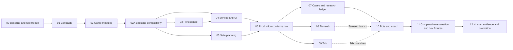

# Multi-game Bots and Coaching Implementation Plan

> **For agentic workers:** REQUIRED SUB-SKILL: Use superpowers:subagent-driven-development (recommended) or superpowers:executing-plans to implement this plan task-by-task. Steps use checkbox (`- [ ]`) syntax for tracking.

**Goal:** Make the real application support game-owned rules and information-faithful reasoning, preserve current play, and provide maintainable cases/evaluation for Spades, standard Tarneeb Partners and Jawaker Trix Solo/Complex Partners.

**Architecture:** Migrate the production service to typed, versioned registered modules inside the existing monorepo. Preserve storage/access/command semantics and original evidence while correcting the documented persistence/workflow gaps; replace the world-consuming, round-only planning boundary while retaining useful budget/pairing arithmetic. Bots and coach consume the same game-owned analysis; strategic improvements require independent evidence.

**Tech Stack:** Current reference: Node 24, strict TypeScript, React/Vite, Fastify, PostgreSQL, JSON Schema/Ajv, Node tests and Playwright. Target backend: **Go + PostgreSQL**, with Rust as the evidence-backed alternative under [CR-ARCH-003](../../../planning/decisions/CR-ARCH-003-backend-stack-and-system-readiness.md). Preserve React/Vite and the installed JavaScript lockfile. M02A freezes the Go toolchain and portable contracts before further backend implementation. Current TypeScript paths/commands below remain historical implementation locations and regression references; the [backend packet's source mapping](../../../planning/implementation/multi-game/backend-readiness.md#delivery-order-and-file-ownership) governs future backend destinations and adds Go/cross-runtime checks. No frontend dependency upgrade is required.

**Spec:** [Interview/research packet](../../../planning/research/2026-10-04-card-game-architecture-interview/README.md), [platform contract](../../12-multi-game-extensibility.md), [current reasoning](../../../planning/12-spades-reasoning.md), CR-STRAT-006–010 and the owner's recorded [Jawaker rule selection](../../../planning/research/2026-10-04-card-game-architecture-interview/08-standard-rule-reconciliation.md).

**Owner amendment:** [CR-IMPL-004](../../../planning/decisions/CR-IMPL-004-online-demo-and-launch-readiness.md) requires an online demo, configurable launch access/coaching limits, frontend reuse readiness and basic first-app quality. Its [execution packet](../../../planning/implementation/multi-game/launch-access-and-client.md) is part of M00–M04/M06/M12. Actual native packaging and final free/trial offers remain later selections.

**System review amendment, 5 October:** [CR-ARCH-003](../../../planning/decisions/CR-ARCH-003-backend-stack-and-system-readiness.md) adds M02A and SYS-01–12 after inspection of the implemented app. Preserve the approved UI. Resolve backend compatibility, durable history, work bounds and recovery before new-game expansion. Hosting and other nonfunctional implementation stay deferred; their owners/triggers remain listed in the [backend packet](../../../planning/implementation/multi-game/backend-readiness.md#resource-evidence-and-deferred-work).

## Global Constraints

**Performance/toolchain amendment, 6 October UTC:** [CR-ARCH-004](../../../planning/decisions/CR-ARCH-004-native-windows-performance.md) requires native Windows for both current runtime checks, pins Go 1.26.8 after a reproducible 1.27.1 profiling failure, and corrects the old unequal internal-work comparison. Follow [native setup](../../../planning/implementation/multi-game/windows-development.md) and the [recorded experiment](../../../qa/implementation/multi-game/performance-windows/report.md). Use game-owned immutable typed snapshots inside bounded operations, with strict decoding at import and serialization at real output/persistence boundaries. M03 subsequently passed its private records gate; M04 is next; full-history, policy and service resource gates remain open.

- “All supported games have four seats.” Competition is four individuals or two teams of two; controllers and visibility are separate.
- “Jev is the only runtime strategic model.” Later CR-IMPL-001/CR-STRAT-009 allow explicit deterministic code policies; no other runtime LLM/framework/cascade.
- “Rules, arithmetic, legal actions, trick winners, score, features, permissions and state transitions are code.”
- “No hidden-hand leakage.” Build allowlisted seat inputs; never pass the aggregate, actual concealed deal, fixture labels or teammate memory to a policy/provider.
- “All state changes are authorized, version checked, idempotent and persisted.” Never keep a transaction open across provider/expensive policy work.
- Public schemas generate DTOs/validators; strict validation rejects unexpected sensitive fields. Private domain types stay independent.
- Existing rules, policy snapshots and original advice remain immutable. Versions travel with records; unavailable/ambiguous history fails closed or read-only.
- Demo open/choice/replay requires a successful application-server response. Free/access-trial/paid permissions are versioned server policy by exact game/variant and operation; final launch values stay configurable.
- Preserve one React/Vite frontend and public assets; isolate transport/platform differences for a later Capacitor assessment. First deliver correct, recoverable, usable, bounded web play; larger capacity/native work follows.
- Preserve the current minimal table, coaching preferences and three playable modes. Standard Tarneeb only; selected Jack-centered Jawaker Trix only. Hosted rollout, real-player multiplayer, ratings, admin editor, reinforcement learning and ISMCTS implementation are excluded.

## Review Focus

1. Legacy resume with missing/ambiguous versions must not acquire a different policy or rescore history — M02/M03.
2. A reveal after a decision must not alter its earlier knowledge/advice — M05/M09.
3. Hearts sealed choices must remain frozen and atomic; 286 legal choices must not be truncated for Jev — M04/M06/M11.
4. Layout pass, finished seats, all-pass auctions and fresh deals must not become fake trick phases or endless automatic loops — M05/M08/M09.
5. A short-hand gain, familiar deal, model agreement or changed coach wording must not become a strength/learning claim — M07/M10/M12.

---

## Status, scope and reading map

**Plan created 4 October 2026 from `c5980b9` plus the existing uncommitted Jawaker-selection documentation. No implementation or new gameplay was performed while writing it.** The interview verified 706 text decisions and 672 browser decisions; those archives are development evidence. Existing module seam tests exercise a counter only, and `plan-genericity.test.ts` is absent. The full application suite must be rerun at implementation start; its historical passing report is not current acceptance.

**Concurrent work reconciled:** main advanced to `7aee013` with a [bounded Spades evaluation/blind-review pack](../../../qa/experiments/2026-10-04-spades-evaluation-pack/README.md). Reuse its 32 pending cases, source index, label validator, match pilot and immutable manifests through adapters in M07/M11. Keep its development estimand, review exposure controls and human-review deferral; no second editable label source, pilot relabeling as confirmation or automatic rerun. Its active pilot outputs belong to that work and remain untouched by this planning pass.

| Packet | Contents |
|---|---|
| [Contracts](../../../planning/implementation/multi-game/contracts.md) | Exact module/facade, persistence/transport, actor-policy, horizon and provider interfaces |
| [Cases and evaluation](../../../planning/implementation/multi-game/cases-and-evaluation.md) | Typed catalog, source ledger, blind labels, experiments, Jev/human gates |
| [Game packets](../../../planning/implementation/multi-game/game-packets.md) | Standard rule freeze, state/actions, arithmetic fixtures, new-game integration |
| [Compatibility and requirements](../../../planning/implementation/multi-game/compatibility-and-requirements.md) | Migration/rollback, requirements and task/test map |
| [Launch access and client](../../../planning/implementation/multi-game/launch-access-and-client.md) | Online demo, configurable offers, mobile reuse recommendation and basic quality |
| [Backend readiness](../../../planning/implementation/multi-game/backend-readiness.md) | M02A Go compatibility gate, platform records, bounded execution, SYS-01–12 and deferred concerns |

**Execution update, 5 October 2026:** M00–M02 and the targeted partnership slice have recorded acceptance. M02 installs native current-game modules, strict readers and V1 compatibility; [M02 evidence](../../../qa/implementation/multi-game/m02/status.md) records 449/449 Linux/WSL tests and separate passing Windows contracts/typecheck/build, with earlier environment failures retained. The subsequent [system review](../../../qa/implementation/multi-game/system-review-2026-10-05.md) records one reproduced evaluator budget defect and concrete integration/recovery gaps. **M02A has now passed its bounded Go/PostgreSQL gate** ([evidence](../../../qa/implementation/multi-game/m02a/status.md)); **M03 private persistence/prepared work also passed** ([evidence](../../../qa/implementation/multi-game/m03/status.md)), followed by M04 service/client integration. Full game/policy/service migration remains pending; no production backend switch occurred. M00's unresolved new-game rule choices and later milestones remain pending. Human review remains deferred.

**M04D execution update, 6 October:** [the demo/offer acceptance](../../../qa/implementation/multi-game/m04d/status.md) passes scoped MG-15 and the MG-16 backend. Go serves the finite authored demo and exact-target configured offer backend, with independent play/coaching grants, original atomic unlock/trial receipts and authoritative saved-delivery/security records. Optional `--access-policy` selects checked configuration; the launch policy remains empty and local demonstration offers are explicit. Optional `--web web/dist` connects React's `#demo` only; normal gameplay/account controls remain on Node, whose demo reports unavailable. M04E must complete the platform/client envelope, account availability/limits and preserved three-mode journeys. Overall M04 remains open. M04D's report records 1,336 normal Go checks, 1,334 race checks, 9/9 real Go/React browser tests and preserved Node/contracts/source checks, including all expected skips.

The packets describe the full intended boundary. Checked steps below have execution evidence; unchecked steps and illustrative assertions remain planned work. M01 contracts do not establish production V2 integration or complete MG acceptance.

## Dependency and ownership order

M02, bounded M02A and the private M03 record adapter are complete. M02A has frozen the replacement backend contracts before M03/M04/M05 backend implementation; planning and fixture preparation can continue independently. M03 and M05 can then run in parallel, with M04 depending on M03. After M06, game engines and catalog/import work can run in parallel. Only the integrator edits registry/generated unions/service boundaries. No parallel consumer invents a DTO. Rule gaps block the affected M08/M09 transition, not the current-game path. Spades case work in M10 can finish without waiting for a new game.

Each task ends with a focused commit and evidence under `qa/implementation/multi-game/`. Record passed/failed/blocked/not-run, exact commands, versions/hashes and next unfinished task. Never mark a checkbox from planned assertions. Use the existing distinct `_test` database guard and local server environment; no key printing or new infrastructure.

**First migrated working-app gate:** M00–M04, including M02A, deliver preserved real game journeys, the online example, configurable local access fixtures and reconnect/review. The current local app already works through V1. M06 adds replacement-service genericity evidence. M05 can progress alongside M03/M04; strategy expansion, human studies, native builds and large-load campaigns do not block functional completion. Existing security, correctness and durable-command checks remain required.

## M00 — Baseline, decisions and execution manifest

**Owner:** integrator. **Requirements:** MG-01, MG-12, MG-15–18. **Dependencies:** none.

**Create:** `planning/decisions/CR-ARCH-001-multi-game-production-boundary.md`, `qa/implementation/multi-game/status.md`, `qa/implementation/multi-game/baseline.json`, `docs/rules/tarneeb-partners.md`, `docs/rules/trix-solo.md`, `docs/rules/trix-complex-partners.md` during execution. **Modify:** `planning/implementation/requirements-and-tests.md` only to index adopted MG IDs.

- [x] Inspect Git changes/worktrees; preserve and attribute other work. Record source/lockfile/schema/policy/archive hashes, installed versions and existing journal behavior in baseline.json.
- [x] Run `npm run contracts:check`, `npm run typecheck`, `npm run test:all`, `npm run build`; save actual results. If `TEST_DATABASE_URL` is unavailable, run pure tests and mark durable acceptance blocked; do not substitute the saved-games database.
- [x] Record CR-ARCH-001 reason, alternatives, compatibility and owner authority for this migration. Preserve the earlier flat-contract freeze as V1; record proposed V2 changes before depending on them.
- [x] Read CR-IMPL-004; record demo/access gaps and a basic first-app acceptance checklist. Keep final offer values unselected and native/capacity work deferred; inspect later evaluation commits without rerunning their experiments.
- [ ] Freeze Jawaker's specified Trix mechanics. Resolve its narrow opening/doubling/tie omissions from sources; explicitly record interpretation/fixtures. Record the selected Tarneeb lead/scoring profile and Solo meaning when the pending owner answers arrive. No invented individual Tarneeb profile or alternate Trix layout.
- [x] Commit the baseline and decision dossier. Gate: shared migration may proceed; each new-game rule branch requires a complete named profile before reducer implementation.

## M01 — Freeze module, packet and V2 document contracts

**Owner:** contracts/integrator. **Requirements:** MG-01–03, MG-15–17. **Dependencies:** M00 baseline.

**Create:** `web/server/game/kernel/seats.ts`, `module.ts`, `session.ts`; `web/server/records/game-document.ts`; `web/shared/games/hearts.schema.json`, `spades.schema.json`; `web/server/tests/module-contract.test.ts`, `game-document.test.ts`. **Modify:** `web/server/game/kernel/registry.ts`, `web/shared/contracts.schema.json`, `web/scripts/generate-contracts.mjs`.

**Interfaces:** the [contracts packet](../../../planning/implementation/multi-game/contracts.md) defines `Module`, `bindSession`, `BoundSession`, `Codec`, `Pin`, `Node`, `Operation`, generated registered public unions and V2 discriminator.

- [x] Add schema/codec tests rejecting mixed game payloads, extra private fields, invalid competitor partitions and uninstalled versions. Example assertion: `assert.throws(() => decodeDocument({documentVersion:'2.0.0', pin:{gameId:'uninstalled'}}));` Export `decodeDocument(raw: unknown): BoundSession` from `game-document.ts`.
- [x] Run `node --test --test-isolation=none web/server/tests/module-contract.test.ts web/server/tests/game-document.test.ts`; record real initial failure.
- [x] Implement pure typed declarations/codecs, registration descriptors/new-session factory and exhaustive registered branch decoding. Bundle only registered public fragments; create strict private validators independently. No heterogeneous unchecked casts or arbitrary public JSON.
- [x] Freeze online demo frame/choice DTOs, access offer/decision schemas, generic coached-unit metadata and the client platform port with M04's owner. Keep launch policy separate from domain rules and preserved V1 DTOs.
- [x] Generate and check contracts; rerun targeted tests and typecheck. Keep V1 bodies stable; add mixed V1-action/V2-candidate rejection and >255-candidate eligibility assertions.
- [x] Commit `feat: define versioned game module contracts`. Gate: signatures/schema pins frozen for parallel work, existing modes still build/play through V1.

## M02 — Extract current game-owned modules and legacy readers

**Owner:** engine. **Requirements:** MG-02, MG-04, MG-09. **Dependencies:** M01.

**Create:** `web/server/games/registrations.ts`, `web/server/game/legacy/v1.ts`; `web/server/games/spades/module.ts`, `state.ts`, `engine.ts`, `observation.ts`, `schema.json`; equivalent five files under `games/hearts/`; `web/server/tests/module-parity.test.ts`, `web/server/tests/support/module-parity.ts`. **Modify:** `web/server/game/index.ts`, `kernel/types.ts`, `observations/index.ts`, `game/replay.ts` into explicit compatibility exports/adapters.

- [x] Add parity tests over saved legal action logs and frozen goldens, including Hearts passing, collection revisions, Nil/bags and both Spades competitors. Assert `assert.deepEqual(replayThroughModule(saved), replayV1(saved));`; define these test helpers in `tests/support/module-parity.ts` and compare state, events, revision, original safe packets and selected baseline actions.
- [x] Run the new parity test and existing `frozen-baseline.test.ts`, `replay.test.ts`, `observations.test.ts` before changes; preserve actual failures/seeds.
- [x] Bind installed Hearts and both Spades variants to typed modules. Move native state/rules/projections into their game boundary; keep original V1 readers and journal semantics. Compatibility policies remain game-owned adapters to pinned safe input, never shared fake bids/bags.
- [x] Rerun parity plus `rules.test.ts`, `hearts-plan.test.ts`, `policy-pinning.test.ts`. No changed default choices/score semantics; unsupported old versions become read-only.
- [x] Commit `refactor: bind current games to registered modules`. Gate: no new-game assumption in kernel and frozen V1 replay/strategy attribution preserved.

## M02A — Validate the replacement backend boundary

**Owner:** integrator/backend. **Requirements:** IMPL-02–04, MG-01–04, MG-09, SYS-01–02. **Dependencies:** completed M02 and CR-ARCH-003.

Execute the [M02A checklist](../../../planning/implementation/multi-game/backend-readiness.md#m02a--backend-contract-and-compatibility-slice): freeze portable wire/digest/RNG/numeric semantics; build a bounded Go/SQL compatibility slice using independent original fixtures; record the local resource and parity evidence. [CR-FIX-001](../../../planning/decisions/CR-FIX-001-urgent-system-repairs.md) corrects the reproduced budget defect and urgent current-service recovery gaps before that port; its [evidence](../../../qa/implementation/multi-game/urgent-repairs/status.md) must carry forward. Full game/service porting remains M03–M06. No hosting, UI redesign or real provider work.

- [x] Correct the charged-rollout cap with version-aware regressions and preserve original policy/evidence attribution (UR-01).

- [x] Publish the portable contracts, exact dependencies and differential corpus; preserve the current implementation and immutable archives as oracles.
- [x] Complete the slice and record its go/no-go decision under `qa/implementation/multi-game/m02a/`. Freeze file ownership before parallel porting. A failed slice requires investigation, not silent reversion to the old Node-only plan.

## M03 — Validate saved documents and prepared work

**Owner:** persistence/backend. **Requirements:** MG-03, MG-05, MG-09, MG-16, SYS-03–07/SYS-10. **Dependencies:** M02A; M02 registrations are the reference.

**Authorized 6 October 2026 (Toronto):** execute the Go responsibility using [the M03 packet](../../../planning/implementation/multi-game/m03-execution.md) and [native Windows setup](../../../planning/implementation/multi-game/windows-development.md). The completed comparison is closed; retain its findings and do not restart language comparisons as part of this milestone. The TypeScript paths below are regression references under the backend source mapping, not a second authoritative implementation.

**Go implementation mapping:** `server/internal/records/{types,document,codec,store,work,access,trials}*.go`, game-owned `storage.go` adapters, canonical forward migration `007-versioned-platform-records.sql` and the restricted `scripts/m03-migrations.mjs` interoperability helper. The original TypeScript `records`, saved-analysis and policy-pinning tests remain regression references. Reuse the frozen `web/server/tests/fixtures/legacy-module-document.json` captured in M02; add separate persistence fixtures rather than regenerating its original expectations.

- [x] Add `_test` database tests: malformed stored state rejects; old original analysis/choice hashes survive resume; unsupported module is read-only; prepared choice cannot commit after actor/revision/window/access change.
- [x] Run native Go record/database tests and the preserved full Node suite through `scripts/windows-env.mjs`; retain actual initial failure evidence. Both use the distinct provisioned `_test` database; M03 schemas are isolated. The former Node-only storage command is superseded by this Go mapping.
- [x] Query document JSON as unknown, decode envelope/version before private payload, validate again on save, and store immutable typed prepared/audit records. Add the missing private platform tables through the canonical migration sequence and shared ledger. M04 activates new versioned sessions lazily; do not bulk rewrite old V1 history. Atomic Hearts bundles need no new per-seat job migration.
- [x] Freeze/implement the separately versioned platform metadata, complete decision/advice binding and opening replay anchor from the backend packet. Validate actual policy/input/actor/revision compatibility, not only nonempty strings. Preserve every actual chance draw and replay against persisted checkpoints.
- [x] Suppress duplicate preparation before dispatch; issued receipts retain their original result. Capture starting access generation and recheck it at publication/commit. Test overlapping preparations, revoke/regrant, crash/reclaim and stale attempts across two instances.
- [x] Implement owned accepted-command reconciliation after revision advance, game replacement and coverage change, with current read/privacy authorization. Keep compact current snapshots and append-only history atomic with receipts; eliminate duplicated growing-history storage without losing historical knowledge or original advice.
- [x] Persist access-trial activation, applied grant/offer references and stable allowance buckets where required by M04; add a forward migration only for missing fields. Prove policy/grant/device changes do not reset usage or invalidate purchased terms. Replay alternative-trial records stay independent.
- [x] Verify reopen across two independent repository instances, idempotent command retry and byte-preserved original advice. Trials retain parent/future-exposure provenance; no later information backfills earlier advice. Service process/reconnect and continuation execution remain M04/M05.
- [x] Commit `feat: validate versioned game persistence`. Gate: corrupted/ambiguous records cannot become playable by selecting a convenient default.

## M04 — Wire service dispatch and table adapters end to end

**Owner:** backend + frontend after M02A freeze; integrator owns shared edits. **Requirements:** MG-04–06, MG-09, MG-15–18, SYS-04–05/SYS-07–12. **Dependencies:** M02A/M03.

**Execution update, 6 October 2026:** follow the [M04 execution sequence](../../../planning/implementation/multi-game/m04-execution.md). [M04A](../../../qa/implementation/multi-game/m04/status.md), [M04B](../../../qa/implementation/multi-game/m04b/status.md) and [M04C](../../../qa/implementation/multi-game/m04c/status.md) have scoped prerequisite/local-service acceptance. [M04D](../../../qa/implementation/multi-game/m04d/status.md) passed scoped authored online demo and exact-target offer backend acceptance (MG-15 and the MG-16 backend). Overall M04 remains open. Next is M04E: complete platform/client/account integration and preserved three-mode journeys. Normal React gameplay/account controls still use Node; Go's optional static build currently connects only `#demo`.

- [x] M04A prerequisite: complete original Go Hearts rules, actor-safe projection and compact persistence; independent original/new corpus and native Go/race/SQL checks passed.
- [x] M04B prerequisite: port exact default policies and full original coach output; implement registered Go V2 lifecycle, actor-safe preparation and original digest/import semantics. Independent complete-output oracles, conformance and native regressions are recorded in its acceptance report. Optional policy execution fails explicitly; M03 storage eligibility and M04 service activation remain separate.
- [x] M04C local service acceptance: implementation delivered under the [M04C packet](../../../planning/implementation/multi-game/m04c-execution.md); scoped acceptance passed ([evidence](../../../qa/implementation/multi-game/m04c/status.md)). Includes opaque local identity, durable ownership/control, bounded HTTP/work, exact preparation, atomic commands, reconciliation and account erasure. Local identity/grants remain fixtures; this does not complete the client or hosted gates below.

**Delivered M04C files/interfaces:** `server/cmd/cardford`, `server/internal/service`, local transport under `server/internal/http`, the `records`/`sessions` composition, canonical migration 008 and the additive `web/shared/local-service.schema.json` fragment. Separate generated local-service artifacts preserve original public schemas/generated files and acceptance archives. See [native run instructions](../../../planning/implementation/multi-game/windows-development.md#m04c-local-go-api). Complete original V1 history continues through the original reader.

**Delivered M04D files/interfaces — scoped MG-15/MG-16 backend acceptance passed:** `server/internal/demo`, `server/internal/access`, the existing Go HTTP/service/records composition, forward migration 009 and narrow generated offer/resolve/unlock/access-trial contracts. `DemoPage.tsx` fetches validated frames without a bundled offline graph. Configured identities are mode-fenced from the retained M04C fixture constructor. Original buckets/periods/offer versions and purchased/saved terms survive retries, restart and configuration changes; source security revocation still fences work/read. UTC-day/lifetime calendars are supported. `AccountView.offers` remains the V1 named-plan shape; M04E supplies complete account/client presentation. [Current local demo/configuration instructions](../../../planning/implementation/multi-game/windows-development.md#m04d-online-demo-and-configured-offers).

**Modify:** `web/server/http/game-service.ts`, `views.ts`, `app.ts`, `trial-service.ts`, `web/src/App.tsx`, `api/useSession.ts`, `api/display.ts`, `features/ReviewPanel.tsx`; affected schema generation. **Create:** `web/src/games/registry.tsx`, `hearts.tsx`, `spades.tsx`, `web/server/tests/module-service.test.ts`, `web/e2e/module-migration.spec.ts`.

**Additional files/interfaces:** the [launch/client packet](../../../planning/implementation/multi-game/launch-access-and-client.md) names the demo service/content, offer resolver, platform port, account/client changes and acceptance tests. Split these into focused reviewed commits inside M04; freeze shared DTOs in M01.

- [ ] Add real service tests for V2 candidate commit/legacy command compatibility, atomic sealed passing, generic automatic/chance/review nodes and rejection of unsupported controls. Assert rejected commands increment neither revision nor event count.
- [ ] Run the new test to record failure; keep existing `integration.test.ts`, `access-review.test.ts` and `trials.test.ts` as regressions.
- [ ] Replace direct combined-engine/mode switches with `BoundSession` operations. Prepare from frozen seat packets outside transactions; commit under the same existing fences. Observe all Hearts seats before bundle application. Keep human next-round confirmation and existing pause/advance behavior.
- [ ] Add bounded analysis admission/execution independent from HTTP handling, finite request/DB waits and cancellation publication checks. Existing review workers do not establish gameplay isolation. No database connection is held during CPU/provider work; local saturation checks preserve live-play capacity.
- [ ] Pass the backend packet's three-mode recovery matrix: stalled HTTP, ambiguous mutation reconciliation, stable review-trial identity across lost responses/reload, supported read-only history, revoked access and explicit next-hand progression. Keep the current table/dialog/coach design.
- [ ] Render seats/competition, safe public zones, score entries and game controls from registered adapters. Preserve table gestures, coach modes and review; update example/access copy where CR-IMPL-004 requires it. Public views/exports/trials omit private audits/deals/hashes; UI never imports the authoritative server module.
- [x] M04D MG-15 acceptance: the server-fetched authored demo is implemented in Go and connected to React; every open/choice/replay and disconnected zero-advancement behavior passed through `server/internal/demo`/HTTP tests and 9/9 real Go/React `web/e2e/demo-online.spec.ts` checks. No engine/provider work or offline fallback graph. [Final integrated evidence](../../../qa/implementation/multi-game/m04d/status.md).
- [x] M04D MG-16 backend acceptance: the pure Go resolver and durable allowance/trial commands passed requested exact targets, independent play/coach/read, expiry/admission, zero/finite quota, no stacking/reset, original migrated unlocks and purchased/saved access through `server/internal/access`, service and records tests. [Final integrated evidence](../../../qa/implementation/multi-game/m04d/status.md). Account UI availability/limits remain a separate M04E acceptance requirement; local fixtures do not establish hosted grants.
- [ ] M04E: freeze the complete platform/client envelope, adapt the preserved three-mode game/review/recovery journeys and connect account availability/limits without putting arbitrary offers into the legacy `AccountView.offers` shape.
- [ ] Add the web platform/transport port and URL validation without native dependencies; test reconnect/foreground and ambiguous-command reconciliation. Run `client-platform-boundary.test.ts` and `client-resume` UI checks. Preserve hosted startup/origin protection.
- [ ] Record basic quality on a complete current-game journey: private correct moves, durable reload, bounded failure/reconnect, keyboard/touch/readable controls and sanitized diagnostics. Fix measured blocking delays; first-app acceptance requires no large-load campaign or proven strategy improvement.
- [ ] Run `npm run contracts:check`, typecheck, targeted server regressions and `npm run test:ui`. Commit `refactor: dispatch live sessions through game adapters`. Gate: the actual current-game user journey still works, not merely direct module calls.

## M05 — Replace continuation information/horizon boundary

**Owner:** reasoning. **Requirements:** MG-07, MG-08, SYS-02/SYS-08/SYS-12. **Dependencies:** M02A; use M02 modules for parity.

**Create:** `web/server/strategy/rollout/types.ts`, `run.ts`, `actor-policy.ts`; `web/server/strategy/knowledge/types.ts`; `web/server/tests/actor-rollout-isolation.test.ts`, `rollout-horizon.test.ts`, `rollout-budget.test.ts`, `web/server/tests/support/rollout-fixtures.ts`. **Modify:** existing `strategy/plan/evaluate.ts` only to expose compatible arithmetic; adapt game-owned Spades/Hearts continuation models under new profiles, retaining V1 readers/pins.

- [ ] Build two feasible worlds with identical actor information and a fixed seed; assert `assert.deepEqual(chooseFromWorld(left), chooseFromWorld(right));`. Define helper in `tests/support/rollout-fixtures.ts` using referee projection and `ActorPolicy.choose`, then test partner memory/reveal chronology separately.
- [ ] Run the new tests; record actual failures from the unsafe/round-only API rather than assume the existing implementation leaks.
- [ ] Implement the exact [referee/actor interfaces](../../../planning/implementation/multi-game/contracts.md#information-only-planning). Separate proven constraints, feasible holdings and positive-support soft weights. Add fresh synthetic chance, game-owned horizon/payoff/comparator and actor memory reconstruction; no defaultMove receives a complete world.
- [ ] Assert work caps before exceedance, complete paired-world coverage, declared cutoff heuristics and no terminal outcome from truncation. Test contract pool retained across a new deal, layouts/automatic steps with no actor and bounded redeal/pass loops. Production reducer/scorer parity is required for any optimized simulation path.
- [ ] Separate deterministic counted budgets from operational deadline/cancellation. Bound sampling/facts/model construction as well as moves; test terminal roots, candidate/world boundaries and cancellation during setup. Persist truthful stop reasons and exclude incomplete paired worlds. Carry M02A's version-aware budget correction forward.
- [ ] Run new tests plus `world-sampler-parity.test.ts`, `spades-playout-kernel.test.ts`, `spades-playout-model.test.ts`, `spades-playout-budget.test.ts`. Commit `feat: add actor-scoped continuation planning`. Gate: selectable V2 only; old profiles/defaults untouched.

## M06 — Prove genericity through the production path

**Owner:** QA. **Requirements:** MG-04, MG-06–08, MG-18. **Dependencies:** M04/M05.

**Modify:** `web/server/tests/support/token-module.ts`, `module-seam.test.ts`. **Create:** `web/server/tests/module-production.test.ts`, `plan-genericity.test.ts`, `web/e2e/module-conformance.spec.ts`; test-only registered token module and client adapter in `web/server/tests/support/token-registration.ts` and `web/src/games/test-token.tsx`.

- [ ] Add actual service/storage/restart/replay/UI flow for the non-card module, individual and non-opposite partner partitions, lowest-score winner and hidden own tokens. Assert `assert.equal(catalogIncludes('test-token'), false);` using the same production catalog builder; test-only factory may inject its registration but public startup cannot.
- [ ] Run production and genericity tests; the missing import/test must fail honestly before it is implemented.
- [ ] Adapt the token fixture to the registered factory and actor-policy runner. No fixture facade bypasses service authorization/persistence. Include reveal and automatic/chance cases without fabricated Spades fields. Import scans target new shared kernel/rollout/case contracts, with explicitly named V1 compatibility exceptions only.
- [ ] Verify reject unsupported schema/capability/variant, mutate hidden hands without changing safe packets and render the same registered UI seam. Separate conformance from strategic quality.
- [ ] Commit `test: prove production module and planner conformance`. Gate: existing GP-06 evidence gap actually closed; ready for new-game modules and case maintenance.

## M07 — Import evidence and generate the maintained case catalog

**Owner:** cases/data. **Requirements:** MG-10, MG-11. **Dependencies:** M06; definitions can be drafted after M01.

**Create/modify:** exact catalog/import files and tests in [the case packet](../../../planning/implementation/multi-game/cases-and-evaluation.md); retain existing Spades `cases/proofs.ts`, `profile.ts`, `cues.ts` and independent evaluation checkers.

- [ ] Write import/catalog tests; assertions include `assert.equal(count('text-discovery'),706); assert.equal(count('browser'),672);` and same-family placement for duplicate/rotated/paired packets. Export `buildResearchLedger()` from the planned importer; no labels generated from text.
- [ ] Run `research-ledger.test.ts` and `case-catalog.test.ts`; retain source hashes on failure.
- [ ] Implement typed definitions, explicit overlapping-tactic resolution and generated human-readable catalog. Import immutable source references and separate completeness/typed-claim absence. Wrap CASE-01–04 first; do not activate unreviewed authored recipes.
- [ ] Adapt the existing Spades blind-review pack as a referenced source; retain original reviewer submissions and sequencing/exposure records. The multi-game ledger indexes immutable label snapshots, never copies pending entries into independent editable answers. Extend the source hash graph for new evaluation adapters instead of resuming an old pilot with changed code.
- [ ] Run importer/catalog `--check`, `case-counterexamples.test.ts`, existing `spades-observed-cases.test.ts` and `reasoning-catalog.test.ts`. CASE-03's zero browser occurrence stays a visible gap; its recognition test cannot satisfy occurrence or strength.
- [ ] Commit `feat: add maintainable cases and research provenance`. Gate: maintainers can find trigger, exceptions, candidate effect, cue, source and independent review state from one definition.

## M08 — Implement standard Tarneeb Partners module

**Owner:** Tarneeb engine/UI. **Requirements:** MG-02, MG-06, MG-12. **Dependencies:** M06 + complete Tarneeb profile from M00.

**Create:** all exact files/tests named in [the Tarneeb packet](../../../planning/implementation/multi-game/game-packets.md#tarneeb-partners-narrow-rule-freeze). **Modify:** registrations/public root/UI registry/catalog only after correctness gate.

- [ ] Write legal auction, trump, direction, follow-suit, scoring/redeal and original-observation tests. For the recommended profile: `assert.deepEqual(scoreTarneebRound(profile,7,8),{bidder:8,opponents:0});` Return that named object from the defined scoring export; update the expected values if the owner chooses Waraq exactly.
- [ ] Run `node --test --test-isolation=none web/server/tests/tarneeb-rules.test.ts web/server/tests/tarneeb-score.test.ts web/server/tests/tarneeb-observation.test.ts`; record failures.
- [ ] Implement pure profile/reducer/score and strict state/observation schemas. Add typed auction/trump UI controls and safe factual coach/baseline phase policy. New deal uses explicit chance; no Nil/bags or hidden partner information.
- [ ] Complete selected-deal service and restart tests with `tarneeb-service.test.ts`; validate every phase and full match in engine tests. Do not add an individual variant or enable a half-implemented catalog entry.
- [ ] Commit `feat: add standard Tarneeb partnership module`. Gate: runnable local variant after correctness/capabilities; strength claims require M11/M12.

## M09 — Implement Jawaker Trix Solo and Complex Partners

**Owner:** Trix engine/UI. **Requirements:** MG-02, MG-06–09, MG-12. **Dependencies:** M06 + complete Jawaker profile from M00.

**Create:** exact engine/layout/score/schema/UI/fixture files named in [the Trix packet](../../../planning/implementation/multi-game/game-packets.md#trix-solo-and-complex-partners-jawaker-authority). **Modify:** installed registrations/public root/UI registry after correctness gate.

- [ ] Write tests for Jack layout, mandatory pass/play, additive penalties/doubles, consumed request pool, fresh deal, finish order and public reveal chronology. Example: `assert.deepEqual(layoutCandidates({C:{low:'J',high:'J'}},['C10','CQ','CA']),['C10','CQ']);` Define board type with absent suits permitted and return canonical card IDs from that export.
- [ ] Run `trix-rules.test.ts`, `trix-layout.test.ts`, `trix-score.test.ts`, `trix-observation.test.ts` to capture real initial failure.
- [ ] Implement the two distinct profiles and shared pure engine. Freeze/source omitted doubling/opening edges before encoding them. Preserve selected double actions, phase-specific rank/layout semantics, public holdings and finished-seat eligibility.
- [ ] Play the concrete 52-card queen-free fixture through legal actions; verify capture contradicts “no queens guarantees no penalty.” Complete engine kingdoms, resume between requests and real service/UI tests; no seven-centered mode or old void evidence after redeal.
- [ ] Commit `feat: add Jawaker Trix game modules`. Gate: both variants have complete phase handling, original safe analysis and proper controls before catalog exposure.

## M10 — Add reviewed tactics and faithful coach cues

**Owner:** game reasoning/content. **Requirements:** MG-07, MG-10–11. **Dependencies:** M07; each new-game branch additionally M08/M09.

**Create:** `web/server/tests/case-counterexamples.test.ts`, `coach-selected-action.test.ts`, `coach-analysis-visibility.test.ts`; game-owned family files and cues per packet. **Modify:** `web/server/coaching/templates.ts`, `cue-registry.ts`, game policy registries and analysis schema branches, retaining old versions.

- [ ] Write positive/opposite/rotated cases with legal histories and independent acceptable sets or explicit unreviewed status. Assert `assert.equal(cueApplies(input, changedAction, oldClaim), false);`; define `cueApplies` in the game's cue registry, checked by the game predicate rather than a string match.
- [ ] Run new behavioral tests and existing `coaching-analysis.test.ts`, `saved-analysis.test.ts`, `strategy-reasons.test.ts`, `coach-legacy-parity.test.ts`.
- [ ] Implement one named family at a time: Spades bidding/entry/Nil/bag pressure; Tarneeb auction/trump/commitment support; Trix penalty disposal/contract selection/layout blocking and teammate finish. Keep heuristic ownership/signal interpretations uncertain and exact predicates checked independently.
- [ ] Use same analysis for bot selection and human advice; keep the advice snapshot when cues are hidden and in later review. Record unsampled/contested choices; suppress reasons invalidated by another selected move. Do not update defaults from scenario hits alone.
- [ ] Commit per family. Gate: small reviewable policies/cues with exceptions and action fidelity; strategic preference still awaits independent evaluation.

## M11 — Evaluate alternatives and repair Jev fixture diagnostics

**Owner:** evaluation/provider. **Requirements:** MG-11, MG-13–14. **Dependencies:** relevant M10 branch.

**Create:** `web/server/evaluation/multi-game/manifest.ts`, `run.ts`, `report.ts`; per-variant files specified in the [evaluation packet](../../../planning/implementation/multi-game/cases-and-evaluation.md#evaluation-must-be-frozen-before-confirmation); `web/server/providers/eligibility.ts`; `web/server/tests/multi-game-evaluation.test.ts`, `provider-eligibility.test.ts`. **Modify:** `web/server/providers/openrouter.ts`, `openrouter.test.ts`, existing gate components through compatible adapters only.

- [ ] Add strict manifest tests and provider fixtures. Assert `assert.equal(providerEligibility(heartsPassPacket).kind,'unsupported-action-space');` and zero attempts reserved/dispatched for forced/off/zero-cap/unsupported choices. Export `providerEligibility` from `providers/eligibility.ts`.
- [ ] Run new tests, existing `openrouter.test.ts`, `provider-ledger.test.ts`, `jev-offline.test.ts`, `gate-inference.test.ts`, `gate-rule.test.ts`.
- [ ] Implement per-variant development reports and manifest freezing; define complete horizon, independent family, blind labels, gain/harm bounds, statistical/stopping/latency limits **before** confirmation. Isolate single-seat strength and test team-wide deployment separately. Existing frozen Spades gate requirements remain in force.
- [ ] Add sanitized response field-category diagnostics and reproduce invalid responses through fixtures. Preserve the rejected historical request and exhausted cap; no live retry here. A future explicitly bounded request gets its own manifest/ledger and records actual resolved model/usage.
- [ ] Commit `feat: add multi-game evaluation and provider diagnostics`. Gate: reproducible development comparison, confirming eligibility explicit; neither model agreement nor familiar browser points promotes a policy.

## M12 — Complete browser evidence, human evaluation and promotion record

**Owner:** QA/product reviewer. **Requirements:** MG-06, MG-11, MG-13, MG-17–18. **Dependencies:** relevant M11 study manifest; correctness journeys can start after M08/M09.

**Create:** `web/e2e/multi-game.live.spec.ts`, `multi-game.config.ts`, `qa/evaluation/multi-game/human-study.md`, `qa/implementation/multi-game/report.md`. **Modify:** defaults/catalog only after their documented acceptance and owner-authorized promotion.

- [ ] Write/run real local server browser journeys through DOM/dev-tools evidence, including all phases, saved coach review, restart, pause and stale retries. Save opening/packet/action/bot/coach/result provenance and all unused/aborted starts. No player screenshot input, API mocks or injected engine moves.
- [ ] Use `npx playwright test -c web/e2e/multi-game.config.ts`. Require its config to use `TRICKS_LIVE_URL`, one worker, real server and recorded start budget. Reconcile old campaign limits before resuming it; new campaign needs its own recorded budget. Correctness games are not a statistical strength test.
- [ ] Freeze the human study before recruiting: cue comprehension followed by unaided immediate/delayed unfamiliar choices, assistance/exposure records and independent accepted sets. No fictitious human results or unsolicited recruitment messages.
- [ ] Record a later native feasibility milestone after the stable web slice: reuse its build in a Capacitor shell and validate hosted auth/transport, resume/Back, safe areas/touch, purchase channel and one complete game on Android/iOS. Tooling/device blockers stay explicit; do not scaffold/publish native projects during the engine migration.
- [ ] Run relevant targeted suites, `npm run contracts:check`, `npm run lint:boundaries`, `npm run typecheck`, `npm run test:all`, `npm run build`, `npm run test:ui`; report actual failures/skips. Preserved old-game goldens and immutable histories are release gates.
- [ ] Commit final evidence. Promote only after applicable strength/safety/human-label gates and explicit recorded owner approval; empirical gaps stay partial. Commit/merge completed work to local main; do not push/deploy or enable live charges/models without authorization.

## Execution handoff

M00–M02A, M03 and M04A/B/C have scoped acceptance. **M04D passed scoped MG-15/MG-16 backend acceptance; see [evidence](../../../qa/implementation/multi-game/m04d/status.md).** Next in the open M04 sequence is M04E's complete platform/client/account envelope and preserved three-mode journeys. M05 can progress independently. Native Windows is the chosen local environment, and the prior PostgreSQL cause remains unresolved. Use fresh reviewers for interface, hidden-information and legacy compatibility changes. Review each milestone's concrete diff/evidence before integration; stop optional testing once its risks/gates are covered. Hosting, live providers/payments and human evidence retain separate gates.

A rule or live-provider blocker is local to its branch. Continue authorized deterministic work; never invent the missing rule/model result, consume held-out seeds early or rewrite a research artifact to imply it passed. Subsequent execution reports list implemented IDs/commits, exact tests/results, provider mode/observed model, known defects, evidence paths and the next unfinished milestone.
