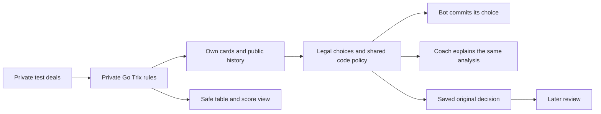

# Trix Basic and Complex implementation plan

**Execution status — 7 October 2026:** The native engine, all four compiled modes, generated contracts, persistence/access/service, deterministic baseline, saved advice/review and React controls are implemented. Functional acceptance is in progress; current results belong to the [acceptance status](../../../qa/implementation/trix/status.md) and [delivery ledger](../../../planning/implementation/trix/delivery.md). The original checklist below is preserved as the historical full plan. The owner deferred expanded strategy/evaluation work, 48 strategic contrast cases, future coach feedback-pipeline integration and the second fixture browser session per variant. Basic deterministic advice is implemented; strategy strength, human teaching benefit and final browser/running-app acceptance are not claimed here.

> **For agentic workers:** Use `superpowers:subagent-driven-development` or `superpowers:executing-plans` to implement reviewed tasks. The original checklist below is a historical planning snapshot; use the linked delivery ledger and acceptance status for current completion and explicitly deferred work. The checked rule-resolution item records owner approval, not an engine test.

**Goal:** Deliver Trix Basic Solo, Basic Partners, Complex Solo and Complex Partners in the native Go app, with full sessions, deterministic bots, player-faithful coaching and saved review.

**Architecture:** One typed Go Trix package; four compiled profiles. Reuse the session kernel, persistence, access and bounded execution. Add registered Trix presentation/advice/review adapters and game-owned strategy. Preserve existing Hearts/Spades behavior and assets.

**Tech stack:** Current repository Go module (`go.mod`: Go 1.26.8), PostgreSQL/pgx, JSON Schema-generated Go/TypeScript contracts, React/Vite and existing Playwright/Windows runners. No new framework, database service, model provider or rules language.

**Spec:** [Rules with confirmed doubling semantics](../../rules/trix.md) · [Scenario/evaluation packet](../../../planning/implementation/trix/scenarios-and-evaluation.md) · [CR-GAME-001](../../../planning/decisions/CR-GAME-001-trix-four-variants.md).

**Historical planning status:** source investigation and planning only at inspection on 7 October 2026, inspected `codex/current-game-modules-m02` at `e60cfb2` plus the working-tree owner updates. Main was at `d66a046` at inspection time; Trix code, gameplay tests and strength results did not yet exist. Concurrent UI and feedback-lab changes were present during inspection. This is the native replacement for the older Trix-specific M09/M10 file proposals; use the execution status above for subsequent implementation.

## Global constraints

- [CR-STRAT-011](../../../planning/decisions/CR-STRAT-011-deterministic-feedback-lab.md): bots and current coach share deterministic code; no runtime AI/model/provider or automatic learning. Future model-assisted coaching is separate.
- Pure typed reducers own legality, scoring and progress. Seat observations own decision inputs. Never use the real hidden deal/seed for strategy, nor a teammate's private knowledge.
- Original observations, decisions, advice, profile/policy versions and exposure records remain immutable. UI hints on/off do not change analysis; access controls only what is delivered.
- Reuse existing authoritative transactions, command/version/lease checks and persisted receipts. No CPU analysis while holding a DB transaction.
- Basic first, then Partners, then Complex. Every phase, including the confirmed doubling rules, must work before a variant enters the playable catalog. TRX-D01/D02 are resolved; implementation acceptance remains pending.
- Frontend uses confirmed server candidates and score rows. Preserve current responsive cards, icons, controls and review pacing. No offline gameplay or new graphic system.
- New game targets can receive separate configured play/coaching offers; no automatic free/trial/pricing choice. Keep table type `practice` (one human, three code bots); future human tables remain separate.
- New Go Trix code does not require a second Node reducer. Preserve Node/current-game reference tests; do not claim it serves Trix.

## Review focus

1. Counterclockwise play must not change seat IDs or existing games: T02/T08.
2. Fresh request deals must not reset the kingdom owner/pool or leak future cards: T02/T03/T07.
3. Double credits, earlier-leader provenance, withheld bonuses and Complex additive costs must not be omitted or applied twice: T02/T04.
4. Layout must not inherit trick legality, trump, void inference or bid controls: T02/T05/T08.
5. Bot, live coach and replay must use the same original actor-safe result through every action type: T06/T07/T09.

## What exists and what must change

| Verified source | Reuse | Required addition |
|---|---|---|
| `server/internal/gamekernel/session.go` — `SessionModel`, `BindSession` | Typed state/actions, actor/automatic/chance/round/session lifecycle, `Presentation` | Trix-owned callbacks; no Trix rules in kernel |
| `server/internal/sessions/installation.go` — `Registration`; `records/service_codec.go` — `NewServiceCodecWithRegistry` | Compiled extras, readers, execution/schema pins, durable records | Four installations with distinct modes/profiles, chance/unit/window adapters |
| `server/internal/conformance/token_session.go` | Example of a module independent of legacy card observations | Follow its extension boundary, not its first-legal demo policy |
| `server/internal/service/platform_session.go` | Safe catalog/session composition | Replace Spades-only mode-name derivation with installed `Mode`; include actual registered UI handlers |
| `server/internal/access/config.go` — `SupportedUnit` | Exact-target grants and offers | Four targets and a request/deal unit; consistent admission, storage and review billing identity |
| `web/shared/contracts.schema.json`, `web/scripts/generate-contracts.mjs`, `scripts/m02a-contracts.mjs` | Closed registered schemas and generation | Trix packet/view/action/event/analysis/presentation branches; registered advice/review additions |
| `web/src/api/presentation.ts`, `useGoSession.ts`, `App.tsx`, `tablePresentation.ts` | Existing transport/recovery and card assets | Typed Trix route/table/actions; remove non-Hearts-implies-Spades assumptions from shared rendering |
| `server/internal/service/platform_review.go`, `platform_review_trials.go` | Authorization, delivery and stored review orchestration | Game-owned projection adapters; current review calls legacy observations and supports card-play trials only |
| `server/internal/records/document_decision.go` — `ValidateHistoricalDecision` | Immutable historical validation | Trusted Trix detail/advice readers; current reader accepts the old analysis/advice combinations and action conventions |
| `web/src/api/useGoSession.ts`, `scripts/start-go.mjs` | Normal native startup | Native selected-deal sequence harness; current Go new-game flow rejects scenarios |
| `server/internal/strategy/rollout/{types,run}.go`, `strategy/knowledge/knowledge.go` | Actor-scoped bounded evaluation and fact/constraint separation | Trix sampler, continuation, objective and scenario predicates; existing `cardcontinuation` is Hearts/Spades-specific |

No new persistence tables are presently justified. Validate this through the existing compiled-installation path before proposing a migration. Existing local game delivery is functional evidence, not Trix readiness or strategic strength.



## Requirements and acceptance map

| ID | Requirement | Owning tasks / evidence |
|---|---|---|
| TRX-01 | Four exact variants, competition and immutable profile pins | T00/T01/T04; registry/contract tests |
| TRX-02 | H7 first owner, rightward play/kingdoms, fresh deals, 20/8 schedule | T02/T03; full-session/replay fixtures |
| TRX-03 | No-trump follow-suit penalty play and specified interpretations | T02; legal/illegal action properties |
| TRX-04 | Independent Basic penalties and additive Complex components | T02/T04; score goldens/conservation |
| TRX-05 | Public pre-play doubles, team/Solo recipient routing, lead history and no-bonus exception | T00/T02/T04; approved protocol and replay cases |
| TRX-06 | Jack layout, mandatory placement, pass/finish/skip semantics | T02; board/termination tests |
| TRX-07 | Request points, kingdom totals, team aggregation, terminal ties | T03/T04/T08; ledger/UI/full-session checks |
| TRX-08 | Actor-only inputs, exact vs uncertain deductions, fresh-deal reset | T05/T07; hidden-world and chronology invariance |
| TRX-09 | Deterministic policy across all phases; same original coach result | T05/T06; policy/coaching/reproducibility tests |
| TRX-10 | Native install, access, restart, recovery and historical review | T01/T03/T07; service/record tests |
| TRX-11 | Complete responsive human-plus-bots UI and original assets | T08/T09; actual native browser evidence |
| TRX-12 | Maintainable case registry and separate four-variant evaluation | T05/T09; activation/coverage/baseline reports |

## Delivery sequence

`T00 rules → T01 contracts → T02 Basic mechanics → T03 durable Basic → T04 partners/Complex → T05 bots → T06 coach → T07 full review/service → T08 UI → T09 acceptance`

After T01 freezes DTOs, UI work may use contract fixtures while Go work proceeds. T05 baseline can begin once T02 is correct; improvements and four-variant validation depend on T04. Only the integrator edits shared unions, generated artifacts and registration composition. The broader M11 feedback lab may consume this work later; it does not replace Trix correctness gates.

### T00 — Freeze the four profiles

- [x] Resolve TRX-D01/D02 from the owner's explicit answers: ordered public declarations; Partners bonus to the other team; Solo self-capture bonus to current/prior external leader, or no bonus if none exists. Rules and change record updated on 7 October 2026. Preserve documented opening/restriction/tie interpretations.
- [ ] Confirm IDs, no compatibility aliases to earlier uninstalled draft IDs, full-session objective, one request/deal as the coaching access unit and request/kingdom/session terminology.
- [ ] Update rule dossiers, game packet, main M09/M10 pointers and feedback-lab variant matrix to four Trix branches. Do not rewrite historical results or another active worker's changes.
- [ ] Add approved semantics, arithmetic fixtures and changelog entry before code depends on them.

Commit: `docs: freeze four Trix rule profiles`. Evidence: `qa/implementation/trix/t00/status.md` with resolved/open decisions.

### T01 — Contracts and minimal platform extensions

Create `web/shared/games/trix.schema.json`; proposed private Go types in `server/internal/games/trix/types.go`. Define `TrixVariant`, `RequestKind`, discriminated phases/actions/observations and closed `TrixActorPacket`, `TrixPublicView`, `TrixPresentation`, `TrixAnalysis`, `TrixAdviceView`, `TrixReviewFrame`. Freeze semantic invariants before parallel consumers.

- [ ] State: kingdom index/owner, consumed pool, deal index/request, declaration progress/reveals, hands, current/completed tricks OR layout bounds/finish order, seat/competitor ledger and totals. Add Solo `lastExternalLeader[4]` with source trick references, and per-card withheld-bonus records. Phase-specific unions exclude impossible mixed boards/tricks. Keep request history outside duplicated hot state where practical.
- [ ] Ledger recipients are a closed seat-or-competitor union: capture penalties/layout awards target seats, Solo bonuses target seats, Partners bonuses target the receiving team. Sum seat entries and direct team credits once; no arbitrary seat allocation. Withheld records carry card/value/reason without a score debit. Public-derived lead provenance is safe to project and must validate against replay.
- [ ] Actions: `choose-request`, `declare-doubles` (canonical ordered subset, empty means decline), `play-card`, `layout-card`, `layout-pass`. Stable candidate IDs bind one exact typed action; all public legal candidates are preserved.
- [ ] Extend **registered** schema unions and generation; do not broaden legacy `GameView`/`Observation` into loosely optional Trix fields. Add versioned registered advice with candidate-linked suggestions/alternatives for all action kinds; legacy advice branch remains readable unchanged. Update `LocalServiceDecisionView.advice` in `local-service.schema.json`, `PlatformAdviceView.advice` in `platform-review.schema.json` and preparation delivery dispatch together.
- [ ] Trix advice contains original decision ID, requested level, code/forced origin, concise text, reason/evidence references and legal candidate references exposed only at the appropriate help level. Analysis detail stays private until an authorized projection.
- [ ] Add narrow registered help/review callbacks alongside compiled installation if existing generic delivery cannot satisfy the new contract. Retain service authorization and access checks; callbacks only project already safe/frozen data. No arbitrary runtime registration.
- [ ] Tests: schema accepts each phase/variant; rejects unknown fields, unrelated candidate IDs, mismatched pins, hidden fields, duplicate declarations and wrong action payloads. Generate Go/TS validators/types; don't edit generated files manually.

Touch: `contracts.schema.json`, `local-service.schema.json`, `platform-service.schema.json`, `platform-review.schema.json`, generation scripts, `server/internal/contracts`, `sessions/installation.go`, `records/document_decision.go` and `service/preparation.go`. Commit: `feat: add registered Trix contracts`.

### T02 — Basic Solo pure engine

Create `server/internal/games/trix/{profile,rules,engine,score,observation,validation}.go`, plus `_test.go` files and `testdata/`.

- [ ] Implement immutable state transitions: chance/deal → request choice → declaration turns when applicable → penalty play OR layout → request scoring → round-complete; explicit continuation supplies a fresh deal or reaches session-complete.
- [ ] Use Trix's rightward successor for every turn; derive owner from H7 only at opening. Do not reuse a Hearts dealer/turn helper that embeds clockwise semantics.
- [ ] Implement follow-suit/no-trump legality, pure trick winner, public doubles, component scoring and exact request pool consumption. Before scoring a won trick, set `lastExternalLeader[winner]` and source reference only if its leader differs; retain it across self-led wins. Solo self-capture uses that public giver or records `no_previous_external_leader`; another player's capture credits the announcer.
- [ ] Implement Jack layout separately, mandatory placement, forced pass, skip finished actors, four awards and termination. Assert an unfinished layout cannot complete a full rotation of passes without a legal placement somewhere under a valid complete deck.
- [ ] Cover all mechanical rule examples and [TX-D01–TX-D12](../../../planning/implementation/trix/scenarios-and-evaluation.md#doubling-discriminators--planned-unit-cases): self/teammate/opponent capture, current versus earlier leader, consecutive wins, losing/regaining lead, fresh-deal reset, opening no-bonus exception, mixed announcers and Complex stacking. Also cover wrong holder/phase, mixed eligible subsets, fifth eligible double card, last layout actor and complete 52-card conservation.
- [ ] Score properties: Partners penalty total −500 and kingdom/session total 0 across all competitor totals. Solo penalty total −500−W and kingdom/session total −W, with W the withheld bonus sum for that scope. A withheld record must not debit W again; −2v was already charged for its card.
- [ ] Observation/event tests: only declared held cards reveal; earlier packets do not change after reveal; rejected operations don't mutate state; passing layout adds only time-specific adjacency constraints.

Commit: `feat: implement Trix Basic Solo rules`. Gate: pure tests pass; catalog still closed.

### T03 — Native persistence and full Basic lifecycle

Create `trix/{session,session_state,session_observation,session_storage,session_analysis,storage,snapshot}.go` and installation composition under `server/internal/sessions/installation_trix.go`.

- [ ] Bind `SessionModel` to typed Trix state, with explicit presentation and strict stored readers. No Trix `LegacyObservation` adapter.
- [ ] Provide installation Start/Open/OpenStored/ValidateHot/Window/Unit/Bootstrap/NextChance. Pin all component versions. Normal chance uses private unbiased shuffle. Use an explicit test registry/fixture UI handler until production activation; declaring an installed UI handler is not proof the real UI exists.
- [ ] Build a trusted native selected-deal sequence harness (`scripts/start-trix-fixture.mjs`, server-owned fixture installation/configuration), since the Go client currently rejects scenarios. Validate each complete deck and replay prefixes through the production reducer. Normal create requests cannot submit concealed deals. Require explicit local test configuration, reject staging/production activation, keep fixture IDs/seeds/remaining deals private, and test immutable creation receipts/reload and normal-random-deal isolation. A sequence supplies fresh fixture material per request, never an injected mid-game state.
- [ ] One access unit per fresh request deal, starting before request selection and covering selection, doubling and play. All unit/storage/admission IDs agree; a new kingdom alone is not a second charge. Stored advice exposure keeps the original unit.
- [ ] Tests drive all 20 deals, every owner and request exactly once per kingdom. Restart at selection, declaration, trick, layout/pass, score and next-deal boundary; reconcile lost responses without duplicate scores/deals/charges. Persist/replay lead-giver provenance and withheld records, including resume between receiving the lead and later self-capture; clear both at the next deal while retaining scored history.
- [ ] Reuse append-only history and bounded snapshots. Corrupt state/events/checkpoint pins must fail strict import; compare reconstructed output and original advice bytes. Measure full 20-deal history with actual analyses before activation, not just empty terminal fixtures.

Commit: `feat: persist complete Trix Basic sessions`.

### T04 — Partners and both Complex profiles

- [ ] Extend the typed profile/schedule/objective and bonus-recipient policy: Partners adds member-seat entries plus direct team credits; every double bonus goes to the team opposite the capturing team, including teammate capture. Complex activates all penalty components and a two-request pool; Complex Solo retains individual lead-giver/no-bonus semantics.
- [ ] Register four exact modes (`trix-basic-solo`, `trix-basic-partners`, `trix-complex-solo`, `trix-complex-partners`) in the test constructor first. `platform_session.go` must use installed mode identity and actual enabled handlers, not special-case only Spades. Production startup installs/advertises each variant and real UI handler only after T05–T09 correctness gates; do not expose a fixture handler in the public catalog.
- [ ] Add four exact access targets in `access/config.go`; configure local fixture offers explicitly without changing launch offers. Keep future table types separate from competition variants.
- [ ] Tests: 20/20/8/8 complete deals, independent seat ledger plus direct team-credit derivation, doubled Q♦ stack, multiple card-specific bonus recipients, withheld Solo bonus totals, ties and kingdom resume; hidden teammate cards never included. All old Hearts/Spades selectors/observations/replays remain unchanged.

Commit: `feat: add Trix Partners and Complex profiles`.

### T05 — Complete deterministic bots and scenario registry

Create `trix/reasoning/{baseline,selection,doubles,penalties,layout,partners,catalog,policy}.go`, `trix/continuation/{sampler,referee,policy}.go` and matching tests as the implementation warrants.

- [ ] Build the complete inexpensive baseline first; freeze a baseline pin per variant for comparison. Evaluate request selection, double subsets, penalty play and layout rather than reusing Spades rankings. Double decisions consider a doubled self/team loss and an opponent bonus; partner capture is not a safe cancellation. Solo continuations track the public lead giver and no-bonus exception. Keep declining a risky double as a legal alternative.
- [ ] Implement the [24 case families](../../../planning/implementation/trix/scenarios-and-evaluation.md) with positive and refuting cases, named parameters and evidence IDs. Documentation links to executable predicates and cue templates; JSON notes cannot execute tactics.
- [ ] Reuse generic rollout and knowledge interfaces with Trix-owned adapters; map session round-complete to rollout round-end. All synthetic future actors get their own projected inputs. No real hidden-deal seed reaches sampling or tie-breaking.
- [ ] Fixed counted budget and deterministic ordering produce repeatable results. Cover up to 32 declaration candidates without silently pruning. Publish exact work/coverage and a pinned baseline path if optional analysis lacks complete comparisons; cancellation does not select an arbitrary partial result.
- [ ] Test hidden-world invariance, reveal/pass chronology, reset, partner score objectives, opponent-style counterexamples and phase-complete decisions. Add request-end evaluation and explicit remaining-pool selection estimate; longer horizons are separate measured candidates.

Commit: `feat: add deterministic Trix decision policies`. Gate: complete legal policies and case coverage; no strength claim yet.

### T06 — Coach parity and useful cues

Create `trix/coaching/{explain,catalog}.go` and `session_analysis.go` complete-preparation wiring.

- [ ] Produce saved analysis once and derive code bot action and coach output from it. Use original brief text explaining the request's goal and the relevant choice; support selection/doubling/cards/layout/pass equally.
- [ ] Three help levels: what to notice; why it matters; candidate-linked suggestion. Several reasonable options must not masquerade as a proven single best move. Forced pass/decline/card is labeled forced.
- [ ] Cue visibility never changes computation. Tests compare human hints on/off, bot preparation and replay for identical permitted inputs and policy pins, with separate exposure/allowance records.
- [ ] Facts require supporting public evidence; hypothetical outcomes stay labeled estimates. No fabricated ownership, calibrated confidence or win percentage. Test misleading-cue counterexamples, especially TX-08/12/19/21; every double cue must match the actual penalty, recipient and lead provenance, including “no bonus” rather than invented self-credit. Preserve all ordinary Complex cost components in the explanation.

Commit: `feat: add original Trix coaching for every phase`.

### T07 — Help, review and native service completion

Touch `service/{preparation,platform_review,platform_review_trials,platform_session}.go`, registered installation/readers and public review contracts; preserve legacy branches.

- [ ] Route registered Trix advice and memory notes without `legacydecision.Observation` or legacy `OriginalDecision` decoding. Preserve immutable saved levels and delivery receipts. In `records/document_decision.go`, install versioned Trix detail/advice readers that bind decision ID, module/policy pins and selected candidate without assuming `play:`, `bid:` or Hearts `pass:` semantics. Keep retired readers available after a policy is removed from new games; test malformed candidate and source bindings.
- [ ] Render historical selection, declarations, penalty tricks, layout and score frames with `TrixReviewFrame`. Alternatives bind a legal candidate from the original packet; use Trix synthetic continuation, not actual concealed future cards.
- [ ] Cover request-choice alternatives across fresh synthetic deals, double subset alternatives and layout passes/placements. If a bounded trial cannot finish, show its explicit incomplete/unsupported result; don't fail ordinary play or label a cutoff final.
- [ ] Verify ownership, grants, revision/control fences, cancellation, worker restart, lost responses, concurrent retries and original record readers with all action kinds. No model call or DB connection retained during policy work.

Commit: `feat: integrate Trix help and review with native services`.

### T08 — Playable React table

Create `web/src/games/trix/{adapter,Table,RequestPicker,DoublePicker,LayoutBoard,ScoreSheet}.tsx` (split non-JSX adapter types into `.ts` where appropriate). Extend `api/{presentation,sessionModel,useGoSession,goReview}.ts`, `App.tsx` and existing styles minimally.

- [ ] Catalog-driven selection: Trix Basic/Complex plus Solo/Partners, exact server target and access reason. Add discriminated client presentations instead of coercing Trix into `GameView`.
- [ ] Four-seat table with explicit rightward turn cue; show current request, owner, remaining choices and request points. No bids, bags or trump label. Reuse semantic cards and icons; no trump visual stacking for Trix spades.
- [ ] Request picker and public double subset confirmation; do not autocomplete human choices. Layout has four accessible suit lanes and clear legal placements; pass appears only when server supplies it.
- [ ] Request result → next deal confirmation; kingdom subtotal → next owner; final player/team table with co-winners. Point rows replace tricks-versus-bid as the main score display.
- [ ] Coaching and saved review cover every phase; support hidden cues, pause/resume, reconnect and later viewing. Keyboard/touch, small screen and zoom checks include dense layout and multiple doubles. Offline mutations remain disabled.

Commit: `feat: deliver the Trix table and score review`.

### T09 — Acceptance, measured baseline and handoff

- [ ] Run mechanics/contract/property/visibility tests before full sessions, then native persistence and focused regressions. Failed seeds and incomplete runs remain in reports.
- [ ] Run the packet's bounded development comparison, separately for all four variants, followed by the 8-session native-browser acceptance campaign. Create `web/playwright.trix-go.config.ts` plus a native fixture/server harness that validates an exact loopback Go origin, builds React for Go and selects `web/e2e/trix.spec.ts`. The ordinary Playwright config starts Node, and the existing M04E config filters other specs; neither is an unchanged Trix runner. Save actual bot choices and coach outputs; distinguish these from historical text-agent discovery.
- [ ] Freeze an independent confirmation protocol before opening held-out results. No automatic default promotion from self-play, fixture success or policy parity. Human labels and teaching-benefit evidence remain separate later gates.
- [ ] Add per-variant evidence pages and `qa/implementation/trix/status.md`: passed/failed/blocked/not-run, exact commands/source/policy pins, chosen rules, unresolved defects, resource observations and how to start the Go app.
- [ ] Enable each variant only when its full engine/bot/coach/UI/recovery gates pass. Experimental policy status must remain visible; no “mastered” claim without the strategy gate. Update changelog and main plan pointers; commit owned changes on main after review, preserving concurrent work.

Commit: `test: record Trix native acceptance and policy baseline`.

## Verification commands for implementation (not run now)

From repository root. Future test names/files below are deliverables of the tasks, not existing tests. Run through the existing bounded Windows runner; no owned invocation exceeds 20 minutes. Unit commands can use a smaller bound.

```powershell
node scripts/windows-env.mjs npm run contracts:check
node scripts/windows-env.mjs node scripts/m02a-contracts.mjs --check
node scripts/bounded-native-run.mjs --seconds=120 -- node scripts/windows-env.mjs go test ./server/internal/games/trix/... -count=1 -timeout=100s
node scripts/bounded-native-run.mjs --seconds=240 -- node scripts/windows-env.mjs go test ./server/internal/sessions ./server/internal/service ./server/internal/records -run '^TestTrix' -count=1 -timeout=220s
node scripts/windows-env.mjs npm run typecheck
node scripts/windows-env.mjs npm run build
node scripts/m04-focused-checks.mjs --list
node scripts/bounded-native-run.mjs --seconds=1200 -- node scripts/windows-env.mjs npx playwright test -c web/playwright.trix-go.config.ts
```

Add `TestTrix*` integration cases and `web/e2e/trix.spec.ts` in their owning tasks. Use the existing guarded test database environment; report missing configuration as blocked. Extend the focused runner with Trix lanes rather than running every long legacy suite after each edit. At the integration milestone run the unchanged current-game compatibility/recovery gates, and fresh normal/race/resource checks appropriate to the changed boundaries. A timeout is incomplete evidence, never a pass.

## Planning verification performed

- **Passed:** direct Go/client/contract inspection and live English/Arabic rule-source reconciliation; independent architecture and rules reviews. Incorporated native fixture-launcher, historical decision-reader, native browser-runner and delayed catalog-activation gaps.
- **Passed:** inline Node document check: four new documents, 15 local links, zero broken local targets, 12 unique requirement rows, 24 unique scenario families and consistent example arithmetic. `git diff --check` exited 0. These are document checks, not game-engine tests.
- **Resolved:** owner explicitly approved the public declaration protocol, Partners credit for either teammate's capture, Solo current/prior external-leader credit and the opening-streak/no-bonus exception. TRX-D01/D02 closed; Trix implementation and its acceptance gates remain future work.
- **Confirmed revision checks passed:** 14 documentation files, 168 local link targets, three section anchors, 12 distinct doubling cases and 64 recipient combinations plus arithmetic/lead-history examples. Independent review's stale active-ledger finding was corrected. CR-GAME-001 records the verification boundary and corrected scratch-checker issue.
- **Not run:** Trix reducer/policy/service/browser tests, simulated sessions, provider calls, statistical strength or human-learning evaluation. Those implementations do not yet exist.
- **Working-tree boundary:** this task changes planning documents and pointers only. Pre-existing UI, feedback-lab and owner-instruction edits remain outside this task's implementation scope. No code or deployment was changed and no existing branches were merged during this planning pass.
