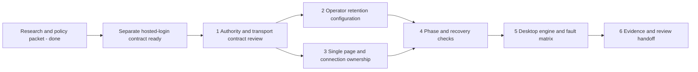

# Pause browser and connection follow-up plan

> **For agentic workers:** REQUIRED SUB-SKILL: Use superpowers:subagent-driven-development or superpowers:executing-plans when implementation is separately authorized. The unchecked steps below are future work, not completed tests.

**Goal:** Complete the desktop-simulated pause acceptance work and integrate one controlling page/connection plus operator-configurable retention after hosted login is ready.

**Architecture:** PostgreSQL continues to own game state, deadlines and generation fences. Hosted login supplies account/session authority; this follow-up composes it with page/control/connection ownership without equating a socket failure with deletion of login or game state. Existing explicit Resume and command receipts remain authoritative.

**Tech Stack:** Existing Go, PostgreSQL, React/TypeScript, generated contracts and receive-only WebSockets with HTTP commands; desktop Chromium/Firefox/WebKit research and controlled simulation. No Redis dependency.

**Spec:** [Researched behavior, source evidence and policy options](../specs/2026-10-15-pause-browser-and-connection-followup.md).

**Status:** Planning only, 15 October 2026 Toronto. No code or runtime configuration changes authorized for this follow-up. Hosted login is being implemented separately. No new browser tests, downloads, server restart or load run occurred during preparation.

## Global constraints

- Cover Hearts Solo; Spades Solo/Partners; Trix Basic/Complex Solo/Partners.
- Keep current Free 300s/Paid 3600s values until a different deployment policy is selected.
- Desktop simulation and documented historical-platform review are sufficient for this phase; physical-device testing is not a completion gate here.
- Do not label a viewport or user-agent preset as an actual mobile OS or historical Safari engine.
- Reconnect, focus and token renewal never authorize play or acquire another page's control automatically.
- Preserve accepted moves, fourth-card presentation, receipts, original deadlines, ownership and actor-safe projections.
- Separate authentication, page/control ownership, transport, foreground permission, playback, resumability and historical retention.
- The future target remains 100,000 independent games; this plan supplies no measured server count or production certification.
- Do not change the local-test service into a hosted service by relaxing its configuration guards.
- Work from the main current checkout when execution is authorized; coordinate with the login branch rather than creating conflicting account/session definitions.

## Review focus

1. Page A closes after page B has replaced it: A must not pause B or revoke B's login.
2. The OS suspends code before any close/stop callback: missing server permission must still stop progression at the last server-accepted foreground deadline, regardless of whether its renewal reply reached the browser.
3. A move commits before its response is lost: recovery must preserve exactly one accepted move.
4. Duplicated tabs inherit storage: only one fresh authorized document may control play.
5. Retention configuration changes during a pause or server rollout: no existing deadline moves and no replica silently applies a conflicting policy.

## Dependencies and deliverables



Hosted-login readiness means a stable verified account ID, authenticated application-session identifier/generation, atomic supersession/revocation semantics, and a documented way for final game commands/work publication to reject an old session. The same account's command receipts must remain recoverable after a new login. These are integration requirements, not a request to implement the identity provider here.

The transport decision is explicit: preserve the existing authorized HTTP fallback (recommended) or require a healthy authoritative WS for live play. The spec records both and their consequences. Do not start transport implementation until the selected contract is recorded.

## Task 1 — Freeze the integration contract after login lands

**Read/coordinate:** `server/internal/records/identity.go`, `service_commands.go`, `server/internal/service/realtime.go`, `web/src/api/client.ts`, `controlLease.ts`, and the login team's final account/session contract.

**Produces:** one reviewed rule for account/session/page/control/connection generations, command and renewal authorization, conditional close, observer sockets and explicit takeover. Reuse existing control/playback generations where their meaning matches; do not invent redundant counters for the same authority.

- [ ] Record the login team's verified session generation and revocation interface, including simultaneous successful login callbacks and stale-session receipt reads.
- [ ] Select and record one transport option from spec section 5. Under WS-required mode, HTTP remains available for stop, receipt/snapshot recovery, Settings and account functions but cannot Resume gameplay without an authorized WS. Under fallback mode, HTTP needs the same sole page authority and explicit Resume.
- [ ] Define the observable replacement sequence: serialize takeover, fence old page, pause/cancel old work, return latest checkpoint, notify/close predecessor, then permit explicit Resume.
- [ ] Define a fresh document identity that cannot reuse copied `sessionStorage` as proof of exclusive control. Reload may preserve pending receipts but must reconcile/reacquire page authority safely.
- [ ] Specify failure handling with this language-independent acceptance fixture:

```text
Given account U, login S, page A, connection generation 7, running game G
When authorized page B wins generation 8
Then A cannot renew, mutate, publish game work or reopen authority automatically
And G is paused with its accepted checkpoint intact
When Close(A, generation=7) arrives after B's explicit Resume
Then B's generation, running permission and deadline do not change
```

**Review gate:** source-grounded contract agreed with the login implementation; no login provider changes in this task.

## Task 2 — Expose retention as validated operator configuration

**Modify after authorization:** `server/cmd/cardford/main.go`, the appropriate local/hosted configuration loader, `server/internal/records/store.go` only where required, focused configuration tests and an operator runbook. Keep existing SQL/API seconds representation and constraints unless a reviewed schema change is needed.

**Consumes:** verified entitlement selection and existing `StoreOptions.PauseFreeRetention/PausePaidRetention`.

**Produces:** proposed `CARDFORD_PAUSE_FREE_MINUTES` / `CARDFORD_PAUSE_PAID_MINUTES`, central minutes-to-seconds conversion, effective diagnostics and coordinated rollout instructions.

- [ ] Add failing configuration cases: missing→5/60; 10/30→600/1800 seconds; 2/15→120/900; zero, negative, fractional, text, >1440 and Paid<Free→startup rejection.
- [ ] Run those focused tests and confirm the unsupported/configuration cases fail before wiring the values.
- [ ] Add minimal parser/wiring to existing store options. Preserve local-only startup restrictions. Document that the variable names did not exist in the previous release.
- [ ] Test saved-policy semantics using the existing lifecycle SQL harness:

```text
At t=0, Free policy=300s; game pauses with expiry t=300
At t=60, deploy Free policy=600s
Read/reconnect/repeat Pause leaves expiry t=300
Resume at t=120 pins 600s for the next pause
Pause at t=130 sets expiry t=730
Resume at exactly t=730 is rejected
Rollback never rewrites either recorded deadline
```

- [ ] Repeat the pinning fixture for a running/held game, verified Paid entitlement and delayed lease-expiry sweep. Include inconsistent-replica configuration detection/rollout handling before multi-instance use.
- [ ] Record defaults, validation errors, effective non-secret values and rollback procedure. No live admin dashboard or tier-specific browser control is needed.

**Review gate:** configuration is operable without a code edit; existing paused deadlines and entitlement authority remain unchanged.

## Task 3 — Enforce one controlling page/connection safely

**Modify after authorization:** `server/internal/service/realtime.go`, `server/internal/http/realtime.go`, `server/internal/records/service_commands.go`, `realtime_playback.go`, `server/internal/service/session_lifecycle.go`, `web/src/api/client.ts`, `controlLease.ts`, `realtimeStream.ts`, `useGoSession.ts`. Any new durable registry/schema belongs in the next available migration after the login changes are integrated, with generated contracts if public fields change.

**Consumes:** task 1 authority contract. **Produces:** one accepted account/page authority, bounded transport replacement and stale-close rejection. Lowering the local four-connection constant alone is not the implementation.

- [ ] Write failing cases for same-cookie duplicate tab, separate-browser login replacement, simultaneous authorized claims, automatic reconnect by a superseded page and old-close-after-new-Resume.
- [ ] Add a conditional close operation whose predicate includes the exact account/session/page/connection generation. A mismatch is a no-op against the successor; a matching unexpected close pauses and cancels its work.
- [ ] Implement replacement and all final request/work/publication checks atomically with the existing account/control ordering. Test that a missed invalidation notification cannot authorize an old instance.
- [ ] Keep late frontend socket callbacks fenced. Do not let a reconnect callback acquire a new controlling generation implicitly.
- [ ] Apply the selected HTTP/WS policy consistently to Resume, presence renewal, human actions, bot work and view delivery. Intentional paused transport shutdown preserves pause reason and deadline.
- [ ] Test silent transport failure without client events; late heartbeat after lease expiry; notification loss; instance restart; no observer game socket from account/settings pages. Multi-instance delivery/routing must satisfy the existing capacity packet before a distributed pass is claimed.

**Review gate:** one authoritative page is enforced under replacement and failure; no old close/heartbeat can disturb the winner; a lost connection does not erase retained state.

## Task 4 — Verify phase-independent pause and phase-specific recovery

**Use/extend after authorization:** `web/tests/pause-lifecycle.test.ts`, `session-lifecycle.test.ts`, `go-pending.test.ts`, `trick-playback.test.ts`, `server/internal/records/session_lifecycle_test.go`, `server/internal/service/session_lifecycle_test.go`, plus game-specific fixtures where needed.

- [ ] For each of the seven modes, enumerate reachable human decisions and round/results boundaries from its actual module; mark inapplicable rows explicitly.
- [ ] At every reachable decision phase, verify manual/away pause before input, no automatic human action, state reconciliation and explicit Resume.
- [ ] For local selections, keep only a same-revision valid draft; clear stale drafts and queued autoplay. A reload is allowed to discard unsubmitted selections.
- [ ] For each game family, run the three command boundaries below, then repeat any variant-specific command path that does not share that implementation:

```text
Unsent selection -> interrupt -> no action receipt and no automatic submission
Sent command, response lost -> interrupt -> original receipt resolved once
Committed transition -> interrupt -> accepted revision preserved, no duplicate action
```

- [ ] Exercise fourth-card landing/dwell, Jacks placement, dealing/round advancement and final scoring. A committed fourth-card frame cannot disappear merely because the game state advanced while the UI was interrupted.
- [ ] Exercise Why hold→away pause→close Why, and takeover during Why. Neither close nor a late Coach response may Resume or regain control.

**Review gate:** shared pause semantics verified across every mode, with explicit accepted/unaccepted-action and presentation outcomes. This is a targeted matrix, not a claim that every possible Cartesian combination was exercised.

## Task 5 — Desktop engine, lifecycle and network matrix

**Evidence location:** `qa/implementation/rally/pause-session-lifecycle/` with a new dated run directory. Preserve prior failed and passing evidence unchanged. Use the built-in browser for visible annotated collaboration and record other engines separately when available.

- [ ] Record actual engine/version, host, source/build hashes, policy values and whether each lane is executed, simulated, documentation-only or unavailable. Use current stable engines and authentic historical versions where obtainable; no guessed old-version pass from a user-agent string.
- [ ] Audit lifecycle/recovery runtime APIs against the selected historical engine floor before claiming compatibility. In `web/src/api/realtimeStream.ts`, replace the `URLSearchParams.size` dependency with a compatible query-presence check; test missing `size` with a populated stream/work-ID query and with an empty HTTP-mode query. Snapshot recovery must preserve negotiated binding and work IDs.
- [ ] Review the latent optional-signal branch in `web/src/api/useGoSession.ts`. If retained, make signal composition work without `AbortSignal.any`; cover already-aborted input, either input aborting later, first-reason preservation and listener cleanup after completion. Current callers do not exercise this branch, so do not report a reproduced defect. Add focused tests to the existing API test suite or a small dedicated helper test file when implementation is authorized.
- [ ] Capture all seven modes at the five landscape viewports. Check visible pause reason/deadline, Resume/Settings/chooser, card/table/player overlap and Coach/Why. Restore normal viewport/network state afterward.
- [ ] Run shared interruption faults in each available engine: hide/blur, unsupported layout, navigation/return, callback suspension, abrupt page loss, offline/recovery and stale callback ordering. Feature-detect engine-specific freeze/discard tools.
- [ ] Use explicit network fault profiles rather than radio labels:

| Profile | Controlled condition | Required invariant |
|---|---|---|
| Healthy path change | Requests/updates continue successfully | No pause due only to a changed network hint. |
| Brief outage | Responses withheld for 2s; recover | No duplicate command; observed disconnect remains latched until Resume. |
| Renewal never accepted | Block renewal requests from reaching acceptance around the current 15s permission boundary | Assert the stored `foregroundLeaseUntil`; renewal arriving at/after expiry cannot revive. Retention starts at that last accepted lease deadline. |
| Renewal accepted, reply lost | Accept a renewal before expiry, withhold its response, then block further renewals | Assert the extended stored deadline, not the preceding deadline. The server's accepted renewal remains valid; after that deadline, pause and retain from its actual expiry. |
| Long outage | No accepted presence renewal or successful communication for 30s | Permission expires independently of client callbacks; retention starts from the last accepted lease deadline. |
| Half-open transport | No clean WS close and no usable updates | Selected transport policy + server deadlines stop unauthorized progression. |
| WS-only / HTTP-only failure | Fail one channel while the other responds | Explicit policy applied consistently; no silent second controller. |
| Accepted response loss | Commit then lose acknowledgment | Original receipt reconciled exactly once. |

- [ ] Run accelerated before/equal/after expiry and changed-config tests for both tiers. Run a bounded real-clock soak for the selected Free/Paid deployment durations when execution is authorized, observing network requests, runner/admission counts and cleanup. Do not spend an hour in this planning task.

**Review gate:** application behavior under recorded desktop conditions passes. Physical call/carrier/OEM behavior is outside this phase and is not inferred from those results.

## Task 6 — Record results and the remaining release boundary

- [ ] Update the verification ledger with passed/failed/not-run evidence; link each phase/authority/fault case to the tested build and policy.
- [ ] Preserve any unresolved disconnect cause separately from a successful retest; capture safe close reason/stage/generation metadata without credentials or hidden cards.
- [ ] Publish the operator configuration runbook and login integration contract. Confirm whether HTTP fallback or WS-required mode was selected.
- [ ] Leave the latest actual game available for annotation review, with temporary simulation overrides removed.
- [ ] Keep staging load, Redis, physical-device certification and future replay/training features outside this delivery. Do not turn these into blockers for finishing the agreed desktop phase.

## Planning validation performed

This packet was prepared from current source inspection and primary-source research, with independent read-only audits of mobile lifecycle evidence and repository configuration/authority/phase seams. Document links, fence balance and scope/status wording are checked before handoff. No new application test result is claimed. Implementation remains deferred until the login integration contract and transport choice are ready and implementation is authorized.
