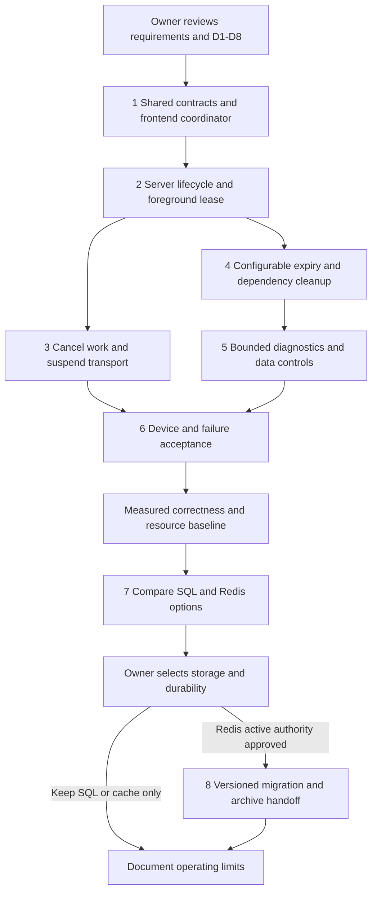

# Pause, presence and game retention implementation plan

> **For agentic workers:** REQUIRED SUB-SKILL: Use superpowers:subagent-driven-development (recommended) or superpowers:executing-plans to implement this plan task-by-task. Steps use checkbox (`- [ ]`) syntax for tracking.

**Goal:** Stop game work when a player leaves or loses connectivity, retain a resumable game for a configurable interval, and expire it safely with clear reasons and bounded resource use.

**Architecture:** Separate foreground permission, playback, transport lifetime and retained game data. Preserve PostgreSQL authority while introducing shared frontend lifecycle handling, server deadlines and work cancellation. Redis is deferred for transient caching only; the earlier active-authority alternative retained below is withdrawn from the approved scope.

**Tech Stack:** Existing React/TypeScript, Go, PostgreSQL, generated JSON Schema/OpenAPI contracts, receive-only WebSockets and HTTP commands. Redis is an evaluation candidate, not an installed or selected dependency.

**Spec:** [Requirements, 23 scenarios, architecture diagrams and storage alternatives](../specs/2026-10-15-pause-session-lifecycle-design.md).

**Status:** Implementation authorized on 15 October 2026 under [CR-ARCH-006](../../../planning/decisions/CR-ARCH-006-pause-presence-and-expiry.md): Free 5m / Paid 60m, PostgreSQL authoritative. The owner limited future Redis work to transient caching and deferred staging capacity tests. Redis active-authority migration below is withdrawn; support-capture/replay/training features remain separate. Checkboxes are not pass claims; consult the [implementation ledger](../../../qa/implementation/rally/pause-session-lifecycle/IMPLEMENTATION.md).

**Current contract ruling:** reuse `/api/session/playback`, adding explicit intent/reason and optional backward-compatible lifecycle view fields, plus `/api/session/presence`. Existing playback generation is the sole lifecycle epoch. This supersedes the draft separate lifecycle endpoint/counter sketch below.

**Later planning scope, 15 October:** the owner accepts desktop simulation for the next acceptance phase and is handling hosted login separately. The [browser/connection follow-up plan](2026-10-15-pause-browser-and-connection-followup.md) researches older/current platforms, single-page connection ownership and operator retention settings without changing code or current durations. Physical-device work is outside that phase; historical not-run results remain not-run.

**Delivery checkpoint, 16 October UTC:** the approved pause/expiry implementation is running from the current checkout. Focused frontend/backend/contract checks, real Free expiry, selected recovery/Why/idle flows and seven-mode/five-landscape paused layouts passed within their recorded scope. See the [verification report](../../../qa/implementation/rally/pause-session-lifecycle/VERIFICATION.md) and [later staging capacity plan](../../../qa/implementation/rally/pause-session-lifecycle/capacity/README.md). Physical devices, real Paid one-hour soak, broader interruption faults/phases and production capacity are not certified by this local delivery.

## Review summary

1. **Pause immediately; retain cheaply.** A saved checkpoint needs storage, not an open socket, bot process or database connection.
2. **Treat disconnection as its own pause cause.** Reconnecting restores a safe view and Resume button, not automatic play.
3. **Use two deadlines.** Proposed 15-second foreground lease bounds silent disappearance; proposed Free 5-minute / Paid 60-minute pause retention controls how long the game can be resumed.
4. **Use ping/pong as one signal.** A socket can respond while a page is backgrounded. Explicit lifecycle commands and lease expiry are also server triggers.
5. **Choose retention deliberately.** Discarded games cannot later support detailed replay unless a bounded incident capture or archive was retained.
6. **Do not equate Redis with a simple speed switch.** Current events, command receipts, quotas, coach artifacts and game state have transactional dependencies. A temporary-game Redis model is feasible work to evaluate, with a different durability contract.

Review decisions D1–D8 in the spec cover durations, idle behavior, storage order, durability, diagnostic retention, paid replay/training, queued moves and existing-data migration. My recommended delivery is tasks 1–6 with SQL authority, followed by measurement in task 7. Task 8 is conditional on selecting Redis active authority. Future replay/training product work is explicitly outside those tasks.

## Global constraints

- Scope is Hearts Solo, Spades Solo/Partners, Trix Basic/Complex Solo/Partners; one human and three deterministic production bots.
- Existing cards, game rules, scoring, fourth-card dwell, actor-safe coaching and explicit Resume after away remain intact.
- Client visibility, browser time, socket state and client tier claims are never game or retention authority.
- All writes remain authorized, version checked and idempotent; preserve existing durability until a numbered change explicitly approves an alternative for new games.
- New public behavior needs requirement IDs, generated contracts, acceptance evidence and a changelog entry at implementation time.
- New retention applies to newly admitted games by default. No existing-game purge or account-erasure reuse is authorized.
- Proposed values are Free 5m, Paid 60m, foreground renewal 5s, lease 15s, visible idle 120s + 30s warning, foreground paused socket grace 30s, cleanup target 60s.
- Current checkout is `C:\repos\test-jev`. Review latest actual app at `http://127.0.0.1:4174/` in the visible built-in browser; do not replace it with a design preview or another checkout.

## Review focus

- Browser disappears before its stop request reaches the server: lease still fences work and starts retention without a final event. Tasks 2, 3, 6.
- Stop/start responses arrive out of order around reconnect or control takeover: original receipt reconciliation and epoch fences prevent accidental running. Tasks 1–3, 6.
- Expiry races with Resume or final completion: one serialized outcome; no resurrection, lost completed save or duplicate charge. Tasks 4, 8.
- Retention removes a game referenced by existing advice/feedback/history: preserve required packages or detach a self-contained artifact under a new explicit contract. Tasks 4, 5, 8.
- A live connection survives while the player is away, or HTTP mode works without a WebSocket: presence policy works in both cases and no background retry loop survives. Tasks 1–3, 6.

## Delivery graph and approval boundaries



Frontend UI/reducer work and backend contract tests may run in parallel **after task 1 freezes schemas**. Integrate task 2 before exposing the new promise that the server will stop on silent loss. Task 4's reference inventory may run alongside task 3. Assign exclusive file ownership for each batch; do not let agents independently invent DTOs.

## Contract sketch to freeze in task 1

These are proposed public names and semantics, not existing API support. Extend the canonical `web/shared/realtime.schema.json` and local service OpenAPI; generate TypeScript/Go artifacts through the existing generator. Retain existing credential/header definitions rather than inventing a second authentication system.

```ts
type LifecyclePhase = 'running' | 'held' | 'paused' | 'expired' | 'completing' | 'completed';
type PauseReason = 'manual' | 'away' | 'layout_unavailable' | 'idle'
  | 'connection_lost' | 'service_unavailable' | 'lease_expired'
  | 'control_lost' | 'access_required' | 'reopened';

interface SessionLifecycleView {
  gameId: string;
  phase: LifecyclePhase;
  generation: number;
  playbackGeneration: number;
  reasons: PauseReason[];
  serverNow: string;
  foregroundLeaseUntil: string | null;
  pausedAt: string | null;
  expiresAt: string | null;
  policyVersion: string;
  requiresResume: boolean;
}

// Added to the existing authenticated/control-bound command envelope.
interface LifecycleIntent {
  commandId: string;
  gameId: string;
  expectedLifecycleGeneration: number;
  expectedPlaybackGeneration: number;
  action: 'pause' | 'hold' | 'release_hold' | 'resume';
  reason: PauseReason | null;
}

// An authenticated lease renewal, not a play/resume command.
interface ForegroundRenewal {
  gameId: string;
  expectedLifecycleGeneration: number;
  sequence: number;
}
```

Proposed endpoints: `POST /api/session/lifecycle` and `POST /api/session/presence`. The lifecycle endpoint uses existing UUID/digest receipts and control credentials. The presence endpoint accepts only increasing sequences for the current control/lifecycle generation and eligible running/held state, with `serverNow < existing foregroundLeaseUntil`; duplicate/stale requests do not extend a deadline. Late renewal materializes pause at the old deadline and returns `lease_expired`, even if a sweeper has not yet updated the stored phase. All deadlines come from the server. No request contains a caller-chosen tier, TTL or authoritative visibility claim that bypasses other checks. Existing `/api/session/playback` clients require explicit version compatibility; they cannot start lease-protected games without renewal support.

In snapshots/push views, lifecycle state is actor-safe and contains no lease secrets. Response semantics must distinguish `game_expired`, `control_lost`, `access_required`, `lease_expired` and `command_unconfirmed`. Transport status is not a lifecycle phase. For already-purged new-policy game payloads, a versioned expired response replaces unavailable game bytes; existing durable and financial receipt guarantees remain unchanged.

## Task 1 — Shared reasons, lifecycle contracts and frontend coordinator

**Requirements:** PL-F01–04, F07, F11; PL-N01, N07, N11. **Scenarios:** S01–S19, S23.

**Files:**

- Create `web/src/table/sessionLifecycle.ts` for a pure reason/blocker/epoch reducer and `web/tests/session-lifecycle.test.ts`.
- Modify `web/src/table/useGamePause.ts`, `pauseLifecycle.ts`, `PauseDialog.tsx`, `RotationGate.tsx`, `useViewport.ts`.
- Modify `web/src/api/useGoSession.ts`, `client.ts`, `goPendingCommands.ts`, `web/src/App.tsx`, `web/src/games/trix/Table.tsx`.
- Modify canonical `web/shared/realtime.schema.json`, `local-service.openapi.json` and their generation inputs; regenerate rather than hand-edit generated Go/TypeScript files.
- Add a numbered architecture decision after checking the next unused number; update CR-UX-008 and CHANGELOG with the approved D1–D8 values and scope.

**Interfaces:** consumes existing authenticated controller/control credentials and presentation queue; produces generated `SessionLifecycleView`, `LifecycleIntent`, `ForegroundRenewal`, and shared lifecycle state for all tables. Define the pure reducer as `reduceLifecycle(state: ClientLifecycleState, event: LifecycleEvent): ClientLifecycleState`, with events `interrupt`, `blockersChanged`, `holdAdded`, `holdRemoved`, `serverView`, `resumeStarted`, `resumeConfirmed`, `authInvalidated` and `gameReplaced`. Keep a set of hold causes; send hold/release only on zero-to-one/one-to-zero transitions. The server rejects release outside the same held generation or after foreground expiry.

- [ ] Add table-driven reducer and adapter tests before changing behavior. Encode all reason priorities, distinct active blockers and Resume latch, and one owner/game identity per state. Test: interrupt away -> connectivity recovers -> phase still paused; start Resume epoch 7 -> blur epoch 8 -> response for 7 cannot release input; open Why + Settings -> close Settings -> still held; interrupt during final hold release -> remain paused.
- [ ] Freeze endpoint schemas and fixtures for running/held/paused/expired, nullable dates, bad reason codes, malformed generations and disallowed secret fields. Run `npm run contracts:generate`, then `npm run contracts:check` and `node scripts/windows-env.mjs node scripts/m02a-contracts.mjs --check`.
- [ ] Route both App and Trix through the same coordinator. Distinguish unexpected transport failure from deliberate suspension and supported HTTP mode. Remove identity preflight only from the stop-critical path; the server must still perform authentication/CSRF/control checks. Preserve receipt-first recovery for uncertain mutations.
- [ ] Add concise copy: “Connection lost — play is paused on this device”, “Reconnecting…”, “Connection restored — Resume when ready”, “Paused while you were away”, and “This game expired”. Show remote confirmation uncertainty separately. Settings and Choose game stay usable; expired game offers a new game without automatic charging.
- [ ] Test lifecycle event registration, initial/reopened pause, duplicate signals, 44px controls, screen-reader updates, keyboard/soft-keyboard behavior and late old-game responses. Define unsupported layout by layout viewport; soft-keyboard visual viewport changes alone must not claim the phone rotated.
- [ ] Verify the batch using the bounded frontend command below; retain failing evidence if a test reveals behavior the contract has not decided. Commit only this batch when repository delivery instructions permit.

```powershell
node --test --test-isolation=none web/tests/session-lifecycle.test.ts web/tests/pause-lifecycle.test.ts web/tests/client-recovery.test.ts web/tests/go-pending.test.ts web/tests/trick-playback.test.ts
npm run typecheck
```

The new test file does not exist until this task is implemented. Its minimum cases are explicit above; this command is not a claimed passing result.

## Task 2 — Server lifecycle, renewable foreground lease and commit fences

**Requirements:** PL-F04–05, F07–08, F10; PL-N02–03, N07, N09. **Scenarios:** S09–S18, S21–S22.

**Files:**

- Create `server/internal/records/session_lifecycle.go`, `session_lifecycle_test.go`, `server/internal/service/session_lifecycle.go`, `session_lifecycle_test.go`.
- Add the next numbered SQL migration in `web/server/records/migrations/` after verifying current numbering. Do not edit migrations 007–012.
- Modify `server/internal/records/realtime_playback.go`, `realtime_projection.go`, `service_commands.go`, `server/internal/service/bot_playback.go`, `platform_session.go`, `server/internal/http/local.go`, and contract fixtures.

**Interfaces:** lifecycle storage exposes operations `ApplyLifecycle(ctx, authenticatedBinding, LifecycleIntent) -> SessionLifecycleView`, `RenewForeground(ctx, authenticatedBinding, ForegroundRenewal) -> SessionLifecycleView`, and an internal final-write permission check on game/control/lifecycle/playback generations plus fresh authoritative time. Use project-generated Go types for public DTOs. All operations serialize on the same game/owner authority already used for command publication.

- [ ] Add fake-clock and real-transaction tests with fixed times: renewal at `t=0` permits eligible work before `t=15s`; at `t=15s` it rejects; a higher-sequence renewal at `t=16s` cannot revive a still-stored-running lease before sweep; pause at `t=4s` sets Free expiry `t=304s`; a duplicate stop at `t=20s` leaves `t=304s`; silent expiry noticed at `t=40s` starts pause at `t=15s`, not 40.
- [ ] Add additive lifecycle storage keyed by game, storing policy version, generation, state, lease deadline, paused timestamp and retention deadline. Initialize paused timestamps/deadline atomically for a new never-resumed game. Pin verified retention policy at creation/explicit Resume. Use fresh server time inside the serialized guard; do not use request-start time or `updated_at` as a presence clock. Deadlines and counters must survive server restart.
- [ ] Implement stop as one authoritative generation change plus invalidation; implement resume as one receipt-protected conditional transition that validates deadline, control, access and supported client contract. Repeated renewal cannot resume a paused game. A server restart requires a new Resume and fresh worker fence.
- [ ] Extend checks before queue admission, worker claim, publication and game mutation. Add an indexed foreground-deadline sweep at a shared interval of at most one second; it must pause/release a dormant human-turn runner without another browser request. Define acceptance linearization at the final serialized permission guard. A transition accepted before a stop/deadline may finish afterward; stop acknowledgement must wait until earlier serialized commits are ordered before it. Do not promise rollback of already accepted cards.
- [ ] Test Resume-vs-pause, expired lease-vs-bot commit, control takeover-vs-late renewal, stop response lost, duplicate UUID/different digest, old client, auth revocation and stale worker publication. Validate no hidden data enters public lifecycle fields.
- [ ] Run focused native tests through the project wrapper with an explicit timeout and isolated test schema. Verify PostgreSQL tests actually ran rather than skipped. Record SQL renewal cost; this first SQL implementation is a correctness baseline, not the final high-concurrency presence design.

```powershell
node scripts/windows-env.mjs go test ./server/internal/records ./server/internal/service ./server/internal/http -run 'Test(SessionLifecycle|ForegroundLease|RealtimePlayback|RealtimeTransport)' -count=1 -timeout=120s
```

New test names must use the listed `SessionLifecycle`/`ForegroundLease` prefixes. Extend existing `TestRealtimePlaybackPauseFencesInFlightCommit` and original-receipt recovery coverage rather than replacing them.

## Task 3 — Release work, pause transport and bound recovery

**Requirements:** PL-F05–07, F11; PL-N04–05, N12. **Scenarios:** S04–S20, S23.

**Files:**

- Modify `server/internal/service/bot_playback.go`, `preparation.go`, `service.go`, `server/internal/records/work.go`, `server/internal/service/realtime.go`, `server/internal/http/realtime.go`.
- Add cancellation tests to `server/internal/service/bot_playback_test.go` and a focused `server/internal/service/session_resources_test.go`.
- Modify `web/src/api/realtimeStream.ts`, `useGoSession.ts`, `web/src/rally/useCoachExperience.ts`, `web/src/table/useHandGestures.ts` only for the approved queued-intent policy.
- Add `web/tests/session-resources.test.ts`; extend `realtime-stream.test.ts`, `trick-playback.test.ts`.

**Interfaces:** transport gains `suspend()` and `recoverPaused()` operations distinct from terminal `close()`. Suspension cancels scheduled callbacks and rejects callbacks that were queued before hiding. The service maintains cancellation handles by game and execution generation; worker publication validates generation even when cancellation arrives too late.

- [ ] Add tests that hide the document after a fallback/reconnect timer is scheduled but before it fires; no network call should occur. Test close-during-negotiation and online events while hidden. Test configured healthy HTTP mode without a socket.
- [ ] Cancel/remove dormant bot runners and queued tasks on persistent pause. Propagate cancellation through deterministic preparation loops instead of merely canceling the HTTP caller. Separate shared-consumer work from game-exclusive work; retain a completed reusable result only within its valid bounded cache policy.
- [ ] Stop read-only coach fetches, polling and speculative work on away; keep command receipts for in-flight mutations. Preserve explicitly requested, authorized foreground Coach/Why reads during a temporary hold or paused screen, subject to the game retention deadline. Test that opening Why does not cancel its own loading request. Release queue/admission reservations in all success/error/cancel paths. Recovery of an existing coaching item must not consume another daily coaching session.
- [ ] Implement immediate hidden transport suspension and 30-second foreground paused grace. No presence renewal in persistent pause; eligible running/held views renew every five seconds with single-flight and jitter. Unexpected disconnect latches; deliberately suspended transport does not show an outage. Bound automatic visible recovery to 30 seconds before Retry.
- [ ] Implement visible idle warning and persistent idle pause using the approved values. Clear unsent queued autoplay on away only if D7 is approved; preserve selected cards and committed presentation as specified. Screen-reader/keyboard interaction counts as engagement.
- [ ] Instrument server active/queued workers, cancellation drain, bot commits, CPU, frontend timers/requests and SQL pool usage. Verify one paused game releases its slot even while waiting for a human decision. Run unit/fault tests and a timed quiescence check; no new all-repository sweep unless failures justify one.

```powershell
node --test --test-isolation=none web/tests/session-resources.test.ts web/tests/realtime-stream.test.ts web/tests/trick-playback.test.ts
node scripts/windows-env.mjs go test ./server/internal/service ./server/internal/records -run 'Test(SessionResources|ForegroundLease|RealtimePlayback)' -count=1 -timeout=120s
```

## Task 4 — Policy-driven expiry and safe dependency cleanup

**Requirements:** PL-F08–10, F12–13; PL-N06, N08–10. **Scenarios:** S18, S21–S22 and completion races.

**Files:**

- Create `server/internal/records/session_retention.go`, `session_retention_test.go`, `server/internal/service/session_retention.go`, `session_retention_test.go`.
- Modify `server/internal/access/config.go` for validated policy configuration and existing account/session projection paths for expiry outcomes.
- Inspect/modify `server/internal/records/store_documents.go`, `store_history.go`, `platform_account.go`, `platform_account_export.go`, `coach_ui.go`, `erasure.go` only where the approved dependency migration requires it.
- Add a forward migration for expiry indexes, lifecycle markers and narrowly scoped per-game retention operations. Preserve immutable historical checks outside that operation.

**Interfaces:** `ExpireDue(ctx, limit)` processes a bounded indexed batch using server time and returns counts/cursor/oldest overdue age; lifecycle reads reject expired data independently of this sweep. Per-game purge requires explicit service authority for that game and approved policy version, never the whole-account erasure principal. Account erasure still covers every store.

- [ ] Produce a dependency inventory before writing DELETE statements: game snapshot, anchors/events/commands, original decisions/exposures, work/attempts, access pointer, projections/playback, grants/unlocks/charges, help/review artifacts, coach sessions/items/feedback, service receipts and outbox. Classify preserve, detach, archive or expire for each FK and immutable trigger.
- [ ] Create isolated fixtures for each dependency class. Test Free/Paid durations, natural entitlement expiry, revocation, upgrades/downgrades during pause, duplicate signals, server clock changes, exact-boundary Resume and new-policy-only migration. Include never-resumed games and a server outage lasting beyond both lease and retention deadlines; neither receives a new clock on recovery. Quotas remain consumed after expiry; no implicit refund or new trial.
- [ ] Implement logical expiry first, then a bounded sweeper. CAS/lock against Resume/completion; invalidate active pointer and generations, cancel work and close matching bindings. Return a safe expired response even if full payload cleanup is delayed.
- [ ] Implement dependency cleanup only after the inventory has a defined outcome for every reference. Existing saved coach replay bytes and original advice cannot be silently deleted with the active game. If preserving them requires a source replay package, retain it under its own explicit policy or materialize the approved self-contained artifact before purge.
- [ ] Preserve existing durable original receipts. For new ephemeral-policy game commands only, implement the approved minimized marker/retry horizon and versioned expired outcome. Creation/bootstrap, financial/admission/coaching usage receipts follow their durable policies. Test replaying an original create command after game expiry and after the 24-hour gameplay marker horizon: it must return the original outcome or an explicit stale-command rejection, never allocate a new game or charge.
- [ ] Test sweeper interruption/restart, backlog recovery, purge failure, missing child, account erasure race and owner isolation. Test that expired/unknown instance IDs cannot recreate a game. Measure delete/WAL/vacuum cost; do not run destructive tests against the manual-review database.

```powershell
node scripts/windows-env.mjs go test ./server/internal/records ./server/internal/service -run 'Test(SessionRetention|SessionLifecycle|RealtimeLazyProjectionAndErasure)' -count=1 -timeout=120s
```

## Task 5 — Bounded diagnostics and future-history boundary

**Requirements:** PL-F12, F15–16; PL-N08–09, N12.

**Files:**

- Create `server/internal/service/session_diagnostics.go`, `session_diagnostics_test.go`, and a canonical diagnostic schema alongside current public/service contracts if a report endpoint is exposed.
- Add minimized telemetry at existing lifecycle/transport/work boundaries. Extend existing coach feedback capture only under the approved incident policy.
- Update `docs/superpowers/specs/2026-10-14-paddle-identity-release-design.md` to explicitly reconcile its proposed detailed-history schedule, after owner approval; update account export/deletion coverage.

**Interfaces:** diagnostics accept an allowlisted event `{kind, serverTime, gameCorrelation, lifecycleGeneration, revision, appVersion, transportMode, errorCode}`. No arbitrary request body or full snapshot is accepted. Restricted incident capture has an ID, purpose, expiry, schema/version manifest and owner; normal telemetry cannot read its private payload.

- [ ] Add canary tests ensuring private card IDs/hands, lease credentials, cookies and raw coach payloads do not enter operational logs. Cap ring by both bytes and event count and test truncation.
- [ ] Implement observed event categories without inferring emotional cause. Add rates for pause reason, stop uncertainty, lease expiry, resumed/expired sessions, cancellation drain, retention bytes, archive failures and cleanup lag.
- [ ] Implement explicit feedback/report capture before active TTL deletion using the approved seven-day proposal or reviewed replacement. Persist enough restricted actor-safe/versioned evidence for the stated purpose; do not store every abandoned game. Automatic technical incident capture requires a named trigger and the same cap/retention controls.
- [ ] Test capture-vs-expiry race, inaccessible expired evidence, cross-owner access, removal on account deletion and backup restore handling. Clearly distinguish existing saved Coach Why items from a future full-game paid replay library.
- [ ] Document future saved-game replay/retry and learning exports as separate milestones. No runtime model integration, automatic training export or population rating claim is introduced.

```powershell
node scripts/windows-env.mjs go test ./server/internal/service ./server/internal/records -run 'Test(SessionDiagnostics|SessionRetention|Coach)' -count=1 -timeout=120s
```

## Task 6 — Visible browser, physical devices and resource acceptance

**Requirements:** all PL-F/PL-N requirements applicable to SQL delivery. Conditional Redis requirements remain explicitly not run.

**Evidence location:** create `qa/implementation/rally/pause-session-lifecycle/` at implementation time with a source/build manifest, scenario results, sanitized traces, screenshots and resource measurements. Keep current audit evidence immutable.

- [ ] Build current source, verify listener ownership and `/api/health`, and open the actual game in the built-in browser with annotation. Confirm local-test/fixture/provider-off modes. Do not advance or replace the user's current game merely to get a fixture without clearly preserving it.
- [ ] Verify each of seven modes through detection -> server pause -> return -> explicit Resume. Use deterministic isolated test games for phase coverage; display them in the built-in browser and label fixtures. Include passing/bidding, Trix request choice/doubling, Jacks, fourth-card landing, trick dwell, end-of-round/results and Coach Why.
- [ ] Exercise S01–S23 with documented setup, action, expected UI, authoritative generation/revision/deadline, observed result and evidence path. Test simultaneous reasons and out-of-order responses. Do not count a visible dialog as proof workers stopped.
- [ ] Cover landscape iPhone SE 667×375, iPhone 12 844×390, iPad 1024×768 and 1180×820, desktop 1440×900, and the reported 592×579 pane; repeat rotation return and coach overlay/pinned states. These CSS viewports are geometry checks, not hardware certification.
- [ ] Run real iOS Safari, Android Chrome and iPad Safari cases: incoming accepted/rejected call and call banner, app/tab switching, screen lock, split view blur, network handover, airplane mode, browser kill and return. Record OS/browser versions and which events actually occurred. Unsupported/undetectable call overlays must be reported honestly. If hardware is unavailable, mark these not run and keep mobile acceptance open.
- [ ] Run controlled half-open socket, API-only failure, WS-only failure with healthy HTTP, lost stop acknowledgement, lost Resume acknowledgement, page discard and server restart tests. Reconcile state before play; verify the maximum lease window and zero post-fence accepted transitions.
- [ ] Observe one real 5-minute expiry and one real 60-minute retained window/expiry, in addition to accelerated fake-clock tests. Use nonblocking monitoring so the app remains reviewable. Verify zero per-game background work/requests after suspension; record shared sweeper overhead separately.
- [ ] Run bounded reconnect/expiry load with measured active/paused proportions. Measure p95/p99, false pauses, CPU, SQL statements/connections/WAL, bytes per game and cleanup backlog. Record exact load/hardware, not a marketing concurrency claim.
- [ ] Produce `VERIFICATION.md` with passed/failed/blocked/not-run rows for every scenario/requirement, links to screenshots and sanitized evidence. Stop at this gate if invariants or mobile acceptance fail; do not mask failures with broad retries or new timing constants.

Representative repeatable baseline commands:

```powershell
npm run contracts:check
node scripts/windows-env.mjs node scripts/m02a-contracts.mjs --check
npm run typecheck
$env:VITE_BACKEND='go'
npm run build --workspace web
```

Use the existing native launcher and confirm the actual executable before restarting port 4174. No hidden/headless browser acceptance substitutes for the owner's visible review preference. Pure tests and isolated fault/load tools can supplement that review.

## Task 7 — Storage benchmark and choice of Redis role

**Requirements:** PL-F13; PL-N08, N10, N12. **Gate:** tasks 1–6 have a measured baseline; no production migration yet.

**Files:** add a bounded benchmark/evidence packet under `qa/implementation/session-storage/` and an architecture decision under `planning/decisions/`. Any benchmark adapters are isolated under test tooling, not selected as the product write path.

- [ ] Measure actual hot snapshot, complete resumable package, decision/coach bytes, receipts, outbox, indexes and WAL across all modes, including a full Trix game. Capture percentile distributions and maximum supported case; the current 256-KiB hot-state cap is not the size of the complete package.
- [ ] Compare A (SQL + expiry), B (SQL authority + Redis presence/cache), C (Redis live authority + durable completion), and periodic SQL checkpoints. For checkpointing, state the accepted-move loss window explicitly; it is not equivalent to the current journal.
- [ ] Replay identical workloads with active/paused/returning populations, representative bot CPU and reconnect storms. Report admission capacity, latency, memory, SQL/Redis operations, network bytes, cleanup throughput and operating cost assumptions. Include memory exhaustion, cache loss and stale-cache recovery.
- [ ] For Redis presence in B, prove final commit authority cannot be bypassed by cross-store timing. A Redis read followed by a SQL write is not an atomic fence. Choose either durable generation validation plus conservative lease snapshots, or another explicitly tested protocol; retain SQL authority and stop on uncertainty.
- [ ] Present the measured choice: retain A, adopt B only, or approve C plus loss/retention/receipt changes. Fix policy/version and operator failure actions before adding production dependency or migrating games.

## Task 8 — Withdrawn: Redis active authority and archive transfer

**Do not implement.** CR-ARCH-006 supersedes this historical proposal. Future Redis work is rebuildable transient caching only; PostgreSQL remains authoritative.

**Requirements:** PL-F13–14; PL-N06, N08–10, N12. **Gate:** explicit selection of option C, approved durability profile and numbered contract changes. This is a separate migration milestone, not required to fix mobile pause.

**Files:** proposed package `server/internal/activegames/` for a storage interface and Redis adapter; `server/internal/service/game_archive.go`; schema/migrations for archive manifests and durable operation reservations; shared compatibility fixtures under `server/internal/activegames/testdata/`.

**Interfaces:** one `ActiveGameStore` supports `Read`, `ApplyCommand`, `ApplyLifecycle`, `RenewForeground`, `ExpireDue`, `FreezeCompletion`, `AcknowledgeArchive`. Each mutation consumes identity, revision/authority generations and idempotency digest, and returns an immutable accepted receipt or typed rejection. Both SQL and Redis adapters must pass the same conformance fixtures. The current records implementation remains the SQL adapter; a game never changes adapters implicitly.

- [ ] Define full active bundle and canonical serialization/version/hash rules. Include actual deal/anchor, event stream, original decisions needed for verification, receipts, lifecycle/control state and safe projection cursor. Inventory existing historical readers before adapting them.
- [ ] Implement atomic short CAS/scripts for per-game writes and receipt/publication intent under a common hash slot; validate before mutation, bound bytes and runtime, keep deterministic game computation outside Redis. Reject missing/expired/generation-mismatched state; never create on a retry read.
- [ ] Preserve account-wide durable quota/admission/coach consumption through idempotent reservations. Test every interruption between reservation, Redis acceptance and durable finalization; reconcile unknown outcomes without double-charge, free allowance reset or lost paid artifact.
- [ ] Implement completion envelope and archive protocol from the spec. Duplicate final completion with same digest succeeds idempotently; different digest fails. Normal TTL cannot remove an unacknowledged transfer. Reserve worst-case transfer capacity for each admitted game, including active/envelope overlap, and test archive failure while every admitted game completes. Admission backpressure must bound archive backlog; no silent discard when SQL/archive is down.
- [ ] Configure isolated authoritative Redis with explicit memory admission, eviction policy, persistence, replication and backup/deletion behavior. Test process kill, failover, partition, stale replica, script error, clock shifts, lost notification, cluster-slot routing and delayed old workers. Quantify lost acknowledged writes under the selected profile; reject release if it contradicts the approved promise.
- [ ] Route only newly admitted canary games by immutable `storageMode` and policy version. Keep legacy SQL sessions readable. On rollback, stop new Redis admissions and drain/pause existing Redis games; never silently continue them from stale SQL. Migration of old games is a separate approved inventory-and-copy operation.
- [ ] Repeat the applicable task 6 browser/resource matrix and full storage conformance/fault suite. Document tested operating limits and rollback instructions before wider rollout.

## Traceability and completion checklist

| Requirement group | Owning tasks | Required evidence |
|---|---|---|
| F01–04, F07, F11 | 1–3, 6 | Shared reducer/contracts, visible behavior, receipt recovery, all seven modes |
| F05–06 | 2–3, 6 | Final commit fences, real cancellation/admission release, no hidden polling |
| F08–10 | 2, 4, 6 | Server-time deadline races, tier policy, no quota reset, safe cleanup |
| F12, F15–16 | 4–5 | Retention dependency inventory, minimized diagnostics, export/erasure, explicit future boundaries |
| F13–14 | 7–8 | Storage decision, adapter parity, durability/failover and idempotent archive transfer |
| N01–07, N11 | 1–6 | Measured timings/resources, phone behavior, exact source and device versions |
| N08–10, N12 | 2–8 | Bounds, privacy/authority, failure tests, capacity evidence with scope limits |

- [ ] Owner decisions recorded; approved and proposed items are distinguishable.
- [ ] All new public behavior has schema, requirement, acceptance evidence and changelog coverage.
- [ ] Existing saved games, original rules/advice and current account/usage ledgers remain intact unless a separately approved migration explicitly changes retention.
- [ ] No test result is inferred from a plan, screenshots, a canceled context or a vendor connection limit.
- [ ] Actual latest game is left available in the built-in browser for review; production code changes are described separately from design and benchmark artifacts.

## Evidence used to prepare this plan

- Current React/Go sources and CR-ARCH-005/CR-UX-008, reviewed read-only on 15 October.
- [Prior pause transport audit](../../../qa/implementation/rally/browser-2026-10-15/pause-transport-review/verified.json): a reproduced lost-stop reconciliation gap, with its explicit test limitations.
- [Private-record storage invariants](../../../planning/implementation/multi-game/private-records.md) and existing migration/erasure dependencies.
- [Browser and Redis primary sources](../specs/2026-10-15-pause-session-lifecycle-design.md#4-interruption-and-failure-matrix), cited near the relevant claims in the specification.

No product implementation or new browser/device/load testing was performed to prepare these documents. Documentation checks cover local links, requirement/scenario coverage and internal consistency only.
