# Regional PostgreSQL and distributed Go implementation guide

18 October 2026. **Planned work only. No implementation, provisioning or runtime validation is authorized or reported by this guide.** All checkboxes describe future work.

> For agentic workers: after implementation is explicitly requested, use the executing-plans workflow or an owner-authorized subagent-driven-development workflow. Track the checkboxes and report actual evidence at each delivery boundary.

**Goal:** Deliver recoverable gameplay across Go instances within a region, preserve confirmed moves after one SQL machine/disk failure, and support independent regions with stable player assignment and asynchronous consolidated views.

**Architecture:** Each region has one PostgreSQL writer and two standby candidates, Go instances behind regional affinity, and regional Keycloak. A minimal global directory resolves stable home assignment. Selected reporting facts flow asynchronously into a derived global SQL view. Whole-region outage leaves affected players waiting for their home region.

**Tech stack:** Existing repository-pinned Go, PostgreSQL/pgx, React/Vite/TypeScript, generated schemas and regional Keycloak. Routing, HA controller/provider and infrastructure versions are Task 0 outputs. No Redis.

**Spec:** [Regional PostgreSQL and distributed Go](../specs/2026-10-18-regional-postgresql-architecture-design.md). [Architecture entry](../../architecture/planned/README.md). [Current implementation](../../architecture/current-state/README.md).

This is the distributed deployment workstream for the [hosted-release plan](2026-10-14-paddle-identity-release.md), not a second identity or billing implementation. Reuse the [local-auth foundation](2026-10-16-keycloak-local-auth.md), [renewable-session design](../specs/2026-10-18-renewable-player-sessions-design.md) and [setup guide](../../development/local-auth.md). Coordinate the hosted entrypoint and migrations with those workstreams. Reinspect the working tree before execution because these source pointers are a planning snapshot, not a frozen release.

## Global constraints

- PostgreSQL is the sole authority for gameplay, history and archived games; Redis is excluded.
- Each game has one regional writer authority at a time; global reporting never accepts gameplay commands.
- Each player keeps a stable home region across logins; active games do not switch regions.
- Confirmed moves must survive loss of one regional SQL machine and its disk; whole-region destruction is outside that no-loss claim.
- Whole-region outage causes affected players to wait for home-region recovery; automatic cross-region game failover is excluded.
- HTTP receipts, snapshots, matched retries and WebSocket publication must obey the same protected-commit boundary.
- Preserve exact command identities, original receipts, version pins, actor-safe projections and existing authorization/control checks.
- Preserve explicit Resume, paused-game deadlines, one active login family, 15-minute access, 90-day qualifying inactivity and the 180-day absolute login cap.
- Provider calls and expensive game/coaching computation run outside SQL transactions.
- Preserve native local/test profiles, existing data and applied migration checksums; add a separate hosted composition.
- Game-history and score-retention policy is deferred; no deletion schedule is introduced here.
- Public contract changes use the existing schema generators; planned test cases are not executed evidence.

## Review focus

| Failure case | Delivery task and evidence |
|---|---|
| A locally visible receipt escapes before durable replication, then the primary disk is lost | Task 2: cancellation/ambiguous-commit test reads through every public path and compares confirmed IDs after failover |
| Go A finishes after B takes ownership, or logout reaches only one instance | Tasks 3–4: stale generation rejects result; all affected bindings lose permission |
| A new browser or concurrent first login creates a second regional account | Task 5: verified identity converges on one canonical assignment through interrupted provisioning |
| Duplicate/reordered export changes a score twice or resurrects erased data | Task 6: effective contribution, revision and suppression tests plus reconciliation |
| Region A fails and routing creates an independent copy in B | Task 7: A players remain unavailable, B serves its own players, A resumes only from its valid timeline |

## Delivery order and ownership

```mermaid
flowchart LR
  T0[0 Contracts and deployment inputs] --> T1[1 Hosted boundary and isolated harness]
  T1 --> T2[2 Protected SQL acceptance]
  T2 --> T3[3 Go ownership and work recovery]
  T3 --> T4[4 Delivery and invalidation]
  T4 --> T5[5 Home assignment and regional routing]
  T5 --> T6[6 Consolidation]
  T6 --> T7[7 Regional outage and restore]
  T7 --> T8[8 Combined acceptance and bounded pilot]
```



The order is a conservative integration sequence. Schema/contract preparation can overlap only after shared interfaces and migration ownership are agreed. Start with one isolated region containing two Go instances and three SQL nodes; add a second isolated region for routing/failure evidence. A bounded hosted pilot precedes expansion to multiple serving regions. A proposed directory layout is not a requirement to split the monolith into microservices.

The implementing engineer owns code and evidence; the platform/operator owns infrastructure, fencing, backups and fault-harness permissions. The product owner resolves deployment budget, initial placement, recovery-time target and reporting scope. Assign named people during Task 0. Future task completion requires a reviewable change, executed relevant acceptance tests and a record of passed/failed/blocked/not-run checks.

## File and interface map

Paths below are repository-relative. Existing files are extension points, not instructions to replace them wholesale. New paths are proposals to confirm against the checkout at implementation time; they do not exist as a result of this guide.

| Area | Existing extension points | Proposed additions / interface responsibility |
|---|---|---|
| Hosted composition | `server/internal/records/store.go`, `server/internal/http/`, current Go entrypoints | `server/cmd/cardford-hosted/main.go`, `server/internal/records/hosted_store.go`, `server/internal/http/hosted.go`; explicit hosted configuration, readiness and drain |
| Protected acceptance | `server/internal/records/store_documents.go`, `server/internal/records/service_commands.go`, `server/internal/service/mutations.go`, HTTP command/snapshot/recovery handlers | Protected confirmation resolver shared by receipt, snapshot, retry and publication paths; exact proof selected in Task 0 |
| Runtime ownership | `server/internal/records/realtime_playback.go`, `server/internal/service/bot_playback.go`, `server/internal/records/work.go`, `server/internal/service/scheduler.go` | `server/internal/service/runtime_recovery.go`; extend existing ownership/claim records rather than create competing authorities |
| Realtime | `server/internal/records/realtime_outbox.go`, `server/internal/service/realtime.go`, HTTP auth/WebSocket handlers | Connection-owner registration, delivery cursor/generation and durable session/control invalidation |
| Regional binding | `server/internal/records/auth.go`, `server/internal/authsession/service.go`, existing OIDC adapter | `server/internal/regional/` for assignment/provisioning contracts and routing verification; reuse existing authentication |
| Reporting | Regional acceptance/completion paths and records layer | `server/internal/records/regional_exports.go`, `server/internal/reporting/`; separate durable export/import and reconciliation state |
| Schemas/contracts | `web/server/records/migrations/`, `web/shared/auth.schema.json`, existing game schemas and generators | New forward migrations allocated at execution; generated typed region/recovery/reporting contracts where public |
| Verification | Existing record/service/HTTP and auth tests; `scripts/windows-env.mjs` | `scripts/distributed-checks.mjs`, `tests/distributed/`; isolated harness and evidence under `planning/qa/distributed/` |

Interface requirements to freeze before parallel implementation:

- **Accepted command:** preserve the existing command ID, canonical payload digest, game revision and stored original receipt. Extend the current `Commit`/`AcceptedOutcome` contract only where protected confirmation requires it; an unknown outcome is never converted to a fresh identity.
- **Execution owner:** game ID, instance identity, monotonic generation and SQL-authoritative lease deadline. Acquisition/takeover and result acceptance must compare the current generation in SQL; external expensive work is outside that transaction.
- **Work attempt:** durable work ID, attempt generation, lease, expected game/control revisions and final acceptance fence. Separate queued work from process-local callback availability.
- **Assignment:** canonical player ID, stable home region, assignment version and provisioning status, plus verified identity bindings. The directory API serializes creation and supports idempotent regional activation; exact identity discovery proof is a Task 0 prerequisite.
- **Export:** globally unambiguous event ID, source region/game ID, source revision, fact schema and game/rule/variant pins, and an operation such as upsert or suppression. Define dedupe/import receipt and per-source watermarks before producer and consumer diverge.

## Task 0 — Resolve deployment and protocol inputs

**Output:** a reviewed deployment/contract decision sheet at proposed `planning/implementation/distributed/stack-selection.md`, with concrete choices and named owners. No infrastructure is provisioned by writing it.

- [ ] Reinspect current code, migrations and hosted-release work. Allocate shared migration/interface ownership; preserve unrelated changes. Map DRA-001–016 to the delivery evidence below.
- [ ] Select the initial region/placement policy, budget, PostgreSQL HA service or controller, writer endpoint, supported settings and independent failure domains. State whether zone loss is covered; three VMs alone do not prove it.
- [ ] Specify primary-plus-standby durable acknowledgement, safe eligible promotion, fencing and protection on two survivors. Define the proof every public read/publication uses after a cancelled synchronous wait. Reject products/configurations that cannot meet these obligations.
- [ ] Set measurable recovery-time and reconnect targets without changing the no-loss scope. Budget connection pools across Go replicas, background workers, migrations and failover headroom.
- [ ] Resolve regional Keycloak discovery for an unknown returning browser, canonical identity proof, directory HA and idempotent assignment/activation. Specify exact hosts/issuers/callbacks and independent staff identity. No account merging by email.
- [ ] Define the first global facts, correction/suppression semantics, allowed readers, freshness target, maximum backlog and behavior at that limit. Select backup/WAL operating windows and restore objectives separately from deferred game retention.
- [ ] Record entitlement delivery/revocation and consumption authority for any cross-region shared allowance. Keep unsupported shared-budget behavior disabled. Review dependencies on regional identity, global ingress and directory outages.
- [ ] Turn each selected protocol into concrete fault scenarios for Tasks 2–7. Complete the decision sheet before implementing dependent behavior; no worker may silently weaken a requirement to fill an open choice.

**Acceptance:** the selected stack has a documented route to every DRA requirement, a costed per-region/global dependency inventory and no unresolved correctness protocol hidden behind a provider name. No latency or recovery-time result is claimed yet.

## Task 1 — Hosted boundary and isolated fault harness

**Files:** hosted composition additions in the map; existing profile/config guards; proposed `scripts/distributed-checks.mjs`, `tests/distributed/` and harness configuration. Coordinate the hosted-release trust-boundary milestone rather than create another competing entrypoint.

- [ ] Specify failing configuration tests: native local/test constructors retain their loopback/profile guards; hosted mode requires explicit region/instance identity, trusted endpoints, secrets and pool limits. Absence of a safe writer or protected path makes acceptance unavailable.
- [ ] Add the hosted composition with readiness, shutdown/drain signals and separate worker limits. Keep existing fixture and real-auth local startup working unchanged.
- [ ] Build a harness that creates only its labelled disposable test databases/processes and records their exact identities. Fault operations must refuse the native gameplay/auth databases, unrelated containers and non-test endpoints.
- [ ] Start two Go instances and the selected three-node SQL topology under the harness. Record version/build/settings and instance/failure-domain identities. Add private synthetic data only; keep credentials out of reports.
- [ ] Prove a no-fault game/receipt/reconnect baseline and bounded cleanup for harness-owned resources. Preserve failure logs and reproducible seeds before cleanup.

**Acceptance:** configuration failures are explicit, all intended test processes are observed, the harness cannot target existing local data, and no-fault baseline evidence is reproducible. A process launch alone is not HA evidence.

## Task 2 — Protected SQL acceptance and failover

**Files:** `records/store.go`, `store_documents.go`, hosted store, service command/receipt paths, HTTP snapshot/retry readers, publication eligibility and corresponding record/HTTP tests. Infrastructure configuration follows Task 0.

- [ ] Add fault tests before changing acceptance: kill each data node immediately before/after commit; lose the response; partition primary/standby; cancel synchronous wait while concurrent snapshot, retry and outbox readers run.
- [ ] Implement the selected protected confirmation proof consistently for HTTP receipts, matched retries, snapshots and socket/export eligibility. A locally visible row or completed computation is insufficient evidence. Do not rely on `remote_apply` alone to solve cancellation visibility.
- [ ] Configure and verify safe promotion/fencing. Promote only eligible history; re-establish primary-plus-surviving-standby protection before confirming new writes. With no safe protection, reject/pause new acceptance instead of downgrading durability.
- [ ] Reconnect Go pools through the verified writer endpoint with bounded retries/jitter. Retain original command IDs/digests; reconcile on the current writer and recheck current authorization/revision only when execution is authoritatively absent.
- [ ] Verify that application transaction deadlines, connection cancellation and shutdown cannot cause an unprotected change to be represented as confirmed through another path. Include old-primary return and stale read-endpoint tests.
- [ ] Compare an external harness ledger of confirmed IDs/receipts/revisions with recovered authority. Count duplicates, missing confirmations and outcome mismatches; publish elapsed recovery and unavailable intervals.

**Acceptance:** zero missing confirmed moves for the single-machine/disk fault model, one effect per command ID, no stale writer, no silent human-intent rebase and protected writes recover on the two survivors. Report any unknown commands separately from confirmed ones.

## Task 3 — Go ownership, work recovery and drain

**Files:** existing playback/work records, bot manager/scheduler; proposed `runtime_recovery.go`; additive ownership/claim migration only if existing records cannot express the contract.

- [ ] Add two-instance tests for A dying after claim, B taking over, A returning with a late result, simultaneous takeover and lease expiry during computation. Include interrupted queued work with no surviving local callback.
- [ ] Extend existing SQL ownership with serialized acquisition/takeover, monotonic generations and SQL time. Use game/control/foreground/access fences at final acceptance; treat affinity as a routing preference only.
- [ ] Reconstruct eligible work from durable state, bound concurrency/retries and reject duplicate or stale completion. Never hold the acceptance transaction during deterministic computation or provider calls.
- [ ] Define planned drain: stop new affinity/admissions, bound in-flight work, safely release or expire claims, and reconnect clients. Recovery must not extend expired permission or automatically Resume a paused game.
- [ ] Exercise game/control/session replacement during takeover. Preserve original advice/history pins and exact command receipts through recovery.

**Acceptance:** one current execution owner, no accepted stale result, no stranded durable work and no unsolicited Resume. Splitting a compute service is unnecessary for this milestone.

## Task 4 — Connection-aware realtime and invalidation

**Files:** `records/realtime_outbox.go`, `service/realtime.go`, auth/session notification and WebSocket handlers; existing realtime tests plus two-instance cases.

- [ ] Test producer/consumer on B while the player's socket is on A, two affected bindings on different instances, connection replacement during claim, and lost/duplicate acknowledgement.
- [ ] Select and implement connection-owner routing with generation/cursor recovery. A global single consumer acknowledgement is insufficient if another connection owner has not processed the invalidation. Keep transport delivery separate from receipt/history durability.
- [ ] Propagate logout, login-family replacement, control loss, pause and expiry across affected instances using durable evidence. Recheck authorization before publishing safe projections; preserve receive-only gameplay sockets and existing close semantics.
- [ ] Use cursor/snapshot recovery for gaps and bounded delivery retention; verify Task 2 protected eligibility before publishing. A stale socket or affinity cookie grants no extra permission.
- [ ] Repeat node loss, drain/reconnect and session replacement with an active game. Assert that old bindings stop receiving protected views and cannot keep automation alive.

**Acceptance:** correct client receives current safe updates, all revoked bindings lose access within the selected contract, duplicates/gaps recover, and no cross-player/private-state leakage occurs.

## Task 5 — Stable home assignment and regional routing

**Files:** regional package, existing auth records/service/OIDC adapter and routing boundary; forward directory/regional-binding migrations; generated auth/UI contracts where behavior changes. Use Task 0's reviewed discovery design.

- [ ] Add contract tests for concurrent first login through two regions, failure between assignment and activation, duplicate callbacks, travel, a new browser and an absent routing cookie.
- [ ] Implement serialized canonical assignment and idempotent regional provisioning. An inactive/pending assignment cannot be replaced with another regional owner after a timeout. Preserve verified issuer/subject binding without treating subjects from different realms as identical.
- [ ] Route to the saved region, then apply Go affinity. Verify region ownership at the regional backend before account/game creation or mutation; client hints and hostnames select routing but do not authenticate it.
- [ ] Enforce exact trusted host/issuer/callback boundaries, host-scoped cookies and CSRF checks. Verify cross-host behavior; localhost ports alone are insufficient evidence. Preserve opaque application sessions and renewable-family policy.
- [ ] Exercise directory outage: established valid regional work can continue under its recorded assignment; unresolved discovery/new assignment waits. Expired authorization still expires. Never fall back to registration in a healthy unrelated region.
- [ ] Keep access/grant/usage/game admission on the regional writer. Confirm any entitlement pipeline is single-authority, ordered and idempotent; do not enable shared global allowances from asynchronous reports.

**Acceptance:** one canonical player/home assignment across all scenarios, no wrong-region write or accidental duplicate account, and no directory query required on each ordinary move. `npm run dev:auth:regional` currently reports unimplemented; replace that status only with actual regional evidence.

## Task 6 — Durable consolidation and reconciliation

**Files:** proposed regional export/reporting packages, completion/correction/suppression acceptance paths and additive schemas. Reuse existing game codecs/version pins; do not repurpose the current realtime outbox unchanged.

- [ ] Freeze allowlisted fact schemas and test duplicate IDs, lost acknowledgements, reordered revisions, corrected scores, backfill and delayed exports after suppression. Preserve game/variant semantics instead of inventing a universal score scale.
- [ ] Commit selected export intent atomically with the authoritative change. Export only protected eligible facts; use bounded claims/retries and separate delivery state from realtime cleanup.
- [ ] Make global import idempotent with a durable receipt and one effective contribution per source game/revision. Record correction/suppression ordering so delayed delivery cannot resurrect removed data.
- [ ] Add source watermarks and reconciliation that can repair derived views from authorized home-region data. The global database must never issue game commands, authenticate paid access or enforce a shared quota.
- [ ] Exercise exporter death, SQL failover, long reporting outage and backlog-limit behavior. Show freshness/missing-region status; never silently discard required exports or show missing activity as zero.
- [ ] Route authorized personal-history/replay reads to their home region. Completed games remain SQL-authoritative before export; exporting is not their first persistence step.

**Acceptance:** retries have one effective result, corrections and suppression converge, authorized data only is consolidated, and normal gameplay remains independent of reporting within the explicit capacity budget. No history/score deletion schedule is added.

## Task 7 — Whole-region outage and restore procedures

**Files:** proposed `planning/implementation/distributed/recovery-runbook.md`, isolated two-region scenarios, routing health behavior and backup/restore tooling for the selected platform.

- [ ] Disconnect the complete test Region A. Verify its players receive a regional-unavailable/recovery state without new ownership, account registration, game creation or mutation in B. Verify Region B's own players still work when global dependencies remain available.
- [ ] Test ingress/directory/identity failures separately so a shared dependency is not mistaken for independent regional availability. Report what existing sessions versus new logins can do.
- [ ] Restore A's reachable authoritative timeline and verify writer fencing, confirmed receipts, ownership generations and session deadlines. Reconcile pending command IDs and require explicit Resume where the game is paused.
- [ ] Restore an independent backup into an isolated target. Check restore point, WAL continuity, version compatibility, game replay/history and receipt comparison. Distinguish this from the single-node no-loss test.
- [ ] Document destructive-region recovery limits and escalation when confirmed history cannot be fully recovered. Do not label an older backup complete or promote the reporting store into gameplay authority.
- [ ] Record measured recovery intervals, prerequisites and operator steps. No automatic cross-region game failover, account migration or cross-region zero-loss guarantee is introduced.

**Acceptance:** the agreed outage behavior is observable, healthy regions do not become duplicate authorities, and the runbook honestly describes recoverable data and gaps.

## Task 8 — Combined acceptance and bounded rollout

**Files:** distributed test manifest/report, deployment settings and release notes; evidence under proposed `planning/qa/distributed/<run-id>/`.

- [ ] Run the complete one-region and two-region critical fault matrix against an immutable build/settings manifest. Include migrations, mixed-version drain/reconnect compatibility and all DRA acceptance obligations.
- [ ] Measure confirmation latency, SQL replication lag, writer recovery, takeover, connection counts, invalidation lag, queue age, reporting freshness and backlog. Load representative game lengths/workloads; local caps are not demonstrated capacity.
- [ ] Set alert thresholds and rollout limits from measured results. Verify sufficient Go, SQL, identity and ingress capacity remains after the intended single failure; include connection/pool headroom.
- [ ] Review a bounded first hosted region/pilot with rollback steps. Additional regions require the two-region isolation/routing evidence and an explicit operating budget; do not claim 100,000-player readiness from a functional test.
- [ ] Keep runtime feature activation disabled until implementation acceptance and release authorization. Roll back code only across compatible forward schemas, drain safely and preserve all accepted records. Never make a rollback “work” by disabling synchronous protection or routing games to another independent region.
- [ ] Publish passed/failed/blocked/not-run evidence, limitations, build IDs and remaining work. Update current-state architecture only for behavior actually implemented and verified.

**Acceptance:** no open correctness failure in the claimed failure model, evidence for the selected limits and an executable recovery/rollback procedure. Deployment permission is separate from completion of these planning documents.

## Requirements coverage

| Requirement | Delivery / mandatory evidence |
|---|---|
| DRA-001 | Tasks 1–2, 6: SQL authority, transaction regressions and no Redis in inventory |
| DRA-002 | Tasks 0–2, 8: three independent data nodes, confirmed-ID ledger and survivor recovery |
| DRA-003 | Tasks 0, 2, 7: promotion, partition, fencing and no durability downgrade |
| DRA-004 | Tasks 2–3, 7: original-ID unknown-outcome reconciliation |
| DRA-005 | Tasks 0, 2, 4, 6: cancelled-sync-wait publication across every channel |
| DRA-006 | Tasks 0, 5: canonical identity and concurrent provisioning convergence |
| DRA-007 | Tasks 1, 5, 7: trusted routing, wrong-region rejection and outage behavior |
| DRA-008 | Tasks 3, 7–8: owner takeover, late result, explicit Resume and drain |
| DRA-009 | Task 4: correct connection delivery and cross-instance invalidation |
| DRA-010 | Tasks 3, 8: recoverable work claims, bounded admission and attempt fencing |
| DRA-011 | Tasks 0, 2, 5: writer-only authority for admission, receipts and consumption |
| DRA-012 | Task 6: idempotent/correctable exports, suppression and reconciliation |
| DRA-013 | Tasks 0, 5–6: directory/reporting outage and bounded backlog |
| DRA-014 | Tasks 5, 7: unavailable home region never creates another authority |
| DRA-015 | Tasks 0, 7: independent verified restore with explicit data limits |
| DRA-016 | Tasks 1, 8: configuration, pools, compatibility, observability and pilot evidence |

## Verification commands and evidence format

These are future execution instructions, **not commands run while writing this guide**. The isolated harness and new distributed tests must be implemented before invoking them. Keep credentials, private tokens and hidden game state out of published reports.

```powershell
# Existing checks, only when their corresponding contracts/UI change:
npm run contracts:check
npm run contracts:auth:check
npm run typecheck

# Proposed focused test naming convention after those tests exist:
node scripts/windows-env.mjs go test -p=1 ./server/internal/records ./server/internal/service ./server/internal/http -run '^TestDistributed' -count=1 -json

# Proposed harness command after Task 1 implements its checked scenario manifest:
node scripts/distributed-checks.mjs
```

The wrapper must assert that every expected named test and fault scenario actually ran; a Go exit code of zero with no matching tests is not evidence. Use the existing local-auth checks for session/regression work according to the setup guide, and distinguish mocked tests from live regional identity/browser evidence. Do not run destructive topology tests against ordinary development endpoints.

Each evidence report must contain requirement IDs, scenario names, build/source hashes, topology/settings without secrets, original command IDs and confirmed revisions, observed outcomes, elapsed times and passed/failed/blocked/not-run status. Preserve logs/seeds for failures. Documentation checks can confirm link and diagram structure only; they cannot prove any HA, regional or capacity requirement.
