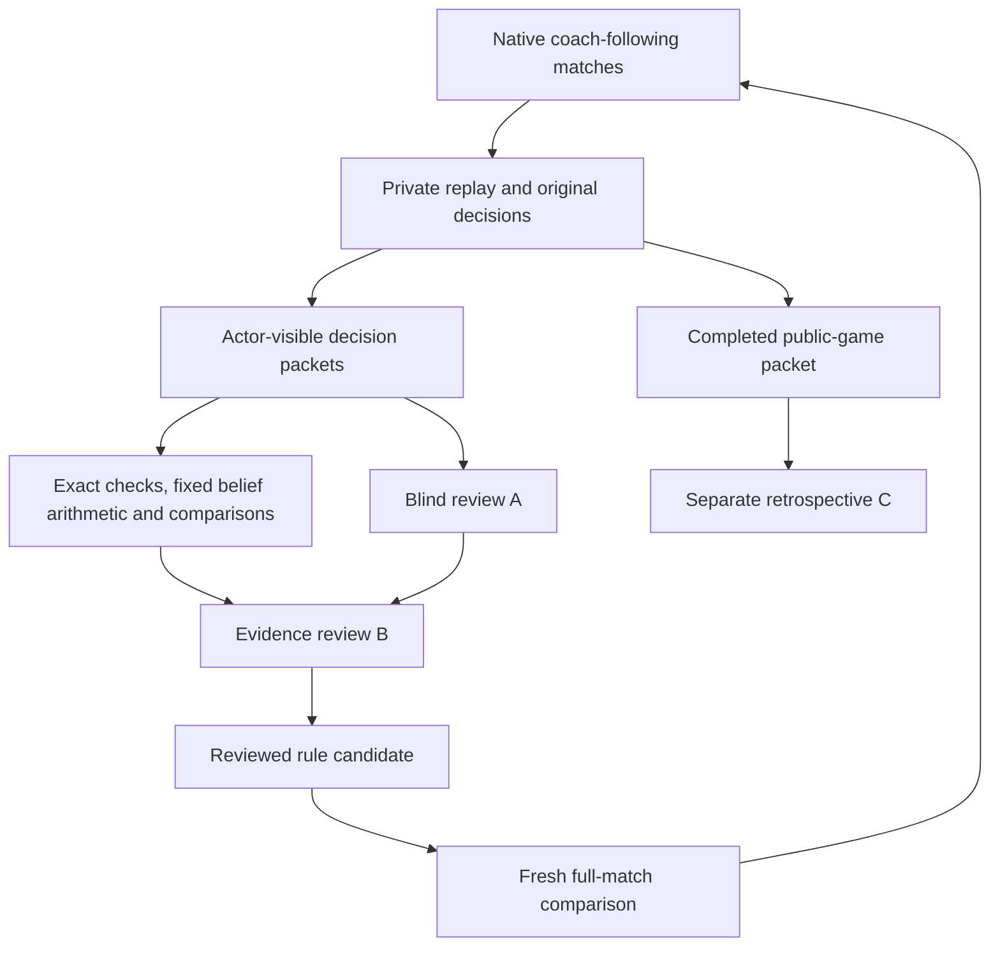

# Coach Feedback Lab Design

**Date:** 7 October 2026. **Status:** proposed design accompanying the owner-requested detailed plan; no implementation, experiments, provider spending, reviewer recruitment or policy promotion performed by this document.

**Implementation plan:** [Coach Feedback Lab](../plans/2026-10-07-coach-feedback-lab.md).

**8 October coaching addition:** action-first tactical advice followed by one complete contextual reason replaces the active beginner-style hint ladder. This is an added design/implementation plan, not a completed product change. The scope and compatibility rules below preserve original saved advice.

**Controlling owner decision:** [CR-STRAT-011 — Deterministic bots and coach feedback lab](../../../planning/decisions/CR-STRAT-011-deterministic-feedback-lab.md). This revision replaces the earlier active model-comparison/routing direction. Historical provider code and records are retained, not represented as audited or removed.

## 1. Purpose and scope

Build an offline, reproducible feedback loop that plays complete games without a browser, records the exact advice each simulated player follows, evaluates decisions from that player's available information, and turns verified failure patterns into small deterministic rule candidates. Use completed game results to explain consequences and measure policies, while keeping them separate from judgments about what a player could know earlier.

The first vertical slice is Spades Partners under the existing rule profile. Its output is an evidence-linked gap tracker, regression cases, trustworthy evaluation reports and, if warranted, a single deterministic candidate rule. Finding no justified change is a valid result. Stronger play and human learning are separate claims requiring their own evidence.

Bots always use deterministic mathematical analysis and code: no AI/learned decision model, runtime model call or model fallback chooses their actions. The current coach shares that analysis and selected action. Offline LLM agents may review evidence and propose investigations; they never control a seat or promote a policy. Runtime strategic/coach-assistance model selection, training, fine-tuning, inference deployment and routing are outside this lab. Selecting and pinning an offline review provider/version is an operational lab task, subject to per-run authorization. Any future runtime model assistance is coach-only and requires a separate project demonstrating incremental value over the then-current deterministic coach. TypeSafe/Jev exploration is removed from active deliverables; no replacement runtime model is selected.

The owner requested research, then a summary, then a detailed plan. That authorizes these planning documents. It does not authorize product implementation, paid inference, changing runtime defaults or contacting reviewers. Prior approvals for unrelated work are not a budget for this experiment.

The lab extends M11/M07/M10 in the [existing multi-game plan](../plans/2026-10-04-multi-game-reasoning-implementation.md) and [evaluation packet](../../../planning/implementation/multi-game/cases-and-evaluation.md). It is not a second authoritative scoring engine, label store or independently competing M11 runner.

## 2. Current foundation and actual gaps

Source inspection was performed on 7 October against checkout HEAD e60cfb2 plus the visible working tree. Concurrent UI changes are outside this plan. This is a source/evidence review, not a new test run.

| Reuse | Current capability | Work still needed |
| --- | --- | --- |
| [BoundSession](../../../server/internal/gamekernel/session.go) and [complete preparation](../../../server/internal/gamekernel/session_execution.go) | Production transitions, actor packets, frozen analysis/advice, sealed actions, chance and round boundaries | Offline complete-match orchestration, explicit seat policy assignment, journals and resumable batches |
| [Document codec](../../../server/internal/records/service_codec.go) | Exact installed policy bindings and retained original decisions | A separately versioned lab adapter: production metadata has one session-wide policy, not a policy map per seat |
| [Partners development harness](../../../server/internal/evaluation/partnerdevelopment/development_test.go) | One-hand paired play, actor packet/hash, selected action, original analysis/advice, activation and unreviewed status | General runner, full matches, independent review stages and larger policy populations |
| [M11 results](../../../qa/implementation/multi-game/m11/status.md) | Recorded 8 families, 16 complete hands, 896 decisions, zero changed choices | These results do not establish full-match value, judge reliability or stronger play |
| [Continuation adapter](../../../server/internal/games/cardcontinuation/adapter.go) and [rollout kernel](../../../server/internal/strategy/rollout/types.go) | Feasible synthetic worlds, complete legal root sets, future actor projections and charged work | Offline configurable policies, more samples, independent screening/validation and a true terminal-match horizon; current horizons are current-round, two-rounds and match-cutoff-two-rounds |
| [Knowledge types](../../../server/internal/strategy/knowledge/knowledge.go), [Spades signals](../../../server/internal/games/spades/reasoning/signals.go) and [constraint sampler](../../../server/internal/games/cardcontinuation/sampler.go) | Separate proof/feasible/soft-weight types, actor chronology, bounded observation-only allocation sampling and partner hints with counterexamples | Joint behavioral likelihood weighting, support/stability diagnostics, closed-run calibration and broader refutation/temporal fixtures; existing hints are not a calibrated posterior |
| [Partner resources](../../../server/internal/games/spades/reasoning/partner_resources.go) and [PI/SP guide](2026-09-29-spades-partnership-reasoning-guide.md) | Experimental public-resource offer/conservation predicates and authored inference/tactic/counterexample structure | Extend existing cases one at a time; preserve experimental pins and distinguish written recipes from activated/validated behavior |
| [Existing manifest validator](../../../web/server/evaluation/multi-game/manifest.ts) | Pinned studies, explicit objectives, sealed confirmation, finite limits and independent-label eligibility | Native runner interchange, reservation/resume, detailed lab settings and reporting; planned run.ts/report.ts are not yet implemented |
| [Existing blind review](../../../web/server/evaluation/spades-pack/review.ts) and [label adapter](../../../web/server/evaluation/multi-game/research.ts) | Actor-only cases, acceptable sets, immutable human-label provenance | Separate model-review schemas, exposure controls, calibrated rubric and adjudication |

The installed two-world continuation default and the UI's short alternative trial are not quality graders. Preserve their current behavior; research budgets and new horizons require an explicit offline configuration.

### 2.1 Six-variant phase coverage and prerequisites

Each row gets its own module adapter, objectives, traces, review rubric and complete-session acceptance. The [game packets](../../../planning/implementation/multi-game/game-packets.md) and selected rule records govern engine prerequisites; the lab cannot invent missing transitions or certify a future engine from this table.

| Variant and rollout order | Decisions/phases the lab must cover | Prerequisite and completion semantics |
| --- | --- | --- |
| 1. Spades Partners | Individual bids including Nil; card play; team contract/Nil/bag context; teammate inference and transfer plans | Existing frozen rule profile and native module; full team match, existing tie/continuation semantics; one evaluated seat first, both-teammate deployment separate |
| 2. Spades Solo | Bids/Nil and card play against three opponents; individual score pressure | Explicit Solo module/objective; no partner beliefs, shared contracts or teammate help; separate full-match result |
| 3. Hearts | Pass selection, atomic sealed passing, card play, heart/queen restrictions, moon choice where the selected profile exposes it | Existing Hearts rules/capabilities; every simultaneous decision prepared before reveal; individual full-match scoring and selected terminal/tie behavior |
| 4. Tarneeb Partners | Auction raise/pass, permanent auction withdrawal, trump selection, card play, all-pass redeal and scoring | M08 native engine plus frozen first-leader, all-pass/dealer, scoring/target and tie choices. Counterclockwise play; no Spades Nil/bags/broken-trump rules. No invented Tarneeb Solo |
| 5. Trix Solo | Kingdom request choice, selected doubling/decline windows, penalty trick play, Jack-centered layout placement/pass, finish order and new-deal progression | M09 native correctness remains pending. [Owner-confirmed rules](../../rules/trix.md) resolve TRX-D01/D02: public subset declarations, self-capture credit to current/prior external leader or no bonus. Preserve/reset public giver history; withheld bonuses change Solo totals. Four kingdoms times five requests = 20 fresh deals; individual objective; layout passes are adjacency constraints, not suit voids |
| 6. Trix Complex Partners | Kingdom choice between combined penalties/layout, required doubling/decline, additive penalty capture, layout blocking/teammate finish, progression | Separate M09 module and full phase coverage remain required. [Owner-confirmed rules](../../rules/trix.md) resolve TRX-D01/D02: direct bonus to the team opposite the capturer even on teammate capture; combine member-seat entries and team credits once. Four kingdoms times two requests = 8 fresh deals; distinct team objective |

The selected 20/8 Trix deal schedules are match rules, not experiment sample counts. Preserve the chosen 7♥ first-kingdom owner, request pool and fresh-deal boundaries, with ownership moving right only when that kingdom is exhausted. Rule omissions block the corresponding future engine/adapter work; they do not block current-game lab mechanics. No future catalog exposure or runtime rule approval is implied.

## 3. Global constraints

- Use the native Go game/session engine for authoritative lab play; do not implement another scorer or legality engine.
- Policies and decision-time judges receive only the acting seat's permitted information; full state and deal seeds stay private.
- Bots permanently use deterministic math/code only; the current coach shares that system. No runtime AI/learned model, provider call or model fallback may select their actions.
- Every simulated action must equal its saved original coach recommendation. A declared deterministic baseline on optional-analysis failure must already be part of that original preparation; an invalid recommendation stops the trajectory without a substitute move.
- Every suggestion gets an immutable decision record and audit status; unreviewed and uncertain are different states.
- Code owns legality, arithmetic, trick resolution, forced status and terminal results; model output is untrusted evidence.
- Decision quality, explanation quality, realized outcomes and human learning are separate measurements.
- New coach output has two layers: a direct tactical cue, then one Why action revealing its complete material reason from the same frozen decision. Legality-only reminders and unexplained low-card preferences do not satisfy strategic coaching.
- Preserve historical advice, frozen policies, source archives, human submissions and consumed experiment identities.
- Keep Hearts, Spades Solo, Spades Partners, Tarneeb Partners, Trix Solo and Trix Complex Partners objectives, results, phases and acceptance gates separate.
- Offline LLM reviewers receive actor-safe evidence and supply proposals only; their provider/version selection is operationally in scope. Runtime model selection/training/integration/routing is deferred to a separate future coach-only project; no Jev exploration belongs to this lab.
- Deterministic likelihood tables, parameters and bounded search are inspectable versioned code, not trained runtime artifacts; no automatic learning or mutation occurs during play.
- Same permitted observation, policy version and fixed work budget reproduce the same analysis and action. Actual deal seeds, hidden state, wall-clock cutoffs and machine-dependent partial search must not choose a move.
- Paid offline judge dispatch is disabled by default with an authorized USD cap of zero.
- Each owned test or batch invocation must finish or checkpoint within 20 minutes, below the existing 30-minute ceiling.
- New lab evidence does not bypass existing strength, human-label, applicable offline-review readiness or owner-promotion requirements.

## 4. Architecture and execution boundaries

Use one thin TypeScript coordinator at the already planned multi-game run.ts/report.ts paths, one Go coachlab worker, and immutable versioned artifacts. TypeScript owns study freezing, run reservation, job accounting and review orchestration. Go owns game execution, replay, exact game facts and simulation. Neither component requires a browser.

Retrospectives can suggest investigation topics, but their future information cannot supply an earlier decision's label or runtime analysis features. A separate private closed-run truth scorer may assess frozen card-location predictions after a trajectory closes; its output is aggregate calibration evidence, never a decision-time packet or a best-move label.

Bulk simulation uses private files and the existing engine/codec in memory; PostgreSQL is not in the per-action loop. Start with an exclusive local run directory and append-only journal for one-machine execution. A PostgreSQL run/job index may be added when concurrent workers or a shared review queue justify it; it is not a prerequisite for the first pilot. Parquet/DuckDB are optional derived analytics, not the canonical archive.

The private canonical RunEnvelope wraps the existing EvaluationManifest unchanged and adds lab-specific settings. Its base families[].seed values retain their original literal-seed meaning. Define its interchange shape in a versioned JSON Schema, with identical accepted/rejected conformance fixtures for Go and TypeScript. Native validation must not trust an arbitrary caller's assertion that a manifest was approved. Do not relax the existing confirmation requirements to admit pending labels.

This unchanged V1 wrapper serves the current three game variants only. Tarneeb/Trix require the explicit later-game branch: multi-game-evaluation-2.0.0 in manifest-v2.ts, coach-lab-run-2.0.0 and version-dispatched StudyDescriptor/native schemas and conformance fixtures. V1 freezeManifest, mode allowlists, literal-seed semantics and historical archives stay unchanged. Each new branch preserves equivalent full-validation receipts, byte commitments, seed custody, reservation/consumption and resume checks; a new game name must not silently broaden V1. Register each later variant only after its rule/module gate is met.

Confirmation uses a separate public StudyDescriptor. A custodian creates and privately freezes the full seed-bearing envelope with the existing freezeManifest checks, then exports only nonsecret study fields, family commitments, the exact private-envelope byte hash and a versioned validation receipt. The coordinator validates this descriptor and reserves the run before the executing process may resolve private material. The restricted resolver then verifies the committed bytes, reruns full validation and supplies the private envelope to Go. Both descriptor and resolved-envelope hashes define resume identity. Never substitute an opaque reference into the old literal seed field. The custodian's generation/validation access is distinct from execution access; log both. If actual access separation is unavailable, report sealing unavailable and do not claim confirmation eligibility.

Production SessionMetadata.Policy stays a single immutable policy pin. The lab has a separate seat assignment map containing exact policy/component/budget pins. Its evaluation adapter binds an allowed deterministic policy for each decision and archives the actual preparation. Baseline and Partners resources can use BoundSession.PrepareComplete's explicit policy argument. Optional installed deterministic executors need an allowlisted lab adapter preserving their exact bindings and proving no learned-model/provider decision path; changing session metadata on every turn is prohibited. Mixed-policy lab archives are not represented as ordinary single-policy production sessions.

Follow native Node.Kind values actor, sealed, automatic, chance, round-complete and session-complete. The rollout adapter's round-end/terminal names belong to a different interface and must not enter this switch. A simulated human controller can follow advice and issue the next-round command inside the lab. This does not change the application's requirement for explicit human next-round confirmation.

For sealed actions, prepare every participating actor from the same pre-resolution state and commit the complete set atomically. Preserve this interface now; exercise it with Hearts when that mode is added.

Deal streams, offline evaluation-world sampling and judge-order randomness use separately versioned streams. Runtime decision sampling, where used, has a fixed observation-derived proposal sequence, work count and tie-break order, not a private engine seed or mutable random stream. Pair arms on the same dealer/deals even when actions or match lengths diverge. Persist later chance material as well as the opening deal.

### 4.1 Fixed work, failure and performance

Every runtime analysis version pins proposal count, expansion/continuation limits, arithmetic ordering and tie breaks. Proposed added-compute targets are p95 <= 50 ms and p99 <= 100 ms on a recorded reference machine and representative observation corpus, relative to the pinned baseline. These are unmeasured engineering targets, not an approved product SLA. Record cold/warm conditions, runtime/compiler, hardware, work counts and correctness parity. If targets fail, revise the algorithm or fixed budget as a new version and rerun validation; never trade reproducibility for an elapsed-time-dependent partial answer.

A watchdog may abort preparation and record an infrastructure failure; it may not promote whichever partial candidate happened to finish. An optional analysis returning a deterministic status such as insufficient support or its fixed work limit may select the policy's predeclared baseline inside preparation, with the status and baseline action archived in the original recommendation. The runner follows that saved action. Malformed, illegal, missing or mismatched saved recommendations fail the trajectory; the runner cannot repair them with a convenient legal card. If the whole preparation times out, checkpoint/retry the identical work or record failure rather than selecting a different move by machine speed.

### 4.2 Action-first coaching with one-step reasons

**Owner direction, 8 October:** coach players who know the rules. The first visible coaching layer gives the recommended move immediately and, where concise, its tactical purpose. One `Why?` activation or supported reason request reveals the full material explanation. Do not require Notice -> Consider -> Suggestion, repeated hint clicks, essential tooltips, an extra expansion or another request to discover the recommendation or its reason. This does not introduce a voice/chat runtime, automatically play a card, alter access rules or force a coach popup every turn.

| Layer | Content and behavior | Does not qualify |
| --- | --- | --- |
| 1: recommendation | The selected card(s), bid or other legal action, plus a short actionable cue: what to do and the supported tactical purpose. Prefer one short sentence and match the highlighted action. | Follow suit; play the lowest card; avoid points; watch your partner, without a supported situation-specific purpose |
| 2: Why | One compact explanation connecting the relevant known facts or conditional estimates to the intended consequence, with the material tradeoff/alternative and limitation. Show all essential rationale at once; readable wrapping/scrolling is allowed. | Restating the cue, a generic rules lesson, listing unrelated history, invented certainty, a hidden-card claim or another hint level |

One reason should answer: **why this move helps the player's individual or team objective here**. Consider the actor's own hand, current trick and remaining actors, relevant previous tricks/public history, permitted passed-card knowledge, bids/contracts, remaining targets and match score. Include only context that materially supports this choice; do not pad every reason with the last trick or score when irrelevant. Exact card counts and arithmetic come from code. Estimates name their assumption in plain language. A reason must explain the actual selection trace, not attach a plausible story after the card was chosen.

**Illustrative Hearts fixture requirement, not a validated current-engine receipt:** normal penalty avoidance, actor is last, the trick contains J♣, Q♠ and K♣, and the actor's only clubs are 3♣ and A♣. Build a complete legal deal proving the Q♠ discarder was void in clubs before accepting this fixture.

- Recommendation: **Play 3♣—avoid taking the queen's 13 points.**
- Why: **K♣ is winning and you are last to play. Your 3♣ stays below it, leaving Q♠ with that opponent; A♣ would win the trick and take its 13 points.**

This explains a low-card choice through a concrete consequence. A changed-context sibling, such as a supported moon attempt, requires reevaluation and must not reuse that purpose blindly. Another family must demonstrate a decision where match score or earlier history changes the preferred action or risk, so the renderer is not limited to current-trick facts. In partnership play, a cue such as **Lead diamonds—give partner a chance to trump** requires supporting void/trump/seat-order analysis; its reason must disclose a merely probable void and material overruff/Nil risk. It cannot promise a teammate winner from a guess.

**Exceptions must remain honest.** Normal game controls enforce follow-suit and other legality; they are not the main coach recommendation. When only one legal action exists, use a quiet only-option status instead of fabricated strategic praise. An explicitly requested Why may explain that constraint and any supported consequence without starting a beginner lesson. When analysis supports several reasonable choices or no clear preference, say so; stable tie-breaking cannot create a unique tactical advantage. If the selected move has no supported tactical reason, retain the actual deterministic choice for execution, expose the insufficient-reason status and record a coaching gap. Do not disguise the gap with generic text or switch to a different move merely because it is easier to explain. Counterexamples determine whether the repair belongs in the action policy, the explanation or both.

**One frozen source for both layers.** Prepare recommendation, complete reason, typed supporting claims/event references, material alternative/tradeoff and limitations from the same permitted observation and original deterministic analysis. Save them together with decision/revision, policy/cue/presentation versions and hashes before revealing or committing. Opening Why reveals saved content; it cannot rerun the policy, consult a model or incorporate subsequent cards/scores. Live responses require current decision identity; historical review displays the original position's reason and never pretends it is current advice. Retries and reloads preserve these bytes.

The public contract uses a new explicitly versioned two-layer advice branch, rather than reinterpreting stored `requestedLevel: 1|2|3` and original three-projection envelopes. Proposed `CoachMessage` content: `decisionId`, `presentationVersion`, `status` (`tactical`, `only-option`, `no-clear-preference`, `insufficient-reason`), selected action, short cue, reason with optional material alternative/limitation, and actor-safe typed evidence references. The corresponding private archive retains the exact analysis/cue hashes. Original legacy records remain readable and clearly identified through their existing validator/projection branch; missing legacy evidence must not be regenerated under the latest coach. New output is authored deterministic content, not runtime prose generation.

Keep recommendation and reason exposure events separate, bound to the same decision. Reopening Why must not consume another game action, repeat a paid coach-unit unlock, request a third hint or duplicate a first-exposure record. A headless test can inspect both layers without manufacturing a human-view event. Reading metrics and preferences can inform usability; they do not prove decision strength, comprehension or unaided learning.

**Lab acceptance includes each layer.** Code audits claim references, arithmetic, chronology, selected-action identity and both saved payloads; fixture-based client checks verify one-step disclosure. Offline review evaluates the cue alone for directness and honesty, then the cue with its reason for contextual relevance, causal support, material alternatives and uncertainty. A strong expanded reason cannot excuse a misleading cue, and brevity alone is not a cue defect when its detail belongs behind Why. The blind decision judge still sees neither the selected recommendation nor its reason; explanation review occurs only in the designated evidence stage. Store `pass`, `fail`, `uncertain` or `not-applicable` assessments by dimension and provenance, with cited failures. These are separate from action quality and game outcomes.

Required regression families: generic follow-suit text despite a meaningful choice; low-card advice with and without a tactical basis; high-card and low-card context reversals; previous-history/score-sensitive choices; proven versus probable partner void; overtaking/overruff/Nil harm; only-option and unresolved ties; factually correct but irrelevant reasons; correct action with a false purpose; original cue/Why mismatches after new events/resume; and more than one reveal needed to reach the complete reason. Every generated recommendation gets an original reason artifact or explicit gap status, even if no player asks Why.

## 5. Data contract and privacy partitions

Store the following logical records. Schemas reject unknown fields, invalid enums, duplicate identities and unknown version references; corrections are new records referencing their predecessors.

| Record | Required content |
| --- | --- |
| Run | Run ID, purpose, original family membership, private seed references/commitments, module/rule/policy/source hashes, seat/environment maps, objective/horizon, limits, stopping/missing-run rules and authorization references |
| Decision | Episode/arm/actor/revision, permitted packet and hash, complete legal candidate IDs, exact original recommendation and committed action, analysis/advice bytes and hashes, applied/excluded rule IDs, forced flag and execution status |
| Coach presentation | Same decision/revision and selected action, presentation/cue versions, status, original cue and complete reason, actor-safe typed support, material tradeoff/alternative/limitation, hashes and independent cue/reason audit dimensions; legacy versus new projection identity |
| Advice exposure | Decision/presentation identity, recommendation shown or reason opened, first exposure and deduplicated retry/reopen status; real UI exposure is distinct from headless content inspection |
| Evaluation | Decision reference, tested and untested actions, model assumptions, sampler/continuation/objective/horizon versions, independent sample streams, paired values/intervals, work/coverage/cutoff status and any assumptions that reverse the ranking |
| Belief analysis | Observation/version/work identity, hard constraints and their evidence, feasible-allocation support, handwritten behavior assumptions, likelihood settings, marginal estimates, ESS/stability diagnostics, retained counterworlds, expiry/refutation and declared baseline status |
| Model review | Stage, opaque case ID, input/prompt/rubric/model hashes, candidate order, acceptable set, proposed verdict, concise evidence-linked reasons, validation status, token/cost/latency and failure/abstention |
| Human review/adjudication | Reviewer qualification/provenance, exposure record, original independent acceptable set, reasons, disputed/unknown status and later adjudication; existing human schema eligibility stays authoritative |
| Candidate rule | Observed failure family, observable trigger/exceptions, proposed action/cue, evidence references, version/hash, affected modes, negative fixtures and evaluation receipts |
| Gap and regression index | Existing PI/SP/case references, reproduced symptom, exact/conditional claim, missing evidence, owner/status, candidate or no-change resolution, fixture hashes and report links |

Decision-quality values are supported, inferior, uncertain and not-applicable. The engine-derived forced flag is independent; the report renders only-option when one legal action existed and excludes it from strategic-choice accuracy. Pending records have no verdict. Workflow status is pending, completed, abstained, disputed or failed. Explanation quality is separately verified, partially-checkable, unsupported, false or not-reviewed. A false explanation does not automatically prove that the selected card is strategically inferior.

Evidence provenance is explicit: exact-engine-fact, validated-small-position-proof, model-dependent-simulation, llm-proposal, independent-human or adjudicated. Neither llm-proposal nor simulation automatically becomes independent-human.

Private replay storage contains full state, commands, chance material and hidden hashes. Judge export builds a new object by allowlisting; it never serializes a private record and deletes a few fields. Model tools have no filesystem/archive browsing. Do not send usernames, account IDs, seeds, private hashes, policy-identifying metadata, other-seat observations or private memory. A case ID is an opaque identifier unrelated to hidden data.

A full-game retrospective may receive the completed public chronology plus the selected actor's permitted history. It does not receive the authoritative aggregate or other actors' private packets. Its output is isolated from decision-time analysis and labels. Future public reveals remain future information even when their eventual values are obvious from the completed game. Private truth-scoring permissions are a separate closed-run capability, unavailable to LLM review or runtime policy code.

Store model input/response artifacts only in the research archive with recorded retention settings; redact credentials and personal fields. Record any future human-data consent/retention separately. Initial data is synthetic game play.

## 6. Decision evaluation protocol

### 6.1 Deterministic audit of every suggestion

Verify replay identity, pre-action revision, actor, complete legal set, selected/committed action equality, forced status and exact fact claims. Independently recompute supported claim types from the actor packet/public chronology instead of calling the same fact builder that produced the claim. Missing typed claims are partially-checkable, not automatically false or verified. Illegal actions and corrupted replay are integrity failures, not ordinary strategy labels.

For the new advice branch, independently audit both cue and reason against the same saved analysis and permitted chronology. A claim may be true but irrelevant to the selected move; code can validate its factual premise while offline/expert review assesses its causal relevance. Missing strategy support receives an explicit gap, not a fabricated reason or a passed completeness label. Forced statuses and unsupported ties are excluded from unique-choice accuracy and still checked for honest wording.

### 6.2 Deterministic partnership inference and probabilities

Implement existing [PI-01–PI-08](../../../planning/decisions/CR-STRAT-007-partnership-inference-guide.md) and [SP-* subcases](2026-09-29-spades-partnership-reasoning-guide.md), rather than creating another strategic taxonomy. PI-01 owns hard deductions, PI-02 conditional evidence, PI-03 competing plans, PI-04 fixture/cue traceability, PI-05 shared bot/coach analysis, PI-06 game ownership, PI-07 information-faithful continuation and PI-08 honest evidence claims. Map the diamond examples principally to SP-L02/L06, SP-H02/H07/H08, SP-W01/W06, SP-T01–04 and applicable Nil subcases. Preserve original meanings and inactive/unreviewed status.

#### Worked example and temporal boundary

The completed order is right opponent J♦, actor A♦, left opponent 6♦, partner Q♦. Actor selected A♦ before 6♦ and Q♦ were public: its original decision review cannot see those later cards. Partner's fourth-seat packet contains J♦, A♦ and 6♦. Only after Q♦ resolves can actor use the completed trick for a later decision. Preserve separate packet/revision identities.

Actor wins this all-diamond trick. Partner followed suit, so Q♦ alone proves neither prior nor remaining diamond void. For a normal partner whose team needs tricks, Q♦ under a secure partner A♦ supports no-lower-diamond only under a preserve-useful-honors assumption. Retain Q alone, QK, Q plus lower diamonds, unblocking, bag avoidance, unknown conventions and mistakes. Personal trick totals do not replace the combined contract objective.

For a Nil partner, Q♦ can weakly support no K♦ under a highest-safe-discard convention. This is not a law of good play: with Q♦K♦, discarding either under A♦ leaves the other as the highest outstanding diamond, so the card-taking consequence can be equivalent. A different tie-break can select Q♦ without a mistake. Distinguish an actually known fixed policy from a general assumption about unfamiliar players.

Before locating K♦, check actor ownership and earlier public play. If unseen, right may hold K♦J♦ and led J♦ before seeing A♦; right did not decline a later chance to discard K♦. Left may conserve K♦ while following 6♦ under A♦. Partner may retain K♦ under equivalent-honor or other behavior. Thus Q♦ does not prove K♦ on the left, and even a probability preference needs the full prior/history and declared assumptions. Do not combine the normal-partner no-lower hypothesis with a Nil-specific no-K hypothesis as though both apply to one objective.

A later diamond return needs its own plan: partner may still have diamonds, lack trump, lose to an earlier trump or be overruffed. After actor wins and leads, order is actor, left, partner, right; right acts after partner. A Nil partner may need a safe discard rather than a winning ruff. Explain the conditional route and failure conditions, not a promised partner trick.

#### Joint allocations and handwritten likelihoods

Let D be a complete candidate allocation at the saved actor-visible prefix. Hard feasibility enforces actor cards, every played card, single ownership, remaining capacities, module-specific disclosures and proven follow-suit voids. Reconstruct historical hands by reversing known play within that candidate. Void persistence belongs to the current no-draw deal; new deals reset it. Incomplete or inconsistent history creates no certainty. Independent card marginals are not a substitute for legal joint allocations.

For another player j at historical decision t, I(j,t,D) contains their hypothesized own cards and only public information available then. A handwritten behavior hypothesis theta returns a nonempty preferred subset C(theta,I) of legal actions L(I). For legal action a, with fixed 0 < epsilon(theta) < 1:

    likelihood(theta,a,I) = (1 - epsilon(theta)) * indicator(a in C(theta,I)) / size(C(theta,I))
                            + epsilon(theta) / size(L(I))
    weight(D) ∝ indicator(hardFeasible(D)) * prior(D)
                * product_over_other_players_j(
                    sum_over_theta(priorBehavior(j,theta)
                      * product_over_t_where_j_acts(likelihood(theta,a[t],I(j,t,D)))))

Hypotheses, priors, error allowances, preferred-set rules and arithmetic conventions are explicit versioned code. This is deterministic uncertainty arithmetic, not a learned runtime model. Sum over hypotheses outside each player's history product so one behavior hypothesis persists across that history. Equivalent safe honors may share the preferred set. Behavioral likelihoods remain positive for legal alternatives: only exact constraints remove a possible holding.

Constraint-only means a constant likelihood of 1 across all hard-feasible allocations: ignore behavioral preferences. Uniform-random legal choice, 1 / size(L(I)), is a distinct named behavior assumption, not neutral evidence; C = L likewise describes uniform choice. For example, a Q-only hand gives probability 1 to playing Q, while QK gives probability 1/2 under uniform choice. Add a fixture where constraint-only retains prior relative mass but uniform behavior changes it. If a cue is unknown or inapplicable, disable its likelihood factor for all worlds for that event according to public applicability; never selectively omit an inconvenient likelihood only in particular worlds.

Use a dealing prior consistent with actor-known facts, then include each other-player action once. Own actions are interventions, not independent evidence about hidden cards. Do not condition a prior on a bid/play and count it again as new likelihood, or multiply several correlated cues derived from one action. Nil is an objective/context fact, not proof of a Nil-shaped hand. Any bidding likelihood has its own explicit version and single evidence path.

Normalize log weights and derive card-location, suit-length and joint-event estimates from complete allocations. Keep exact bounds separate. Sampled absence, zero sampled owner frequency or rounding to one never becomes a proof. Exact absence needs a constraint proof or exhaustive feasible coverage independent of behavioral preferences. Retain reachable counterworlds for conditional absence claims when feasible; record a proof when hard constraints actually exclude them.

Use exact enumeration for small positions. Otherwise use a fixed-count proposal/order scheme derived solely from canonical permitted observation and policy/sampler/work versions, preserving capacities and accounting for proposal weights when needed. Never seed from the real deal, a private-state hash, run ID or wall clock. Charge setup, rejection and reconstruction as well as accepted worlds; sparse feasible sets cannot trigger unbounded retries.

Record ESS = 1 / sum(normalizedWeight squared), proposal/accepted counts, support coverage, work truncation and stability across prespecified offline proposal streams and plausible fixed behavior assumptions. ESS cannot validate a wrong belief model. Low support, concentrated weights or unstable conclusions return a deterministic insufficient/unstable status and the declared baseline inside original preparation. Preserve hard-constraint-only allocations as an audit control; tiny weights do not remove legal possibilities. Thresholds are prespecified and validated, not claimed calibrated by construction.

#### Counterexamples and closed-run calibration

Fixture families cover Q alone/QK/Q plus low; normal/Nil; highest-safe/equivalent-honor tie-breaks; K owned/already played/right with J/left with 6/partner; forced/optional play; earlier/final position; existing trump; unblocking/bags; unknown behavior; later refutation; no-trump/overruff/Nil returns; duplicated clues; incomplete chronology; fresh-deal resets; and identical permitted observations under different private worlds. Link positive, negative and changed-context siblings to existing SP-* cases and PI requirements.

A separate private scorer may compare frozen card/length predictions with concealed truth only after the run closes. Report Brier/log scores, reliability bins, false near-certainties, joint-event accuracy, support failures and family-level uncertainty. Its truth access never reaches a selector or actor-only reviewer. Accurate card prediction does not establish a best move. No automatic parameter update follows calibration: numerical revisions are inspectable candidates under the same gates as rules.

Hold out both deal families and unfamiliar fixed player policies. Ablate hard constraints only, one behavior assumption, conservative hypothesis mixture, and mixture plus the downstream tactic. Measure inference quality, action changes, cue factuality and paired full-match outcomes separately. Include random routine cases alongside authored counterexamples and test legal mistakes/policy mismatch. Freeze parameters before audit/confirmation; no online learning, neural artifact or provider dependency enters runtime.

### 6.3 Two different alternative comparisons

Actual-deal replay is retrospective sensitivity analysis: replay a different legal action in the recorded deal with all later actors reselecting from their own views. It is never used to label decision-time optimality.

Information-set evaluation samples plausible worlds using only the saved actor packet, then plays alternatives under frozen observation-restricted continuation policies. Compare actions on common worlds. Uniform feasible worlds are a declared baseline belief, not a guaranteed posterior. For high-impact proposals, rerun with a separately pinned plausible belief assumption and a different continuation population. More samples only reduce sampling noise.

The proposed discovery profile screens the complete legal set with 32 common worlds, then compares the played action with up to three selected alternatives on 128 fresh worlds. Retain all screened and unconfirmed actions in coverage. Use simultaneous paired confidence intervals with Bonferroni familywise alpha 0.05 over the actually confirmed comparisons. Do not call an action uniquely best when alternatives were not confirmed. These intervals are conditional on the evaluator and are not promotion evidence or domain-truth confidence.

Sample budgets are proposed operational settings, benchmarked before broad use. Cap every decision by charged steps, memory, sampler/setup work and wall time; retain incomplete coverage and mark the result uncertain. No sample extension after inspecting significance. A higher-budget analysis is a new declared version with its selection history retained. A practical-effect threshold is supplied in that analysis's units before a meaningful-improvement label is permitted; no universal points-to-win-rate conversion exists.

Use the module's declared utility. Current-round score comparisons remain round diagnostics. Full-match policy acceptance uses terminal outcomes. Extend the offline continuation adapter with a true terminal-match horizon and explicit continuation pins before presenting its estimates as match-level. Partial match cutoffs retain their heuristic label. Do not sum one-move estimated losses to claim they explain the final match loss.

No full-deal solver may make concealed-information-dependent decisions and supply an actor-safe answer key. Exact late-game reference labels require explicit feasible-world coverage and consistent actions at indistinguishable future information sets; otherwise retain approximate/unknown provenance.

### 6.4 Three isolated offline LLM stages

| Stage | Inputs | Required output and restriction |
| --- | --- | --- |
| A: blind decision view | Exact rule profile, actor's own permitted information, all public history through the decision, complete shuffled legal set | Acceptable alternatives, relevant facts and uncertainty; no selected recommendation, cue, policy, later events, results or other review labels |
| B: evidence review | Frozen A output, original chosen action and cue with identity metadata removed, verified facts and information-set evaluation | Proposed action and explanation assessments with event/evaluation references; preserve A and disclose any correction; still no later actual events |
| C: retrospective | Completed public history, actual result, frozen earlier review references and clearly labeled actual-deal branches | Explain realized consequences and later partner/opponent decisions; cannot overwrite A/B or create decision-time analysis features |

Each stage has a fresh request context and an explicit input schema. The judge cannot request additional unapproved tools/data. Structured claims must distinguish exact facts from hypotheses and cite allowed event/evaluation IDs; unavailable references, unsubmitted actions and numerical claims inconsistent with their cited records fail validation. This is not a complete semantic truth detector for free text: uncross-checkable prose remains an unverified model proposal for review. Unsupported strategic reasoning can abstain. Narrative reasons are concise evidence summaries, not a request for private chain-of-thought.

Within stage B, freeze a cue-only directness/factuality assessment before exposing the complete original reason to the explanation assessment. Both use decision-time evidence only. Record strategic-purpose support, contextual relevance, action fidelity, uncertainty wording and disclosure completeness separately; a second-stage justification does not erase a first-layer defect. The two product layers are not two new blind strategic votes.

Use a versioned principle catalog with rule-profile applicability, observable preconditions, exceptions and primary-source or reviewer provenance. Rules are authoritative for legality; principles remain hypotheses where strategic evidence is absent.

Run the hidden-world-swap test, candidate-order reversal and fluent-wrong/terse-correct explanation cases. Identical stage-A inputs must remain byte-identical under changed private worlds; cached outputs must stay identical. Fresh model repeats are assessed for stochastic/order sensitivity, not required to be perfectly identical.

Judge all unforced decisions in the preselected initial review block, including routine moves. Every forced move still gets fact/explanation audit. Later selective review records inclusion reason/probability and retains a random audit sample; unreviewed strategic decisions stay explicit. No model judge is presumed competent merely because it agrees with another model.

An optional independent LLM critic may review the same actor-safe A/B evidence under a fresh context, without the first judge's labels before its own submission freezes. Its purpose is to expose missing counterexamples and disagreements. Persist both original submissions and an evidence-linked disagreement report; majority agreement is not strategic truth and disagreement is not resolved by another unsupported vote. Any later reconciliation cites independent facts, proof, simulations and eligible human review. Critic calls require the same explicit per-run authorization and durable accounting as other paid offline review.

## 7. Experiments, data splits and inference

Assign the original match/deal-stream family before generating decisions. Keep rotations, paired arms, counterfactual branches, mode twins, derived fixtures and duplicate actor packets together. Authored tactical data and naturally sampled data have separate reports. Matching hidden-world variations do not become independent games.

Use four logical partitions: development; judge calibration-fit; judge calibration-audit; validation. A later sealed confirmation partition is created only for a frozen study. Existing legacy records remain discovery/regression and are never retroactively sealed. In the existing base manifest, all non-confirming partitions remain discovery; the lab extension records the finer roles without weakening base validation.

Recommended operational progression, not a power calculation:

1. Mechanical smoke: two deterministic fresh stream families, baseline-only, complete matches and deliberate interruption/replay. Zero paid calls.
2. Review cost block: one preselected development family, two paired complete matches, one candidate seat; audit all decisions and queue all distinct unforced packets for A/B, plus C after completion. Export token/work estimates first. Paid execution waits for a concrete budget/model authorization.
3. Discovery pilot: at most eight fresh development families, two arms, one evaluated seat and one frozen environment: 16 matches before any rotations. Process one family per resumable batch. This establishes coverage/cost and may expose defects; it is not strength evidence.
4. Candidate validation: fresh validation families and the frozen candidate; add four seat rotations, at least two opponent populations and unfamiliar partners only after their native policies are available and separately pinned. Both-teammate deployment is a separate arm, not pooled into one-seat results. Select validation size from measured cost and the needed precision before its results are viewed.
5. Confirmation: fresh sealed families, a prespecified useful gain, harm limits, sample/power analysis and multiplicity/stopping rules. A sealed flag alone is insufficient: reserve the run and keep seed material outside developer/reviewer-accessible packets until dispatch. Log seed access and never silently reuse consumed families.

The proposed new full-match estimand is the family-averaged paired difference in evaluated competitor win outcome, averaged over prespecified rotations/environments. Partners uses team winners; the current rule profile continues tied scores at/above 500 rather than awarding a draw. Report score margins, contracts, Nil, bags, action changes, activations and runtime as secondary metrics. For later games, use their explicit module terminal/tie semantics.

Cluster uncertainty by original family, not moves or rotated matches. Freeze analysis and sample size before confirmation. Correct subgroup/multiple-candidate tests or explicitly mark them descriptive. No repeatedly extended testing until a favorable result appears.

Proposed safeguards are 100 rounds, 10,000 committed actions and 20 minutes per process invocation. These are lab resource stops, not new game-ending rules. Checkpoint between safe transitions and resume only identical source/policy/manifest bytes. Record canceled/censored/failed cases and unused chance streams. Never drop an unfinished pair or call its current leader the winner. Report worst/best feasible outcome bounds for missing arms; if they can reverse the decision, the study is inconclusive. Infrastructure defects invalidate the affected batch and need a symmetric documented rerun, with original failures retained.

**Existing gate reconciliation:** CR-STRAT-009 defines a different per-hand, both-teammates gate with its own thresholds and counts. This plan does not transfer those numbers to single-seat full matches or supersede that gate. Before a confirmation can support default promotion, record an owner-approved amendment reconciling the new estimand with the existing gate, or satisfy both applicable protocols independently. Until then, full-match reports are additional evidence and promotion remains ineligible.

## 8. Reviewer calibration, deterministic improvement and concrete outputs

Prepare an initial judge-calibration pilot of 16 fit cases and 16 audit cases from separate original families, with no family crossing partitions. These are proposed workflow counts, not a reliability guarantee. Use two independently qualified reviewers per case, blind original submissions and an adjudicator for disagreement. If reviewers are unavailable, prepare packets and blank submissions; label the judge uncalibrated and continue deterministic development without inventing expertise. Preserve the earlier 32 pending submissions unchanged.

Report supported/inferior class precision/recall, false accusations of inferiority, abstention/coverage, explanation factuality, order sensitivity and family-level uncertainty. Adjust prompts only on fit cases. A small audit supplies diagnostics, not a universal accuracy claim. A threshold for automated reliance requires a separately sized, prespecified domain validation; the first lab keeps model verdicts provisional.

Rank investigation cases by potential consequence, recurrence in natural play, uncertainty/disagreement and missing rule coverage. Always retain random routine controls. A rule candidate must contain a reproduced failure, observable trigger, action preference, exceptions, conflict behavior, cue, positive fixture, harmful/unnecessary counterexamples and unaffected-mode checks. Independently verify its premise before implementation; do not require a policy change if the problem was only a bad explanation or evaluator assumption.

Test the actual deterministic candidate in complete matches after local branch evaluation. A locally useful action does not prove that repeatedly applying the rule improves a policy. After a change, collect newly reached positions and retain earlier regressions. Candidate changes may alter handwritten conditions, explicit numerical assumptions, deterministic conflict handling or authored explanation templates. Each is reviewable and versioned; none is an automatically trained runtime policy. Building a training-dataset project, training trees/neural models, selecting runtime model providers or developing model routing is outside scope. Offline review provider/version configuration remains distinct and in scope.

Every completed discovery iteration emits a concrete outcome package:

1. An indexed gap tracker referencing existing PI/SP/case IDs, reproduced symptoms, assumptions, disputed evidence, affected modes/phases and next required evidence. Distinguish inference, action, explanation, evaluator and infrastructure defects.
2. Reachable positive/negative/changed-context regression fixtures with immutable observation/action/claim receipts and source references. A counterexample can invalidate a claim without proving a replacement move.
3. An all-decisions audit/coverage report, frozen A/B submissions, separate C retrospectives, optional critic disagreement report, original human submissions/adjudications and explicit pending entries.
4. Belief-calibration and behavioral-sensitivity reports from the isolated closed-run scorer, plus separate paired complete-match results, censoring and performance/work measurements.
5. A candidate-rule packet or explicit no-change finding, including trigger, exceptions, conflicting rules, cue, original/candidate versions and gate status. The maintainer report links fixes to evidence without automatically changing defaults.
6. A two-layer coaching report with original cue/reason examples, legality-only and missing-purpose rates, supported/irrelevant/false premises, action-reason mismatches, meaningful context coverage, forced/tied/uncertain handling and one-step disclosure results. Keep automated fact checks, LLM judgments, independent human assessments and actual UI observations distinguishable.

The research archive is an evidence and regression store, not an active model-training pipeline. Historical model experiments remain historical. Future coach-only runtime model selection, training and integration require a separately scoped project; this lab neither chooses a runtime-assistance model nor generates runtime model-comparison/routing deliverables. Pinning an offline judge/critic version and validating its review behavior remains part of this lab.

For paid offline judge/critic work, reserve request identity and maximum authorized accounting before dispatch. Persist input/prompt/model hashes, dispatch state, observed usage/cost and terminal response/failure/unknown status. Resume cannot silently replay an unknown-outcome request or obtain a fresh spending allowance. Retry is a new accounted attempt within the same run cap. With cap zero, produce packet previews, token estimates, fixtures and blank review entries only. No human outreach or paid call follows automatically from completing an evidence package.

## 9. Completion and explicit decisions

| Gate | Evidence needed | Without it |
| --- | --- | --- |
| Lab mechanics ready | Exact advice following, deterministic analysis/action parity, no runtime model/network dependency, legal transitions, replay/resume, no leakage, complete/censored accounting and bounded work | Fix the pipeline; do not interpret strategy results |
| Two-layer coaching ready | Direct supported cue and complete saved reason, both faithful to the same decision; honest exceptions; single Why disclosure; versioned legacy compatibility and exposure accounting | Report the content or delivery gap separately from policy quality; no manufactured strategic rationale |
| Conditional inference usable | Hard/soft separation, feasible counterworlds, closed-run calibration, unfamiliar-policy stress, support/stability and performance diagnostics | Keep hypotheses provisional or use the declared deterministic baseline; no probability/proof claim |
| Reviewed discovery ready | Every pilot decision accounted for, independent facts, explicit review coverage and evidence-linked proposed labels | Report the available evidence and gaps; no fabricated labels |
| Candidate justified | Verified premise, negative cases, independent review/proof appropriate to the claim and frozen candidate | Retain a hypothesis or no-change finding |
| Stronger policy supported | Frozen unseen-family study, declared effects/harm/power, full-match outcomes and robustness guards | Promising, unchanged, regression or inconclusive; no strength claim |
| Default promotion | Existing gate reconciliation, eligible labels and recorded owner promotion decision | Candidate stays experimental |
| Human coaching benefit | Separate comprehension and delayed unaided-transfer study | No human-learning claim |

Once implementation is separately authorized, mechanics, fixtures, packet preparation and reports can proceed without human reviewers or API spending. Concrete decisions before dependent experiments are: offline judge selection and per-run spending limits; reviewer qualification/availability; practical gain/harm and precision targets; validated deterministic policy populations; confirmation protocol and seed custodian; and any default promotion. Model selection for future runtime coaching is deferred, not a pending task in this project. No runtime, sample-size or financial approval is inferred from silence.

## 10. Research basis and limits

Sources were inspected during the preceding research discussion. The architecture and pilot settings above are engineering proposals; these papers do not establish CardFord strength.

- [ISMCTS](https://eprints.whiterose.ac.uk/id/eprint/75048/1/CowlingPowleyWhitehouse2012.pdf): imperfect-information search and determinization/strategy-fusion limitations.
- [Policy Based Inference in Trick-Taking Card Games](https://skatgame.net/mburo/ps/cog2019-policy-based-inference.pdf): joint-configuration weighting from historical action probabilities. Its learned Skat policy and results are not imported; this proposal uses handwritten fixed likelihoods and needs its own evidence.
- [Bayes' Bluff](https://arxiv.org/pdf/1207.1411): separates uncertainty in cards/game dynamics from uncertainty about player behavior. The paper's poker adaptation and performance do not establish Spades calibration; no online policy learning is adopted here.
- [Other-Play](https://proceedings.mlr.press/v119/hu20a.html): self-play conventions can fail with unfamiliar partners; Hanabi evidence motivates, but does not prove, the Spades cross-play requirement.
- [AIVAT](https://arxiv.org/abs/1612.06915): principled variance reduction under stated imperfect-information-game assumptions; not a promised CardFord sample saving.
- [LLM-as-a-judge](https://arxiv.org/abs/2306.05685): judge biases and reasoning limits; chatbot-preference agreement is not card-strategy validation.
- [Bidding in Spades](https://arxiv.org/abs/1912.11323): focused heuristic/supervised-learning combination and bidding comparisons holding play fixed.
- [Bicycle Spades rules](https://bicyclecards.com/how-to-play/spades): follow-suit and trick-winning fundamentals; the installed frozen rule profile remains authoritative for all variant-specific scoring and Nil behavior.
