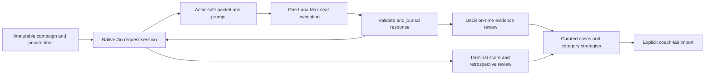

# Trix scenario collection design

**12 October partial-review deadline amendment (TSC-20):** preserve the exact incomplete final-channel stream as raw evidence when the first reviewer attempt reaches its absolute deadline without a completed message or turn. Bind the original prompt, Luna Max host, unchanged context, existing guard, same-turn interruption and local shutdown in a separate immutable proof. Do not repair partial JSON or infer a completed review. Link the preceding player-timeout processor and all its historical proofs before allowing only the original second attempt. Later pauses and the cumulative cap remain effective; future failures require separate inspection. No historical rationale, grade, rule, score or raw bundle is rewritten.

**12 October stopped-player timeout amendment (TSC-19):** separately inspect and bind the exact output-free first player timeout, its clean local host shutdown and own-journal interruption. Preserve the fatal settlement and consumed attempt. Bind the unchanged native frame, actor, revision, legal candidates, prompt, Luna Max host, context and existing shutdown guard before permitting the one remaining attempt. Do not infer a card response, reset the game, alter prior moves, relax historical proofs or automatically approve future timeout/context changes. The original player/reducer and review/raw-export validators remain delegated to their frozen processors. Later pauses and the cumulative two-attempt cap remain effective; selection stays deferred.

**12 October stopped-reviewer timeout amendment (TSC-18):** separately certify the exact locally terminated first attempt with no observed final response, without claiming a cooperative interrupt. Preserve its raw wire, host journal, rejected settlement and consumed attempt. Bind the original prompt, unchanged single-digest context, source and model/effort evidence before allowing the existing second attempt. An additive shutdown guard may prevent writes after shutdown starts while retaining the original adapter and all successful-response inspectors unchanged. Freeze its dispatcher separately; later pauses, uncertain dispatches, future context changes and cumulative two-attempt limits remain effective. No automatic failure admission or selection is introduced.

**12 October saved-player context amendment (TSC-17):** separately inspect and bind the second host-context cutover, limited to removal of one unrelated skill catalog entry and its exact mirror. Recover the existing first declaration final through original receipt, schema, legality and native reducer checks; retain its fatal rejection and consumed attempt. Use an immutable derived evidence view, explicit historical sequence routing, frozen processor delegation and crash-safe exact-response import. No automatic future context approval, fresh model attempt, changed rationale or selection scope is introduced.

**12 October final-game reference classification (TSC-16):** preserve literal model text/grades and distinguish unverified explanation flags from proved alternative-action references. A narrowly audited canonical projection may remove only correctly owned, existing explanation-issue references with no frozen missed-opportunity proof from seat correction lists, retaining them separately in the receipt. All winning-correction proof gates remain strict; aggregate supported references, totals, counts and prose are untouched. Both exhausted calls remain consumed, and the earliest eligible saved review must be reused after immutable zero-call admission. No gameplay or selection scope changes.

**12 October forced-explanation correction (TSC-15):** separate native one-option status from the model's schema-valid explanation-quality label. The review and raw-game admission gates must agree and require an immutable source/journal-bound policy receipt. Preserve both original saved proposals, all historical grades/text and the cumulative two-attempt cap; use the earliest eligible response. Forced actions still have no missed winning alternative and remain ineligible for later strategic selection. A versioned wrapper reuses all remaining original validation and host/context gates without rewriting historical validators or prompts. See the current runbook for the exact zero-call admission and recovery sequence.

**12 October whole-array extension:** the same absent `publicPhaseAndTurn/handCounts` container can also be corrected when a reference addresses the whole existing root array. All other metadata and content gates remain. A predecessor-bound V2 recovery preserves each historical amendment and its source/normalizer pins, verifies both consumed attempts, and reuses the earliest eligible saved response. This extension is a reference correction, not a new context admission, grade change or extra attempt. Actual admission and progress remain separately reported.

**12 October reference recovery:** after the context recovery, collection stopped at 30/52 decision reviews because both attempts for one forced decision were rejected. A separately frozen reference envelope may correct only the nonexistent `publicPhaseAndTurn/handCounts/<seat>` container to the existing actor packet root `handCounts/<seat>`, without changing the seat, prose, grade, hypothesis or proof claim. Full original host/context/content/proof checks remain mandatory, and both attempts stay consumed. The saved second review contains a substantive public card-counting error that the first rejected review identified; preserve it and the disagreement separately. Metadata acceptance is not a judgment that the review is correct. See the current runbook for the exact admission procedure; no third call or selected-case export is authorized by this repair.

> **Superseded operating policy — owner amendment, 11 October 2026:** This design's 90-minute active-segment ceiling, bounded-pilot stop instruction and selection-before-continuation wording describe the original policy only. Current authorization is to finish the planned 160 requests in the same phase order, including the already completed Basic Solo Diamonds request in its 32-request total; retain the 300-second per-invocation limit and two attempts per decision, and review each game before starting the next. Selection/export is deferred and all raw evidence remains retained. See [CR-STRAT-012](../../../planning/decisions/CR-STRAT-012-offline-trix-scenario-collection.md), the [continuation note](../plans/2026-10-11-trix-campaign-continuation.md), and the [current runbook](../../../planning/implementation/coach-lab/trix-scenario-collection/README.md). The recorded 19:23 checkpoint remains historical; the later continuation stopped at one completed game, 26/52 accepted decision reviews and zero game reviews after an interrupted MCP startup timeout. Narrow recovery is implemented; zero-call frozen recovery admission is pending.

**Prepared:** 10 October 2026. **Snapshot:** 11 October 2026, 19:23 UTC. **Status:** one real Basic Solo Diamonds request and 24 decision reviews are accepted; the review worker is stopped. Game reviews and selected cases are zero; the four-request pilot is incomplete. See the [current runbook](../../../planning/implementation/coach-lab/trix-scenario-collection/README.md) and [evidence ledger](../../../qa/evaluation/coach-lab/trix-scenario-collection.md).

## Clean checkpoint — 11 October 2026, 19:23 UTC

Run `trix-luna-20261011-pilot` has one complete Basic Solo Diamonds request: 52 first-attempt accepted plays, 13 native tricks, scores South −30, West −30, North −10 and East −60. **24 of 52 decision reviews are accepted; game reviews and selected cases are zero.** The four-request pilot remains incomplete. Next work is the remaining 28 decision reviews, one game review, then the other three pilot requests.

The pause was appended at `2026-10-11T19:22:40.531Z`; the final in-flight review was accepted at `19:22:41.963Z`. Worker `90551` exited with code 0 and stop reason `paused`, reporting 24 imported reviews and 23 dispatched calls (one historical review recovered). All 25 review claims are settled, with zero unresolved claims. `activeWorker` is null and `driver.lock` is absent. All 52 player attempts were accepted. All 77 actual invocation receipts (52 player + 25 review) report `stoppedVerified: true`, with zero unverified stops. The run is paused with no active worker or outstanding dispatch.

The first two review attempts had invalid echoed `packetHash` metadata. Both literal proposals/response bytes and rejection receipts remain retained; the two-attempt cap was preserved with no third call for that review. The host-verified normalizer changes only the accepted review's `packetHash` to the immutable job value and audits raw bytes/proposal, host evidence and processing source. Reasoning, grading, evidence and proof claims remain unchanged by normalization and undergo ordinary validation. Saved attempts are considered chronologically; the first usable verified envelope is selected without choosing a preferred rationale.

The reviews-only processor started at 18:48:04 UTC and stopped before the original deadline `2026-10-11T19:29:40.108Z` (segment start `17:59:40.108Z`). No new segment or deadline extension occurred. The baseline remains paused; any later continuation requires explicit owner authorization and the documented host-evidence gates.

Original player source digest: `13bba042d15995c9640aeb8d82a5a7cd7e88a62b61119eaa2aea76ce51570030`. Separately frozen review processor: `ec1fb8be5722bd5b3a7776dba64cac0f2b3cfd0dabdab1987b05044ec13fe617`. Original native binary: `0ed25c6d0535f9eff50044d6f743c0ae7ecf291fb86adf4d7823813d6402ad3b`. These original archives/pins remain unchanged. The full gate passed native/build/schema checks and 180/180 combined checks; the final focused worker/envelope suite passed 41/41, with no remaining independent-review findings. This verifies implementation mechanics, not playing strength or corpus coverage.

A separate derived export succeeded at `exports/5d1453f64934d24c55bde691` with zero cases, original-native replay/compatibility and selection-source digest `20ee5f1d124d041f08f06b22e928b394e5dcb1a8dfa8770f93e1fa4ffebf198c`; selection-audit journal sequence is 398. The original frozen external-case reader accepted this export with zero cases, strategies and game findings. Derived native replay passed `basic-solo-1` with 13 tricks. Selected-case shortfalls remain Basic Solo 200, Complex Solo 200, Basic Partners 200 and Complex Partners 400. A zero-case publication does not establish complete reviews or coverage.

## Purpose

Collect useful Trix decisions, the acting player's concise explanation of alternatives and uncertainty, and native outcomes. Turn those observations into categorized, evidence-qualified cases for later deterministic coach work. Self-play is a discovery method, not a source of automatically correct answers or a claim that a model tried optimally.

Use four logical players, South, East, North and West, each pinned to GPT 6 Luna (`gpt-6-luna`) and `max` thinking. Every play invocation gets the complete current actor-safe packet. Store their returned explanation as a **decision rationale**, not a transcript or measurement of private internal thinking. A rationale can omit an idea without proving that the model never considered it.

## Scope and collection order

| Order | Variant | Requests | Selected-case target and cap | Maximum completed requests |
|---|---|---|---:|---:|
| 1 | Basic Solo | Diamonds, King of Hearts, Queens, Lutoosh | 200: 50 per request | 32: at most 8 per request |
| 2 | Complex Solo | Combined penalties | 200 | 32 |
| 3 | Basic Partners | Diamonds, King of Hearts, Queens, Lutoosh | 200: 50 per request | 32: at most 8 per request |
| 4 | Complex Partners | Combined penalties | 400 | 64 |

Trix Jacks is excluded as a **request**; J cards remain ordinary cards in the 52-card deck. Spades and Hearts games are excluded; spades/hearts suits remain in Trix. Basic has four separate penalty requests. Complex has one request with all four penalty components; do not create four imaginary Complex subgames.

One collection episode is one complete selected request: start from a native shuffled deal, legally select the scheduled request, perform legal public declarations if present, play all 52 cards through 13 tricks, calculate native request totals, and stop at `round-complete`. This is not a complete Basic/Complex kingdom session. Request choice is a recorded scheduling intervention, not a model's recommendation. Do not change the request pool or auto-advance into Jacks.

The owner confirmed: retain all raw moves and responses; cap only the curated cases. A case is one actor decision at one revision, plus references to its reviews/outcome. Multiple tags, alternatives or reviews do not create extra cases. Forced moves remain raw evidence and do not fill strategic quotas. At most eight selected decisions per physical deal family across the campaign. A double decision can be a case; scheduled request choice cannot.

The request caps are approved resource limits, not promises of enough good cases. Finish a phase when its target is met or its request/work cap is reached. At a shortfall, publish missing coverage and continue in the declared order; never invent cases or enlarge a cap silently. Any supplemental campaign gets a new immutable manifest and preserves the shared 1,000-case corpus cap.

## Requirements

- TSC-01: Collect only the four declared Trix variants and allowed penalty requests, in the stated phase order.
- TSC-02: All four logical seats use `gpt-6-luna` and `max`; one active player call at a time; no silent model or effort fallback.
- TSC-03: Every move packet includes exact native identity/rules/objective, own cards, legal options, all completed tricks, current trick, public declarations and score state. Opponent hands, other-seat rationales, deal seeds and future events are excluded.
- TSC-04: Shared rules/name/profile are immutable and byte-identical across seats in an episode; seat-specific objective and hand fields are explicitly separate.
- TSC-05: Preserve `|Player|Suit|Rank|` for contextual cards and `|Suit|Rank|` for the returned card. Player symbols are S/E/N/W; suit symbols are ♠/♥/♦/♣; rank symbols are A/K/Q/J/10/9/8/7/6/5/4/3/2.
- TSC-06: Validate the response and native legal candidate before applying it. Record the rationale before committing the move. Engine code owns transitions, winners and arithmetic.
- TSC-07: Capture raw requests, all attempts, accepted responses, native events, checkpoints, exact pins and source/binary/prompt hashes without destructive rewriting.
- TSC-08: Freeze decision-time review before retrospective review. Add a corrective `missedOpportunity` only for a demonstrably better legal option from that actor's information; otherwise record uncertainty or an explanation-quality issue.
- TSC-09: Save complete request scores, component ledger and a qualified game-review note for every finished episode, including poor, mixed and ambiguous games.
- TSC-10: Curate at most 1,000 cases with 200/200/200/400 phase caps, family deduplication, category strategies, counterexamples and explicit shortfalls.
- TSC-11: Replay accepted actions exactly; resample model choices only in a new run. Recovery must not apply an accepted action twice or replace original responses.
- TSC-12: Export versioned, actor-safe lab cases separately from private reconstruction/outcome data. Collection does not alter production bots or promote a strategy.

## Native foundations and implementation status

Current Go code has module `2.2.0`, state/observation/public schema `1.2.0` and event schema `1.0.0` for all four current variants. Solo rule profiles end in `1.0.0`; Partners profiles end in `1.1.0`. These were verified from `server/internal/games/trix/session.go`, not inferred from older documentation. Freeze actual source bytes as this checkout contains uncommitted work.

`sessions.BoundSession.Packet(seat)` and `Commit(seat, candidateID)` provide the observation/legal-action seam. The existing coachlab collector selects installed deterministic policies; its `export-model`/`import-model` commands import review feedback, not player moves. The separate offline wrapper in `server/internal/evaluation/trixcollection/` and operator journal in `scripts/trix-scenario-collection/` now implement this path. Canonical schemas live in `contracts/trix-scenario-collection/`; prepared pack schemas are historical reference assets. Review/curation/export and the external-case reader are present; the pre-live gate passed, 24 real decision reviews are accepted while remaining reviews and complete pilot verification are unfinished. The manual review importer binds evidence and a distinct reviewer identity, with independence attested by the operator rather than verified host activity. See the [source guide](../../../planning/implementation/coach-lab/trix-scenario-collection/rules-source-map.md).

## Architecture



Four **logical seats** do not require four simultaneous workers. Use a fresh invocation context at each turn with the appropriate seat identity. This makes the full packet the source of truth and prevents context compression, previous seats' hands or reviewer feedback from contaminating play. No model is asked to continue someone else's context. No seat sees its partner's private rationale. No current-game reviewer comment is fed back into later moves.

The original host-assisted subagent route completed a synthetic `gpt-6-luna`/`max` call, but encrypted parent input could not prove the frozen prompt hash; its journal adapter rejects dataset admission. A local app-server recorder now captures outbound plaintext before dispatch and complete wire activity. Its later synthetic Luna Max probe completed with zero recorded tools, and the archived context journal was recovered and inspected. **That probe established transport capability before the pre-live gate passed. The real pilot subsequently admitted 52 player responses and 24 decision reviews, with audited recovery of copied-hash metadata.** The automatic `run` coordinator and host-verified independent reviewer are implemented; a separately frozen reviews-only processor completed its bounded segment and stopped cleanly; see the current runbook for their bounded command contract. These are installed host model names, not asserted public API names. Never translate `max` to another effort.

Each player task forbids tools and receives only the rendered packet as task content. `fork_turns="none"` excludes parent conversational turns; it does not remove platform/system/developer instructions, workspace configuration or ambient memory. Record and inspect the permitted base-context manifest: generic platform/safety instructions and identical game-independent operating instructions are allowed; episode-specific facts, hidden deal material, other-seat history, collection targets and reviewer guidance are not. Reject ambient memory that exposes the chosen fixture family.

Prefer transport-level disabled tools when supported. Since an instruction alone is not isolation, the bridge must inspect the complete invocation/tool activity: **any tool call, inherited parent/seat conversation, uninspectable activity/base context or unsupported setting disqualifies that attempt and stops that episode for review**. The collaboration function result alone is not this receipt. The adapter must obtain a trusted host event journal/export bound to the returned agent ID and invocation; if no such inspection source exists, this bridge is unavailable. Do not accept a final response while silently ignoring a prior tool read. A read-only filesystem sandbox alone is insufficient. Fail this gate before any accepted dataset run if the host cannot provide the required receipts; build an appropriately isolated adapter instead of loosening the gate.

The app-server adapter and automatic coordinator must satisfy the same input, configuration, isolation, complete-activity and post-turn context gates on every attempt. Successful synthetic transport does not waive those gates. The fixture-only `lab:collect:check` and configuration-only `preflight` commands cannot prove live readiness. One real Diamonds episode and 24 decision reviews are accepted; no game review or selected case has been established at this snapshot.

## Per-invocation packet

Render one UTF-8 prompt from the shared player template and an allowlisted native observation. The packet has:

1. Protocol and invocation identity: opaque job ID, acting seat, revision, current variant/request, episode rules hash. IDs contain no seed or fixture answer.
2. Common game descriptor: Basic/Complex; Solo/Partners; full game description; exact rule pin; rank order, turn order and request-scoring rules, including doubling routing. All seats get identical bytes.
3. Objective: maximize own final request points in Solo; combined own-team request points including direct team bonuses in Partners. Higher/less-negative is better. Show all four Solo competitors or both Partners teams explicitly; never reward minimizing only personal penalties in Partners.
4. Own remaining hand in `|S|♥|K|` notation; hand counts for all seats; own seat's remaining legal options in both native ID and display notation.
5. All completed tricks in chronological order: leader, four ordered plays, engine winner, component scoring and resulting next leader. Initial history is empty. Unfinished trick includes its lead, plays, current winning seat, next actor and seats still to act.
6. Public doubles in declaration order; king/queen ownership revealed by declarations; native public ledger and withheld bonus facts. Other players' intentions are not public facts.
7. Explicit phase/lifecycle, trick number and current public totals. The table may be nonempty when the actor's turn begins; empty means the actor is leading.

Generate the **legal list and arithmetic** from native code. The native rules renderer uses structured metadata and explicit source-backed clauses verified against reducer fixtures, not a model reading Go and inventing rules. Rendering a rule paragraph alone does not establish parity.

## Player response and rationale

For play, retain exactly the user's three fields in a JSON envelope:

```json
{"card":"|♥|K|","reasoning":"A concise, supported decision rationale.","confidence":45}
```

This is syntax only, not a collected scenario. Ask for a concise explanation of material facts, the strongest plausible alternatives, intended tactical effect and uncertainty. Usually 80–180 words is enough; forced moves need only a sentence. Do not collect hidden scratchpads or require exhaustive private reasoning steps. Confidence is an uncalibrated 0–100 self-assessment of the choice given current information; it is neither win probability nor evidence quality, and high numbers never qualify a case automatically.

Doubles are a separate phase and cannot truthfully use a single-card response. Use the declaration template/schema: `cards` is the subset being doubled (possibly empty), plus `reasoning` and `confidence`. Only the native legal list is authoritative. Record all four sequential declaration turns even when a seat has only decline available. Keep doubles as natural model choices for normal episodes. Controlled doubled/undoubled twins are explicitly labeled interventions.

## Collection strategy

Begin with four complete Basic Solo requests, one per contract, as a pilot. They count within the phase caps if the packet/protocol remains unchanged and all gates pass. Freeze a protocol correction as a new version; retain the old pilot as diagnostic evidence rather than mixing it silently.

Then collect batches of four complete requests. Balance Basic request types; rotate which seat gets the opening ownership and early/late opportunities through native legal deals. Use a frozen seeded schedule for reproducibility, with deterministic candidate-deal rejection sampling for an opening-seat stratum; retain rejected seed receipts privately. The normal corpus uses diverse shuffled deals. Up to one-quarter of the phase's requests may be predeclared, reachable coverage fixtures or observation-identical counterexample twins. Tag authored/intervened families explicitly and never tell players the intended category or outcome.

After each batch, inspect category/phase/seat/forcedness/declaration coverage and near-duplicates. The implemented scheduler uses the frozen seeded order with opening-owner strata and balanced Basic request types; automatic adaptive coverage selection and authored twins are not yet implemented. Any later selection from undercovered strata must be predeclared in a new manifest or supported by an explicit immutable adaptation record. Such adaptation is discovery, not a representative prevalence or strength study. Do not import known successful scripts as player choices. Keep all losses and failures in raw logs. Family-related deals, seat rotations, repeated responses and alternative continuations share lineage and cannot straddle future development/validation splits.

At most 160 completed requests are authorized across the campaign, giving at most 8,320 play responses plus up to 640 declaration responses. The latter is a conservative upper bound; Diamonds/Lutoosh have no doubling phase. Independently enforce 17,920 total player attempts across the campaign, counting all failures, incomplete episodes and retries, with at most 180 attempted episodes. Failed attempts consume this ceiling and may cause shortfalls before 160 completions. Batches contain four requests, each invocation is capped at 300 seconds, and each active segment at 90 minutes. Reaching a wall cap pauses work; a later explicit resume starts a separately bounded segment, never an automatic extension. These are work ceilings, not a recommendation to exhaust them. Record actual tokens, latency and host usage when available. No fabricated dollar estimate or speed promise.

## Review and evidence levels

An independent decision reviewer sees only the frozen actor packet and player's response, with confidence hidden initially to reduce anchoring. It can assess facts, options, objective, tactics and uncertainty. It cannot determine actual internal effort. Preserve `adequate`, `incomplete-explanation`, `unsupported-claim`, `incorrect-fact`, `uncertain` and `forced` judgments with evidence references. A valid explanation can accompany a questionable action and a good action can have an inadequate explanation.

`missedOpportunity` is null by default. Populate it only with a specific alternative legal action, the relevant objective, an actor-information proof or independently checkable certificate, and a strictly positive supported advantage. Immediate native dominance is sufficient only when it establishes the relevant remaining-request objective. If future turns could reverse it, mark a hypothesis instead. Exhaustive endings must respect information sets and legal responses, not solve separately with each hidden hand exposed. Current sampled common-world evaluation is useful supporting evidence but **does not prove** a missed winning move.

Keep numerical comparisons under their declared objectives. Existing `EvaluateRequest` uses own-minus-opponent margin; the players optimize own/team request points. In non-zero-sum doubled situations, these can disagree. Add an explicit own-request/combined-team-request-points comparison before using numerical results for this corpus, or retain the existing result with its distinct objective and no corrective verdict. Never relabel margin units as team points.

After completion, a separate retrospective reviewer gets public completed play and native score/component summaries. A private actual-deal counterfactual may be retained separately as outcome-only diagnostics. Freeze the actor review first; never overwrite it with knowledge of later cards. The game report aggregates rationale issues and supported corrections, with `quality = supported / mixed / insufficient-evidence`; it never asserts all four agents did their absolute best merely from final scores.

## Curation and downstream lab use

Use the [taxonomy](../../../planning/implementation/coach-lab/trix-scenario-collection/taxonomy.md) for tactical families. Each category carries a conditional strategy hypothesis: observable trigger, objective, candidate action principle, assumptions, counterexamples, uncertainty and evidence references. Categories start as hypotheses, not advice to inject into player prompts. New discovered patterns get versioned IDs; retain the original labels.

Accept a core case only when its packet and action pass native audit, its episode completes/replays, it has a non-forced decision, its rationale has been reviewed, and it adds a distinct decision problem. Core cases may include a supported good rationale, a proved correction or a clearly marked ambiguous/counterexample teaching situation; do not turn ambiguity into an answer key. Inadequately explained moves without a supported correction stay in raw/diagnostic records instead of filling the solid-case quota. Prefer diverse variants, stages and seats to many nearly identical decisions from one hand.

Export immutable versions of `cases.jsonl`, `category-strategies.jsonl`, `game-findings.jsonl`, `coverage.json`, `casebook.md` and `source-manifest.json`, plus a private lineage/replay blob. Cases store the original model choice separately from any reviewed alternative and any current deterministic coach recommendation. A later import may use those observations to compare the current coach, propose a narrow deterministic change, test counterexamples and validate on fresh families. The import cannot claim collection cases are independent held-out evidence.

The explicit `derive-export` root command can freeze a new selection evaluator and produce a separate audited publication from a quiescent original run. It requires no native source drift and preserves the original manifest, raw/player evidence, native binary and prior publications. Selection policy `trix-selection-1.0.1` excludes Basic card-penalty decisions after all scoring cards settle in completed public tricks and balances eligible stages under the existing family cap. The policy is included in the recorded full gate; the zero-case derived publication above succeeded, with original frozen external-reader validation and 13-trick replay passed.

The implemented `review-completed --run-id ID --context-admission FILE --original-deadline UTC` route freezes a separate full review processor graph, preserves original player evidence and performs only completed-request reviews inside the unchanged deadline. Its host-verified metadata normalizer changes only an echoed decision-review `packetHash`, preserves literal raw proposals/bytes, and audits the transformation; all rationale/proof checks remain in force. Freshly initialized drivers include this normalizer automatically. The paused baseline prevents player work while `status` exposes the active review worker.

A future explicit `--new-segment true` continuation is implemented, tested and independently reviewed. It requires an owner continuation request and inspectable/stopped evidence for all prior host calls; the reviews-only baseline stays paused and player dispatch remains forbidden after a crash. No such continuation or extension occurred today.

## Reliability and completion

Journal `prepared -> responded -> validated -> committed` with checksummed immutable blobs and native expected revision. Permit one format/transport retry using the same frozen prompt and only a schema/legal-error explanation; save both attempts. Do not retry low-confidence or merely unappealing choices. Unsupported model/effort, identity mismatch, any tool use or secret leakage stops the episode; it does not get an automatic gameplay fallback.

Checkpoint after every accepted action. A crash after response persistence resumes that response without paying for a replacement; a crash after native commit replays the idempotency journal before advancing. A corrupt/mismatched checkpoint stops. Partial episodes remain explicitly incomplete and are not curated. The request never continues on another variant, model or prompt hash after resume.

Completion means implementation gates pass, each phase has a report of target/actual/shortfall, all accepted episodes have complete native replay/score receipts, every selected case traces to its original inputs/outputs/review, and aggregate caps pass. It does not mean every possible Trix pattern has been covered.
