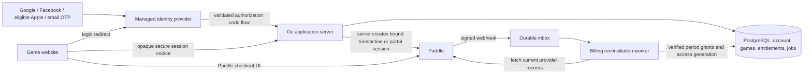

# CardFord: Paddle, player accounts and website release

Status: original hosted-release design prepared 14 October 2026. Owner authorized the Keycloak local foundation on 16 October; see the [current implementation plan](../plans/2026-10-16-keycloak-local-auth.md) and [setup guide](../../development/local-auth.md) for current scope and evidence. Live Paddle and cloud release remain later gates.

**Decision update, 16 October:** regional Keycloak replaces the Auth0/Supabase alternatives below. Keep Go, Vite and PostgreSQL native locally, with Keycloak in Podman. Accounts route automatically to their immutable home region, including while travelling; a minimal protected global directory is the approved routing exception. The future staff portal uses separate staff identity. Historical vendor comparisons and proposed commercial quotas below are not current vendor selections or approved prices/limits.

**Distributed architecture update, 18 October:** the [regional PostgreSQL specification](2026-10-18-regional-postgresql-architecture-design.md) and [implementation guide](../plans/2026-10-18-regional-postgresql-architecture.md) now govern that deployment workstream: no Redis, three SQL nodes per regional game cluster, fenced Go recovery, stable regional ownership and asynchronous reporting. Whole-region outage leaves affected players waiting for their home region. This is planning only; it neither completes hosted delivery nor selects a history/score-retention policy.

The owner selected Paddle, two public tiers (Free and one personal monthly paid tier), and limited playable Free practice with a small coaching allowance. The owner also requested social sign-in, account and credential management, OTP, growth planning and data retention. Exact price, allowances, hosted deployment choices and retention periods remain decisions. Recommendations below are not recorded as approved product terms.

Companion documents: [delivery plan](C:/repos/test-jev/docs/superpowers/plans/2026-10-14-paddle-identity-release.md) and [manual setup checklist](C:/repos/test-jev/planning/implementation/hosted-release/manual-setup-checklist.md).

## Recommendation

Use Paddle for checkout, recurring charges, payment methods, invoices and subscription self-service. Use regional Keycloak for credentials, social federation and authentication factors. Keep a permanent internal player account ID in CardFord's PostgreSQL database, independent of both vendors. CardFord remains responsible for authorization, game records, quotas, subscription-to-player binding, privacy requests and release operations.

Use Auth0 Universal Login as the reference identity design, subject to a tenant capability test and a cost check including Free users. It provides hosted login and supports email OTP and MFA; account-linking availability depends on the purchased plan. Firebase Authentication with Identity Platform is the main alternative if its cost or existing infrastructure is preferable, but its web integration and email login experience need a separate adapter. Do not build password storage, OTP delivery or social OAuth exchanges separately for each provider in the game server. Sources: [Auth0 hosted login](https://auth0.com/docs/authenticate/login/auth0-universal-login/universal-login-vs-classic-login/universal-experience), [email OTP](https://auth0.com/docs/authenticate/login/auth0-universal-login/passwordless-login/email-or-sms), [account linking](https://auth0.com/docs/manage-users/user-accounts/user-account-linking/link-user-accounts), [Firebase Auth](https://firebase.google.com/docs/auth/).

Paddle's published standard pricing is 5% + US$0.50 per checkout transaction; obtain the applicable quote, especially for a low-priced game subscription. Paddle markets support for games, but seller, product and domain approval are still launch gates. Its acceptable-use restrictions need review against the actual product; do not assume every card game is automatically approved. Sources: [pricing](https://www.paddle.com/pricing), [games](https://www.paddle.com/solutions/paddle-for-games), [acceptable use](https://www.paddle.com/help/start/intro-to-paddle/what-am-i-not-allowed-to-sell-on-paddle).

This design covers the game website. A later native app/store release requires its own sign-in, account-deletion and payment-distribution review; Paddle web checkout does not by itself settle store rules.

## What the current code actually has

Reviewed the working tree in `C:/repos/test-jev`, based on HEAD `e60cfb21d706611525197183f16628790025f5ac` (`ui changes`). The checkout contains substantial uncommitted work; the findings describe the inspected files, not an immutable release. No application tests or live vendor journeys were run for this planning task.

| Area | Current evidence | Release implication |
| --- | --- | --- |
| Active game runtime | [Go entry point](C:/repos/test-jev/server/cmd/cardford/main.go:98) opens a local schema, runs migrations and starts a local HTTP server. [package scripts](C:/repos/test-jev/package.json:16) distinguish `start:go` from the retained Node server. | Build hosted support in Go. The old Node billing adapter is reference material. |
| Environment guards | [local configuration](C:/repos/test-jev/server/internal/http/local_config.go:21) accepts local/test identity and fixture billing only. [store constructor](C:/repos/test-jev/server/internal/records/store.go:49) accepts a loopback local schema or isolated test database. | There is no production constructor to switch on safely. Add an explicit hosted mode with separate validation. |
| Authentication | [identity.go](C:/repos/test-jev/server/internal/records/identity.go:122) has hashed opaque sessions; local bootstrap generates an owner and a 30-day session. | Useful session foundations, but no verified external identity, recovery or stable cross-device account enrollment. |
| Authorization coupling | [authorize](C:/repos/test-jev/server/internal/records/identity.go:42) depends on `localService` or a principal being present; when neither is present the test-oriented path returns without session authorization. | Release blocker: hosted storage must reject missing principals. Merely setting `LocalService=false` would be unsafe. This is a hosting-design finding, not a demonstrated public exploit in the current local-only service. |
| Local HTTP | [routes](C:/repos/test-jev/server/internal/http/local.go:100), [request checks](C:/repos/test-jev/server/internal/http/local.go:210) and [cookie](C:/repos/test-jev/server/internal/http/local.go:352) provide schema checks, exact local origins and bounded requests. | Retain these protections, add HTTPS sessions/CSRF and separate OIDC and raw webhook entry points. Disable public local identity creation in hosted mode. |
| Current subscription UI | [fixture billing](C:/repos/test-jev/server/internal/records/platform_account_billing.go:48), [account service](C:/repos/test-jev/server/internal/service/platform_account.go:133) and [AccountPage](C:/repos/test-jev/web/src/features/AccountPage.tsx:193) simulate Practice/Unlimited/Family; configured offers disable billing management. | No live native Go billing or Paddle integration exists. Replace hosted account projections; preserve local fixtures as local fixtures. |
| Earlier Stripe work | [adapter README](C:/repos/test-jev/web/server/billing/README.md), [purchase service](C:/repos/test-jev/web/server/billing/purchases.ts:69) and [Stripe adapter](C:/repos/test-jev/web/server/billing/stripe.ts:103) include binding, inbox and reconciliation patterns. | Reuse invariants and failure cases. Do not copy Stripe idempotency assumptions or assume the old `players` schema grants Go access. |
| Offer configuration | [launch policy](C:/repos/test-jev/server/internal/access/launch.json:1) is empty. [configuration](C:/repos/test-jev/server/internal/access/config.go:60) supports exact game targets and day/grant allowances. | Define two public tiers with versioned terms. Multiple internal target-specific offers may support one public tier. |
| Quotas | [Coach panel allowance](C:/repos/test-jev/server/internal/records/coach_ui.go:15) is deliberately separate from historical hand/request coaching, with a hardcoded Free allowance of two sessions per UTC day. | A shared hosted policy must cover every coaching entry point. Existing values are not approved commercial terms. |
| Paid grants | [grant insertion](C:/repos/test-jev/server/internal/records/access.go:158) and [immutable-grant trigger](C:/repos/test-jev/web/server/records/migrations/008-local-go-service.sql:58) preserve original terms. | Renewals need new immutable period grants; do not update old grant expiry in place. |
| Saved results | [access policy](C:/repos/test-jev/server/internal/access/policy.go:44) distinguishes retained results, but revoked grants can deny them. | Commercial expiry/refunds need a defined policy separate from stronger security revocation. |
| Account deletion | [erasure.go](C:/repos/test-jev/server/internal/records/erasure.go:10) deletes local data transactionally. | Hosted deletion must also stop renewal, revoke identities/sessions and handle vendor failures and retained financial records. |
| Realtime/operations | [realtime service](C:/repos/test-jev/server/internal/service/realtime.go), [outbox migration](C:/repos/test-jev/web/server/records/migrations/011-realtime.sql), [playback](C:/repos/test-jev/server/internal/service/bot_playback.go) provide durable foundations alongside process-local state. | A single-instance pilot is simpler. Multiple replicas require explicit fan-out, limits and recovery validation. |
| Deployment | [Windows launcher](C:/repos/test-jev/scripts/start-go.mjs:13), static local health and [startup](C:/repos/test-jev/server/cmd/cardford/main.go:36) are development-oriented. | Add a production build/entry point, readiness checks, SIGTERM handling, release migrations, monitoring and restore evidence. |

Preserve deterministic production bots/coaching, seat-safe projections, game-version pins, command receipts, revision checks and control leases. Billing must never enter the rules engine or expose hidden state. Existing local saves and historical grants are not silently migrated into customer accounts.

## Product terms to review

| Capability | Free recommendation | Paid monthly recommendation |
| --- | --- | --- |
| Account | Recoverable account, saved progress, multiple devices | Same account and identity features |
| Practice | 3 newly admitted units per UTC day, pooled across released games | No commercial daily practice quota |
| Coaching | Coaching on 2 practice units per UTC day, pooled across games and all coaching routes | Included supported deterministic coaching, without a commercial daily unit quota |
| Unit meaning | One Hearts/Spades hand or one Trix request; show the appropriate word in each game | Same unit boundaries for authorization and continuation |
| Interrupted play | Resume an admitted unit without another charge; finish it when quota expires | Finish an admitted unit when subscription coverage expires, unless account security requires immediate blocking |
| Saved results | Read already delivered owned results within the retention policy | Same; cancellation does not erase progress or old coaching |
| Billing | No Paddle customer or payment method needed | One person, one monthly subscription, quantity 1; Paddle self-service portal |

These amounts are a proposal, not implemented limits. The coaching allowance means distinct coached units, not individual questions: multiple supported coaching actions on an already unlocked unit do not consume a second unit. Old-result reads do not consume quota; generating coaching for a previously uncoached historical unit does. Operational concurrency/rate/CPU limits still apply to both tiers. Do not advertise unbounded compute or unimplemented coaching capability.

This requires a new hosted allowance version: the current Coach panel counts sessions, while older coaching counts hand/request unlocks. Retain historical accounting, introduce one stable hosted coaching bucket and route all new hosted coaching through it. Local fixture behavior remains explicit. Free practice also needs its own atomic admission counter; the current boolean `Play` permission is insufficient. Starting a new game, advancing to the next hand, selecting a Trix request and starting a playable branch must not bypass the same budget. Read-only replay is free.

Use UTC counters on the server and display the reset time in the user's local time. Maintain Free counters during upgrades/downgrades rather than recreating them. Paid renewal follows Paddle's actual calendar-month period, never the fixture's `now + 30 days`. No launch family plans, annual billing, paid trials, add-ons or self-service plan switching are needed. Price/currency and the word used for the paid tier need owner approval.

## Architecture and ownership

| Owner | Data and responsibilities |
| --- | --- |
| Managed identity provider | Social connections, passwordless email delivery, any later passwords, MFA secrets, recovery codes, credential breach/abuse controls, authentication audit events |
| CardFord | Stable random `account_id` mapped to the existing owner model, identity bindings, session hashes, account status, preferences, games, quotas, billing references, access decisions, privacy jobs |
| Paddle | Payment collection, card processing, billing customer and subscription records, receipts/invoices, payment recovery and merchant-of-record obligations within its contract |

Do not store card data, passwords, OTP values, social access tokens or recovery codes in the game database or logs. Avoid retaining IdP refresh tokens when normal server sessions suffice. If a provider token is necessary for revocation, keep it in a narrowly scoped encrypted credential store, not player records. Store only needed profile fields; social profile photos and contacts are unnecessary for launch.

## Login, federation and account security

### Customer experience

The proposed familiar flow is a single Sign in / Create account entry, followed by Google, Facebook and Continue with email. Apple appears only after eligibility and configuration are complete. Existing users return to the same progress and paid access on another device. A fixed demonstration may remain anonymous; account-backed Free play uses recoverable login so deleting a cookie does not reset allowances.

The Account page has Profile, Sign-in methods, Security, Subscription and Data controls. It shows the current tier, next billing or access-end date, remaining Free allowances, linked sign-in methods, active sessions, logout-all, optional two-factor setup and export/deletion. Provider buttons use approved branding. Avoid a long registration form and avoid asking users to create a separate billing password.

Google, Facebook and Apple are identity connections, not subscriptions. A Facebook login is not automatically an Instagram or WhatsApp login. Add Microsoft or Discord later through the managed broker if audience demand warrants it; do not launch every available network by default.

Apple web configuration requires a Services ID associated with a primary Apple-platform App ID enabled for Sign in with Apple. Apple's environment documentation also describes an existing App Store app requirement. Confirm the project's eligibility with Apple before committing to Apple at web launch. Configure relay email and key rotation if it is enabled. Sources: [Apple web configuration](https://developer.apple.com/help/account/capabilities/configure-sign-in-with-apple-for-the-web/), [environment requirements](https://developer.apple.com/documentation/signinwithapple/configuring-your-environment-for-sign-in-with-apple), [relay email](https://developer.apple.com/help/account/capabilities/configure-private-email-relay-service/).

### Identity binding and login protocol

1. The Go backend starts OpenID Connect authorization-code login with PKCE S256, unpredictable state and nonce, a short-lived server-stored login attempt and an exact callback URL. Bind the attempt to the initiating browser and intent (login, link, step-up). Permit only internal allowlisted return paths.
2. The backend exchanges the code and validates signature, issuer, audience, authorized party where applicable, expiry, nonce and authentication time. Use a maintained OIDC library, permitted algorithms and bounded JWKS refresh. Do not accept arbitrary issuers, client-supplied profile JSON or a social access token as an app session.
3. Resolve the verified `(issuer, subject)` to the stable internal account. Enforce uniqueness transactionally during concurrent first login. Email is contact data, not the account key: it can change, be missing, unverified or use Apple's relay. Google likewise documents using `sub` as the identifier. Sources: [OIDC claim stability](https://openid.net/specs/openid-connect-core-1_0.html#ClaimStability), [Google OIDC](https://developers.google.com/identity/openid-connect/reference).
4. Create an opaque random app session and store only its hash. Rotate it on login, linking and security changes. Proposed limits: 7-day idle timeout and 30-day absolute expiry; sensitive actions require authentication within 10 minutes. These are policy defaults for review.
5. Each private request rechecks current account status and session/security generation, including after asynchronous work and before commits. Account suspension/deletion and logout-all invalidate realtime bindings and outstanding work. Retain separate tab control leases for game commands.

Use HTTPS and a host-only `__Host-` session cookie with Secure, HttpOnly, Path=/ and no Domain. SameSite=Lax supports the top-level OIDC return; require valid Origin and a session-bound CSRF token on browser mutations. Keep tokens out of URLs, browser localStorage and analytics. The OIDC callback and signed webhooks have their own validation, not blanket CSRF exceptions. Sources: [OWASP OAuth guidance](https://cheatsheetseries.owasp.org/cheatsheets/OAuth2_Cheat_Sheet.html), [session guidance](https://cheatsheetseries.owasp.org/cheatsheets/Session_Management_Cheat_Sheet.html).

### Linking and recovery

Never merge accounts because their email addresses match, even if a provider marks an email verified. A signed-in user explicitly chooses Add sign-in method, recently authenticates the current account and proves control of the second identity in a separate single-use flow. Bind both proofs to the same account and link intent. The server performs the broker link with limited Management API permissions and preserves the internal account ID and audited subject aliases if the broker's primary subject changes.

If the second identity already belongs to another CardFord account, do not reassign its games, quota or subscription automatically. Offer recovery/support; merging two populated accounts is a separate audited workflow, including duplicate subscriptions. Disallow unlinking the final recoverable method. Linking, email changes and recovery rotate sessions and notify the verified contact address. An email receipt, knowing a Paddle customer ID or support staff finding a matching email is never proof of account ownership.

Start with email OTP for users without social accounts. A login OTP is one authentication factor; it is not automatically two-factor authentication. Recommend optional authenticator TOTP plus recovery codes for players, and mandatory strong MFA for administrators. Support passkeys through the selected IdP where its plan and recovery flow meet requirements. SMS is not a launch dependency. Do not let a linked provider or email-only recovery bypass an enrolled MFA policy: test this across every enabled identity method. Keep OTP issuance/verification, expiry, replay rejection and attempt limiting at the IdP; also rate-limit login initiation and account actions in the app.

Recovery must be non-enumerating, abuse-limited and IdP-managed. A player who loses all factors uses the configured recovery flow; support cannot transfer a subscription from an email claim alone. Handle verified provider deauthorization/deletion events and credential compromise notifications through durable jobs, promptly invalidating applicable sessions. Revocation of one social connection is distinct from deletion of the entire CardFord account when other methods remain.

### Identity vendor decision

| Choice | Fit and decision gate |
| --- | --- |
| Auth0 Universal Login — recommended reference | Hosted social/email OTP/MFA flows and standard OIDC fit the Go server. Prove explicit linking, recovery, optional player MFA, mandatory admin MFA, custom domain, event delivery, export/delete and production email on the selected plan. Price total monthly active users at 1k/10k/100k, including Free users. |
| Firebase Auth + Identity Platform — alternative | Suitable consumer identity option with social providers and TOTP through Identity Platform. It requires a different token/session adapter; email link sign-in is not the same experience as email OTP. Prove cookie-based backend sessions and avoid default browser token persistence. [Firebase TOTP requirements](https://firebase.google.com/docs/auth/web/totp-mfa). |
| Clerk — considered, not the reference | Its documented automatic linking of verified matching emails does not match this design's explicit two-identity proof policy without additional controls. [Clerk linking behavior](https://clerk.com/docs/guides/configure/auth-strategies/social-connections/account-linking). |
| Self-hosted identity — defer | Adds credential handling, mail abuse, security updates, MFA/recovery and availability operations to a small game launch. |

Managed identity is an availability and cost dependency, not proof that the whole application scales. Keep the app identity adapter separate from billing and game rules so a future provider migration preserves account ownership. Such a migration must explicitly transfer verified mappings and session policy; it cannot be reconstructed by matching emails.

## Secure Paddle integration

### Purchase and customer binding

1. An authenticated, active account with a verified recovery contact requests checkout using only an allowlisted public offer ID and an idempotent app command ID. The server selects the environment, price, monthly interval, quantity and permitted currency policy. Reject a client-supplied owner, customer, subscription, amount or arbitrary price ID.
2. Persist an account-owned checkout operation before calling Paddle. Serialize customer creation and subscription purchase intent for that account, with a unique active operation and an expiring fenced worker lease. Bind the environment and Paddle seller context throughout. Do not hold a PostgreSQL transaction during provider calls.
3. Create/reuse only the customer's already verified server mapping. Create the Paddle transaction on the server. Put an opaque operation reference in `custom_data` for correlation, but never use that metadata, checkout email or frontend events alone as authorization: Paddle supports client-supplied custom data too. [Paddle custom data](https://developer.paddle.com/build/transactions/custom-data/).
4. Persist the exact returned transaction ID before exposing the checkout to the browser. Open that transaction with Paddle.js on the approved checkout page. A Paddle `checkout.url` may point to the configured payment page on our domain; it is not necessarily a separately hosted Paddle website. [Transaction checkout](https://developer.paddle.com/build/transactions/pass-transaction-checkout/), [default payment link](https://developer.paddle.com/build/transactions/default-payment-link/).
5. Treat a checkout return or `checkout.completed` JavaScript event as a reason to refresh account status. It grants nothing. The UI can show Payment received; confirming access while the backend verifies the provider records.
6. Reconciliation validates the exact transaction binding, customer, related subscription, seller/environment, approved product and price, monthly interval, quantity and actual completed billing period. Check supported paid/discount rules explicitly; no unapproved zero-price or trial purchase creates paid access.

Paddle documents that arbitrary API operations do not support client-supplied idempotency keys. Local command deduplication alone cannot prevent duplicate external payments. A timeout after a create request enters `ambiguous`, not `failed-and-retry`. Reconcile existing provider records and webhook evidence before allowing another create; if provenance is not conclusive, require operator resolution. Never bind a transaction supplied by the browser or one found only by matching its metadata/email. The same uncertainty applies to customer creation. [Paddle library guidance](https://developer.paddle.com/sdks/libraries/).

One active internal subscription slot prevents normal concurrent checkout, but an old open checkout can still complete later. Detect a second paid subscription, keep one entitlement owner, alert support and follow a documented cancel/refund resolution. Do not silently charge twice, transfer ownership or stack monthly durations from unrelated subscriptions.

### Webhooks, reconciliation and entitlement projection

- Expose one bounded raw-body POST webhook route per configured environment. Verify `Paddle-Signature` with its endpoint secret and timestamp policy against the exact bytes before JSON parsing. Use the maintained Go verifier where suitable; keep clock synchronization and secret rotation operational. [Signature verification](https://developer.paddle.com/webhooks/about/signature-verification/).
- Insert a unique event by environment/seller/event ID and a durable reconciliation job in one transaction, then return success promptly. Do not acknowledge a write failure. Duplicate notifications of the same event are harmless. Process unknown valid events without granting access; alert/quarantine unknown bindings or unsupported versions.
- Process jobs outside the request with bounded retries/backoff and leases. Fetch current transaction/subscription/adjustment state outside the database transaction, then lock the account/billing aggregate and apply with a generation fence. An older worker must not overwrite a newer refund, cancellation, deletion or rebind decision.
- Webhook delivery can repeat and arrive out of order; use event occurrence timestamps as a stale-event signal, not the sole authority. Keep the provider's current snapshot and verified paid periods. A successful HTTP callback is not a distributed ordering guarantee. Paddle asks for a response within five seconds. [Webhook delivery](https://developer.paddle.com/webhooks/about/respond-to-webhooks/).
- Grant on a verified completed payment and its actual coverage interval. Create one immutable grant per paid period and target; deduplicate by provider transaction/period/target. Never extend an old immutable grant in place. Atomically update the entitlement projection and access generation so existing realtime clients refresh.
- Handle subscription lifecycle and transaction lifecycle together: created/updated/activated/canceled/past-due/paused/resumed where offered, completed payments, failed payments and adjustments. Scheduled cancellation alone does not prove loss of already-paid time. Reconcile on event, pending-checkout refresh, near expiry and a periodic sweep with jitter/cursors. No Paddle API call is required on every card play.

Provider outages preserve already verified, unexpired coverage. Do not grant a fresh paid period from a client claim or extend it indefinitely because reconciliation failed. Alert on queue lag, old ambiguous purchases, paid transactions without mapped accounts and entitlement/provider mismatches. Source for the provider pattern: [Paddle access provisioning](https://developer.paddle.com/build/subscriptions/provision-access-webhooks/).

### Subscription policy proposal

| Verified state | CardFord behavior |
| --- | --- |
| Free / first payment pending or failed | Free allowances. No paid grant. |
| Completed eligible payment | Paid through the verified period end. |
| Cancellation scheduled | Paid until the existing period end; show that date. |
| Renewal failure after a previously paid period | Proposed one-time 72-hour grace from that period's end, then Free. Repeated events cannot reset grace. First purchase gets no grace. |
| Canceled / paused with no remaining paid period or grace | Free; retain owned history. |
| Approved full refund or chargeback covering the current period | End affected new paid access according to the reviewed refund policy; invalidate the commercial projection. Partial and tax-only adjustments are separate cases. |
| Pending/rejected refund | Do not revoke solely because a refund was requested. |
| Dispute reversal or corrected billing record | Reconcile current facts and issue an audited compensating entitlement if warranted; never blindly restore all historic grants. |
| Account security suspension / deletion | Immediately deny private access and new work, regardless of commercial status. |

Represent grace as an explicit, once-per-period entitlement decision; never rewrite the provider's paid-through timestamp. Approved refunds can reduce usable coverage, so the earlier Stripe pattern of only taking `GREATEST(paid_through)` is insufficient. Separate commercial exclusion of new access from security revocation of all access; ordinary lapse/refund should not remove already delivered owned coaching. Sources: [Paddle adjustments](https://developer.paddle.com/api-reference/adjustments/), [adjustment lifecycle](https://developer.paddle.com/webhooks/adjustments/adjustment-created/).

Use Paddle's customer portal for payment-method updates, invoices and cancellation/resumption where available. An authenticated POST derives the account's customer/subscription IDs, creates a fresh portal session and returns its temporary URL. Do not accept arbitrary IDs, store the URL, expose it in logs or cache it. Fresh authentication is required when the app's recent-auth threshold has expired. [Portal sessions](https://developer.paddle.com/api-reference/customer-portals/create-customer-portal-session/).

## Durable data model

Add forward migrations in the existing canonical migration directory. Names below are proposed logical tables; they do not exist yet. Reference the Go owner identity rather than the legacy TypeScript `players` table. Keep separate databases/tenants for development, staging and production, and still persist provider environment/seller context to detect configuration mistakes.

| Group | Required records and constraints |
| --- | --- |
| Accounts | `accounts`: immutable account ID/owner mapping, active/suspended/deleting/deleted state, security generation, creation/last-active times, verified contact and policy versions. Unique owner FK. |
| Identity | `external_identities`: unique issuer+subject, account FK, provider connection, linked time and audit reference. `auth_attempts`: expiring single-use state/nonce/PKCE and linking intent. Extend/replace session metadata while preserving current credential checks. |
| Customer binding | `billing_customers`: unique account+environment+seller mapping and unique provider customer binding; immutable ownership except an explicit audited migration. |
| Checkout | `billing_operations`: account, command ID+request digest, offer/price version, state, provider transaction reference, lease/fence and ambiguity reason. Unique active purchase slot and provider transaction ID. |
| Subscription | `billing_subscriptions`: bound customer and subscription, current provider status/scheduled change, period boundaries and reconciliation generation. One chosen paid subscription per personal account; duplicate external subscriptions become an incident. |
| Financial evidence | `billing_periods` and `billing_adjustments`: verified transaction periods and adjustment effects; retain references needed to explain access. Minimize payer/address duplication. |
| Delivery | `billing_event_inbox`: unique event ID, receipt/occurrence time, digest and short-lived encrypted payload if needed. `billing_jobs`: deduplicated work, attempts, next run, lease, completion/error. |
| Access and usage | Existing immutable grants, admissions, unlocks and access generation, plus hosted practice usage and a shared coached-unit ledger. Stable bucket IDs and unique account/unit charges. |
| Security/privacy | Minimal append-only security/billing audit; durable export/deletion jobs, external completion receipts and purpose-limited deletion tombstones. No bearer secrets in any audit. |

Avoid JSON customer metadata as the only mapping. Enforce foreign keys, uniqueness and conditional writes in PostgreSQL, not just application memory. Index lookup/queue paths and bound history reads; archive/purge by policy. Use stable internal IDs for analytics, with pseudonymous aggregation where suitable.

Restrict commercial billing/paid-grant writes to a billing worker role or narrowly scoped database functions. The web role may issue only server-defined Free terms through its guarded account path. If Paddle reports that an email already belongs to an existing customer, do not attach that customer to a different app account by email; keep the binding unchanged and use verified recovery or an audited conflict-resolution flow.

## Retention, export and deletion

The following is an operational proposal requiring owner/legal/accounting approval for the actual launch markets and seller jurisdiction. It is not a universal legal retention schedule. Limit collection to the product purpose, document vendor responsibilities and deletion limits, and keep financial records separately from gameplay. Canadian PIPEDA guidance and GDPR both emphasize purpose-limited retention; exceptions do not authorize keeping all account data indefinitely. Sources: [Canadian privacy guidance](https://www.priv.gc.ca/en/privacy-topics/privacy-laws-in-canada/the-personal-information-protection-and-electronic-documents-act-pipeda/p_principle/principles/p_use/), [GDPR Articles 5 and 17](https://eur-lex.europa.eu/eli/reg/2016/679/oj/eng/).

| Data | Proposed policy and enforcement |
| --- | --- |
| Login state/link intent | 10-minute validity; purge within 24 hours. Never log codes, state or PKCE secrets. |
| App sessions | Expire at idle/absolute limit; purge revoked/expired session rows after 30 days unless a specific incident hold applies. |
| OTP/password/MFA material | Managed only by the IdP under reviewed settings/contract; CardFord retains none. |
| Active profile and progress | Keep while account is active. Review Free accounts after 24 months of inactivity; give 30 days' notice before deletion. Exclude active paid accounts and documented holds. |
| Game replays and coaching | Proposed rolling 12-month detailed-history window for both tiers, with export and product disclosure; retain minimal aggregate progress while active. Never purge an active game, required rule profile or referenced live record. |
| General request/error logs | 30 days; redact bodies, tokens, private cards and payer data. Raw IP abuse data up to 7 days, then remove or aggregate. |
| Security audit | 90 days of minimized events; specific incident extensions have an owner, reason and expiry. |
| Raw billing webhook payloads | Up to 30 days for incident recovery, encrypted and restricted; retain minimal event IDs/digests and necessary billing evidence separately. |
| Financial records | Keep Paddle as the invoice/payment system of record. Accountant/legal adviser determines required years and minimum local evidence; do not copy card/address data merely for convenience. |
| Backups | Proposed encrypted rolling 35-day window; restore into isolation, replay deletion/tombstone jobs before serving traffic. Verify with an actual restore drill. |
| Export download | Private single-user download, short-lived URL if object storage is used; delete export after 24 hours. Never cache at the public CDN. |
| Deletion | Block access and renewal work immediately; target primary nonrequired data removal within 7 days, with external failures tracked and legally required deadlines overriding this target. Backup expiry and justified financial retention are disclosed. |

Account deletion is a durable workflow, not one SQL delete: require recent authentication; explain loss of progress and subscription cancellation; mark `deleting`; increment security generation/revoke sessions; suppress new grants and checkout; stop future renewal at Paddle; erase game/profile data; delete/revoke identities and social tokens where required; request vendor deletion/minimization where permitted; record completion. Provider failure triggers retries and an operator alert, not a success message. Confirm cancellation before declaring billing cleanup complete. A refund is a separate policy action, not automatic from deleting the account.

Keep only the minimum protected tombstone/billing references needed to finish cancellation, reject delayed entitlement events and satisfy documented obligations. While those records exist, every worker must deny resurrection. After expiry/purge, unknown provider references are quarantined and never auto-create accounts; recreating an account creates a new ID and does not reclaim old subscriptions by email. Review tombstone retention as personal/pseudonymous data, not anonymous data. Apply the same deletion decisions after backup restore.

Provide user export of owned profile, settings, game/coaching data and minimal billing references, preserving seat privacy. Test that player A cannot export player B's data. A provider's data-deletion callback must be authenticated and durably recorded; it must not become an unauthenticated account-delete endpoint. Support provider disconnection separately from full account deletion and document the provider-required response.

## Backend release and growth requirements

Start with one region and a deliberately bounded pilot on a long-running Go service, managed PostgreSQL and a background reconciliation worker. Serve the web app and API under the same origin through TLS; keep public assets cacheable and all private/auth/billing responses no-store. The precise cloud vendor is a separate operational choice. No managed websocket migration or microservice split is needed to prove a paid website.

Required before launch:

- Explicit hosted entry point/configuration; refuse fixture identity/billing, seeded debug fixtures and empty/mismatched offer mappings in production. Use a separate migration command with a privileged migration role; the app role cannot create schemas or modify grants arbitrarily.
- Fail-closed user authorization in every private storage path. Give verified billing/privacy workers narrow internal operations and explicit service authority; absence of a browser principal must never imply permission.
- Private database networking, TLS certificate verification, encrypted backups, bounded pools/timeouts, least-privilege roles and secrets-manager configuration. Budget DB connections across web and worker replicas.
- Separate liveness and readiness; readiness checks DB/migration/config state, while external-provider degradation does not restart otherwise healthy gameplay. Graceful SIGTERM drains HTTP, leases and jobs. Test restart behavior of bot playback and realtime recovery.
- Split rate budgets for sign-in, checkout/portal, webhook intake, gameplay, expensive coaching and export. Rate-limit accounts and relevant IPs with bounded privacy retention. Enforce concurrent-work caps even on paid plans.
- Narrow CSP changes for the dedicated Paddle checkout surface using the current provider requirements; do not turn off the site's CSP or use broad wildcards. Keep OAuth secrets, Paddle API keys and webhook secrets server-side. A Paddle client-side token is public configuration, not authority.
- Production build excludes local fixtures, offline labs, reference server entry points, secrets and private source maps. Verify the artifact, dependency inventory and secret scan. Retain migration SQL required by the release process.
- Alert on failed sign-in spikes, callback failures, account-link anomalies, ambiguous/duplicate purchases, webhook signature failures, queue lag, entitlement drift, failed deletions and backup failures. Redact credentials and private payloads from logs/traces.
- Run hosted authentication and billing journeys, browser/mobile redirect checks, restore/recovery drills and bounded load tests against an agreed pilot concurrency target. Measure game preparation, coaching, realtime reconnects, DB locks/pools and outbox latency together. A provider's advertised MAU or socket limit is not game capacity evidence.

Before increasing replicas, address in-memory realtime bindings/rate counters, shared entitlement invalidation, outbox fan-out, websocket reconnect routing, fenced playback ownership and distributed abuse limits. Durable command receipts, leases and optimistic revisions remain mandatory. Keep identity and billing jobs independent from expensive game work so a login or webhook surge does not starve play.

## Decisions and launch gates

Owner decisions: paid name/price/base currency; exact practice/coaching limits; games exposed at launch; 72-hour renewal grace; refund/continuation policy; identity vendor and cost envelope; Apple eligibility; launch countries/minimum age; cloud region/budget; retention schedule and support ownership.

Engineering gates: no unauthenticated hosted store access; verified identity linking across providers; exactly-once internal quota/entitlement application under duplicate events; no duplicate-checkout blind retry; all private resources scoped to the account; expired/refunded/deleted states handled; all coaching routes share the hosted allowance; no retained-result loss from ordinary expiry; vendor-failure recovery; real sandbox journeys; restored backup honors deletions; documented pilot capacity.

This document is source inspection and a proposed architecture. It is not a claim of deployed security, working social login, Paddle approval, a successful payment or production capacity.
