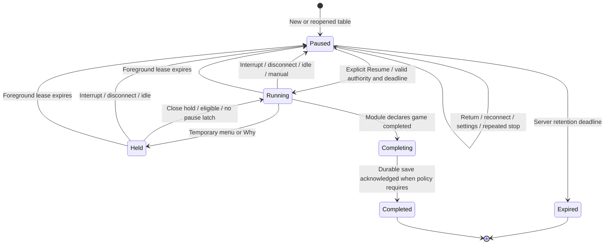
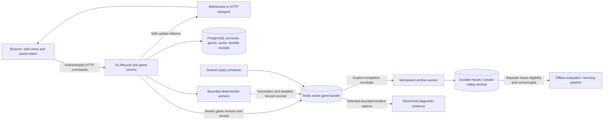

# CardFord pause, presence, session expiry and game retention

**Status:** Pause/expiry implementation approved on 15 October 2026 under [CR-ARCH-006](../../../planning/decisions/CR-ARCH-006-pause-presence-and-expiry.md): Free 5m / Paid 60m, PostgreSQL authority. Redis is deferred transient caching only; option C and its active-authority migration are rejected for this delivery. Future target is 100,000 concurrent independent players with three bots each; staging capacity tests are later work. Historical draft alternatives below do not override this decision. Existing historical-data deletion, support capture, replay/training and production deployment remain separate approvals.

**Companion:** [Implementation plan and review decisions](../plans/2026-10-15-pause-session-lifecycle.md).

## 1. Purpose and scope

Stop spending game-processing resources when the player is unavailable, preserve a resumable checkpoint for a configurable interval, and explain interruptions accurately when the player returns. A paused game is stored state; it must not need an active bot, worker, WebSocket or database connection to remain resumable.

The scope is the current one-human/three-bot practice product: Hearts Solo, Spades Solo/Partners, and Trix Basic/Complex Solo/Partners. The policy applies during passing, bidding, request choice, doubling, trick taking, Jacks, between-round review, coaching and Why. Multiplayer would require a separate policy because one player's absence cannot necessarily pause everyone.

### What the owner requested

| Category | Requirement or direction |
|---|---|
| Interruption coverage | Handle rotation, incoming calls, switching tabs/apps, phone lock and clicking outside a visible browser window, including iPad/multiple displays. |
| Connection loss | Pause and tell the player that connectivity caused it. |
| Resources | Pause is principally a resource-management feature, including server work. |
| Return | Keep the game available briefly; expire abandoned sessions. Use configurable policies, potentially five minutes for Free and one hour for Paid. |
| Storage investigation | Consider temporary active games in Redis, TTL cleanup, and durable persistence only for selected/completed games. |
| Diagnostics | Consider short-lived evidence for connection problems, game disputes and coach feedback without retaining every unfinished game indefinitely. |
| Future product | Saved replay, retrying past decisions, paid history and possible offline learning pipelines. |
| Delivery now | Investigate and document requirements, non-functional targets, diagrams, options and a reviewable implementation plan. |

The duration examples, Redis adoption, loss tolerance, retention schedule, paid-history packaging and use of player data for training are **proposals**, not settled product terms. Existing approval still requires explicit Resume after leaving the app and keeps Settings/Choose game available while paused.

## 2. Current implementation and evidence

The current Go/PostgreSQL and React source supersedes historical Node/SQLite descriptions. [CR-ARCH-005](../../../planning/decisions/CR-ARCH-005-local-realtime-and-server-bots.md) defines receive-only WebSockets, HTTP mutations, durable receipts, control ownership and playback generation fences. [CR-UX-008](../../../planning/decisions/CR-UX-008-rally-live-ui.md) defines the existing pause UX.

| Current behavior | Source | Consequence |
|---|---|---|
| Hidden, blur, pagehide, pageshow and unmount latch local pause; a Resume epoch rejects stale responses | `web/src/table/useGamePause.ts`, `pauseLifecycle.ts` | Useful shared foundation; stores a boolean rather than structured reasons. |
| Phone layout gate uses viewport dimensions, not physical phone orientation | `web/src/table/useViewport.ts` | Split view, soft keyboard and window resizing need separate consideration. |
| Trix listens for offline; Hearts/Spades lack equivalent handling; socket loss updates stream status only | `web/src/games/trix/Table.tsx`, `web/src/App.tsx`, `web/src/api/useGoSession.ts` | Inconsistent connectivity pause behavior. |
| Stop verifies identity before POST; failed stop intent is not reliably reapplied after reconnect | `web/src/api/useGoSession.ts` | Local pause can disagree with server playback. |
| Pause retains the socket; HTTP fallback polls every 10 seconds when stopped | `web/src/api/realtimeStream.ts` | Paused sessions still consume transport/authentication resources. |
| Server stop increments playback generation and fences commits; prepared work may finish and be reused | `server/internal/service/bot_playback.go`, `server/internal/records/realtime_playback.go` | Preventing a move is not the same as canceling CPU work. |
| Socket heartbeat runs every 15 seconds with a five-second ping deadline; authorization reads storage | `server/internal/http/realtime.go`, `server/internal/service/realtime.go` | Useful connectivity evidence; not evidence of player attention or permission to continue. |
| Game state, events, receipts, decisions and derived records have durable transactional dependencies | `server/internal/records/*`, `web/server/records/migrations/*` | Redis-only live state is a contract migration, not a cache substitution. |

The [15 October audit](../../../qa/implementation/rally/browser-2026-10-15/pause-transport-review/verified.json) reproduced a locally paused Trix screen whose server playback stayed enabled across two snapshots 70.1 seconds apart. The identity preflight failed before the stop POST; reconnect did not enforce the paused intent. The game awaited a human request choice, so this was **not evidence of bot cards advancing during that interval**. That audit ran 50 focused source tests and desktop browser network/focus/viewport checks. Physical calls, iOS suspension, process kill and production load were not tested. Those results are prior evidence, not tests run for this planning task.

## 3. Separate concepts and authority

| Concept | Meaning | Authority and lifetime |
|---|---|---|
| Authentication session | Who the player is | Existing identity/security policy; not erased when an abandoned game expires. |
| Control lease | Which tab/device may mutate this game | Existing server generation and credential checks; not proof the tab remains foreground. |
| Foreground lease | Recent permission from the controlling, eligible page to keep live interaction available | Short server deadline; renewable only while foreground and eligible. New proposal. |
| Playback | Whether bots/automatic game transitions may advance | Server state and commit fence; never inferred solely from a socket. |
| Transport connection | How safe updates arrive | Can close while game state is retained. A connection can be alive while the user is absent. |
| Paused game retention | How long the incomplete game remains resumable | Absolute server deadline per pause episode and versioned policy. |
| Saved history | Results, replay and retained coaching | Separate retention/entitlement policy; may outlive or be absent from active storage. |

The frontend owns immediate input/animation blocking and honest explanatory copy. The server owns progression, deadlines, expiry, quotas, permissions and retention. There is no reliable web signal proving that a human is watching; foreground leases and idle checks are a best-effort presence policy, not anti-bot proof.

## 4. Interruption and failure matrix

In this table, **latch** means explicit Resume is required even after the cause disappears. **Stop** means cancel eligible work and fence future commits; commands already committed remain valid. Every away transition starts one retention episode; duplicate signals do not restart its clock.

| ID | Scenario / observable evidence | Frontend behavior | Backend and return behavior |
|---|---|---|---|
| S01 | Player presses Pause | Block input, stop presentation/audio, latch `manual` | Stop; show Resume with deadline. |
| S02 | Phone rotates into unsupported portrait | Latch `layout_unavailable`; show rotation instruction | Stop; returning to landscape reveals Resume, never auto-starts. |
| S03 | iPad split view, resized desktop or foldable becomes too small | Explain insufficient space, not an assumed phone rotation | Stop; playable geometry plus Resume required. Keyboard opening must not be mistaken for physical rotation. |
| S04 | Switch browser tab or minimize browser | Hidden/blur -> latch `away`; no hidden dialog work is necessary | Best-effort stop then transport suspension; on return refresh and Resume. |
| S05 | Switch phone apps | Same lifecycle handling as S04 | No dependence on a final callback; foreground lease expires if stop never arrives. |
| S06 | Lock phone / automatic screen lock | Hidden/blur/pagehide when delivered; later restoration | Same stop/lease fallback; unlock does not resume. |
| S07 | Incoming call, system panel, permission dialog or full-screen interruption | React to actual visibility/focus interruption; label `away`, not “phone call detected” | Latch when an event occurs; otherwise lease/idle fallback. A call banner that does not affect browser state cannot be identified reliably; do not claim complete call detection. |
| S08 | Click another window/display; iPad game stays visible but loses focus | Window blur latches, following existing UX approval | Stop even though visible. Focusing again shows Resume. Element-to-element focus within the page is not an interruption. |
| S09 | Browser freezes, discards, crashes, force-quits or device loses power | A final event may never run; next document starts paused | Lease expiration independently blocks progression; no final stop message required. |
| S10 | Reload, back/forward cache, reopen saved URL | Start/re-enter paused; reconcile pending receipts and safe snapshot | Never restore “running” from local storage; explicit Resume. |
| S11 | Offline event / airplane mode | Latch `connection_lost`, disable moves; show connection explanation | Stop attempt may fail; lease bounds uncertainty. Online event allows recovery, not resume. |
| S12 | Wi-Fi to cellular handover, socket close, dropped frames, half-open connection | Latch on loss of a previously healthy update channel; distinguish outage from planned transport suspension | Recover snapshot, reassert stop, show connection restored + Resume. Silent failure bounded by foreground lease. |
| S13 | LAN connected but Internet/API unavailable, captive portal, DNS/TLS/proxy failure | Treat `navigator.onLine` as a hint; rely on authenticated endpoint outcomes | Explain cannot reach game; do not blame Wi-Fi or claim exact cause. No automatic resume. |
| S14 | Server restart, maintenance, overload or regional outage | “Game service unavailable” when confirmed; otherwise generic reachability copy | Fail closed; reject stale worker leases; return paused or honestly report unrecoverable state loss. |
| S15 | HTTP healthy but WebSocket unavailable | Pause on unexpected channel loss; establish healthy HTTP fallback explicitly | Resume can use supported HTTP mode. Healthy configured HTTP mode is not an endless “Reconnecting” error. |
| S16 | Stop committed but acknowledgement lost; reconnect races with Resume | Retain original command ID/body and local latch | Read receipt/snapshot; reconcile exactly once; do not replay a stale opposite intent. |
| S17 | Another tab/device claims control | Show controlled elsewhere; local read-only pause | Only controller may renew/play. Non-controller leaving never pauses the controller. Take control and Resume remain separate. |
| S18 | Authentication/security revocation, access expiry, account deletion | Explain prerequisite and clear private state as required | Existing security fences take priority. Billing expiry is not automatically account deletion or game expiry. |
| S19 | Settings, scores, Coach drawer or Why opened from active game | Use existing temporary hold behavior when the view actually blocks progression; stop irrelevant work | Closing can return to play only with fresh foreground permission and no persistent latch. Settings/Choose game still work from paused state. |
| S20 | Page remains visible and focused but unattended | Proposed idle warning after 120 seconds without meaningful interaction, then pause after 30 more seconds | No indefinite renewal merely from a running JS timer. Input/coach navigation dismisses warning; idle pause starts retention. Values require review. |
| S21 | Return before / exactly at / after expiry | Show remaining time / expired result based on server response | Resume succeeds only if `serverNow < expiresAt`; equality is expired. No resurrection from stale cache or late heartbeat. |
| S22 | Tier/policy changes, duplicate lifecycle signals, old device reconnects | Render current effective policy returned by server | Freeze allowance for an existing pause episode; ordinary changes affect future episodes; security revocation can terminate immediately. |
| S23 | Interrupted drag, queued unsubmitted move, fourth-card landing, pending human command | Cancel drag; preserve confirmed presentation interval; proposed clearing of unsent queued autoplay after away | Reconcile submitted UUID before any new move. Do not undo accepted moves or silently auto-play an old queued card on return. |

Browser lifecycle delivery varies. Hidden is often the last observable opportunity; freeze and discard may prevent further code from running. Use lifecycle events opportunistically and a server deadline for correctness. [Chrome lifecycle guidance](https://developer.chrome.com/docs/web-platform/page-lifecycle-api), [WebKit power guidance](https://webkit.org/blog/8970/how-web-content-can-affect-power-usage/).

`navigator.onLine` does not establish reachability of CardFord; a working LAN can lack Internet access. An offline hint pauses play conservatively but must not prevent Retry from checking the real service. [MDN onLine](https://developer.mozilla.org/en-US/docs/Web/API/Navigator/onLine).

## 5. Proposed functional requirements

“Must” below describes the proposed acceptance contract **if this draft is approved**.

| ID | Requirement | Main acceptance scenarios |
|---|---|---|
| PL-F01 | One shared lifecycle coordinator must apply the reason/blocker/latch policy across all seven modes and all phases. | S01–S23; seven-mode matrix |
| PL-F02 | A detected interruption must immediately block game input, suspend presentation and future audio, and retain explicit Resume intent. Clear active blockers independently from the latch. | S01–S10, S23 |
| PL-F03 | Explain connection loss separately from ordinary pause; distinguish local blocking, pending remote confirmation, server-confirmed pause, recovery and expiry. | S11–S16 |
| PL-F04 | Authenticated stop must not depend on a separate successful identity preflight. Preserve server authorization, CSRF, receipt reconciliation and idempotency. | S09, S11, S16 |
| PL-F05 | A short server foreground lease plus playback/control generations must fence every bot/automatic commit and reject late renewal after pause/expiry. Socket loss can accelerate stop; ping/pong cannot authorize running. | S09, S12, S14, S17 |
| PL-F06 | Pausing must cancel queued/preparing work, release runner admission slots and stop polling/retries when not visible. Shared work is canceled only when it has no remaining authorized consumers. | S04–S09, S19–S20 |
| PL-F07 | Return must reconcile the last accepted game state and pending command, enforce pause, validate ownership/access/layout/connectivity, then expose Resume. Resume must recheck the interruption epoch after every await. | S10–S18, S21 |
| PL-F08 | Store `pausedAt`, `expiresAt`, policy version and lifecycle generation server-side. A repeated stop, GET, socket pong or view-only tab must not extend retention. | S16–S22 |
| PL-F09 | Expiry ends that active game instance; reject new gameplay/Resume and clean associated ephemeral data. It must not log the player out, fabricate a score, charge again, delete unrelated history, or resurrect the game. | S18, S21–S22 |
| PL-F10 | Policies must be centrally configurable by server-verified tier; clients cannot submit a duration or claim Paid access. Existing games receive explicit compatibility treatment. | S17–S22 |
| PL-F11 | Keep Settings and Choose game available while paused; returning from either preserves pause. New games open paused. Preserve actor-safe Why and fourth-card timing. | S19, S23 |
| PL-F12 | Separate active resume, completed results, detailed replay, transient diagnostics, support captures and training datasets into independently retained classes. | Retention table below |
| PL-F13 | Any Redis-authoritative mode must preserve revision checks, command receipt atomicity, single-writer fencing, quotas, safe projections and deletion semantics or document an approved superseding contract. | Storage gates below |
| PL-F14 | Completed results selected for saving must become durable exactly once before reporting “Saved.” Expiry must not erase an unacknowledged completion transfer. | Completion sequence below |
| PL-F15 | Record observed interruption signals and errors without inferring dissatisfaction, unfairness, phone calls or network root cause as facts. | Diagnostics acceptance |
| PL-F16 | Saved replay/retry and learning pipelines remain separate product milestones with explicit data-purpose and entitlement decisions. Paying is not automatic consent to training. | Future-feature boundary |

## 6. Lifecycle design and clocks

### 6.1 Orthogonal state

Maintain four independent values rather than one overloaded `paused` boolean:

1. **Intent:** running / temporary hold / persistent pause, with local epoch and reason history.
2. **Availability:** foreground, focus, playable layout, connectivity, control and access blockers.
3. **Server state:** running / held / paused / expired / completing / completed; lifecycle and playback generations.
4. **Transport:** live WebSocket / healthy HTTP / recovering / deliberately suspended / closed.

Primary UI reason priority: auth/deletion or expired -> control elsewhere -> connection/service unavailable -> unsupported layout -> away/idle -> manual. Keep other reasons available internally; resolving the highest one exposes the next, never clears the latch. Server and client report evidence, not unobservable causes.



### 6.2 Implementation policy under CR-ARCH-006

| Setting | Initial value | Semantics |
|---|---|---|
| Foreground renewal | Every 5 seconds while eligible; piggyback on accepted foreground commands where possible | One coordinator per controlling tab. Renewal never starts playback or extends an existing paused-game deadline. |
| Foreground lease | 15 seconds from accepted renewal | Missing signal bounds silent disappearance. This is separate from the existing 30-minute control credential. |
| Free paused retention | 5 minutes | Owner-approved. Local Free-equivalent and trial access do not imply a paid entitlement. |
| Paid paused retention | 60 minutes | Paid status comes from verified server entitlement, never a browser flag. |
| Visible inactivity | 120 seconds + 30-second warning | Meaningful pointer/key/touch/assistive interaction or explicit coach navigation resets idle; mouse movement, animations, server events and pongs do not. |
| Foreground paused socket grace | 30 seconds | Keep a short pause responsive, then suspend transport/polling. Settings/account requests remain available on demand. |
| Hidden/away transport | Close immediately after best-effort stop dispatch | Do not wait for an acknowledgement to freeze the UI or close. Lease is the fallback if request fails. |
| Expiry cleanup | Bounded indexed sweeps | Logical expiry applies at the deadline. Release active resources; preserve PostgreSQL history and dependent receipts under the existing retention contracts. No blanket historical-data purge is authorized. |

For explicit pause/away, `pausedAt` is the first accepted stop time. For silent loss, use the existing foreground lease deadline as `pausedAt`, even if a sweeper notices later. Then `expiresAt = pausedAt + policy.pausedRetention`. The browser's clock is never authoritative. The undetectable period before a missed lease expires is unavoidable; the proposal permits up to 15 seconds after the last accepted renewal, not instant stopping after an unobservable phone crash.

New games open paused: creation must atomically initialize `pausedAt = serverNow` and `expiresAt`, so a game that is never resumed cannot remain forever. Pin the policy/verified tier snapshot at creation and each successful explicit Resume for the following pause episode; do not reconstruct an old paid entitlement from the current tier when a delayed sweeper runs. Security revocation still overrides eligibility immediately.

Use two indexed due queues and a shared scheduler: running/held foreground lease deadlines, and paused retention deadlines. Check due leases at least once per second under the acceptance load; transition to pause, release dormant workers and schedule retention even when no request or worker callback arrives. If the service returns after both deadlines passed, expire immediately using the original lease deadline; never grant an extra retention window because the sweeper was down.

Manual pause, unsupported layout and connection loss start retention. A temporary in-app hold while the player remains engaged does not start away retention: it stops game computation but renews foreground eligibility. Its idle timer still converts it to persistent pause. On a paused screen, simply looking, refreshing, reopening Settings or reconnecting does not restart retention. Only a successful explicit Resume ends the pause episode. Paid upgrade during an episode does not silently extend it; an eventual explicit “extend” feature is outside this release.

The client coordinator keeps a set of temporary hold causes (for example Settings, scores and Why). Emit a hold only on empty-to-nonempty transition and release only when the set becomes empty. Closing one of several overlapping surfaces must not restart playback. A release is accepted only from the same still-held generation with an unexpired foreground lease, current eligibility and no persistent interruption epoch; otherwise remain paused and require Resume.

Use a conservative false-negative policy: if the server cannot validate the lease/authority, progression stops. Slow network can therefore pause an otherwise present player. Tune the timing against device tests and measured false pauses; do not silently lengthen it in response to load.

Renewal additionally requires `serverNow < existing foregroundLeaseUntil` at the serialized check. A late renewal cannot revive a lease merely because the sweeper has not yet changed `running` to `paused`. Materialize the pause at the old deadline, reject renewal with `lease_expired`, and require explicit Resume. An increasing sequence number is necessary but insufficient.

### 6.3 Stop, suspend and return sequence

```mermaid
sequenceDiagram
  participant UI as Controlling browser
  participant API as Go API
  participant Gate as Lifecycle store / commit fence
  participant Worker as Bot worker
  UI->>UI: Interruption: block, latch reason, stop renewal
  UI->>API: Idempotent stop (best effort, no identity preflight)
  UI->>UI: Suspend timers, audio, requests and socket
  alt Stop reaches server
    API->>Gate: Pause + generation fence + expiresAt
    API->>Worker: Cancel / release admission
  else Browser disappears first
    Gate->>Gate: Foreground deadline passes
    Worker->>Gate: Recheck immediately before commit
    Gate-->>Worker: Reject stale/expired permission
  end
  Note over Gate: Retain checkpoint; no live connection required
  UI->>API: Return: auth, snapshot and original receipt reconciliation
  API-->>UI: Paused, reason, deadline, safe view OR expired
  UI->>UI: Show Resume; never start on reconnect
  UI->>API: Explicit Resume with expected generations
  API->>Gate: Atomic deadline/authority check + fresh lease
  Gate-->>UI: Confirmed new generation
  UI->>UI: Recheck local epoch, release presentation
```

If Resume commits and a later interruption wins locally, send compensating stop using the acknowledged generation, cease renewal immediately, and rely on lease expiry if that stop cannot arrive. A delayed stop for an older game/owner/generation must not stop a newer run. Reject unsupported lifecycle clients before starting new-policy games; do not let old clients renew by ordinary snapshot polling.

### 6.4 Connectivity policy

WebSocket protocol ping/pong detects transport responsiveness, not foreground engagement. It is one server signal, alongside explicit lifecycle commands, foreground lease expiration, auth/control events and idle expiry. Keep HTTP mutation authority; the first implementation need not add browser-to-server WebSocket commands. [WebSocket control frames](https://developer.mozilla.org/en-US/docs/Web/API/WebSockets_API/Writing_WebSocket_servers).

An unexpected disconnect latches pause. A deliberate close while already paused is `suspended`, not a new connection error. Closing an old or non-controlling binding must not stop a newer controller. Bind disconnect handling to game ID, control generation and connection epoch. A missing binding in intentional HTTP mode is normal. Reconnect is single-flight, with jitter/backoff and no hidden-page loop. After 30 seconds of unsuccessful visible recovery, present Retry instead of retrying forever; a real online event or Retry may start another bounded recovery attempt. The countdown may be provisional until the server confirms the deadline.

## 7. What actually stops consuming resources

| Resource | On pause/hold | While retained and away | On return |
|---|---|---|---|
| Bot runner and automatic transitions | Fence immediately; cancel queued/preparing tasks | No per-game goroutine, admission slot or recurring wake loop | Recreate only on confirmed Resume when bot work is due |
| Deterministic search/preparation | Cooperative cancellation throughout loops; release reservations | No speculative work/cache refresh | Reuse a valid completed result only if versions/revision still match |
| Coach work | Keep user-requested foreground Coach/Why reads available during a hold or paused screen; cancel speculation and work without an authorized foreground consumer | No recommendation generation, polling or scheduled prefetch | On-demand safe reads; recovery of an existing item does not consume another coaching allowance |
| Mutating request already sent | Preserve command ID/body and reconcile its outcome | No blind retry loop; no rollback assumption | Resolve accepted/rejected/unknown before new mutation |
| Browser animations/drag/audio | Freeze timing, cancel drag; future audio stops | No RAF/interval work for hidden table | Resume remaining confirmed presentation safely |
| WebSocket/HTTP fallback | Short foreground grace; immediate hidden suspension | No live socket, fallback polling or presence renewals | New authorized connection/snapshot as needed |
| Database connection | End request transaction promptly | No connection/transaction held per paused game | Ordinary pooled request; no persistent session connection |
| Game state | Keep bounded checkpoint/history necessary to resume | Storage only plus shared indexed expiry sweeper | Read if unexpired, otherwise expired response |
| Realtime delivery/outbox | Do not enqueue private animation history forever for an absent tab | Compact/bound replay window; snapshot recovery allowed | Fresh snapshot after a gap; no claim missed animation was shown |
| Account/quota/feedback records | Existing transactional integrity | Retain independently by purpose | Expiry does not replenish quotas or remove paid access |

Cancellation is a real workstream: current preparation may outlive pause. A context being canceled is not proof a CPU-bound loop stopped. Measure worker exit and CPU after cancellation. Failures must not leak background reservations. Global sweepers/publishers still consume bounded shared resources; “no per-game work” does not mean zero infrastructure cost.

## 8. Storage options and recommendation

| Option | Active authority / durability | Benefits | Costs and risks | Recommendation |
|---|---|---|---|---|
| A. PostgreSQL plus lifecycle expiry | Keep existing transactional aggregate/events/receipts; add deadlines and bounded cleanup | Smallest correctness change; preserves current replay/quotas/recovery | Per-action SQL remains; new expiry deletion must respect immutable history dependencies | First delivery for pause correctness; short lease renewals may add SQL until optimized |
| B. Hybrid | PostgreSQL remains authoritative; Redis stores distributed presence, routing and optional reconstructible cache | Removes frequent presence operations from SQL; shares liveness across instances; reversible cache loss | Still persists game actions; cross-store lease gating needs explicit failure policy and fencing | Preferred next evaluation after resource measurements; do not pretend it implements completed-only persistence |
| C. Redis-authoritative active games | Incomplete aggregate/events/receipts in Redis; selected terminal results/history in durable archive | Fits temporary games and TTL removal; can reduce per-move SQL | Different durability promise, quota/receipt atomicity, recovery, completion handoff and operational complexity | Conditional target if owner accepts documented loss tradeoffs and benchmarks justify migration |

Recommended order: deliver reliable pause/resource shutdown and configurable expiry using A; evaluate B and C against measured cost. Do not couple the mobile correctness fix to a complete storage rewrite. If the owner chooses C now, its migration still follows the same authority and acceptance gates below. Redis is a candidate, not an adopted dependency in this draft.

### 8.1 Why Redis TTL alone is insufficient

- Retention and worker authority are different clocks. Every command/commit checks logical `expiresAt`; byte cleanup is secondary. Expiry notifications are not a reliable scheduler or archive trigger: notifications can be delayed and Pub/Sub delivery can be missed. Use a bounded due-time index/sweeper, not one timer per game. [Redis expiration notifications](https://redis.io/docs/latest/develop/pubsub/keyspace-notifications/).
- Choose persistence and failover behavior explicitly. RDB/AOF change loss windows; replication acknowledgement does not by itself guarantee that no accepted write can be lost during failover. These are release choices to fault-test, not claims that Redis is always volatile or always durable. [Redis persistence](https://redis.io/docs/latest/operate/oss_and_stack/management/persistence/), [Redis replication](https://redis.io/docs/latest/operate/oss_and_stack/management/replication/).
- Isolate authoritative game storage from an evictable cache. Prefer `noeviction` with admission limits; fail a new admission cleanly when capacity is exhausted instead of silently evicting an unexpired game. [Redis eviction policies](https://redis.io/docs/latest/develop/reference/eviction/).
- Keep all atomic per-game keys in one cluster hash slot. Validate everything before a short CAS/script changes aggregate, event, receipt and publication intent. Never run game search inside Redis. Atomic scripts block other server work while executing, so bound their duration and payload. [Redis scripting](https://redis.io/docs/latest/develop/programmability/eval-intro/).

### 8.2 Candidate architecture if C is selected



This is **not** a dual-write design where both SQL and Redis accept game mutations. Each game has one immutable `storageMode` and one authoritative write path. Cache copies are versioned and disposable. Redis outage pauses Redis-backed games; do not route them to a stale SQL snapshot and continue. SQL-backed games retain their established path.

An active bundle needs game identity and owner, original deal or replay checkpoint, module/rule/schema/policy versions, current state, ordered accepted events, decision provenance, command receipts, control/lifecycle/playback generations, paused deadline, bounded safe delivery cursor, and references to coach/feedback records. Apply consistent logical expiry to all subordinate data and indexes. UUID receipt retention must cover the retry horizon; a lightweight expired-instance marker rejects late requests without retaining the full game.

Account-wide coaching allowances, purchases, access grants and deletion workflows stay durable. They cannot be reset by deleting an active Redis key. For cross-store operations use a durable, idempotent reservation/admission record keyed by operation ID; finalize or release only after reconciling the actual outcome. A timeout alone cannot prove a charge/consumption failed. Ordinary card plays should not consume SQL quota; paid admissions and coach usage still need durable coordination. “Completed games only in PostgreSQL” therefore cannot literally mean “no database writes before game completion.”

Creation/bootstrap receipts also remain in the durable ledger, outside the generic game-payload/marker TTL. Current creation allocates a new game ID after receipt reconciliation; an old creation command may contain no target game ID. Deleting its deduplication record could create another game on retry. Preserve the original creation/admission result or introduce an explicitly versioned server issuance/retry horizon; client-side pending-command expiry is not sufficient.

### 8.3 Completion, expiry and replay boundary

```mermaid
sequenceDiagram
  participant Game as Active authority
  participant Transfer as Completion worker
  participant Archive as Durable archive
  Game->>Game: CAS final revision to completing; freeze immutable envelope
  Note over Game: Normal away TTL cannot delete unacknowledged transfer
  Transfer->>Game: Read completion ID + digest + envelope
  Transfer->>Archive: Idempotent insert by game ID + final revision
  Archive-->>Transfer: Durable acknowledgement / same digest
  Transfer->>Game: Mark archived; allow active bundle cleanup
  Game-->>Game: Release active memory; keep minimal retry marker
```

If completion wins the serialized transition, expiration cannot subsequently turn it into abandoned play. If expiry wins first, reject the final command; do not manufacture completion or a loss. Mark “Saving…” until durable acknowledgement. For Redis-only active state, survival of a crash **before** the archive acknowledgement depends on the selected durability tier; this risk requires explicit acceptance. Do not claim an asynchronous archive makes the last move durable at acknowledgement unless it actually does.

Use a recoverable completion queue and bounded archive backlog; at a high-water mark pause new admissions rather than silently discard unsaved completed results. Reserve worst-case completing-envelope capacity for every admitted game, accounting for simultaneous active and transfer copies; stopping new admissions alone does not protect against existing games all completing during an outage. Test that exact saturation case. Retry is idempotent, and different digests for the same completion ID are an integrity error. When detailed replay is not retained, keep only the approved minimal result; show no replay promise.

## 9. Retention and diagnostics proposal

Expiry means the **incomplete game instance** is no longer resumable. It is distinct from login expiry, subscription expiry, account deletion and completed history retention. A completed Trix request/Hearts hand can be a result unit within an incomplete larger game; the registered module declares terminal-game versus round boundaries. Do not infer completion merely from an empty hand or a result dialog.

| Data class | Draft policy | Why / implementation boundary |
|---|---|---|
| Incomplete active game and resumable history | Current episode + Free 5m / Paid 60m after pause | Required to resume; exact tier policy pending. Logical expiry first, bounded dependency cleanup second. |
| Expired-instance marker and eligible ephemeral gameplay receipts | 24 hours after expiry, payload minimized | Stores no hand/deal; never reopens the game. Excludes durable creation/admission, financial and coaching-usage deduplication. Unknown game IDs never imply create. |
| Completed minimal result / aggregate progress | Follow separately approved account/result policy | Does not require a full private deal or detailed replay; do not introduce a silent 12-month promise here. |
| Detailed completed replay | Candidate paid feature, not enabled by this draft | Storage budget, retention, user export/deletion and downgrade access need review. |
| Operational lifecycle/error ring | Most recent 200 events or 64 KiB per live instance; expires with active data | Reasons, timings, versions, status codes and opaque correlation IDs; no raw hands, tokens or request bodies. |
| Aggregate operational metrics | Proposed 30 days, coarse counters/histograms without user/game IDs | Diagnose rates and cost; cannot reconstruct a game. |
| Explicit support/coach-feedback incident capture | Proposed 7 days in restricted storage after report or defined technical incident | Capture selected evidence **before** active TTL cleanup. A capture receipt exposes support ID and retention; no automatic “frustrated player” classifier. |
| Existing durable coach feedback/allowance records | Preserve current entitlement/export/erasure contract | Snapshot actor-safe context or handle a missing expired game reference; do not leave dangling foreign keys. |
| Training/evaluation export | Disabled until a separate purpose, eligibility, consent and deletion policy is approved | Paid status alone does not authorize dataset inclusion; preserve provenance and frozen actor information. |

An expired game cannot later be reconstructed from data that was actually discarded. Choose deliberately between transient metrics, a short support capture, and retained replay. Redis is also a datastore: “not in PostgreSQL” does not remove access control, storage cost, backup or retention responsibilities. No hidden durable copy of every abandoned game should be created under the name diagnostics.

For gameplay complaints, an authorized diagnostic replay needs the original state/deal, events, versions, deterministic decision provenance and relevant coach item/feedback references. Keep private reconstruction server-side; expose actor-safe views. Record `connection_lost`, `user_left`, `error` and `feedback_submitted` as observed events. Leaving after a coach comment does not establish that the comment was unfair or caused departure.

Future retry branches preserve the original replay, branch point, rule/coach version and whether future cards were already revealed. Post-hoc full-information analysis must not be presented as evidence that a player could know those cards at the original decision. This remains consistent with the existing deterministic production-bot boundary.

### Compatibility and existing data

This proposal conflicts with blanket persistence and historical retention assumptions in `AGENTS.md` hard boundary 6, [ADR-009](../../11-decisions-risks.md), current immutable-row constraints, and the **proposed** 12-month detailed-history policy in the [14 October account/release design](2026-10-14-paddle-identity-release-design.md#retention-export-and-deletion). Approval must produce a numbered superseding decision describing exactly which new ephemeral records are exempt; do not silently edit old grants, receipts or historical rules.

Default migration: apply new policy to newly admitted games; keep old storage modes and published retention promises. Inventory references before enabling purge. An optional migration of old incomplete games requires its own owner-approved scope and reversible staging proof. This draft authorizes no deletion of the current test game or any existing history.

## 10. Proposed non-functional requirements

These are acceptance targets, not measured achievements. Test environment, load, network impairment and percentile population must accompany results.

| ID | Target / invariant | Measurement |
|---|---|---|
| PL-N01 Responsiveness | Detected interruption blocks input in the same event turn; paused/rotation status paints within 100ms p95 on supported devices | Instrument event-to-block and event-to-paint, not screenshot appearance alone |
| PL-N02 Stop correctness | Zero transitions accepted under an old generation after confirmed stop; no operation passes its final serialized permission guard at or after lease expiry | Race tests with fake time and final transaction/script fence; acceptance before the deadline may finish afterward and remains ordered before a confirmed stop |
| PL-N03 Stop latency | Reachable stop acknowledgement <=1s p95, <=2s p99 under pilot load; silent-loss bound 15s from last accepted foreground renewal | Inject delay/loss; separate network time from server handling |
| PL-N04 Worker release | Queued work removed immediately; cancelable preparation and runner admission released within 1s p99 after server pause, or 2s p99 after a silent lease deadline including scheduler detection | Worker/CPU/admission instrumentation, including a dormant human-turn runner with no further requests; a canceled context alone does not pass |
| PL-N05 Quiescence | After suspension: zero per-game heartbeats, fallback polls, preparation polls, bot decisions, speculative coach jobs or held SQL connections | Observe 5-minute and 60-minute away windows; exclude one bounded stop and shared indexed sweeper |
| PL-N06 Expiry | Logical deadline enforced exactly on every command/read; physical active-data cleanup <=60s p99 after deadline under healthy tested load | Boundary races, delayed sweeper, Redis notification loss, restart and clock skew |
| PL-N07 Recovery | Paused safe snapshot <=2s p95 on healthy service at pilot load; no automatic Resume and no duplicate accepted mutation | Trace reconnect, pending UUID reconciliation, renderer catch-up |
| PL-N08 Bounded memory | Explicit per-game bytes/events/receipt/work caps; no authoritative cache eviction; new admissions reject before capacity exhaustion | Measure worst supported full Trix game, four suit stacks, coach history and slow consumers before setting caps |
| PL-N09 Privacy/authority | No private hand/deal, auth token or lease credential in telemetry/public frames; owner isolation and deletion apply to every store | Contract canaries, cross-owner tests, export/deletion and backup restore drills |
| PL-N10 Durability | Existing SQL mode retains current acknowledged-write guarantees; Redis mode cannot launch without documented/tested failover loss and archive guarantees | Kill/restart/failover across accept/publish/archive boundaries; report losses explicitly |
| PL-N11 Mobile UX | 44px controls, readable cause/deadline, screen-reader status, reduced-motion timing, no blocked Settings/Choose game | Built-in browser geometry then physical iOS Safari/Android Chrome/iPad interruption checks |
| PL-N12 Operations | Single-flight recovery, jittered retries, bounded queues, versioned policy, per-owner limits and observable expiry/archive backlog | Load/fault tests including simultaneous reconnect and resume storm |

### Capacity model to measure

Let `A` be active/held foreground controllers, `P` paused retained games, `S` sockets still within foreground grace, `B` measured bytes per active bundle, `H` renewal interval, and `R` replica count including primary. Then:

- Foreground renewal rate is approximately `A/H`, reduced by piggybacked commands; moving it to Redis changes cost placement, not the number of operations.
- Paused-retention memory is approximately `P * B * R` plus allocator, indexes, receipts, delivery buffers, persistence buffers and headroom. Longer paid retention increases `P`.
- Approximate steady retained population is arrivals per second into pause times mean retained seconds; measure the actual return/expiry distribution rather than assuming every player remains an hour.
- Old socket heartbeat work is approximately `S/15` authorization checks per second, with multiple SQL operations possible per check. Suspending retained paused games drives `S` down.
- Durable gameplay write rate in A/B follows accepted moves and ledger transactions; C reduces per-move SQL only after a real authority migration.
- Reconnect demand includes authorization, snapshot bytes, pending receipts, lease admission and bot work, not just socket handshakes.

Illustration only: 10,000 controllers at a 5-second renewal interval imply about 2,000 renewals/second before piggybacking. No load result supports this rate yet. Measure per-game memory and bot CPU before selecting instance sizes, Redis topology or a public concurrency claim.

## 11. Review decisions

| Decision | Recommended proposal | Why it matters |
|---|---|---|
| D1 Pause retention | Configurable Free 5m / Paid 60m, starting once per persistent pause, server time | Product promise and cost. An equal duration for both tiers remains a valid launch choice. |
| D2 Presence/idle | 5s renewal / 15s lease; visible idle warning at 120s + 30s; manual pause also expires | Bounds abandoned resource use; phone testing may justify tuning. |
| D3 Storage order | A first, evaluate B/C; no blanket Redis migration | Correct mobile behavior can ship without changing all durable semantics. |
| D4 Redis durability | Do not promise unexpired-game recovery across infrastructure loss until a measured profile is chosen | TTL expiry and accidental loss are different user expectations. |
| D5 History/diagnostics | Minimal operational ring; explicit seven-day incident capture; no automatic archival of all abandoned games | Deleted data cannot support later detailed replay. |
| D6 Paid saved replay / training | Separate milestones and policies | Replay access, retention and training permission are independent. |
| D7 Temporary holds and queued moves | Active in-app review holds may return automatically; external interruptions latch; clear unsent queued autoplay on away | Preserves existing UX while preventing an old queued choice firing unexpectedly. |
| D8 Migration | New games only by default; preserve existing data until separate migration approval | Avoids silently deleting existing history or changing published grants. |

Approval can accept these defaults, replace specific values, or choose a different storage option. The implementation plan carries these decisions as gates; it does not treat a planning request as permission to implement or purge.
