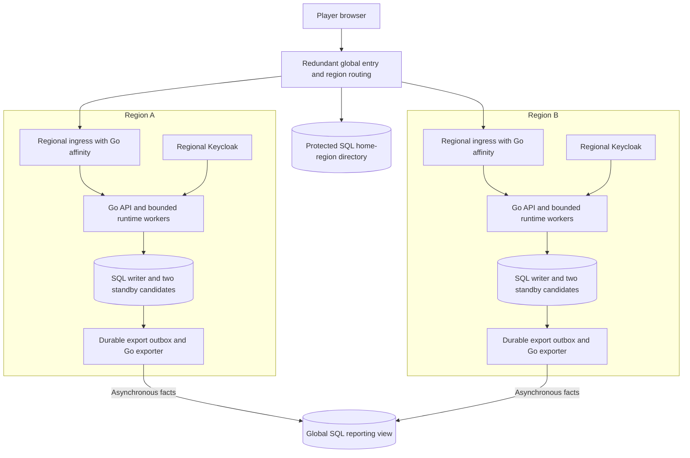
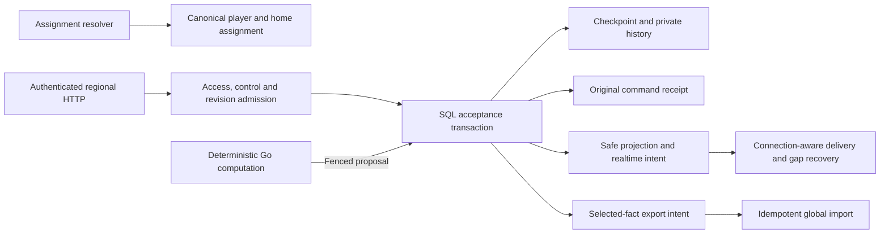
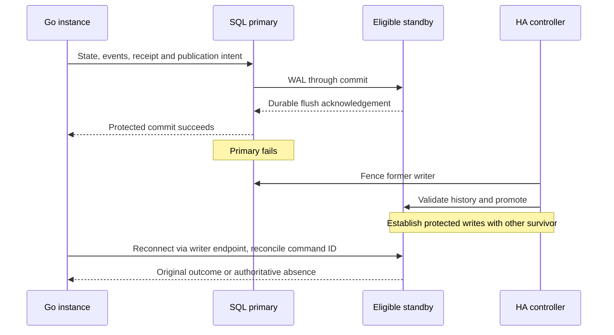
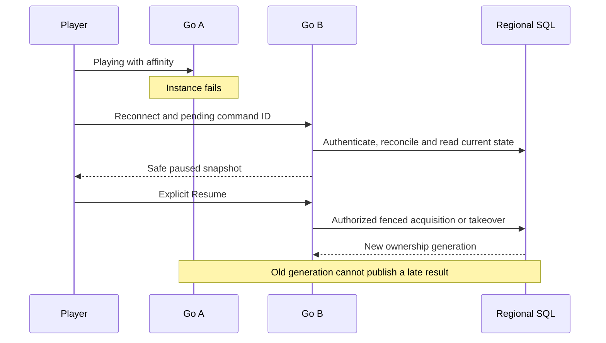
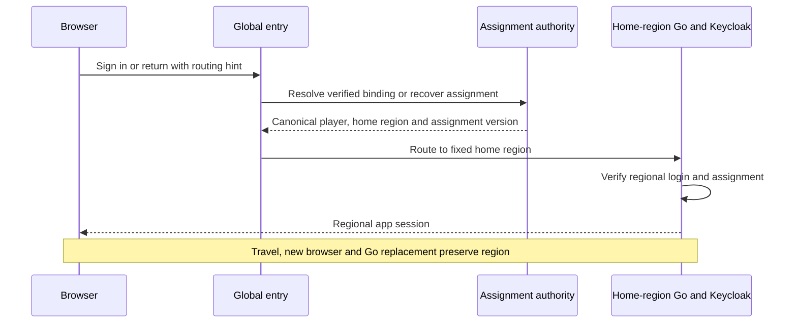
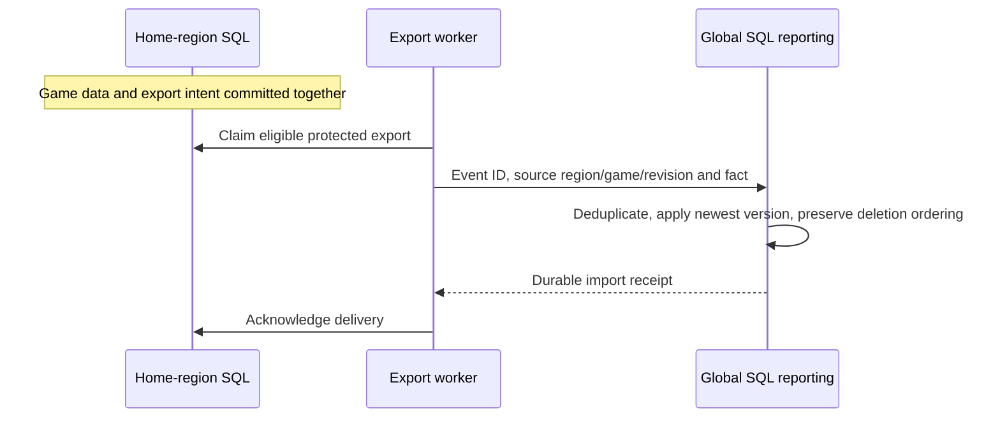

# Regional PostgreSQL and distributed Go architecture

18 October 2026. **Planned specification; implementation has not started under this document.**

[Planned architecture index](../../architecture/planned/README.md) · [Implementation guide](../plans/2026-10-18-regional-postgresql-architecture.md) · [Current-state architecture](../../architecture/current-state/README.md)

## Authority and scope

This consolidates [CR-ARCH-007](../../../planning/decisions/CR-ARCH-007-postgresql-only-game-authority.md), [CR-ARCH-008](../../../planning/decisions/CR-ARCH-008-stable-player-home-region.md), and the owner-confirmed regional-outage behavior. It replaces the two architecture explorations as the specification to use for future planning. It does not change application code, cloud services, commercial policy or product retention.

Owner decisions: no Redis; PostgreSQL authority for gameplay/history/archive; explore three data nodes so protected writes can recover using survivors; stable player home region across logins; no active-game region switching; players wait during whole-home-region failure; history/score retention later. The planned implementation approach uses regional application/data deployments, a minimal global assignment directory and asynchronous global reporting. Vendor and detailed deployment choices remain open.

Existing [regional Keycloak direction](2026-10-14-paddle-identity-release-design.md), [local-auth foundation](../plans/2026-10-16-keycloak-local-auth.md), [renewable-session policy](2026-10-18-renewable-player-sessions-design.md), deterministic game boundaries and separate staff identity remain applicable. This spec does not replace them with a global identity vendor or browser JWT scheme. Hosting follows the bounded pilot sequence before expanding to more regions.

## Global constraints

- PostgreSQL is the sole authority for gameplay, history and archived games; Redis is excluded.
- Each game has one regional writer authority at a time; global reporting never accepts gameplay commands.
- Each player keeps a stable home region across logins; active games do not switch regions.
- Confirmed moves must survive loss of one regional SQL machine and its disk; whole-region destruction is outside that no-loss claim.
- Whole-region outage causes affected players to wait for home-region recovery; automatic cross-region game failover is excluded.
- HTTP receipts, snapshots, matched retries and WebSocket publication must obey the same protected-commit boundary.
- Preserve exact command identities, original receipts, version pins, actor-safe projections and existing authorization/control checks.
- Preserve explicit Resume, paused-game deadlines, one active login family, 15-minute access, 90-day qualifying inactivity and the 180-day absolute login cap.
- Provider calls and expensive game/coaching computation run outside SQL transactions.
- Preserve native local/test profiles, existing data and applied migration checksums; add a separate hosted composition.
- Game-history and score-retention policy is deferred; no deletion schedule is introduced here.
- Public contract changes use the existing schema generators; planned test cases are not executed evidence.

## Requirements and evidence obligations

| ID | Planned requirement | Required evidence |
|---|---|---|
| DRA-001 | Keep SQL authority and transactional gameplay/history/receipt boundaries; no Redis or second game writer | Acceptance/receipt regression plus deployment inventory |
| DRA-002 | Regional primary plus two standby candidates; confirm only with primary and independent standby durable storage | Kill each data node around accepted moves; compare confirmed IDs/revisions on survivors |
| DRA-003 | Safe promotion, old-primary fencing, strict durability during degraded operation | Partition and stale-primary tests; no local-only fallback or stale promotion |
| DRA-004 | Resolve ambiguous outcomes using original command ID and digest; never silently rebase human intent | Lose commit/HTTP response, retry elsewhere, one original outcome |
| DRA-005 | Gate every public confirmation on protected acceptance, including after synchronous-wait cancellation | Concurrent snapshot, retry and outbox readers during cancelled/ambiguous commit |
| DRA-006 | One canonical player/home assignment across concurrent first login, travel and new browsers | Concurrent discovery/provisioning yields one assignment and no duplicate regional owner |
| DRA-007 | Authenticated regional routing and wrong-region mutation rejection | Forged/stale hints, unexpected issuer/host/callback, cleared affinity cookie |
| DRA-008 | SQL-backed Go ownership generation/lease, authorized takeover and bounded drain | Go death, late old-owner result, planned drain, preserved explicit Resume |
| DRA-009 | Connection-aware outbox delivery and cross-instance session/control invalidation | Owner on A, producer/consumer on B; replacement login/logout closes all affected old bindings |
| DRA-010 | Recoverable bounded work admission, execution and result acceptance | Worker death and duplicate claim/completion; no stale result or unbounded retry |
| DRA-011 | Keep game admission, access/usage and current receipt reads on their regional writer | Concurrent revocation/charge/move; no replica-lag authorization or duplicate usage |
| DRA-012 | Durable selected-fact exports and idempotent global aggregation, including corrections/deletions | Lost acknowledgements, reordered revisions, duplicate score fact and delayed resurrection attempt |
| DRA-013 | Directory/reporting failures have bounded, explicit behavior | Established valid regional play continues where permitted; no guessed assignment; backlog/lag visible |
| DRA-014 | Whole-region failure never creates another game authority | Region-A outage leaves its players unavailable; Region B serves only its own players; safe A recovery |
| DRA-015 | Independent backups, verified restore and no silent history rollback | Isolated restore, restore-point/receipt checks and documented recovery limits |
| DRA-016 | Hosted configuration, pool budgets, compatibility, observability and measured rollout | Guard tests, mixed-version recovery, drain/reconnect load and scoped pilot evidence |

## High-level reference architecture

Each region owns disjoint player/game data. Regional HA copies contain that region's authoritative database; other serving regions do not receive every live game. Full personal history/replay reads route to the player's home region. A global index can route authorized detail requests to the owner region. Two independent regions imply six gameplay data nodes under this baseline; directory, identity, reporting and backup capacity are additional responsibilities whose hosting must be budgeted.

## Components and data authority

Boxes are responsibilities, not mandatory separate processes. Begin with replicated instances of the Go modular monolith. A separately deployed compute pool is an optimization requiring measured need; the durable work protocol must support recovery either way.

| Responsibility | Authority and boundary |
|---|---|
| Player identity and home assignment | Minimal protected global directory plus verified regional identity binding; serialized assignment/provisioning |
| Regional authentication | Regional Keycloak and SQL app login families; existing provider-token custody, security generation and expiry policy |
| Active gameplay, grants, usage, control, leases and receipts | Same regional writer acceptance boundary; no cross-region synchronous call on ordinary moves |
| Live socket/runner memory | Disposable process state, reconstructed using SQL; never grants authority by itself |
| History, scores and original advice | Home-region SQL with exact pins and actor-safe readers |
| Global reports | Derived, versioned facts; cannot authorize paid access, enforce global quotas or accept moves |
| Backups | Independent recovery copies; separate from product retention and regional reporting |

Regional Keycloak is an established direction, but automatic cross-host account discovery is not implemented. The first delivery phase must resolve how an unknown returning browser reaches the existing home identity before creating a regional subject. Database-local uniqueness of `(issuer, subject)` is insufficient across independent regional realms. Do not merge accounts by email, equate different realm subjects, or turn a routing hint into proof of account ownership. Preserve separate staff identity.

Billing remains provider/server-verified. Regional entitlement events need a single source/version authority, deduplication and revocation ordering. Cross-region family allowances/global limits require one consumption authority or reviewed reserved budgets; asynchronous reports are not quota enforcement. Unsupported shared-budget behavior remains disabled until that contract exists.

## Stack and deployment roles

| Layer | Planned baseline | Still to select or prove |
|---|---|---|
| Browser | Existing React/Vite, HTTP commands and receive-only gameplay WebSocket | Typed routing/unavailable/recovery states and cross-host cookie behavior |
| Backend | Existing Go module, game codecs and pgx; no runtime model dependency for bot decisions | Hosted entrypoint, instance identity, drain and recovery protocols |
| Regional storage | PostgreSQL physical HA: one writer, two standby candidates, independent hosts/disks | Provider, supported version/settings, promotion/fencing and placement |
| Identity | Regional Keycloak, existing opaque application sessions | Discovery/provisioning protocol, regional identity HA and exact callback boundaries |
| Routing | Redundant global entry plus regional affinity ingress | Concrete service, trusted hint/hostname mechanism, health behavior |
| Consolidation | SQL export intent plus Go delivery/import workers; global SQL read model | Initial fact contract, freshness target and backlog capacity |
| Operations | Independent backups/WAL recovery, metrics and isolated fault harness | Backup window, tested recovery time, operating owner and budget |

The local development toolchain remains repository-pinned; this document performs no version upgrade. Managed PostgreSQL HA is the first service class to evaluate, not an approved vendor. Self-operated HA would additionally need a proven control quorum and fencing. Infrastructure support for PostgreSQL alone does not establish application-level correctness.

## Protected SQL acceptance and failure recovery

The required acknowledgement covers the primary's durable WAL plus at least one independent eligible standby's durable WAL. Safe promotion must preserve every confirmed transaction, and the two survivors must re-establish independent protection before new confirmations. Do not silently reduce to local-only commits when a standby is unavailable. `synchronous_standby_names` alone is not a failover controller. [Synchronous replication](https://www.postgresql.org/docs/16/warm-standby.html#SYNCHRONOUS-REPLICATION), [PostgreSQL failover](https://www.postgresql.org/docs/16/warm-standby-failover.html)

A timeout is an unknown outcome. Resolve the original ID/digest on the current writer; if absent, retry only under still-valid authorization and revision. In-memory results, old snapshots and different command IDs cannot substitute for reconciliation. No silent human-command rebase.

Synchronous-wait cancellation can expose locally visible changes before they are safely replicated. All confirmation paths must establish protected eligibility; the implementation phase must select and test the proof rather than assume any SQL read suffices. A later synchronous write may supply a WAL barrier, while read-only receipt/snapshot paths need explicit handling. `remote_apply` alone does not remove this application review obligation. [Documented cancellation caveat](https://patroni.readthedocs.io/en/latest/replication_modes.html)

## Go affinity, ownership, work and delivery

Keep related requests and the WebSocket handshake on the same Go instance during normal operation. SQL ownership generations and leases govern automation; cookies and sockets do not. An authorized takeover must serialize against the prior generation. Every late automated result rechecks owner, instance/generation, game revision, control/access and foreground permission at acceptance.

Preserve one active login family and region-local session replacement/invalidation. Recovery does not extend paused-game deadlines, replace expired access, revive an old family or authorize automatic Resume. A planned drain stops new admissions, bounds existing work, releases/transfers ownership safely and forces reconnect recovery where needed.

Outbox delivery must find the correct connection owners and handle affected connections on more than one instance. Account-wide logout/control changes cannot be consumed by only one instance while another keeps an old socket. Duplicate delivery is tolerated through sequence/cursor recovery; game history and original receipts are not disposable delivery rows. Durable work claims include leases/attempt fences; worker loss causes recoverable retry, not duplicate effects.

## Stable regional assignment and routing

This is a responsibility sequence; the exact discovery proof/bootstrap protocol is a mandatory first-phase output. A first assignment is durable before regional account activation. Provisioning is idempotent and has explicit pending/active/deleting states. Unresolved identity or directory failure must not create an independent regional account. Existing authenticated sessions may use an already valid assignment without querying the directory on every move, but may not bypass expiry/revocation.

DNS may choose a bootstrap endpoint; authenticated routing or regional endpoints enforce home ownership. A wrong-region request must not create or mutate a game. Use exact host/issuer/callback allowlists and existing cookie/CSRF practices; do not broadcast bearer tokens across regions. DNS traffic management cannot supply individual authenticated stickiness by itself. [Traffic Manager behavior](https://learn.microsoft.com/en-us/azure/traffic-manager/traffic-manager-faqs)

## Global consolidation

The home region remains authoritative for all moves and personal history. A completion/correction/deletion transaction can also append selected export intent. The initial global view is a game index and selected score/usage facts; no universal scoring scale or automatic replication of all private game events is implied.

At-least-once delivery must yield one effective current contribution per game, not a score increment on every retry. Track source identity, revision and schema/rule/variant versions. Corrections, backfill and deletion/suppression need ordering and durable evidence; delayed exports must not resurrect removed data. Report per-region freshness/missing data rather than showing an unavailable region as zero activity.

The existing realtime outbox is unsuitable unchanged: its cleanup intentionally permits removing undelivered rows because browsers recover through snapshots. Export uses separate delivery state, retry/backlog bounds and reconciliation watermarks. Reporting outages do not block normal gameplay while the budget permits; capacity exhaustion has explicit backpressure, never silent loss of required exports. Exact payload fields, reporting freshness and capacity are first-phase inputs, not retention policy.

## Failure contract and operational recovery

| Failure | Required behavior | Boundary |
|---|---|---|
| One Go instance | Recover in-region, fence stale work, reconcile receipts, preserve explicit Resume | Affinity may change |
| One SQL machine/disk | Preserve confirmed moves and recover protected writes on survivors | No unsafe promotion or durability downgrade |
| No safe SQL writer/copy | Pause new acceptance, retain unknown outcomes for reconciliation | Availability yields to the stated durability requirement |
| Directory outage | Continue valid established regional work where permitted; unresolved discovery/provisioning waits | Identity/session expiry still applies |
| Reporting outage | Queue within budget and show stale/partial reporting | Reporting is never gameplay authority |
| Whole home region unavailable | Affected players wait; other regions serve their own players | No automatic relocation, duplicate account, new game writer or reporting-store promotion |
| Region returns | Validate authoritative timeline/receipts, renew valid authentication/control as needed, recover paused game | No unsolicited Resume or silent rollback of history |
| Whole-region destruction | Use separately reviewed recovery procedure and available backups | No zero-loss cross-region guarantee or recovery-time promise in this spec |

Independent backups and restore verification remain necessary because replicas propagate unwanted data changes. Record restore point and any known gaps; never present an older backup as a proven complete confirmed history. A destructive disaster exceeding the single-node fault model requires an explicit recovery decision if complete history cannot be recovered. Backup operating windows are separate from the deferred product-retention policy. [PostgreSQL PITR](https://www.postgresql.org/docs/16/continuous-archiving.html)

The regional availability promise assumes global routing remains reachable and established authorization remains valid. Directory, identity, ingress and writer-endpoint dependencies need their own HA/failure assessment. No single global dependency may be silently declared harmless to all regions.

## Current-to-planned map and execution boundaries

| Current source | Reuse | Planned addition |
|---|---|---|
| [Store](../../../server/internal/records/store.go), [Commit](../../../server/internal/records/store_documents.go) | Bounded transactions, record/revision checks, durable receipts | Hosted constructor, writer reconnection and protected confirmation proof |
| [Playback](../../../server/internal/records/realtime_playback.go), [bot manager](../../../server/internal/service/bot_playback.go) | Generations, foreground/control fences | In-region owner takeover, drain and durable recovery |
| [Outbox](../../../server/internal/records/realtime_outbox.go), [hub](../../../server/internal/service/realtime.go) | Sequenced intents and safe projections | Connection-aware delivery and multi-instance invalidation |
| [Work](../../../server/internal/records/work.go), [scheduler](../../../server/internal/service/scheduler.go) | SQL leases/attempts and bounded compute | Recoverable dispatch/admission beyond local callbacks |
| [Auth records](../../../server/internal/records/auth.go), [auth service](../../../server/internal/authsession/service.go) | Verified identity and renewable family policy | Global assignment/provisioning and regional binding; no duplicated auth stack |
| [Canonical migrations](../../../web/server/records/migrations/), [generated contracts](../../../web/shared/auth.schema.json) | Additive schema history and public validation | Forward region/ownership/export changes, no rewritten applied migrations |

Before execution, select the HA provider/configuration, placement, protected-commit proof, recovery-time target, exact regional identity discovery, routing service, directory availability and export/freshness/backlog contract. These are concrete first-phase deliverables with owners and tests, not permission to improvise a weaker guarantee. The guide identifies what can proceed once each input is resolved.

Validation proceeds from one isolated region with two Go instances and three SQL nodes, to two simulated regional deployments and independent failure tests, then a bounded hosted pilot. Multi-region rollout and capacity claims follow measured acceptance. No implementation, provisioning, migration, runtime/failover/load test or collection activation occurred while writing this specification.
