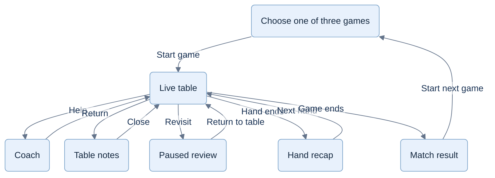

# Product and views

**Product:** Tricks Coach · **Chosen primary domain:** `trickscoach.com`. [CR-BRAND-001](brand-and-domain.md) records the owner-approved name and pending manual Vercel setup. Use the exact plural name in future public-facing copy; Jev remains the strategic model/provider name. This documentation update does not change the prototype UI.

Commercial entry, membership and family behavior are defined in [06](06-commercialization.md); the server boundary is in [07](07-hosted-architecture.md). The current prototype does not implement them.

## Experience

A complete card game with a coach in the player's corner. The player already knows the rules; the coach helps them notice, decide and improve. Default: Spades partners, coaching **When I ask**, three computer opponents. Resume the active game on return.

The visual reference is [App.tsx](../web/src/App.tsx), [styles.css](../web/src/styles.css), [desktop](../web/qa/ui-v1-desktop.png) and [phone coach](../web/qa/ui-v1-phone.png). Preserve the blue table, simple avatars, right coach panel and hand below. Decorative captions, pep-talk text and the small hand footer are removed; the table uses the freed space. Keep computer-player disclosure in game setup; names and avatars can feel personable.

[CR-UX-004](decisions/CR-UX-004-table-cues.md) records the later owner-approved cue and copy changes. Active-seat rings/dots, numeric bid/trick counts and grey unavailable cards carry routine status; screen-reader announcements remain. Last trick stays visible at the left as four small cards with a winner mark and no visible names. Extra rules/review explanation is expandable.

## View contract

### Table view map

Optional views return to the current table. Help does not commit a move; review retains the latest live position.

| Existing view | Required behavior |
|---|---|
| Public demo | Finite example game and authored coaching; replayable without login. No dynamic coaching or live full-game access for unpaid users. |
| Membership | Selected offer survives sign-in; paid access resumes the saved table. Show coaching hands remaining/reset and an optional upgrade. Expiry pauses play without deleting the game. |
| Account and family | Independent member accounts; clear paid-by relationship; payer manages seats/billing without access to private member games. These routes work in portrait on phones. |
| Table | Four seats; active seat; current trick and winner; hand/trick number; scores, bags and contract where relevant. Opposite seat is labeled Partner only in partnerships. |
| Game picker | Hearts Solo, Spades Solo, Spades Partners. Explicit Start game replaces the current table; preserve the former game internally as abandoned. Cancel changes nothing. |
| Hearts pass | Select/deselect exactly three cards, then confirm. Exchange all four bundles atomically. Mark received cards until the player's first play. Hold hands skip this phase. |
| Spades bid | Integer 0–13, Nil shortcut and explicit confirmation. Show earlier public bids; no artificial restriction on their sum. |
| Play | Double-click/double-tap during another player's turn prepares and raises a card; it never auto-plays when the turn arrives. During the player's turn, double-click/double-tap plays that legal card. Single activation selects; Enter is the keyboard play equivalent. Remove the Play card button; keep bid/pass confirmation. Recheck legality at play time; every legal card remains available, including cards outside the coach's shortlist. |
| Coach | Notice → Consider → Suggestion, plus the existing direct-suggestion shortcut. One cue at a time; dismissal never erases recorded exposure. Advice never commits a move. |
| Table notes | Public played counts and known voids; expandable played cards, table rules and Hearts private pass memory. Last trick lives directly on the table. Label public facts and private pass knowledge separately. No old-game navigation. |
| Settings | Coaching: When I ask; Occasional cues; After the hand. Game speed: 1×, 1.2×, 1.4×, persisted. Keep these together; no model, skill-level or strategy configuration screen. |
| Pause | Preserve position and selections. Dialogs, backgrounding and the phone rotation gate suspend progression. Resume starts a fresh animation delay. |
| Hand recap | Existing score comparison plus at most one supported strength, one review moment and one next focus. Back to table/Play again always available. Play again continues the match; expand evidence within this dialog. |
| Match result | Name the winner and final standings, then Play again to restart the same mode. Other modes remain in the game picker. No archive or replay library. |

Table notes' **unplayed** count includes the player's hand; it must not be labeled unknown. Detailed memory is optional assistance. Score, bids, legal-card availability and the visible trick are ordinary game information.

Use “Play to 500” for Spades: scoring is simultaneous and tied leaders continue. Requested advice must adapt to a credible Hearts moon plan or Nil situation; omit the default hand-objective caption.

## Advice states

Facts and legal play remain responsive while analysis runs. Use the existing coach panel:

In V1 `off` and `shadow` modes, the shared local strategy supplies all visible advice. A shadow response or failure never changes the UI, recommendation, human assessment or game timing. After promotion, `recommend` mode may use Jev for a requested suggestion; facts and earlier help levels remain code-derived. These are internal modes, not another player setting.

- Pending: “Considering the position…”; allow dismissal and human play.
- Ready: reveal only the requested help level. Outline evidence at Notice; mark a proposed card, bid or pass only at Suggestion.
- Close alternatives: “Both have a case,” with one short tradeoff when requested.
- Unavailable: retain factual notes and any validated local suggestion. If Jev advice was requested, offer Retry and label a displayed local alternative “Local suggestion”; record its provenance. If neither source has an answer, show “Suggestions unavailable. You can keep playing.” Never present a local answer as Jev's.
- Stale: remove advice silently when the decision changes. Never transfer its highlight to a new hand.

For experimental Jev-controlled bots, an unavailable decision pauses that bot with Retry. Normal practice bots use the local strategy, so a provider failure cannot stop them. Switching an experiment to local strategy is an explicit developer action recorded internally.

Saving failure is different: keep the last confirmed table and pending selection; show “Couldn't save this move. Retry.” Do not advance an unrecorded game. Reconnect/reload recovers the authoritative accepted state, including a move accepted before its response was lost.

## Responsive and accessible behavior

Preserve iPad portrait/landscape, desktop, and landscape phones. Width below 700 CSS pixels with height greater than width shows only the rotation gate and pauses play. Do not rotate the page artificially. Keep safe-area insets, visible viewport sizing and at least 44 CSS pixels of exposed card target at the supported 667-pixel landscape width. Short coach explanations may scroll; their action stays reachable.

Keyboard-selectable cards, visible focus, modal focus trapping/restoration, inert backgrounds, reduced motion and concise live announcements remain required. Selection, legality, recommendation and current winner use distinguishable marks, not color alone. Baseline speed is 1×: 900 ms bot and 2,100 ms completed-trick pacing. Divide both delays by 1.2 or 1.4 for faster settings; leave coach/toast reading time unchanged. Changing speed must preserve pause and cancel stale timers; network time may extend waits.

Validate the six contrasting coaching situations in [04](04-coaching-and-evidence.md), including on physical iPhone/iPad Safari and Android Chrome. Screen emulation alone does not establish touch comfort or suspension behavior.

Out of scope for the first commercial product: beginner curriculum, chat interface, human multiplayer, competitive rating, user game history/library and a drill catalog. Accounts, hosted persistence, paid play and family membership are commercial requirements in [06](06-commercialization.md) and [07](07-hosted-architecture.md), built after the local rule/coach foundations. The landscape gate applies only to game tables, never login, billing or account management.

[Future play considerations](11-future-play-and-membership.md) cover returning for bot enjoyment, optional free access and human matches. They preserve the shared table and optional coach; they do not add views, matchmaking or a free tier to this release.
