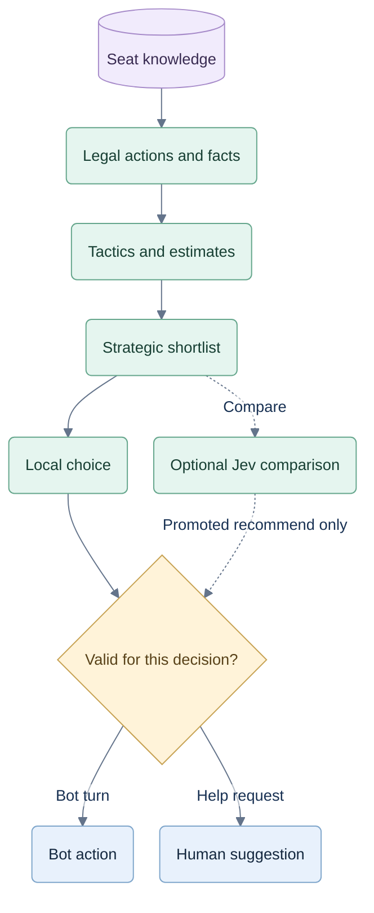

# Games and decisions

**CR-STRAT-005:** [Reasoning contract and scenario catalog](12-spades-reasoning.md) specifies the shared solo core, partnership overlays, evidence classes and saved analysis.

## Rules to preserve

Freeze `hearts-training-1.0.0`, `spades-solo-training-1.0.0` and the existing partnership `spades-training-1.0.0`. These are this app's variants, not claims about every table's rules. Use the current [engine](../web/src/game.ts) and [scoring fixtures](../examples) as the starting point.

All modes: 52 unique cards, ace high, 13 per seat, clockwise. Seats: 0=You/South, 1=Leo/West, 2=Maya/North, 3=Theo/East. Next seat is `(seat+1)%4`; partners are 0/2 and 1/3. Dealer rotates per hand. A completed trick stays visible before collection; its winner leads next.

| Rule | Hearts solo | Both Spades modes |
|---|---|---|
| Start | Three-card left/right/across/hold cycle. After exchange, 2♣ opens. | Dealer's next seat bids first and leads first. All four bid 0–13; zero is ordinary Nil. |
| Follow | Follow suit when possible. Highest led-suit card wins. | Follow suit when possible; otherwise any card. Highest spade wins, otherwise highest led suit. No mandatory trump or overtrump. |
| Restricted lead | No hearts lead until a heart was played, unless only hearts remain. Q♠ does not break hearts. | No spade lead until a spade was played, unless only spades remain. |
| First trick | When unable to follow clubs, no hearts/Q♠ discard if a non-penalty card exists. All-penalty hands may discard one. | Trump is allowed when void, including trick one. |
| Score | Hearts +1, Q♠ +13. Collect all 26: shooter +0, others +26. | Positive contracts, individual Nil and bags as below. No blind Nil or jokers. |
| Finish | After any score reaches 100, unique lowest score wins. A tie for lowest continues. | After any competitor reaches 500, unique highest score wins. A tie for highest continues. |

For each Spades competitor (one player in solo, one partnership otherwise):

```text
B = sum of positive bids
C = tricks taken by those positive bidders
F = tricks taken by failed Nil bidders
O = C >= B ? C - B : 0
delta = (C >= B ? 10*B : -10*B) + individual Nil bonuses + O
        - 100*floor((previousBags + O + F)/10)
newBags = (previousBags + O + F) % 10
```

Each Nil scores +100 at zero tricks, otherwise −100. Failed-Nil tricks add bags but no +1 points and no contract credit. Both partners may bid Nil. Mirror team totals to their seats; count each partnership once when determining a winner. Example: positive bid 4 takes 3, Nil partner takes 1, previous bags 9 → −240 points, zero residual bags.

## Knowledge before intelligence

Authoritative state contains every hand. `observe(state, seat)` exposes only that seat's cards, public bids/plays/scores, hand sizes, rules and private outgoing/incoming pass information. Exclude deal seed, seed-derived identifiers, other hands, other private passes and future events. Before Hearts exchange, do not expose the current 2♣ holder through a turn/leader field. All strategy components consume this observation, never authoritative state.

Derive counts and voids from events. A failure to follow proves a void; a bid suggests strength without proving card ownership. A passed card's recipient remains known until that card is played. Incoming cards can undo a planned personal void. All four pass commitments use pre-exchange observations and stay private until atomic exchange.

Use structured accepted actions and immutable versions to reproduce every hand; replay derives broken-suit flags and winners. Seeded dealing alone does not reproduce human passes, bids or choices.

## Decision pipeline



Shadow comparisons remain internal. A human suggestion leaves every legal action available.

1. Enumerate every legal action. Play ≤13; bid 14; Hearts pass 286 complete triples. Derive exact counts, known holdings and voids first.
2. Apply the solo tactical core, then partnership objectives and exceptions before selecting a move. Partner evidence is public and can be exact (void) or soft (lead/discard); it never shares hidden hands. Apply conditional tactics: short suits, queen protection, moon opportunities, safe underplays, contract need, bags, Nil coverage, control and next lead. Bots and coach share this policy and its verified reasons.
3. Calculate exact probabilities for tractable questions; otherwise sample hidden deals constrained by known holdings, voids and hand sizes. Uniform feasible assignments are the baseline assumption. Validate both feasibility and sampling frequencies against exact small-state enumeration; naive sequential placement can be biased. Bid/pass-based weighting is a separate, versioned soft assumption.
4. Compare complete plans using the same sampled deals across actions. Simulated actors use their own observations. Incoming Hearts passes are simulated before judging a proposed pass. Screen all actions cheaply, then allocate extra computation to competitive or uncertain plans; record which actions received deeper evaluation.
5. Retain strong, close and strategically different candidates. Initial cap: 12; retain an alternative objective when relevant. Code ranks this shortlist; enabled Jev runs compare choices using the same facts, estimates and limitations.
6. Validate the selected candidate and current decision version. Apply only a legal bot action; a human suggestion never commits a move. Produce explanation text from verified predicates and templates.

The coach reuses this analysis before a move and compares the accepted human choice afterward. Both use the original player observation. Review may replay real events or illustrate a sampled alternative, but neither a later outcome nor a better single trial certifies a mistake. The [coaching specification](04-coaching-and-evidence.md) controls presentation, timing and review behavior.

The 286 passes are a manageable local evaluation set, not 286 model questions. Tactics rank possibilities; only proven impossibility/dominance removes something from the complete reference set. One shortlisted candidate is policy-selected; only one **legal** action is forced. Humans keep the full legal set, and evaluation must include their chosen action even when omitted from the shortlist.

Skip the model for forced moves or a one-candidate shortlist; record the latter as a local policy choice. Count these bypasses separately when measuring Jev's contribution.

Initial live experiment budget: at most 256 feasible worlds and 250 ms of local analysis in a worker. The time budget covers sampling, candidate evaluation and rollouts together; it excludes the provider call. These are profiling starting points, not accepted performance targets. Save per-action coverage, actual sample count/seed and truncation; partially evaluated actions are not proved inferior. Replay/benchmark mode uses fixed work counts. Use exact analysis when the information state is tractable; hidden cards do not become known merely because the hand is nearly over. Do not report raw heuristic weights as probabilities.

Rank rollouts by this rules profile's expected end-of-hand score: minimize own penalty in Hearts; maximize own/team score in Spades. Where a rollout ends the match, prioritize match win/loss before score. Include contract/Nil success and bag/penalty exposure as separate tradeoffs. This is a bounded estimate, not solved optimal play; log its horizon and opponent policy.

## Bidding options and selection gate

The prototype's king weight `0.55` and other bidding weights are unvalidated heuristics. Research informs features and methods; it does not establish those constants. Preserve the current bidder as a named benchmark, not a probability model.

| Option | V1 investigation | Selection condition |
|---|---|---|
| A — calibrated lightweight bidder | Use high-card structure, suit length, trump protection, seat, earlier bids, scores and bags. Fit contextual outcome estimates; model Nil separately. Record training source, policy and calibration. | Reliable held-out estimates and useful score/contract results at low latency. |
| B — constrained-deal rollouts | Compare candidate bids by simulating later bidding and play, then apply this app's exact scorer. Include Nil, contract failure and bag risk. | Contextual gain justifies compute and remains robust across opponent policies. |
| C — adaptive A/B | Use A routinely and B for uncertain, Nil, bag or endgame cases. | Add only if it improves on A and B individually enough to justify the extra policy. |

Compare A and B first; C is optional, not the chosen implementation. Freeze downstream playing-policy versions for the initial bidding comparison, while allowing those policies to respond to each candidate bid. Observed tricks under one bid are not labels for what would happen under every other bid. Use score-relevant outcome distributions, including partnership/Nil interactions, rather than rounding mean expected tricks. Two hands with the same mean can have different contract risks.

Separate development, calibration and final test deals, grouping related seats/variants of a deal together. Synthetic data validates performance under its generating policies; it is not human evidence. Report solo and partnership results separately. Keep a coefficient/probability provenance record and abstain from unsupported percentages.

The [Bidding in Spades study](https://arxiv.org/html/1912.11323v2) combines contextual regular-bid heuristics with learned Nil-success calibration; it does not validate a universal king coefficient or prove rollout bidding superior. The [commercial Spades hybrid study](https://edpowley.com/academic/papers/aiide13.pdf) supports combining tactical knowledge with search for play and retained heuristic bidding. Both concern partnership play; solo requires its own evaluation.

## Keep Jev's contribution measurable

V1 defaults to local code. Internal modes are `off` (no requests), `shadow` (record Jev separately, never apply/show/grade with it) and `recommend` (requested suggestions after promotion). Normal bots remain local. Jev-controlled bots are a separate experiment. Record mode and `code`, `jev`, `forced` or explicit `fallback` provenance; shadow responses never overwrite the applied choice. Jev is the only remote strategic model. No model supplies arithmetic, rules or fabricated reasoning.

Use three evaluation arms: **full-reference code → shortlisted code → Jev on the same shortlist**. The first comparison measures shortlist loss; the second isolates Jev selection. The full reference evaluates all legal actions with a larger fixed offline budget and remains an estimate. Pair deals, rotate seats and compare multiple opponent-policy families, stratifying mode, phase, Nil, bags and endgame. Save bypass/fallback rates and report both eligible-decision effects and whole-game results.

Use held-out evaluation samples, inspect omitted legal actions and the human choice, and report score/contract/Nil outcomes, calibration, coverage, uncertainty, latency and observed cost. Independent random seeds reduce sampling dependence, not shared policy bias; cross-check with alternate policies and tractable exact references. Shadow logs establish operational behavior, not outcome benefit. Promote requested Jev advice only after controlled evidence supports it; never use agreement with Jev as the grading target.

Critical regressions: cover a live Nil partner even when the positive contract is already met; distinguish solo from partnership goals; avoid declaring an unfinished trick safe; preserve queen protection/possible moon plans in Hearts passing.

Use [information-set search principles](https://eprints.whiterose.ac.uk/id/eprint/75048/) to avoid evaluating plans that rely on hidden knowledge. Add future games through explicit game adapters sharing observations, actions and coaching records; do not build an abstract rules language now.
