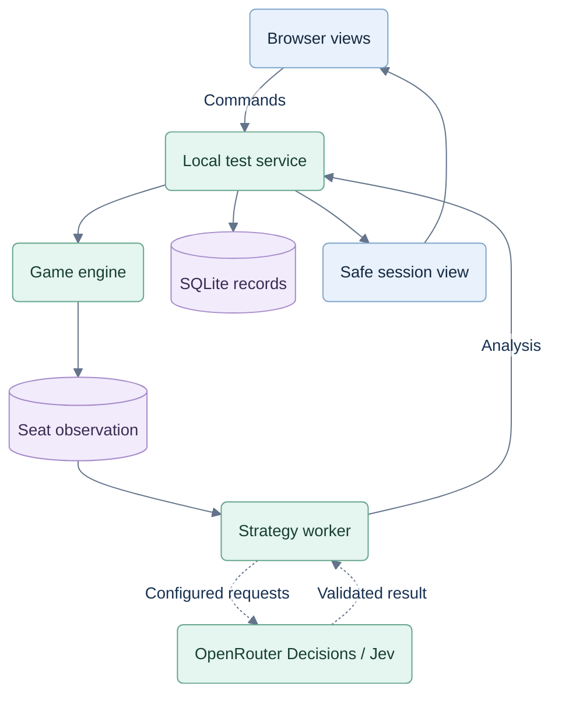

# Service, records and OpenRouter

## Local harness and hosted target

Keep React 19, TypeScript and Vite. The local harness may use Node 24.19+, native fetch and SQLite with explicit test identities/mock grants. The hosted target in [07](07-hosted-architecture.md) uses Node/Fastify, PostgreSQL and managed identity; production concurrency must be tested on that database. Local mocks are never commercial enforcement. Paid play and hand-based coaching allowances are defined in [06](06-commercialization.md). Enabled Jev experiments need OpenRouter credentials and internet.



This is the local test harness. Hosted identity, access and PostgreSQL boundaries are defined in [07](07-hosted-architecture.md).

The service owns game state and validates commands. The browser receives the human projection, never other hands or the deal seed. Keep the pure engine under `web/server/game/` and import it into server tests. Share only public DTO schemas/types and display utilities with the browser; do not ship the engine, coach implementation or aggregate. Run probability work in a worker so saving and legal human actions stay responsive.

Default service binding: `127.0.0.1:8787`; Vite proxies `/api`. One `npm run dev` starts both. Optional `npm run dev:lan` exposes Vite for trusted Wi-Fi device testing; the service still binds loopback. Allow only configured Host/Origin values, require JSON for mutations, and expose no general-purpose provider proxy. One current table per player; local V1 has one persisted test player. Concurrent tabs use revision checks, not independent game writers.

Resolve player identity in the service, never from a browser-supplied owner field. Scope games, the current-game pointer, preferences, progress and coaching usage by player; child records inherit ownership through their game. Verified authenticated sessions replace the local resolver for hosted games. Visitors receive only the fixed public demo, which needs no authoritative live game session. Keep cards, animation, audio, input and responsive rendering in the browser; trusted rules, state, coaching and paid access stay in the service.

This is the target runtime; today's `npm run dev` starts only the browser prototype. Commands, configuration and activation gates are defined in [V1 setup](05-v1-setup.md).

## Execution modes

| Internal mode | Applied behavior |
|---|---|
| `off` — default | Local bots and local coach; zero provider calls. |
| `shadow` | Same applied behavior as `off`; eligible decisions additionally produce separately stored Jev comparisons. Never reveal/apply these choices or feed them to human grading. |
| `recommend` — gated | Requested suggestions may use Jev. Bots stay local; facts/templates and assessment stay independent. A validated local alternative may be shown with explicit provenance. |

Configure the mode server-side. No automatic promotion or player model picker. Enabling requests requires an experiment manifest with a request cap, model/policy versions, eligible decisions and latency/cost targets. Count retries toward the cap; zero disables requests. Shadow work has lower priority than gameplay, never blocks a move, and never changes visible loading/error states. Its failures are internal records. A changed position invalidates live advice even if a shadow result remains useful for that recorded position.

Promotion requires the three-arm evaluation in spec 02, including supported benefit and acceptable latency/cost. Without that evidence, keep `off` or `shadow`. Jev bot experiments require a separate explicit experiment configuration and are not enabled by `recommend`.

Coaching entitlement is separate from provider mode. Paid coaching may use code or Jev; `off` does not bypass access control. Local development grants mock full access by default and can simulate limited/exhausted plans. Enforce one coached-hand unlock per player/game/hand with transactional reserve/ready/release states; decisions and provider jobs retain separate identities. Provider requests and learning exposure have separate records. Do not meter from browser-reported display events.

## Shared contracts

Define public DTOs in `web/shared/contracts.ts` and private domain types in `web/server/game/`. The table documents both; `SessionState` is server-only. Validate inputs and allowlist outputs. [07](07-hosted-architecture.md) specifies hosted identity, secure shuffling, authorization, audit and concurrency.

| Type | Required content |
|---|---|
| `SessionState` | Existing game aggregate + unique game ID, server-only owner ID, increasing revision, rules/engine versions, active/completed/abandoned status, all-seat private pass records. |
| `DecisionObservation` | Decision ID, mode/profile, acting seat, own hand, public state/history, permitted pass knowledge. No hidden aggregate or deal seed. |
| `GameAction` | Discriminated union: `{kind:'bid',bid:number}`, `{kind:'play',card:Card}`, `{kind:'pass',cards:Card[]}`. Engine determines actor. |
| `Candidate` | Stable action ID, action, tactical plan tags, predicate-backed facts, estimates with method, per-action coverage, calibration/provenance and uncertainty. |
| `DecisionAnalysis` | Observation hash, full legal actions, shortlist, local choice, separately recorded Jev choice, applied choice/source, execution mode, versions, sampling record and provider outcome. |
| `Exposure` | Unique event ID, source decision, affected hand/revision, content level/surface/source; server-issued time, delivery-unknown state and optional untrusted display-reported time. Issued help disqualifies independent claims even without a browser acknowledgement. |
| `SessionView` | Human observation + revision, phase, legal actions, public score/result, coach preference, current help exposure. |
| `Assessment` | Decision/category, supported/reasonable/review/not-assessed status, evidence, assistance class and assessor version; optional proved-mistake flag. |
| `ReviewCase` | Accepted decision ID, original observation/action/assessment, evidence event IDs, legal alternative and original recorded continuation references. |
| `ReviewView` | Case plus human-visible replay frame, original hand/trick, live pause revision and Original/Possible continuation label. No authoritative hidden state. |
| `ReviewTrial` | Unique trial ID, parent decision, legal alternative card, separate simulated continuation, sampler/policy versions and exposure; never an accepted live action. |
| `CoachAccess` | Effective plan/coverage, canPlay, canCoach, remaining coached hands/reset time, whether this hand is unlocked and whether new work is allowed. No browser override. |
| `CoachedHandUnlock` | Player/game/hand identity, reservation ID/period, lease and fencing token, reserved/ready/released status and first durable usable-result reference. |

Decision ID includes game, hand, phase, actor and revision. Every state mutation carries `{commandId, gameId, expectedRevision}`. Repeating an accepted command ID returns its recorded result; reusing that ID with different content is rejected. A stale revision returns 409 plus the current view. Validate phase, actor, card ownership and legality again on acceptance.

## Browser/service API

| Method/path | Contract |
|---|---|
| `GET /api/session` | Current `SessionView` or null; includes completed current match until replaced. |
| `POST /api/sessions` | `{commandId, mode, expectedActiveGameId}` → atomically create a durable game and retire the previous active one. |
| `POST /api/session/actions` | Mutation envelope + `action:GameAction`, optional display reports → accepted `SessionView`; reports are not proof of independence. |
| `POST /api/session/prepare` | Game/revision → compute the next bot action without applying it; return prepared decision ID. |
| `POST /api/session/advance` | Mutation envelope + prepared decision ID for a bot, or `kind:'collect-trick'|'next-hand'` → view. |
| `POST /api/session/advice` | Game/revision + requested level 1/2/3 → version-bound advice or typed unavailable result; no game mutation. |
| `POST /api/session/exposures` | Deduplicated client display reports; server-issued assistance already exists and cannot be erased by missing reports. |
| `PUT /api/preferences` | Persist `{coachMode:'asked'|'nudges'|'after',gameSpeed:1|1.2|1.4}`; default legacy speed to 1 and retain prior exposures and the game revision. |
| `GET /api/session/recap` | Current hand result, assessments and aggregate progress; no arbitrary historical game lookup. |
| `GET /api/coaching/access?handId=X` | `CoachAccess` for the owned hand; no browser plan override. |
| `POST /api/coaching/hand-unlocks` | `{requestId,gameId,handId,decisionId,expectedRevision,requestedLevel}` → verify all relationships, reserve a hand once and prepare usable coaching; recover the same result on retry. |
| `GET /api/session/reviews?scope=hand\|match&handNumber=N` | Review index within the current game, including previous hands and the just-completed match. |
| `GET /api/session/reviews/:decisionId?step=N` | Read-only `ReviewView`; reconstruct only recorded events up to the live pause boundary. |
| `POST /api/session/reviews/:decisionId/trials` | `{gameId,expectedRevision,trialId,alternative:{kind:'play',card}}` → isolated `ReviewTrial` through this trick. Deduplicate trial ID; revalidate legality and current-game membership. |

The client schedules preparation/advancement only while visible and unpaused. A prepared bot answer can finish during pause but cannot commit then. On resume, refetch state before starting a fresh delay. Human acceptance invalidates pending advice. Duplicate requests coalesce by decision/analysis versions; cache uses canonical observation, candidates, policy, analysis budget, prompt, model and execution mode. A cached shadow answer cannot become live advice simply because the mode changed.

Assess accepted human choices asynchronously from their recorded pre-action observation. Recap includes pending/ready/partial assessment status and shows available evidence without delaying Next hand. Already accepted actions remain durable across pause or a lost response.

Opening review suspends the client's advance loop and records the latest accepted live revision. Replay/trial operations never call the live submit/advance path, change its revision or replace its saved snapshot. On return, refetch and restore selections only if still applicable; another tab's accepted change requires reconciliation, not a rollback. After a reload, recover the real game paused; a trial cannot become the active game.

Scope every review query to the current-game pointer. Starting another game closes previous review access while retaining internal records. Reconstruct evidence from the original observation, even when later events are replayed. Build trial worlds solely from that observation with a separate sampler seed; never consult actual hidden hands or their seed. Keep original playback and simulated continuation visibly distinct. Legacy snapshot-only records may supply available facts, but cannot fabricate a replay.

Full hosted play requires an active individual/family grant. Advice, analytical recap, guided review and trials additionally require coaching access; an existing hand unlock covers all its decisions/help levels. Read-only original playback returns owned public/own-card facts without locked analysis. Check ownership/access on all paths, including caches. Automatic markers/shadow work never spend limited allowance. Quota exhaustion permits ordinary play for active members; subscription expiry pauses live progression and preserves the table, account access and coaching saved under an existing unlock during paid coverage.

## Jev transport

Use native fetch with Bearer authentication, server-only `OPENROUTER_API_KEY`, and `POST https://openrouter.ai/api/alpha/decisions`. Request release `typesafe/jev-1.13`; save the returned resolved model separately. Do not use chat completions, a floating latest alias or a model router. [OpenRouter Decisions contract](https://openrouter.ai/docs/api/api-reference/alphadecisions/submit-a-decisions-request)

```json
{
  "model": "typesafe/jev-1.13",
  "state": {"observation": {}, "candidates": [], "objective": "profile-specific objective"},
  "questions": {
    "move": {
      "type": "choice",
      "instructions": "Select the candidate best serving the stated objective, accounting for supplied uncertainty.",
      "criteria": {"play:H2": "Preserve control", "play:HA": "Take the next lead"}
    }
  }
}
```

This illustrates the wire shape; runtime state contains the complete validated observation and estimates. Candidate IDs map exactly to actions. Whole pass triples use one ID each. The upstream [TypeSafe reference](https://docs.typesafe.ai/api) documents a 255-choice limit; enforcement through OpenRouter has not been independently confirmed. Our small shortlist does not depend on that limit, and all 286 Hearts bundles remain available to local screening.

Require `answers.move.type === 'choice'`, a supplied choice ID, finite probabilities in [0,1] covering the criteria, approximately unit sum (tolerance 0.02), and confidence in [0,1]. Validate the response model against the configured release/snapshot allowlist. Save request ID, provider, usage and cost when supplied; missing usage stays unknown. Provider confidence describes answer concentration, not chance of winning. Jev returns no explanation; templates describe verified candidate consequences. [Jev tutorial](https://openrouter.ai/docs/guides/community/jev-tutorial)

Initial application deadline: 8 seconds from admission of a requested Jev operation; queue wait, preparation and retries use the same remaining budget, not a fresh deadline per stage. Do not admit work predicted to expire before it can be useful. No automatic retry after timeout, auth/credit errors or invalid input. Permit at most one retry for a definite 429/503 response, honoring Retry-After only within the remaining deadline. Never replace Jev with another model. Log each attempt; ambiguous failures can still be billable. A user Retry starts a recorded new attempt. Actual latency and billing behavior require the live smoke test. Hosted dispatch/work capacity follows [10](10-capacity-and-scaling.md).

## Durable internal records

Store `C:\repos\test-jev\data\jev-test.sqlite`: games, accepted commands/events, snapshots, decision analyses, exposures, assessments and preferences. Use SQLite transactions and prepared statements. Atomically persist the accepted action, resulting snapshot, essential journal/outbox and current-game pointer before acknowledging. Record server-issued guidance before serving it; browser display reports remain a separate signal. Preserve every started game, including abandoned/failed experiments. No automatic deletion in this local evaluation phase; future retention policy is separate.

Keep review trials in a separate `review_trials` table linked to the parent decision; persist review exposure and shown alternative provenance. They neither increment started-game counts nor enter live score or independent-progress aggregates. Original review frames are derived from immutable accepted events.

Add player, entitlement, usage-period and coaching-unlock records. A unique player/game/hand constraint prevents duplicate spending. Reserve/finalize/release allowance transactionally; persist it across restarts. Serving a ready saved answer after a lost response does not consume another unit. Commercial billing-event storage and authenticated session enforcement are added before hosted paid release; a local user-controlled service cannot secure real subscriptions.

Keep original decisions immutable. Store observation, all legal actions, shortlist, per-action coverage, sampled-world seed/count, local/provider/applied choices, execution mode, errors, actual timings and rule/engine/bidder/sampler/opponent-policy/assessor/model versions. Store experiment manifests, calibration provenance and promotion results alongside analyses. Use recorded Jev responses during replay; the remote model need not repeat its answer. Aggregate progress is derived and rebuildable.

Local development may import browser records once, idempotently by game ID, without deleting originals. Hosted services must not use these untrusted records as live state, authoritative training evidence, allowance or competitive-rating input; retain only labelled reference data if an import feature is later specified. Validate snapshots; derive/check flags and results. Mark incomplete historical action trails as legacy snapshot-only: preserve them but exclude them from replay-quality benchmarks. Recover a valid current snapshot when possible; never silently manufacture missing pass events. Quarantine invalid records and show a concise recovery message.

The API key lives only in a git-ignored `web/.env.local`; no `VITE_` prefix, bundle inclusion or key logging. Exclude database files from source control. Send only decision-time game information to OpenRouter; keep full records local. Do not promise provider zero retention without verifying applicable routing controls. [OpenRouter data handling](https://openrouter.ai/docs/guides/privacy/data-collection)
