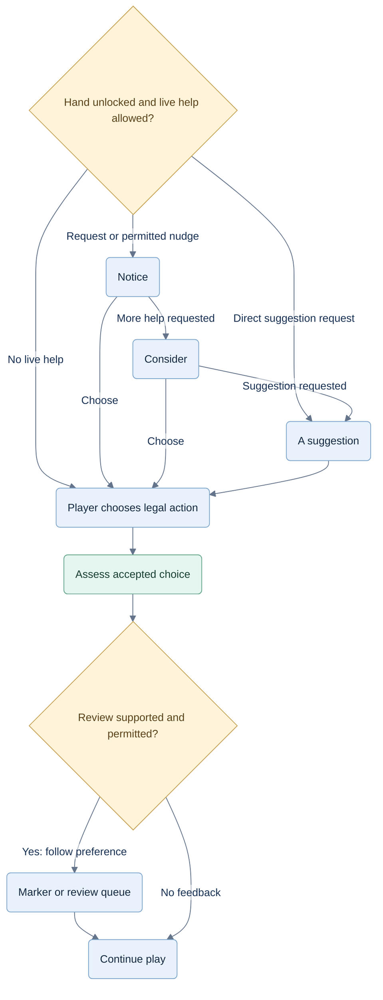
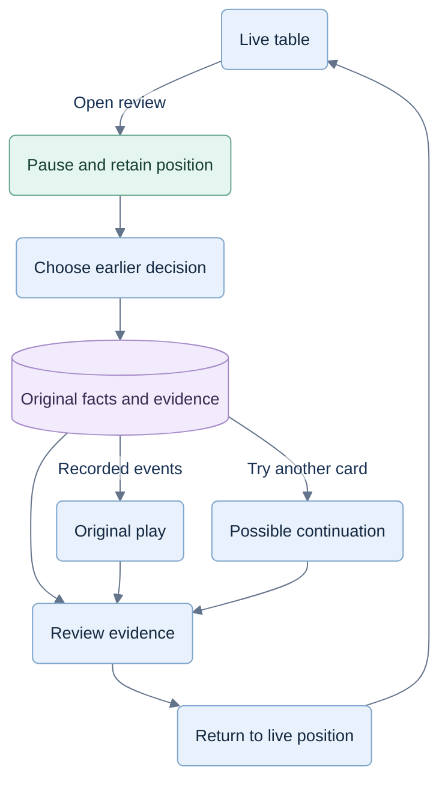

# Coaching and evidence

This is the primary product specification. The game views are a useful starting point; styling can change. The core experience is **help before a choice → notice a useful review moment → revisit the evidence → return to play**.

**CR-STRAT-005:** [Spades reasoning](12-spades-reasoning.md) requires analysis for every human decision regardless of UI preference. Preserve original analysis and authored advice for later authorized review. No live Table notes screen is required; aggregate trick results belong at game end.

## One strategy, two uses

**Evaluation refinement:** [CR-STRAT-008](decisions/CR-STRAT-008-coverage-and-evaluation.md) and its [protocol](../docs/superpowers/plans/2026-09-29-scenario-and-jev-evaluation.md) add blind rendered-cue review and a fresh immediate/delayed unaided-transfer study. If Jev selects a different action, only reasons supported for that action may be shown; policy wins and model agreement do not establish teaching value.

Bots and coach use the same player-information boundary, tactics, candidate evaluation and verified reasons. A bot applies its selected action. The coach decides what to reveal, when to speak and how to compare the player's accepted choice. It also remembers teaching exposure and selects useful review moments. Assessment audits the shared strategy's evidence; simply disagreeing with the bot is not a mistake.

| Moment | Coach behavior |
|---|---|
| Before the move | Give a cue, context or suggested action at the requested help level. |
| After the move | Assess the accepted choice. If a materially better alternative is supported, offer a quiet “Worth a look” marker tied to that decision. |
| Player opens review | Pause at the latest accepted live position, reconstruct the earlier decision and show the evidence visually. |
| Hand/game ends | Offer a few useful moments to revisit; review is optional. |

## Help without taking over

Keep the coded labels: **Notice**, **Consider**, **A suggestion**. Notice points to relevant evidence; Consider states a fact or tradeoff; Suggestion identifies a move. Explanations describe code-verified facts and estimates, never invented Jev reasoning. Initial copy budgets: heading 6 words; cue 18; context/suggestion 35. Prefer a highlight plus one sentence; expansion is optional.

An answer-revealing cue counts as suggestion exposure even if presented at Notice. Memory aids count as assistance. Record content actually shown, including automatic cues and notes opened during opponents' turns; a requested but undelivered hint is not exposure. Hosted display callbacks are untrusted: server-issued guidance and uncertain delivery also exclude independence-sensitive claims, as defined in [07](07-hosted-architecture.md). Count decisions only after accepted actions. Forced actions are excluded from strategic denominators.

Occasional nudges use meaningful evidence, not merely hesitation: a newly relevant void, changed contract/bag pressure, live Nil danger, accumulating Hearts penalties or a possible moon threat. Solo Spades must have its own triggers. Initial guardrail: one cue per decision and at least three completed tricks between unsolicited cues. Never escalate automatically beyond Notice; suppress repetitive, forced and weakly supported nudges. Keep frequency configurable internally for testing.

Coaching frequency also controls post-action feedback:

| Existing preference | Before a move | After a move |
|---|---|---|
| When I ask | Help on request. | Save findings for requested review and recap; no unsolicited marker. |
| A nudge now and then | Sparse Notice cues. | One quiet review marker when evidence warrants it; share the cue budget. |
| After the hand | No live strategic cues. | Queue findings for hand/game review. |

Player-initiated current-game review remains available in every coaching preference. End-game results show completed trick winners and public statistics. Settings changes never erase prior exposure. Keep at most one unresolved live marker; do not stack notifications. The marker never pauses play, opens a dialog, undoes a move or reveals the replacement card automatically. Dismiss means continue playing; the finding remains available in review. Late findings identify their original hand/trick and never highlight the current card as wrong.

### Before and after a choice

New coaching requires current access and explicit activation of a locked limited-plan hand. Requests choose the help depth; automatic nudges stop at Notice. Only the nudge preference permits a quiet live marker; other preferences save findings for requested review or recap. No cue commits a move, pauses play or automatically labels a mistake.

## Member access and coached hands

[06](06-commercialization.md) replaces free full play with a fixed authored demo and paid membership. Practice and Learn provisionally includes four coached hands per day; Unlimited has no normal daily hand cap. One hand unlock covers its bid/pass, decisions, help levels and current-game review. Provider requests are not the purchased unit.

Before first coaching in a locked hand, show remaining hands and request explicit activation. Automatic cues cannot spend limited allowance or reveal paid advice before activation. Unlocked hands follow the selected coaching frequency. At coaching exhaustion an active member can keep playing. At membership expiry live play pauses with state preserved; coaching saved under an existing unlock during paid coverage remains readable. A match review previews the number of distinct locked hands to activate.

The usage ledger records first usable coaching durably saved for the hand. Provider attempts, server-issued guidance and browser display reports are separate. Internal analysis neither unlocks a hand nor consumes coaching allowance. An unlock alone does not prove content was viewed; issued guidance makes the hand potentially assisted even when display is unknown. Unseen shadow output is never issued guidance.

## Pause, revisit, compare

A **hand** is one deal; a **trick** is four played cards; the **game/match** spans hands. Review covers earlier tricks and hands of the current game, including the just-completed match until the next game starts. This adds no library of older games.

Open review from a marker, the review control or a recap. Freeze automated progression and retain the latest live position and selections. Use a compact hand/trick selector with flagged decisions; any accepted player decision can be inspected, even if ungraded. Return to table restores that live position. Resuming never substitutes a replayed move.

Each review presents:

1. **Your choice:** reconstruct the hand, trick and objective immediately before the action; mark the chosen card/bid/pass.
2. **What you knew:** highlight the relevant prior play, revealed void, bid, count or score. Link evidence to its event in this game.
3. **Another option:** show one useful legal alternative and its exact consequence or estimated tradeoff. If the choice was defensible, say so; if evidence is weak, leave it ungraded.
4. **What happened:** optionally step through the recorded continuation. Keep later outcomes separate from the original decision's quality.

Use separate **Original play** and **Try another card** states. Original play is read-only event replay, needs no new model call and cannot change scores, records or advice already shown. Only recorded events up to the live pause boundary are available; never reveal still-hidden cards from the active hand.

Try another card is an explicit, isolated practice trial. V1 compares a legal alternative through the end of that trick, then returns to the review. Sample plausible hidden holdings from the original observation, never the actual concealed deal. Recompute subsequent bot actions from their own observations; do not replay original future cards after the alternative. Label the continuation “Possible continuation”; one favorable outcome is an illustration, not proof. Grade only from the broader supported comparison, not that single trial. Bids and pass bundles receive evidence-based comparisons in V1 without a full alternative-hand simulation UI.

Trial results never change the live game or improve its recorded score. No hidden-hand reveal is required in V1. A record missing the events needed for reconstruction says “Replay unavailable” rather than inventing a sequence.

### Review flow

Original play stops at the live pause boundary. An alternative samples plausible holdings from the original observation; neither path changes the live game or counts practice as independent progress.

## Review at the end

The hand recap offers one review moment and one next focus, with Open review and Next hand. The match result offers **Review this game** or **Choose next game**. Start with up to three distinct, high-value moments, ordered by teaching value; allow other hands/tricks within this same game to be inspected. One useful pattern beats a list of every imperfect card. Empty or inconclusive assessments produce no filler criticism.

End-game review uses the same evidence and replay experience as paused review. Neither is conditional on developing a conversational chatbot or a new visual theme. Deliver recorded evidence review first, then the bounded alternative trial; both are in scope.

## Assess the decision, then discuss it

Reconstruct what the player knew **before** choosing. Compare the chosen action with relevant legal alternatives using separate evaluation samples and the same information boundary. Do not use actual unseen opponent cards, later plays, shortlist membership, a lost trick or Jev agreement as proof of error.

| Assessment | Meaning and presentation |
|---|---|
| Supported | Evidence supports the choice. May supply a brief strength. |
| Reasonable alternative | More than one plan is defensible; explain the tradeoff if useful. |
| Review opportunity | A supported alternative was materially better; show the decision-time evidence. |
| Not assessed | Insufficient coverage, uncertain estimates, contaminated record or unsupported situation; omit grading. |

Use “mistake” only for a proved avoidable consequence under the player's information and objective. Sampling-based review requires a held-out validated evaluator, non-overlapping uncertainty bounds and a versioned materiality threshold. Initial score-gap thresholds: 1 expected penalty point in Hearts or 10 expected score points in Spades; treat these as pilot settings. Unsupported match-winning tradeoffs remain not assessed. Provider confidence is never a substitute.

Separate sampling seeds do not remove shared sampler/opponent-policy bias. Monte Carlo bounds quantify sampling noise under the stated assumptions, not whether those assumptions are right. Before enabling categorical feedback, audit contrasting held-out positions against alternate playing policies and stronger or tractable exact references. Material disagreement means abstain; more samples alone do not resolve it. Until this gate passes, show verified facts and keep experimental grades internal. Shadow Jev choices never supply human grades.

Record one primary category per assessed opportunity; optional secondary tags:

| Category | Example of observable decision behavior |
|---|---|
| Information use | A revealed void changes which lead is exposed. |
| Objective management | Overtricks add bag risk after the contract is covered. |
| Resource use | Spend an ace/trump when a cheaper card serves the same plan. |
| Timing/control | Choose who leads the next trick. |
| Risk/forecasting | Bid/pass assumptions fail across plausible holdings. |
| Mode coordination | Cover partner Nil; treat every other seat as an opponent in solo. |

These describe choices, not diagnoses such as “forgot,” “careless” or “doesn't understand.” Do not infer mental causes.

## What progress means

Retain a compact local profile by mode, category and opportunity class. Store eligible count, acceptable count (supported plus reasonable), review count, assistance, assessor version and difficulty/context. Coverage is assessed opportunities divided by all relevant meaningful opportunities, including abstentions. Wins and help frequency are game outcomes and usage, not skill scores.

A fresh independent opportunity is a first encounter in a new hand, not a replay, with no optional memory/cue/context/suggestion exposure or server-issued assistance earlier in that hand. Unknown delivery is potentially assisted, not proof of independence. Standard scores, bids, legality and visible tricks are permitted. Keep memory-assisted strategy separate from unaided performance; never label a guided hand independent because its last move was quiet.

Post-action feedback does not retroactively make the already accepted choice assisted. Showing a marker, explanation, replay or alternative is exposure for subsequent live decisions. Record the reviewed decision separately from the live hand receiving the lesson. Trial decisions never enter independent-progress counts; dismissal/reload cannot erase exposure. A later fresh hand can provide transfer evidence.

Initial descriptive window: compare the latest 20 eligible opportunities with the preceding 20 of the same mode/category/opportunity class and assessor version; each spans at least three hands. Count supported and reasonable alternatives as acceptable; exclude not-assessed and forced cases, while reporting coverage. V1 shows factual counts or “Building evidence.” Decisions within a hand are correlated, so ordinary opportunity-level Wilson bounds do not establish learning. Enable “Improving” only after validating a trend method that treats hands as clusters and compares similar difficulty and coverage. The window sizes are pilot settings, not evidence guarantees.

Repeated review opportunities across three fresh hands may nominate the next focus. They do not prove why the player struggled. Recap shows at most one strength, one review moment and one next focus; use no filler when evidence is absent. No overall rating, leaderboard, historical game list or obligatory quiz.

Future matching must preserve this boundary: coaching evidence may inform an uncertain initial placement only after separate validation; eligible human outcomes determine competitive rating. Players without coaching history need an equal provisional path. See [F03](11-future-play-and-membership.md#f03--three-distinct-uses-of-skill-evidence). No rating feature is added here.

## Scenarios that must pass

1. **Hearts pass:** compare full triples; an incoming club reverses a planned void, while outgoing-card knowledge remains correct.
2. **Solo Spades:** opposite seat is an opponent; bids, bags and advice never use partnership logic.
3. **Partnership control:** preserving an ace and taking next lead can both be justified; live Nil protection overrides the simplistic “partner is winning” cue.
4. **Good choice, bad outcome:** an unseen trump causes a loss; the review preserves the decision's reasonable status.
5. **Help then transfer:** a suggestion succeeds; only a later fresh independent opportunity contributes to independent progress. Automatic/memory help cannot disappear after reload.
6. **Continuity:** pause during analysis, dismiss a cue, reload, skip recap and start another game. No stale advice, duplicate action, lost exposure or user archive appears.
7. **Review during play:** flag a completed move, let the player open it after further play, step through an earlier trick and return. The latest accepted live state and selection remain intact; no hidden information leaks.
8. **Alternative and match review:** try another legal card, distinguish the simulated continuation from the original, and resume unchanged. Review an earlier hand at match end; starting the next game ends player access to the prior game's review. Practice never raises the progress score.

## Local pilot gate

Run these scenarios with players who already know the relevant game, using the target devices. Observe whether they identify the highlighted evidence, distinguish fact from estimate, reject a suggestion comfortably, and continue without reading long text. Capture unsolicited-cue dismissals, time to act, assistance and later independent opportunities. Do not treat faster actions or fewer hint requests alone as learning.

Enable categorical feedback only after a held-out scenario audit finds no hidden-information leaks or unsupported mistake labels; report coverage and abstentions. Claim Jev adds value only after the paired comparison in [02](02-games-and-decisions.md). Existing [research notes](../docs/RESEARCH.md) motivate this direction; the thresholds and UI still need this local validation.
