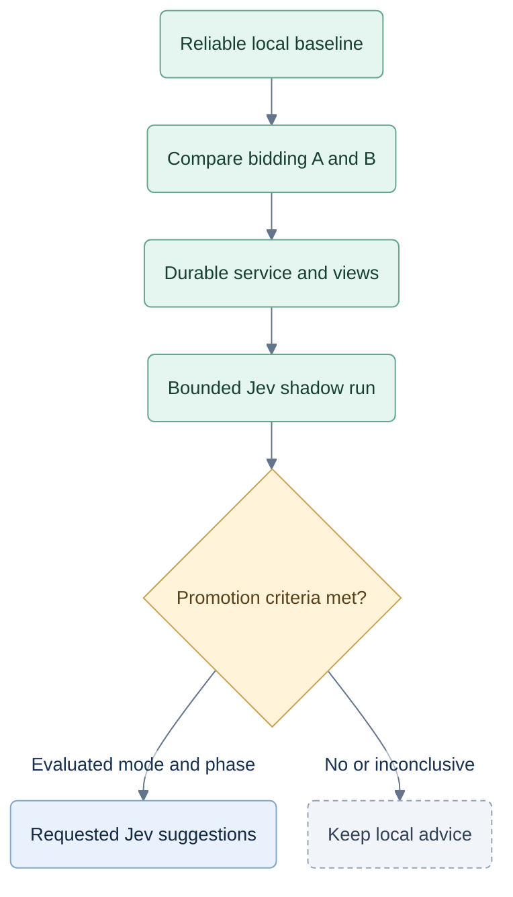

# V1 setup

Specification, 26 September 2026. The browser game exists; the service, probability pipeline and Jev integration below are planned. This update does not implement or activate them.

**Current reasoning update:** [CR-STRAT-005](12-spades-reasoning.md) supersedes tactical/analysis behavior below. Runtime and storage status are in the [local handoff](../qa/implementation/LOCAL-V1-REPORT.md).

## What V1 commits to

- Keep usable game interactions, three modes and landscape phone gate; visual styling remains flexible.
- One shared analysis policy for bots and coach: solo core plus partnership overlay, consuming only the acting player's knowledge. Retain every human analysis even when cues are off.
- Prioritize coaching before/after a choice, evidence review across the current game's hands/tricks and optional end-game review. Alternative trials never replace the live game.
- Compare **A: calibrated contextual bidding** with **B: constrained-deal rollouts**. Add adaptive A/B only if it earns its complexity. No replacement magic coefficient.
- Local Node service and worker; SQLite retains every started game internally. No user game archive.
- Prepare ownership and coaching-access boundaries locally using a test player and mock plans. Hosted full games require membership; unpaid visitors get only the fixed demo. Commercial play/coaching requires the hosted boundary, not a user-controlled local service. [Product](06-commercialization.md), [architecture](07-hosted-architecture.md), [test gates](08-commercial-testing.md)
- Start code-only. Evaluate Jev in shadow, then promote requested suggestions only where evidence supports them. No Jev-controlled practice bots in this setup.

## Run today

From `C:\repos\test-jev\web`, use `npm ci` if dependencies are missing, then `npm run dev`. This starts the existing browser-only game at `http://localhost:5173`; it does not start a service or call Jev. Existing checks are `npm test` and `npm run build`.

## Target local layout

```text
C:\repos\test-jev\
  web\src\                  existing views
  web\shared\               public DTO schemas/types and display utilities
  web\server\               engine, private state, strategy, access, records, workers
  web\.env.local            server-only settings and optional key
  data\jev-test.sqlite      internal games and decision records
  data\evaluations\         datasets, run manifests and results
  planning\                 specifications and implementation plan
```

Use the checked Node 24.19+ runtime and existing React/Vite toolchain. After implementation, `npm run dev` starts Vite plus the loopback service at `127.0.0.1:8787`; `/api` is proxied. `npm run dev:lan` exposes Vite for trusted Wi-Fi testing on iPad/phones while the service stays on loopback. Local play works without internet; enabled Jev requests use remote OpenRouter inference.

Task 3 creates `web/.env.local.example` with this target configuration; these variables are not implemented today:

```dotenv
JEV_MODE=off
JEV_MODEL=typesafe/jev-1.13
JEV_MAX_REQUESTS=0
OPENROUTER_API_KEY=
```

`JEV_MAX_REQUESTS` caps provider attempts, including retries, for an explicitly identified experiment. Track consumption durably; restarting cannot reset a run's cap. Zero disables requests in any mode. Keep the key in ignored `web/.env.local`, never a `VITE_` variable. The imported root `.env.example` belongs to v0.2 and is not the V1 configuration.

## Build and activation order

| Stage | Work and exit evidence |
|---|---|
| 1. Reliable baseline | Freeze rules; isolate player knowledge; unify tactical decisions; verify private passing, solo/team goals and Nil cover. |
| 2. Bidding comparison | Preserve today's heuristic as a baseline. Train/calibrate A and evaluate B using frozen playing policies. Separate development/test deals and report each Spades mode. Select the simplest supported result; no automatic commitment to C. |
| 3. Local V1 | Connect worker, durable service and existing views. Record complete actions, actual assistance and analysis provenance. Keep unsupported grades internal. |
| 4. Jev shadow | Pass mocked transport checks, then set a finite experiment cap and nonzero cost budget before a small live smoke run. Record validated provider choices separately; local play/advice is unchanged. |
| 5. Promotion | Compare full-reference code, shortlisted code and same-shortlist Jev. Enable requested Jev suggestions only for evaluated modes/phases meeting predeclared benefit, reliability, latency and cost criteria. Other cases keep local advice. |

Each evaluation manifest records rules/modes, deal splits, seat rotations, bidder/play/sampler versions, budgets, opponent families, candidate policy and acceptance criteria **before** the final run. Include calibration, contract/Nil/bag outcomes, shortlist loss, coverage, fallback rates and latency/cost. Separate model benefit from coaching usefulness. No live request or promotion is part of this documentation update.

### Activation path



A passing result applies only to its evaluated modes and phases. Commercial release still follows the current hosted specifications.

## Pilot settings, not promises

Start profiling with a 12-candidate shortlist, at most 256 worlds/250 ms of total local analysis, and an 8-second application deadline for a requested Jev operation, including queue wait, preparation and retries as specified in [03](03-local-runtime.md). The provider receives only the remaining time budget. Offline evaluation uses fixed work counts. A 100-seed run is a smoke check, not proof of superiority. Measure before fixing budgets; uncertain estimates abstain from grading. Hosted concurrency and growth follow [10](10-capacity-and-scaling.md).

Deliver recorded evidence review first, then bounded alternative-card trials; enable unsolicited review markers only when they lead to a working review. Both paused and end-game review are in scope. Calibrated assessment and progress claims have their own held-out audit and hand-level evidence gates in [04](04-coaching-and-evidence.md). Current sequencing and acceptance are in [delivery and evidence](09-delivery-and-evidence.md) and [commercial testing](08-commercial-testing.md). The older [local implementation plan](2026-09-26-implementation-plan.md) is historical and must be revised before execution.
