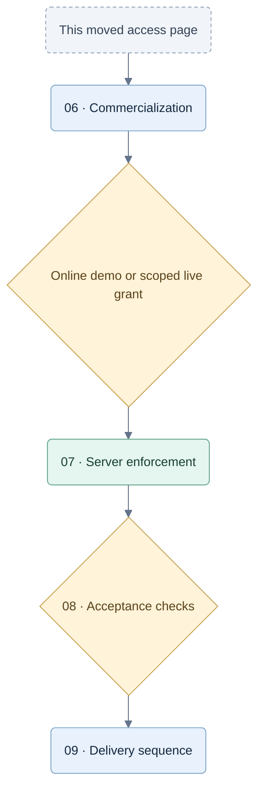

# Access specification moved

The current product and subscription specification is [06 — Commercialization](06-commercialization.md). It supersedes the earlier permanent free-game offer and decision-based coaching allowance.

Latest owner direction: [CR-IMPL-004](decisions/CR-IMPL-004-online-demo-and-launch-readiness.md) requires an online authored demo and configurable server-issued free/access-trial/paid grants scoped by game/variant and coaching allowance. Final launch offers, prices and family limits remain undecided. See [07 — Hosted architecture](07-hosted-architecture.md), [08 — Test gates](08-commercial-testing.md) and [09 — Delivery and evidence](09-delivery-and-evidence.md). This is specification guidance, not activation evidence.

## Follow the current access design

