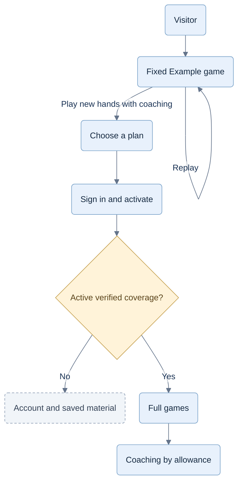
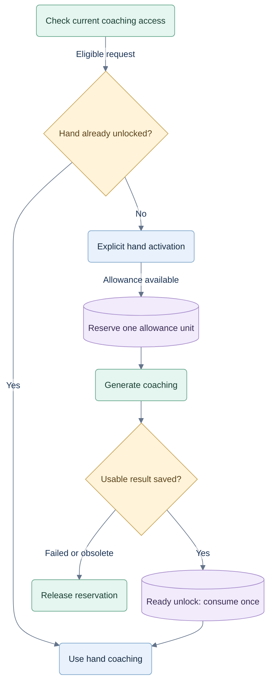

# Product, demo and subscriptions

26 September 2026. Commercial product proposal based on the owner's latest direction. This replaces the earlier free-game offer and decision-based allowance. Product, architecture and testing come first; incorporation follows testing and precedes launch. This document implements no billing or access enforcement.

Read with [the architecture](07-hosted-architecture.md), [test gates](08-commercial-testing.md) and [delivery sequence](09-delivery-and-evidence.md). Requirements P01–P08 below are traceable in the test gates. Prices, currency, allowances and family composition remain hypotheses.

**Future consideration, 27 September:** [CR-FUTURE-001](11-future-play-and-membership.md) evaluates free or play-only membership for people returning mainly for the bots, and later human games. The offer below remains the launch proposal. Free access is no longer ruled out forever; introducing it requires separate demand, cost and access-policy decisions.

## P01 — Who pays and why

Players already know Hearts or Spades. They want to compete better: notice what a play reveals, weigh plausible alternatives, understand their own decisions and practice applying those ideas in new hands. A useful message is: **“Understand the table. Make better decisions against other players.”**

The coach explains observable evidence and uncertainty. It cannot know why an opponent acted, reveal concealed cards, guarantee wins or promise a skill increase without evidence. Preserve the assessment standards in [04](04-coaching-and-evidence.md). A good choice can lose a trick. “Mistake” requires the specified evidence, not disagreement with a bot.

Retention must come from useful guidance on fresh decisions and a meaningful next focus. A few useful tips are a successful demonstration, but repeat use and willingness to pay still need a pilot. No beginner curriculum, human multiplayer, overall competitive rating, drill catalog or old-game archive is added to the first commercial scope.

## P02 — Fixed demonstration, no timed trial

A visitor can open a labelled **Example game** without an account or card. It shows a fixed deal and finite, authored sequence of decisions, coaching, original playback and a sample alternative. Any selectable branches are also finite and authored. The coaching is hardcoded; no dynamic evaluator or Jev request runs for a visitor.

Visitors may repeat it indefinitely. Reloads, new accounts, cookies and clocks cannot turn this content into personalized coaching because the public demo has no such capability. Publish only the demonstration frames and copy, with a content version. Do not ship a general engine, accept arbitrary seeds or positions, or embed a paid API credential in the demo. The example can be copied; copying it does not confer service access.

After a meaningful choice, explanation and replay, offer **Play new hands with coaching** and show the plans. Let the visitor finish and replay the example. Do not invent weaknesses to create purchase pressure. An optional first-visit flag only hides repeated introductory prompts; it does not prove one visit per person or grant access. Every selectable card/help/replay branch maps to authored frames; demo activity never contributes to usage, progress or rating.

**Confirmed owner decision:** visitors and unsubscribed accounts have only the fixed demo for interactive play. Full games require an active individual or family entitlement. This supersedes permanent free play. An unpaid account can still manage billing, its data and previously delivered material; it cannot start/advance live games or generate coaching.

### Demo and member access

The example is always repeatable and contains only authored branches. Signing in alone does not grant live game access.

## P03 — Monthly plan hypotheses

| Offer | Suggested monthly price | People | Live game access | Coaching |
|---|---:|---:|---|---|
| Fixed demo | Free | Visitor | Fixed example only | Authored example guidance only |
| Practice and Learn | 4.99 | 1 | Unlimited ordinary play while subscribed | 4 coached hands per day |
| Unlimited | 9.99 | 1 | Unlimited ordinary play while subscribed | No daily coached-hand limit for normal personal use |
| Family | 17.99 | 5 total | Each active member has ordinary play | 3 unlimited seats and 2 seats with 4 coached hands per day |

These are suggestions, not an approved price sheet. **Currency is not selected.** Do not publish a bare dollar sign or create live prices until base currency, tax display and country availability are chosen. For this pilot proposal, the payer occupies one of the three unlimited seats: five people, not six.

Both individual plans offer the same verified coaching tools. The higher tier changes allowance; “other features” are not saleable promises until specified and delivered. No annual plan, lifetime purchase or paid credit wallet is necessary for the first experiment.

“Unlimited” cannot conceal an ordinary daily cap. Publish protective concurrency/rate limits that accommodate measured human play. Bound repeated computation, reuse results and measure cost before advertising the offer. If sustainable limits would stop normal use, revise the price or describe a capped plan before launch.

## P04 — One coaching session is one hand

**Proposed pilot definition:** one session is one dealt hand, including its bid/pass, live guidance, recap and later review within the current game. A hand is 13 tricks; a match may contain many hands. The UI says **“4 coached hands per day.”** This replaces the previous example of five coached decisions per day.

The stable purchase unit is `(playerId, gameId, handId)`. Decision IDs identify analysis within the hand; additional help levels or decisions in that hand do not spend another unit.

1. Before first coaching in a locked hand, show **Coach this hand · uses 1 of 4**. Ordinary play consumes no coaching allowance.
2. Reserve one unit atomically. Consume it when the first usable result is durably saved for access. If work fails or becomes obsolete before that point, release the reservation. A valid code-derived answer may fulfill the request under the provider policy; identify its provenance.
3. Hints, explanations and bounded alternative trials in a ready hand share the unlock. Reloading, changing devices, retrying or reopening tomorrow cannot spend another unit. Abandoning after usable coaching is saved does not refund it.
4. Generating coaching for a previously uncoached hand consumes one unit with explicit consent. Factual playback alone does not. A match review previews the number of distinct locked hands requiring new coaching. The player selects them; a batch cannot silently unlock more.
5. Initial reset: midnight UTC, displayed in local time and as a countdown. Usage uses the server clock, persists across restarts and follows the player across individual/family plans. It does not roll over or reset when the browser clock, plan or group changes.
6. A reservation belongs to its recorded allowance period. Completion after midnight consumes that original reservation once. Release affects only its original period. Jobs have bounded expiry and fencing tokens; expired work cannot later publish a free answer.

Allow one active coached hand and one expensive coaching job in flight per player. Switching devices resumes that hand. Saved review is still readable while another job runs. Stop or finish computation before switching to another hand, with clear UI feedback. This limits automated extraction without charging separately for each hint.

Limited-plan automatic cues cannot unlock a hand. Until explicit activation, show only a neutral availability marker with no recommendation or assessment. After activation, honor the coaching preference. Bot decisions, shadow experiments, ordinary public facts and retries consume no extra customer unit.

Exhausting allowance keeps ordinary play available to an active subscriber. Expiry pauses live progression without discarding the table. Coaching already unlocked and saved during valid coverage remains readable within current-game scope, including recovery after a lost response; new analysis/trials require current entitlement. Starting another game closes prior-game review as specified in [04](04-coaching-and-evidence.md).

### Limited-plan hand unlock

Repeated help within a ready hand shares its unlock. New analysis still requires current coverage; factual playback and previously saved material follow their separate read-access rules.

## P05 — Accounts, upgrades and failure behavior

Use managed sign-in with an email code and supported social sign-in. Keep the demo anonymous. Ask for an account when a paid plan is selected, linking payment and recovery to a stable owner; preserve that selection across login. Billing, login and family pages support phone portrait. The landscape gate applies only to the table.

The server creates checkout from an allowlisted offer; the browser cannot supply a trusted price, role or quota. Show currency, total due now, renewal interval, tax and cancellation terms before confirmation. Do not attach a free-trial configuration. Link and Apple Pay are payment methods, not the game's login identity.

Allow an upgrade request at any time. Show a server-generated proration preview; grant the higher tier after required payment is confirmed. An incomplete upgrade preserves the prior paid tier and usage. Downgrades take effect at renewal. Cancellation stops renewal while retaining paid-through access. Keep **Manage subscription** and cancellation easy to find.

Do not unlock from a success URL, client receipt or optimistic subscription status. Delayed confirmation shows **Confirming your payment** with recovery that does not require paying twice. An outage cannot revoke known paid-through coverage or invent a new paid period. Account, billing repair and demo access survive expiry.

Stripe [pending updates](https://docs.stripe.com/billing/subscriptions/pending-updates) can condition eligible upgrades on successful payment. The app must still verify payment and effective coverage, including exceptional states. Validate exact provider behavior in its sandbox before activation.

## P06 — Family membership

Every person has a separate authenticated account, player ID, current game, allowance and progress. Family is a billing relationship, never a shared login or an unprotected browser profile switch.

The owner sees seats, invitations, seat plans and billing. Members see **Paid by [owner display name]**, linking to a membership explanation. The payer does not gain access to members' cards, history, coaching or private activity.

Invitations expire, are single-use and are bound to the verified invited account. Reserve a seat while an invitation is valid; acceptance is transactional. Enforce capacity of at most three unlimited and two limited assignments, five total including the owner. Pending reservations and accepted assignments held for the period occupy capacity; unused seats are allowed. A held assignment after removal grants no active access. Each limited seat has its own allowance; unused units are not pooled.

Proposed anti-rotation policy: accepted seats and seat classes are assigned for the billing period. A member may be removed immediately, but their accepted seat cannot be reassigned to another person until renewal. Unaccepted invitations can be corrected. Audited support corrections handle mistakes. Show the rule before purchase and acceptance; validate usability during the pilot.

Removal revokes new work while preserving the person's own account and records. A member can buy an individual plan without losing their identity. Never stack family and individual allowances: use the strongest valid grant and retain player/day usage. Joining a group must disclose an existing individual subscription and prevent silent double billing; cancellation remains the member's choice. Group payment failure/cancellation follows its paid-through time for all seats.

Define whether “family” means household or any invited group before launch. Do not infer membership from IP address or demand identical locations.

## P07 — International subscriptions

The market is worldwide, not Canada-only. A Canadian Stripe seller can accept international customers, subject to supported payment methods, restricted locations and applicable obligations. Incorporation in Canada does not limit sales to Canada or resolve foreign digital-service tax obligations. [Stripe global availability](https://stripe.com/global), [Stripe restrictions](https://stripe.com/legal/restricted-businesses).

Before launch, record supported customer countries, recurring methods/currencies, tax treatment, refund/renewal rules and privacy requirements. Enable markets when ready. The Canadian GST/HST small-supplier threshold is not a worldwide exemption. Configure tax collection against applicable registrations or a merchant-of-record arrangement. [Stripe Tax](https://docs.stripe.com/tax).

International access also affects personal-data handling. Offering services to people in the EU can bring GDPR obligations even for a company outside the EU; evaluate required notices, lawful processing, consent where applicable, user rights and international transfers before enabling those markets. Required service records and optional analytics need separate treatment. [European Commission](https://commission.europa.eu/digital-life/protecting-your-data-and-privacy_en).

| Arrangement | Operational consequence |
|---|---|
| Standard Stripe Checkout + Billing | The company remains responsible for applicable indirect-tax registrations, collection, filing/remittance and consumer obligations. Stripe and specialist services can assist. |
| Eligible merchant of record, including evaluation of Stripe Managed Payments | Provider assumes specified tax/transaction responsibilities in covered markets for an additional fee. Confirm seller/product eligibility, country gaps, payout terms and customer experience. Company income tax and product obligations remain separate. |

Stripe describes Managed Payments coverage and explicitly leaves compliance with the seller in uncovered countries; it is not universal tax coverage. [Managed Payments](https://docs.stripe.com/payments/managed-payments/how-it-works).

**Payment correction:** Stripe's standard PayPal method lists selected European business locations, not Canada. Recurring use may require approval. Its custom PayPal adapter uses the merchant's own PayPal account, requires access and has additional fees; this is not a confirmed drop-in integration here. Validate a separate PayPal subscription integration or eligible adapter before promising PayPal. Start the payment pilot with cards and supported wallets. [Stripe PayPal](https://docs.stripe.com/payments/paypal), [custom adapter](https://docs.stripe.com/payments/payment-methods/custom-payment-methods/paypal).

## P08 — Evidence before setting prices

Store offer versions, prices/currencies, limits, seats and effective dates on the server. Purchases retain their recorded version; editing a constant cannot silently change existing commercial terms.

Measure demo completion/conversion, coaching use on fresh hands, return visits across days, upgrade demand, family-seat use and cancellations, with denominators and uncertainty. No conversion forecast is established.

Measure ordinary hosted play, coached hands, jobs, Jev attempts/retries, storage, support and payment/tax costs separately. At four hands/day, heavy use is 120 coached hands in 30 days. At 4.99 that leaves roughly 0.042 currency units gross per hand before every cost. Family must cover three heavy unlimited users and two limited allowances. Test usage distributions, not just averages.

Billing follows the product/security pilot. App Store distribution is later. Keep entitlements independent of the billing provider so verified store transactions can eventually grant the same access without changing player identities or the game.
