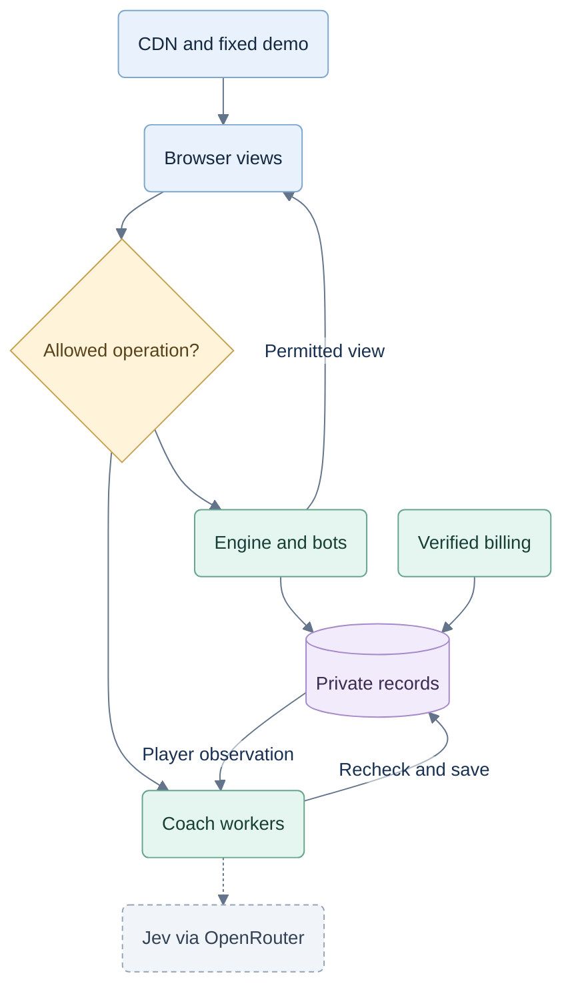

# Hosted architecture and trust boundaries

26 September 2026. Proposed architecture for the commercial web app. [06](06-commercialization.md) owns product rules; [08](08-commercial-testing.md) defines the evidence required to ship. This is a design, not a completed implementation or security audit.

## A01 — Assume the browser is controlled by the player

A player can read/change JavaScript, inspect their own decrypted requests, script API calls, edit storage, suppress display events and copy their responses. TLS protects traffic in transit; it does not hide traffic from its endpoint. Client-held signing keys, hashes, obfuscation, WebAssembly, CORS and disabled context menus cannot establish that the official UI sent a request.

Enforce access even when the protocol and client are fully known. Keep engine/coach implementation off the downloaded bundle and disclose only necessary views. This reduces source exposure, but cannot prevent independent implementations of public card rules, learning from outputs or redistribution of legitimately received advice. TypeScript is suitable when trusted code runs on the server. [OWASP REST guidance](https://cheatsheetseries.owasp.org/cheatsheets/REST_Security_Cheat_Sheet.html).

This strengthens the earlier browser-engine recommendation: commercial games use a server-owned engine, bots and coach. The browser renders, takes input and animates confirmed transitions. Offline live play is not part of this phase; the finite demo can work offline once loaded.

The [security research](security/hardening.md) compares a browser-engine baseline with this design, evaluates Workers/Wasm/session bundles and records implementation work. Success means a fully understood or modified client still cannot obtain unauthorized service work. It does not mean preventing inspection of the interface.

## A02 — Stack and deployment

The product is **CardFord**. The prior `trickscoach.com` domain plan has not been verified and is not a CardFord domain decision. Domain mapping, DNS, HTTPS and deployment remain unverified. Hosting vendor and region choices below remain open. See [CR-BRAND-002](brand-and-domain.md).

| Component | Proposed choice |
|---|---|
| Browser | Existing React 19, TypeScript and Vite. Preserve the table/accessibility; separate demo, account and live routes. |
| API | Node 24 supported/patched release, Fastify 5, strict TypeScript and static JSON schemas. Replace the planned built-in HTTP adapter for hosted use. |
| Domain | Server-only pure TypeScript engine, observation, strategy and assessment. Reuse audited rules; no language rewrite. |
| Identity | Managed authentication and server-verified identity; opaque application sessions in secure cookies. Select vendor after testing login/recovery, cost, deletion and data location. |
| Database | PostgreSQL for hosted integration, pilot and production. Transactions, migrations and a private application role. Local SQLite experiments do not establish production concurrency behavior. |
| Jobs | Independently scalable bounded Node worker pools; reserve game/bot capacity separately from coaching/review and shadow. Durable jobs/outbox in PostgreSQL initially; separate bounded async provider dispatch. |
| Hosting | Public CDN and load-balanced stateless Node replicas; managed database with failover and globally budgeted connection pools in one initial region. Same-origin `/api`. Choose vendors/region from latency, recovery, privacy and cost evidence. |
| Billing | Stripe Checkout/Billing adapter initially; provider-neutral access grants. Merchant-of-record/store adapters must satisfy the same coverage contract. |
| Observation | Required server journal and first-party metrics; optional product analytics separate. |

Fastify supplies validation and response serialization. Use developer-controlled schemas, then authorize against database state. Reject unknown input fields at sensitive boundaries; do not silently strip them or accept user-generated schemas. Framework selection does not supply authorization. [Fastify schemas](https://fastify.dev/docs/latest/Reference/Validation-and-Serialization/), [Node support](https://nodejs.org/en/about/previous-releases).

For sensitive JSON bodies, explicitly configure Ajv `removeAdditional: false`, `coerceTypes: false` and schemas with `additionalProperties: false`; Fastify's default removes extra properties. Set body, string, array, queue and execution limits. Trust forwarded addresses only from configured deployment proxies. TypeScript types do not validate network input.

Keep the proposed stack: changing the server language would not change subscription enforcement. Profile expensive strategy work in bounded server workers before considering Rust/Go/Wasm. Support a tested matrix of maintained Chrome, Edge, Firefox and Safari releases on target devices; a device from 2020 is different from an unpatched browser from 2020. Record exact versions in T39. Optional browser workers are for responsiveness, never access control; no Wasm/threading requirement for ordinary play.

Proposed service boundary; public demo content stays separate from protected work.



Proposed boundaries under `web/`:

```text
src/                 views, input, session client, demo player, account UI
public/demo/         finite frames and authored guidance, no live evaluator
shared/              public DTO schemas/types and display utilities
server/game/         engine, full state, dealing and seat observations
server/strategy/     tactics, sampler, bots and worker policy
server/coaching/     advice, assessment, review and assistance records
server/access/       identity, grants, coached-hand usage and family seats
server/billing/      checkout, events, reconciliation and price catalog
server/records/      repositories, migrations, journal, outbox and jobs
server/http/         validated routes, authorization and serialization
```

Browser imports may use public contracts, never `server/` or the legacy engine/coach. Enforce this with import-graph and production-artifact checks. Do not re-export the engine through a shared barrel, ship it in source maps or leave the old browser app on a public alternate route. Hosted builds must reject development mock identity/paid grants at startup.

Deploy with HTTPS, content security policy and escaped rendering of names/provider content. Keep database and administrative access private, use least-privilege roles and administrator MFA, pin/audit dependencies and patch supported runtimes. Secrets stay in the deployment secret store; no direct browser database access or public analysis-worker endpoint. Apply shared account-level request/work budgets across API replicas, plus edge abuse controls; a process-local limiter is insufficient. These reduce exposure and credential theft without claiming to attest the browser.

## A03 — Authoritative games and hidden information

The service owns the deck, all hands, accepted moves, scoring, bots and versions. Clients send commands, never trusted snapshots, observations, scores, seeds, ownership or subscription claims. Reject caller-chosen production randomness.

Use a cryptographically secure server shuffle, such as Fisher–Yates with `node:crypto.randomInt`, and persist the resulting deal plus events. Feeding a secret seed into the prototype's 32-bit generator does not make it secure. Deterministic injected randomness belongs in fixtures/evaluation. IDs are random and unrelated to the deal. [Node crypto](https://nodejs.org/api/crypto.html#cryptorandomintmin-max-callback).

Build each `SessionView` and replay frame by allowlisting the seat's information. Own cards, public plays/bids/scores, legal actions and permitted pass knowledge may be returned. Other cards, seed, unrevealed passes and future events may not. Check errors, caches, logs, support exports and future streaming channels too. Never serialize the aggregate then delete a few private fields.

Bots, sampling and Jev receive only `DecisionObservation`. Sampling possible worlds is allowed; consulting actual hidden holdings for advice/assessment is not. Worker jobs reference owned server records and reconstruct observations there. Expose no arbitrary client-supplied-position coaching proxy.

In solo practice, the client may request advancement, but the server validates/revises it and computes bots. Later PvP uses server-owned scheduling/deadlines: hiding a tab cannot pause opponents. Review/trials never change the authoritative live revision or scores.

## A04 — Identity, commands and resource access

Resolve identity from a verified server session. Use `Secure`, `HttpOnly`, appropriately scoped `SameSite` cookies, CSRF protection for mutations, allowed origins, session rotation/revocation and bounded expiry. Managed-login callbacks verify state/nonce/PKCE as appropriate. No localStorage value proves identity/payment. Stolen credentials remain usable until invalidated; support device/session revocation and suspicious-access review. [OWASP browser storage](https://cheatsheetseries.owasp.org/cheatsheets/HTML5_Security_Cheat_Sheet.html).

Keep identity-provider tokens on the backend. Validate issuer/audience/signature and bind identity by verified issuer/subject, not an email supplied by the browser. Every route declares a policy; unspecified routes deny access. Apply these policies to reads, retries, polling, future streams and downloads as well as mutations:

| Operation | Required authority |
|---|---|
| Fixed demo, public plans | Public finite content only; no live engine or analysis work. |
| Start/advance a live game | Valid session, owned game where applicable, active play coverage, control lease and legal revision/action. |
| Generate guidance, assessment or alternative trial | Valid session, owned current-game decision, active coaching coverage, hand unlock/reservation and work budget. |
| Read owned saved coaching or factual current-game replay | Valid session, ownership and current-game/retention scope; previously delivered coaching remains readable after plan expiry. No new computation or hidden information. |
| Manage billing or family seats | Valid session and the specific billing/family role; this grants no access to members' private games. |
| Payment webhook | Verified provider signature and server-bound purchase; no browser session substitutes for it. |

**Future compatibility:** this operation split can later distinguish an approved free/play-only grant from paid coaching. Current play coverage remains paid; do not bypass A04 or add grants now. Human matches also need seat-specific authority and shared scheduling, not merely a different plan flag. [F04–F05](11-future-play-and-membership.md#f04--necessary-design-implications) records that separate design/migration work.

Use current session/access generations from the authoritative store at protected boundaries. Replicas may not rely on a stale positive permission cache. Revoking a session blocks its subsequent requests; security revocation also cancels/fences unfinished work initiated by it. Ordinary sign-out blocks retrieval through that session but may let already-authorized work finish for recovery after sign-in. Coverage expiry/removal stops new work and publication unless another valid grant remains. Recheck before dispatch and at result commit; a request timeout alone does not stop a worker. Work committed before revocation remains subject to the saved-result read policy.

For each live mutation:

1. Authenticate, validate schema, then resolve the owned resource. Reject malformed IDs and unexpected fields before expensive work.
2. In a short transaction, recheck play entitlement and resource state. Scope command ID to player and route; retain a canonical payload digest to reject conflicting reuse.
3. Check expected revision, phase, actor and legality. Exact retries recover the original result if still authorized to read it; conflicting payloads are rejected. Stale commands return a conflict and safe current view.
4. Commit the accepted event, snapshot/revision and essential journal/outbox entry together. Acknowledge after commit. Two commands cannot both use one revision.

Grant/session-generation changes and authorized state/result publication share the relevant access/session locks or an equivalent serializable boundary. A family removal, session security revocation or expiry check cannot race between authorization and acceptance. Apply this to bot advancement and job results as well as human actions; no queued job can keep an expired live game progressing.

Game IDs, hashes, invite URLs or valid login alone do not authorize an operation. Apply the operation's policy on coach, recap, review, job polling and cached-result paths, including conditional requests. Private API responses use `private, no-store`; CDNs cannot cache one player's answer for another. Cache keys include owner and observation/policy versions, but a cache hit still authorizes. Return small results through authenticated APIs, with no reusable public result links. Exclude private responses from service-worker caches and clear the official client's private state on sign-out. Neither cache headers nor expiry can recall a copy already received by a user.

Multiple devices may stay signed in, with one active control lease/table per player. Switching devices transfers control explicitly; reconnects recover committed state. Family members have distinct leases. Shared IPs or travel are not violations.

## A05 — Allowance and worker lifecycle

Commands reference `gameId`, `handId`, `decisionId`, `requestId` and `expectedRevision`; the server verifies their relationships. `POST /api/coaching/hand-unlocks` activates a hand; decision advice subsequently uses that unlock. Caller-supplied plan, payer, allowance or time is never authoritative.

Enforce unique `(player_id, game_id, hand_id)` unlocks and `(player_id, allowance_period)` usage rows. In a transaction/row lock, compare `used + reserved` with effective allowance, reuse an existing unlock or reserve one unit, and create a durable job. Unlimited grants still require ownership, unlock records and concurrency checks.

Lock an existing player/access row before initializing first-use usage or unlock rows; locking a nonexistent row provides no exclusion. Use unique constraints, a consistent lock order and bounded whole-transaction retries for serialization/deadlock failures. Provider calls stay outside retried transactions. See [PostgreSQL isolation](https://www.postgresql.org/docs/current/transaction-iso.html) and [locking](https://www.postgresql.org/docs/current/explicit-locking.html).

Workers use fencing tokens and finite leases. Before first result publication, recheck current entitlement, ownership, reservation expiry/state, decision freshness and versions. Atomically save usable coaching and change `reserved -> ready`, converting one reservation into one consumed hand. A lost HTTP response recovers that result without charging twice. Failure/obsolescence before readiness releases once; late workers cannot finalize released reservations.

Later decisions in an unlocked hand require active coaching entitlement but no extra unit. Bound/cache alternative simulations separately. Customer hand usage, provider attempts/cost and assistance issued/display-reported are three records. Never charge a customer solely because a failed upstream call cost us money.

Entitlement, Jev `off/shadow/recommend`, experiment budgets and abuse controls are separate. `off` can supply paid code-based coaching; `shadow` cannot bypass access or expose experimental grades. Use server secrets and bounded provider budgets from [03](03-local-runtime.md).

## A06 — Billing and family grants

Minimum entities: players, auth sessions, billing accounts, subscriptions, plan versions, entitlement grants, family groups/seats/invitations, games/events/commands, usage periods, hand unlocks, analysis jobs/results, assistance, security events, billing events and outbox.

Player data belongs to the player, not the payer. Grants carry source, beneficiary, coverage, plan version and revocation. Daily usage survives grant changes. Seat assignment history prevents membership rotation from multiplying access. Normal account creation grants demo access only.

Verify webhook signatures over raw bodies and enforce provider timestamp/replay policy. Uniquely record event IDs and durably queue reconciliation before acknowledging. Serialize reconciliation per subscription or lock its record. Retrieve current provider state as necessary; verify payment, expected product/price/currency and paid coverage. Event timestamps alone do not determine order. [Stripe webhook ordering/retries](https://docs.stripe.com/webhooks).

Bind provider customer, Checkout and subscription IDs to a server-created purchase and billing account. Verify the expected environment and beneficiary as well as the offer; a valid signature is not permission to credit an arbitrary player named in a request.

Reconcile renewals, upgrades, cancellation, refunds, disputes and recovery. Paid-through coverage and explicit effective revocation drive access; a status string alone is insufficient. Freeze new premium work during a disputed coverage review under the published support policy, without calling it gameplay cheating. Apply an actual access revocation only when the coverage decision warrants it. A failed upgrade retains the prior tier.

The checkout return page queries server access. Periodic reconciliation repairs missed notifications. Honor confirmed paid-through coverage during provider outages; pause new live work when it ends unless renewal is confirmed. Family notices identify who can repair billing without revealing private payment details.

## A07 — Required activity records and optional analytics

Accepted moves, coaching reservations/results, grant changes and family mutations create required server records. The client cannot suppress these while receiving the accepted operation. If the essential transaction/journal fails, reject it, retain the last confirmed view and offer recovery. That failure is not automatic evidence of tampering.

An outbox exporter or optional analytics outage does not prevent committed operations. Monitor/bound backlog; pause new mutations if the database cannot safely accept their essential records. Blocking analytics, declining optional consent, missing heartbeats, devtools and ad blockers do not by themselves disable accounts or prove cheating. Offline demo viewing is not fully observable.

Record event ID, server time, player/session correlation, game/hand/decision/revision, operation, outcome/reason, grant/usage changes, policy versions, timings and known provider cost. Derive funnel, retention and paid usage from these records. UI click/display signals are best-effort and untrusted; a heartbeat is not attestation.

For learning integrity, separate guidance **issued for access** from display acknowledgements. Missing acknowledgement means display is unknown. Any issued guidance makes a hand potentially assisted for independence-sensitive assessment. Suppressing the callback cannot manufacture independence. This can exclude an unseen response, so do not claim the person read or understood it.

Do not put tokens, passwords, payment details, provider keys or full private game payloads in general telemetry. Protected game records hold needed replay data; operational events reference IDs. Define retention, user deletion/export and audited support access. Proposed pilot retention: 90 days for detailed games and 30 days for raw security/client events, then deletion or documented aggregation; billing records follow applicable obligations. Retention and privacy notices are launch gates. [OWASP logging](https://cheatsheetseries.owasp.org/cheatsheets/Logging_Cheat_Sheet.html).

## A08 — Abuse and future competitive play

| Attempt | Enforcement/evidence | Limit |
|---|---|---|
| Edit bundle, storage, clock or plan | Server grants/clock/ownership govern operations. | A modified screen can draw a fake game; it cannot change our records. |
| Replay/parallelize captured requests | Idempotency, revisions, row locks, job fencing and shared concurrency limits. | Authorized requests may be automated; measure and throttle abuse. |
| Convert demo into live coach | Finite public content; no live grants. | Example copy cannot be kept secret. |
| Guess account/seat IDs or reuse caches | Allowlisted views and checks on all content paths. | Staff/database access needs separate controls and audit. |
| Disable telemetry or forge display receipt | Server journal and conservative issued-help flags. | Physical viewing/off-platform activity remains unknowable. |
| Rotate family seats | Period assignments, transactional counts, player usage and immediate revocation. | Credential lending is not completely preventable. |
| External AI, another screen or collusion | Later: protected matches, no live platform coach, delayed review and calibrated investigation. | No browser technique proves absence of external help. |

Reject invalid actions. Strong automation signals may cause throttling, verification or review with recorded reasons. Never ban solely for latency, shared IP, tab switching, devtools, good play or missing optional analytics. Include accessible input and family networks in false-positive evaluation.

Measure failed ownership/access checks, conflicting request-ID reuse, repeated stale leases, queued work volume and provider spend by account/session/operation. Separately budget login-code issuance/verification, recovery, checkout creation, polling, public bandwidth and rejected traffic. Apply shared limits and global email/provider circuit breakers. Aggregate repetitive rejection logs so attacks cannot exhaust the journal; accepted-operation accounting remains mandatory. [OWASP resource consumption](https://owasp.org/API-Security/editions/2023/en/0xa4-unrestricted-resource-consumption/).

Start behavioral detection in observation mode. Record trigger, detector/policy version, action, duration, review outcome and mistaken interventions; test normal retry and family patterns before enforcing behavioral thresholds. Invalid requests are always denied. Use temporary throttles, reauthentication or review proportionately, with recovery; a signal is not proof of cheating. A global provider pause must leave authorized code-based play available within capacity. Do not add browser fingerprinting or devtools traps as subscription controls.

Keep **training progress** separate from **competitive rating**. Coach estimates may eventually seed a provisional bracket after calibration, but are not verified PvP ratings. Derive later ratings from server-recorded outcomes per mode. Demo, replay, trials, bots and coached hands cannot directly increase competitive rating.

Before PvP, add server match scheduling, timeout/disconnect rules, opponent privacy, ranked-session isolation, no platform coaching on a live ranked match, delayed reviews/spectating, collusion/boosting monitoring, rating uncertainty, investigation and appeals. Do not export ranked positions into a coach endpoint. Block obvious simultaneous ranked/training use on the same account; cooperating accounts and external assistance remain residual risks.

## A09 — Evidence required

Prove continuity, authorization on every route, PostgreSQL last-unit races, bundle boundaries, failure/recovery, latency and cost under heavy legitimate use. Managed identity and hosting vendor selection remain procurement gates; the required contracts/tests are specified now. No framework makes the service unhackable. [08](08-commercial-testing.md) is the release evidence contract.

## A10 — Capacity grows by workload, not account count

Follow [10 — Capacity and scaling](10-capacity-and-scaling.md). A table is stored state plus work on a transition, never a dedicated server/thread or database connection. API replicas, CPU workers and Jev dispatch scale separately. Browser animations remain local; rules, access and accepted state remain authoritative.

Preserve short player/game transactions, compact current snapshots, append-only event history and bounded connection/queue budgets across maximum replicas, including rolling deployments. Recheck authority at publication even under load. No global per-move lock, stale replica authorization or client-engine fallback. Queue adapters and stable ownership permit later storage/dispatch changes; multi-region or sharding requires a deliberate authority and migration design.

The existing 250 ms analysis ceiling is not a per-bot performance target. Measure real CPU cost and quality before sizing pools. Demonstrate progressively 1,000, 10,000 and, when needed, 100,000 active-table tiers; 100,000 registered accounts is a different load. No capacity is established by the framework choice or these specifications.
