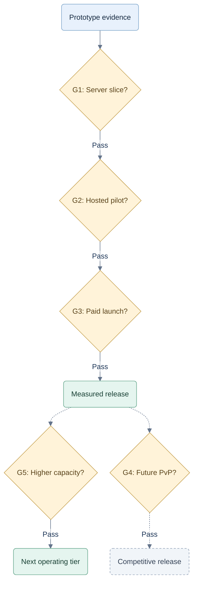

# Commercial product and security test gates

26 September 2026. Acceptance design for [06](06-commercialization.md) and [07](07-hosted-architecture.md). Tests in the tables are **planned and not run**. They require the proposed service. Their names describe future suites, not existing files or passing results.

## What was actually checked

During the earlier commercial baseline review in `C:\repos\test-jev\web`, Node v24.19.0 ran the following. This suite was not rerun for the subsequent security research:

```powershell
node --test --test-isolation=none tests/*.test.ts
```

Result: **38 tests passed, 0 failed, 0 skipped**, approximately 0.97 seconds. The existing suites cover game rules, code-derived coach behavior and browser-save validation. Source/test hashes are recorded in [the baseline manifest](evidence/commercial-baseline-2026-09-26.json). The runtime and tests were not changed by this documentation work.

Current gaps found by code inspection: `web/src/App.tsx` imports the engine/coach, holds the aggregate and calls advice locally; `web/src/game.ts` stores all hands and a 32-bit seeded deal; `web/src/storage.ts` accepts browser state. There is no hosted identity, billing service, server allowance enforcement or competitive rating. Passing these 38 tests does not validate the commercial architecture. No hosted adversarial/load test, live provider test, payment test, physical-device test or user study was run in this work.

## Test environments and evidence

Use pure deterministic rule fixtures; API tests with at least two players and two families; real PostgreSQL with concurrent connections/processes; browser tests in Chromium, WebKit and Firefox; payment-provider sandbox fixtures/test clocks; and an isolated deployed staging service for load/recovery checks. Stub Jev deterministically before any finite-budget live experiment. Never conduct adversarial tests against unrelated services or customer accounts.

Every run records code revision or source hashes, rules/policy/schema versions, database/runtime versions, fixture seed, offer configuration, commands, duration and pass/fail/not-run status. Keep request/response samples redacted and retain counterexamples. Security checks must use direct HTTP requests as well as the UI. A disabled button is not acceptance evidence.

## Demo, data boundary and access

| ID / requirement | Concrete check | Required result |
|---|---|---|
| T01 / P02 | Traverse every authored demo branch online; disconnect before open/choice/replay and reconnect; clear storage, alter clock and invent nodes. | Each transition requires a validated response; no offline advancement. Complete finite paths; zero live engine/evaluator/provider calls or progress/quota gain. |
| T02 / P02, A01 | Send invented demo seeds/positions, substitute live IDs, request live advice and alternative trials directly. | No runtime evaluator/provider invocation through demo; live operations require applicable scoped play/coaching grants. |
| T03 / A01–A03 | Inspect production module graph, chunks, lazy routes, maps, service-worker caches and alternate deployment routes. | No server engine/strategy, keys, mock-grant bypass or legacy browser app in public artifacts; demo remains finite. |
| T04 / A03 | Compare legal fixtures with identical player knowledge but different hidden holdings. Inspect normal/error/replay/job responses. | Same observation and seeded analysis; no hidden hand, seed, private pass or future-event leak. |
| T05 / A03 | Check production shuffle path and ID generator, then replay a stored original deal. | CSPRNG path is mandatory outside fixtures; no caller seed, clock-derived deal or seed-derived ID; deterministic replay uses recorded deal/events. Statistical distribution tests alone do not prove secrecy. |
| T06 / A04 | Player B requests A's game, decision, job, review or cached answer with a valid B login. | Denied without payload or cross-owner cache leakage. |
| T07 / P02, P05 | Forge localStorage plan, expiry, family owner, price, usage or a successful checkout URL; switch requested game/offer after quota exhaustion. | Server access unchanged. Free/access-trial/paid grants apply only to configured targets/tools/quotas; no reset/stacking or cross-game expansion. Owned saved reads retain their policy. |
| T08 / A02, A04 | Send missing/expired/revoked sessions, forged callbacks, cross-origin mutations and script-bearing display names/provider text. | No unauthorized operation or script execution; cookie/security headers and safe recovery hold; an allowed origin is not itself authorization. |
| T09 / A04 | Concurrent identical commands, same ID/different payload, stale revision, illegal cards and out-of-turn actions. | At most one accepted transition; deterministic retry, conflict/rejection and correct safe view. |
| T10 / A04 | Transfer control between two signed-in devices; leave an old tab issuing commands. | One control lease, no divergent tables; family members can each control their own game. |

## Sessions, payments and family

| ID / requirement | Concrete check | Required result |
|---|---|---|
| T11 / P03–P04, A05 | Unlock a hand, use all hint levels, review multiple decisions and reopen on another device/day. | Exactly one coached-hand unit; help never narrows legal play or commits a move. |
| T12 / P04, A05 | One allowance unit remains; send 50 requests for different eligible hands through at least two API processes/connections. Repeat with usage/unlock rows initially absent. | Exactly one reservation may succeed; reserved+used never exceeds allowance. Initialization races and transaction retries do not duplicate work. In-memory locks alone are insufficient. |
| T13 / P04, A05 | Crash before job dispatch, after provider return, after result commit and before HTTP delivery; retry. | No free duplicate result or double spend; failed/unusable work releases; committed result is recoverable. |
| T14 / P04, A05 | Expire/release a reservation or security-revoke its initiating session during queued/running/committing work; let the old worker finish and retry concurrently. Separately disconnect the HTTP request while valid work continues. | Fencing rejects publication after job expiry, cancellation or security revocation. A transport timeout alone may leave valid work running; its committed result is recoverable without another charge. |
| T15 / P04 | Request at 23:59:59 UTC, complete after midnight, change browser time/zone and restart service. | Original reservation period charged once; next reset is accurately shown; no fabricated fresh allowance. |
| T16 / P04, A05 | Advance a decision while first advice runs; fail provider; abandon after ready coaching; revisit locked hand in recap. | Stale first work releases; usable code fallback is correctly labelled; ready abandoned hand stays used; new coaching for a locked hand needs explicit consent; factual playback alone does not. |
| T17 / P03–P04 | Exhaust Practice and Learn; switch `off/shadow/recommend`; trigger automatic nudges. | Active ordinary play continues; no unchosen unlock or free dynamic help; provider mode never grants access. |
| T18 / P05, A06 | Successful upgrade, 3DS/action required, decline, delayed/repeated callback and renewal during upgrade. | Preview matches charge; upgrade only after verified paid coverage; failed upgrade preserves old tier and usage. |
| T19 / A06 | Invalid signature, replayed/duplicate event, wrong customer/beneficiary/environment, same-second and out-of-order paid/cancel/refund events. | Reject unverified or mismatched purchases; deduplicate by ID; reconcile current state under concurrency; no stale access resurrection or credit to another player. |
| T20 / P05, A06 | Cancel at period end, fail renewal, lose payment-provider connectivity and restore it. | Confirmed paid-through access honored; at expiry live play pauses with saved state; repair/demo remain available; no indefinite fail-open. |
| T21 / P06 | Create a partly filled family, race two invitations for its last seat and accept expired/wrong-account/reused invites. | At most three unlimited and two limited assignments, five total including payer; period-held accepted seats cannot be reused; invalid acceptance rejected. |
| T22 / P06, A04–A06 | Remove member during analysis/publication or bot advancement; attempt seat rotation and group changes; retain individual grant. | Grant checks serialize with publication/acceptance; revocation blocks new work; no quota reset/stacking; strongest still-valid grant works. |
| T23 / P06 | Owner requests members' private hands, results, activity and account export. | Billing relationship grants no private-data access. Member retains their own data after leaving. |
| T24 / P06 | Existing subscriber joins family, owner cancels, invitation is corrected, family member upgrades individually. | Clear double-billing choice, preserved identities and paid-through behavior, no accidental sixth seat. |
| T25 / P03, P07 | Eligible country/method checkout, unavailable country, currency/proration/tax displays and restore after redirect. | Only supported recurring methods offered; same stated offer at checkout; no live price before currency approval. |

## Recording, failure, coaching and competitive boundaries

| ID / requirement | Concrete check | Required result |
|---|---|---|
| T26 / A07 | Block analytics, reject optional consent, suppress/fake heartbeats and display callbacks. | Core authorized play works; essential server records exist; issued help cannot become independent through missing callbacks. |
| T27 / A04, A07 | Fail the essential journal insert in a transaction that would accept a move/unlock. | No accepted mutation/result acknowledgement; retry recovers last committed state. |
| T28 / A07 | Stop metrics exporter; build backlog; then exhaust the safe journal-storage threshold. | Exporter outage alone does not stop play; backlog alerts/recovery work; essential-storage exhaustion safely pauses new mutations. |
| T29 / A07 | Scan logs/exports for seeded canary secrets and another player's data; exercise retention/deletion job. | No sensitive payload in general telemetry; scoped exports and retention execute without deleting required accounting records improperly. |
| T30 / P01, A03 | “Good decision, bad outcome,” Nil protection, Hearts pass changing a void, solo versus partner cases. | Evidence uses decision-time knowledge; no unjustified mistake/mental-cause label; unsupported grades abstain. |
| T31 / P01, A07 | Help requested but not ready, ready but delivery unknown, display reported, trial replay and fresh unaided hand. | Distinct assistance states preserved; uncertainty reported; only eligible fresh evidence contributes to training progress. |
| T32 / P01, A03 | Replay/alternative trial while live game advances in another authorized context; restart into review. | Original snapshot, scores and decisions immutable; restore current authoritative state without trial replacing game. |
| T33 / A08 | Observe detectors against abusive bursts plus legitimate retries, screen-reader, background-tab, VPN/travel and shared-family-network sessions. | Record trigger/policy version, action, duration and reviewed outcomes; measure mistaken interventions before behavioral enforcement. No cheating penalty solely for those signals; recovery works. |
| T34 / A08 | Submit client skill/rating, demo results, bot wins, coached outcomes and replay trials to rating intake. | No competitive rating updates; first release has no ranked endpoint. Before PvP, only eligible server matches update rating. |
| T35 / A08 | Later PvP: request own ranked position through coach/review/export, spectate live and disconnect/rejoin. | No live coaching/opponent secrets; server deadlines and delayed review hold. External assistance remains an acknowledged limitation. |
| T36 / A02, A04 | Set development identity/full-access flags in hosted configuration; remove session middleware from one route in a mutation check. | Startup/build rejects dev access; authorization test detects the missing guard. |

## Performance, economics and usability

| ID / requirement | Experiment | Evidence required |
|---|---|---|
| T37 / A02, A05, A09–A10 | Begin at 1, 10 and 100 bot tables; progress to 1,000, 10,000 and the future 100,000-active-table target in [10](10-capacity-and-scaling.md). Drive real command sequences and declared coaching/analysis mixes, including expensive decisions and bursts. | Report hardware, dataset size, CPU-time distributions, action/bot-ready p95/p99, queue age, DB pool/lock/WAL load, completed/rejected work, quality versions and cost. Meet admitted-load objectives with bounded overload recovery. Simulated provider tests do not establish real Jev capacity. |
| T38 / A02, A09 | Crash API/worker after acknowledged commits; restore database backup to a separate staging instance. | Process-crash recovery loses no acknowledged action. Report actual disaster RPO/RTO and backup verification; do not promise zero regional-loss RPO from local crash tests. |
| T39 / P05, A09 | Demo → sign-in → sandbox checkout → first coached hand → upgrade → cancellation; phone portrait/landscape and keyboard. Record exact maintained browser/device versions and optional-feature fallbacks. | No lost selection/table, duplicate charge, trapped focus or forced rotation on billing. Physical iPhone/iPad Safari and Android Chrome check touch/suspension. Demo dismissal/replay and reduced motion work; no security dependence on Wasm/workers or promise of all 2020 browser versions. |
| T40 / P01, P04, P06, P08 | 10–15 experienced players over at least three separate days, including a small invited family group. | Observe whether they understand a hand allowance, select/reject advice, explain tradeoffs, return voluntarily and manage membership. Treat this as qualitative evidence, not a statistically representative conversion forecast. |
| T41 / P03, P08, A09 | Replay median, heavy and sustained legitimate usage under every proposed offer; model family with three heavy unlimited members. | Cost per hand and per member, gross-to-net revenue by actual currency/country, margin sensitivity and worst supported usage. No “unlimited” launch if ordinary use is uneconomic or silently capped. |
| T42 / P07, A07 | Review proposed enabled-country list with payment/tax/privacy requirements and actual checkout method support. | Document seller/product eligibility and country exceptions; required notices, registration or MoR coverage; deletion and data-transfer handling. No “every country supported” assumption. |

Initial performance objectives for the pilot: same-region non-analysis API p95 under 300 ms at the declared test load; visible code-based coaching p95 under one second where its work budget permits; Jev remains bounded by the existing eight-second application deadline. End-to-end experience from international locations must be measured separately. Missed objectives require a scope/capacity decision, not hidden client fallbacks.

## Additional checks from the reverse-engineering review

Use a client that knows the protocol and bypasses the official UI. These checks validate service authority; detecting an edited browser is not a prerequisite.

| ID / requirement | Concrete check | Required result |
|---|---|---|
| T43 / A04 | Exercise every registered route against the operation-policy matrix: missing/unpaid/expired/revoked/wrong-owner/family-payer sessions, warm caches across replicas, conditional reads, copied result URLs and job polling. | Default deny catches unclassified routes. New work requires current coverage; owned saved coaching remains readable after plan expiry, but never via a revoked session or another owner. No private service-worker/CDN cache exposure. |
| T44 / A02, A04 | Send extra/coerced/nested/oversized fields, user-supplied schemas, spoofed forwarded addresses, forged issuer/subject and CSRF attempts. | Explicit runtime validation rejects invalid bodies before expensive work; only trusted proxies affect network identity; identity/session/origin rules remain enforced. Errors reveal no secrets. |
| T45 / A08 | Flood login-code issuance/verification, recovery, checkout, polling and repeated rejected requests in isolated staging; exhaust configured provider/email budgets. | Shared route/account/global limits and recovery operate across replicas; bounded jobs/logs prevent avoidable cost growth. Provider pause does not itself stop authorized code-based play; no fail-open entitlements. |

Research and proposed work packages: [security review](security/hardening.md). All 49 acceptance cases remain planned; this documentation update ran no hosted security or load tests.

## Capacity and growth checks

| ID / requirement | Concrete check | Required result |
|---|---|---|
| T46 / A10, S02, S06 | Spread real table commands across replicas without sticky routing; kill/drain an API and CPU worker, deploy new replicas and reconnect clients under load. | One authoritative revision per game; recover committed state and unfinished valid jobs; no duplicate allowance spend or process-local authority. Capacity remains within the declared failure envelope. |
| T47 / A10, S04 | Saturate review/shadow queues while live tables progress; send forced/easy/expensive decisions, cancel stale work and exhaust admitted capacity. | Reserved bot capacity and bounded queue memory/age; shadow stops first; fair admitted coaching/review completes or reports a bounded failure. No silent policy downgrade, invalid grade, late fenced publication or charge for unusable work. |
| T48 / A10, S05 | Load 100,000+ account records and realistic retained games; test longest supported matches, first-use races, maximum replicas plus rolling-deploy overlap, DB failover and repeated queue deliveries. | Combined pools retain operational reserve; no connection per user, global move lock or full-history rewrite per turn. Short scoped transactions, correct revocation/quota and idempotent results survive. Measure WAL, vacuum/backlog and recovery behavior. |
| T49 / A10, S07 | Simulate Jev latency tails, 429/503, credit exhaustion and outage across all dispatch replicas. Before enabling/expanding a Jev workload, separately run an explicitly budgeted live capacity experiment on the exact Decisions endpoint/model. | Shared attempts/concurrency/spend bounds; no retry storm; application deadlines include queue wait; ordinary authorized code-based play continues within capacity. An off deployment requires no paid provider experiment. Enabled Jev capacity/cost remains unverified until separately evidenced; extra keys are not the scaling mechanism. |

## Release gates and proposed suite ownership

**First working-app scope, CR-IMPL-004:** basic rules/privacy, ownership/revision/idempotency, durable reload/reconnect, bounded failures and keyboard/touch usability are the current implementation gates. Use the [MG-15–18 packet](implementation/multi-game/launch-access-and-client.md) for online demo, scoped offers and client recovery. G2/G3 hosted/payments and large-load/capacity checks below remain later release work; they do not delay a functioning local web slice. Strategy/learning claims keep their separate gates.

Planned evidence gates; these are not completed tests.



| Gate | Checks | Exit evidence |
|---|---|---|
| G1: server-owned prototype | T01–T05, T09, T30–T32, T36 | Finite demo, no live engine/coach in bundle, correct owned views and replay; local implementation can use explicitly labelled mock grants. |
| G2: authenticated hosted pilot | T06–T17, T21–T24, T26–T29, T33–T34, T37–T40, T43–T49 at declared pilot load | Real identity/PostgreSQL; access races and audit failure checks pass; useful coaching and usable account flows. No real customer charges. |
| G3: paid launch | T18–T20, T25, T39, T41–T42, plus regression of G1/G2 and T37/T46–T49 at at least 1,000 active tables or the higher projected launch peak | Incorporation, verified payments, supported countries, measured failure/capacity envelope, sustainable offer and published terms. Exact Jev capacity is a separate dependency. |
| G4: future PvP | T04, T06, T09, T26, T31–T35, plus a dedicated match/rating suite | Calibrated eligibility/rating, fairness review/appeals and server match lifecycle. Separate approval/evidence from training launch. |
| G5: each capacity expansion | T37–T38, T41, T43, T46–T49 at the proposed next tier | Demonstrate the next operating envelope before exceeding the prior one; 10,000 and 100,000 active tables require their own results. Include headroom, failover, dataset growth, provider limits and cost. |

Proposed suites: `server/tests/{observations,commands,access,usage,family,billing,journal,review,rating-boundary}.test.ts`, `e2e/{demo,subscription,coaching,family,recovery}.spec.ts`, a production import/artifact check and a staging load/recovery harness. Adopt these paths when their owning components exist. Assert observable behavior and durable records, not merely implementation calls.

Any unauthorized paid result, cross-player/hidden-state disclosure, accepted illegal transition, repeatable quota race, resurrected revoked coverage or fabricated independence blocks the relevant gate. Timing/behavior detectors also need measured false-positive handling. Passing finite tests does not prove that external cheating or every vulnerability is impossible.
