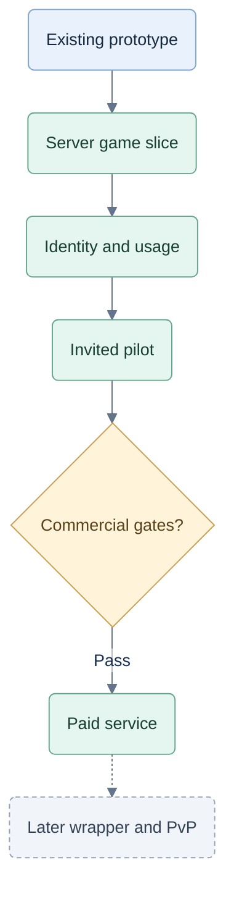

# Delivery sequence, decisions and evidence

26 September 2026. Scope of this work: product, architecture and test design first, using the existing game as evidence. No production service, checkout, incorporation, provider account or multiplayer deployment is created here.

## Recorded direction

| Status | Decision |
|---|---|
| Owner confirmed | Product name **Tricks Coach**; chosen primary domain **trickscoach.com**. The owner will add it to Vercel manually on 26 September 2026. Setup remains unverified. [CR-BRAND-001](brand-and-domain.md). |
| Owner confirmed | Target people who already know the rules and want to make stronger decisions against others. |
| Owner confirmed | Only the fixed, authored coached demo is available without a subscription. No timed trial and no permanent free full-game tier. |
| Owner proposed | Monthly 4.99/9.99 individual plans, with four daily coaching sessions versus unlimited; 17.99 family with three unlimited and two limited users. Values remain adjustable. |
| Owner confirmed | Separate member accounts/profiles, one payer and visible paid-by relationship. Upgrade can be requested at any time. |
| Owner confirmed | Worldwide market; incorporate after testing and before launch. App Store and human multiplayer are later phases. |
| Design recommendation | Keep authoritative engine/coach, hidden state, grants and usage on a hosted Node service; browser supplies no trusted claims. |
| Proposed pilot semantics | Session = one hand; reset at midnight UTC; payer included in five seats; accepted seat assignments last the billing period. These details need pilot feedback. |
| Evidence boundary | Browser tamper-proofing and perfect external-cheating detection are not deliverable promises. Essential server records enforce access; optional analytics are not an attestation. |

## Work split and dependencies

Proposed delivery path; later distribution and competition have separate gates.

| Stage | Product/spec work | App/stack work | Evidence to finish |
|---|---|---|---|
| 0 — Current baseline | Record existing behavior, new demo/plan semantics and changed scope. | Existing prototype only. | Baseline tests and observed gaps below. |
| 1 — Server-owned vertical slice | Fixed demonstration, coached-hand definition and member/exhausted states. | Move rules/bots/coach and private state into `server/`; public DTOs; server CSPRNG; durable commands; finite demo player. Explicit mock identities/grants for development. | G1 in [08](08-commercial-testing.md); bundle inspection and hidden-information tests before exposing any paid-like hosted build. |
| 2 — Identity, usage and records | Account recovery, allowance UI, expiry behavior and recording notice. | Managed auth, PostgreSQL ownership/grants, hand reservations, workers, journal/outbox, device continuity. | G2 security/concurrency/failure checks on actual production-class storage. |
| 3 — Product pilot and family | Test real review usefulness and hand-session comprehension; separate members and payer view. | Family seats/invites and mock payment adapter, sandbox plan changes, saved review and privacy boundaries. | G2 usability/false-positive evidence; T40 qualitative pilot; no real charges. Family can be feature-flagged until its gates pass. |
| 4 — Commercial activation | Set currency/actual prices, unlimited terms, country list, refund/renewal notices and privacy/retention. | Incorporate; set up bank/provider; choose direct Stripe versus eligible MoR; sandbox then verified live checkout/webhooks/portal and reconciliation. | G3, cost/capacity evidence, enabled-country compliance and successful payment lifecycle. Owner operates verified company/payment accounts. |
| 5 — Later distribution/competition | Store offer and purchase rules; distinct ranked-play/rating/fairness specification. | Store billing grants and wrapper if appropriate; separately build authoritative multiplayer and ranked lifecycle. | Storefront-specific review; G4 and dedicated competitive rating validation. |

This sequence is a dependency roadmap, not a claim that the production build is ready for execution. The detailed [local implementation plan](2026-09-26-implementation-plan.md) remains useful for rule/strategy/review work, with the scope corrections recorded there. Freeze public contracts and produce component implementation plans against the reviewed hosted design before starting those build stages.

The [security implementation plan](security/implementation/server-authority.md) supplies the access-boundary work packages for stages 1–4. Research supports the existing React/TypeScript + Node/Fastify + PostgreSQL choice; moving privileged computation to the service provides the protection. Wasm, workers and session bundles do not replace server authorization. New checks cover route policies, cached-result access, revocation, strict validation and abuse limits.

The [capacity design](10-capacity-and-scaling.md) adds stateless API replication, separate bot/coach/provider capacity, database pool budgets and progressive 1,000/10,000/100,000 active-table evidence. Build these separation boundaries in stages 1–2; benchmark before paid launch and each expansion. Queue migration or data partitioning is triggered by measured limits, not a registered-account milestone. No hosted capacity has been demonstrated.

## Compatibility and specification changes

| Earlier assumption | Replacement and reason | Affected evidence |
|---|---|---|
| Full ordinary games are free | Demo-only unpaid access; both paid individual tiers include ordinary play. Explicit owner clarification. | T01–T02, T07, T17, T20 |
| Five coached decisions/day | Proposed four coached hands/day; all decisions in one hand share a unit. Clearer customer session. | T11–T17 |
| Engine can ship in shared/browser code | Public contracts only shared; authoritative engine and coach server-only. Requested source/access protection and later fair play. | T03–T06, T09 |
| Browser display receipt establishes assistance | Issued guidance and display reports are separate; uncertain delivery cannot prove independence. User-controlled telemetry cannot be trusted. | T26, T30–T31 |
| Browser records can be imported as authoritative | Legacy local saves may be retained as labelled personal reference in local development; hosted service never trusts them for live games, paid allowance, learning claims or ranking. | T05–T09, T34 |
| SQLite/local mock access is sufficient | Useful local harness only. Hosted acceptance uses real identity, PostgreSQL and server-owned payment coverage. | T08, T12–T14, T18–T29 |
| Billing country defines market | Canadian company can sell internationally subject to country/provider/tax/consumer rules. | T25, T42 |
| Coach level can directly become competitive rating | Keep training feedback separate; later calibrated provisional seeding and verified match outcomes. | T31, T34–T35 |

Unchanged domain constraints: the three game modes, fair-information coaching, independent assessment, no fabricated mistakes/progress, current-game replay only, immutable original choices and isolated alternative trials. Jev remains the only optional remote strategic model; shadow results cannot grade humans or leak into advice.

## Actual baseline evidence

Source inspected: `web/src/App.tsx`, `web/src/game.ts`, `web/src/coach.ts`, `web/src/storage.ts`, package/readme and current planning files. The prototype still contains the full game aggregate and browser coaching. This is acceptable as a local prototype and unsuitable for the requested commercial access boundary.

Previously executed in `C:\repos\test-jev\web`: `node --test --test-isolation=none tests/*.test.ts` on Node v24.19.0. **38 passed; 0 failed; 0 skipped.** Hashes: [baseline manifest](evidence/commercial-baseline-2026-09-26.json). No new service, UI or billing code was written. The 49 checks in [08](08-commercial-testing.md) are future acceptance cases, not completed tests. The subsequent security/capacity research rechecked source boundaries and documents; it did not rerun or expand the executable test suite.

Source updates were prepared against exact hashes of current documents. Original v0.2 pack files and its manifest are preserved. `C:\repos\test-jev` has no Git repository; no commit is claimed.

## Launch decisions that remain open

The product name and primary domain are decided. Pending handoff: the owner adds `trickscoach.com` to Vercel manually on 26 September 2026; afterward, verify project mapping, DNS, HTTPS and the expected site response. Apply **Tricks Coach** to app/page copy when implementing public branding. This documentation change completes neither UI branding nor domain setup; see [BRAND-01–03](brand-and-domain.md).

- Currency, regional price/tax display, exact monthly prices, coaching unit feedback and sustainable unlimited capacity.
- Whether family means a household or an invited group; acceptance of payer-inclusive seats and the reassignment policy.
- Identity/hosting vendor and primary region after recovery, privacy, latency and cost checks.
- Direct seller versus eligible merchant of record; country coverage and practical PayPal path for a Canadian seller.
- Final retention/deletion notices, support and billing-repair behavior; ranked eligibility, methodology and appeals are a later project.

None blocks completing this design/test proposal. Each has an owner-visible decision gate before the corresponding public promise or production integration.
