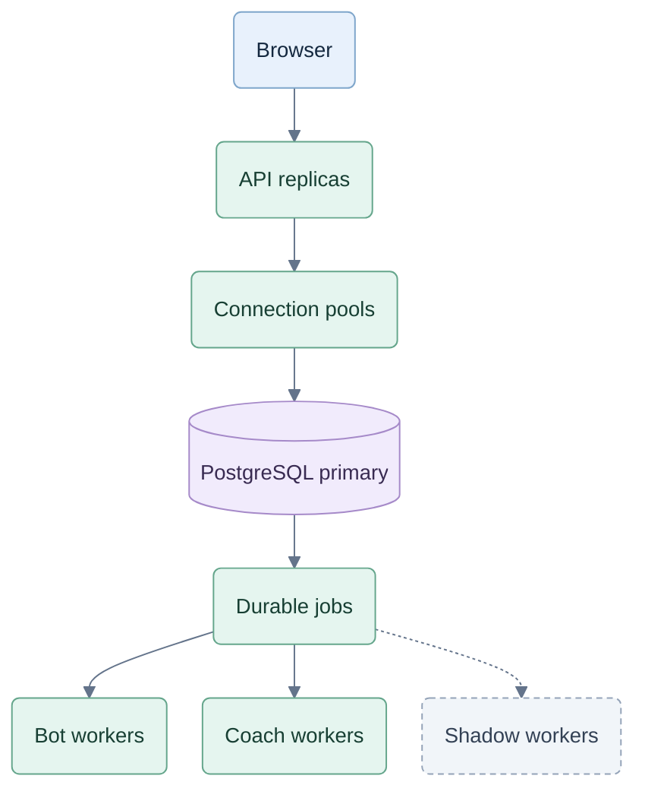
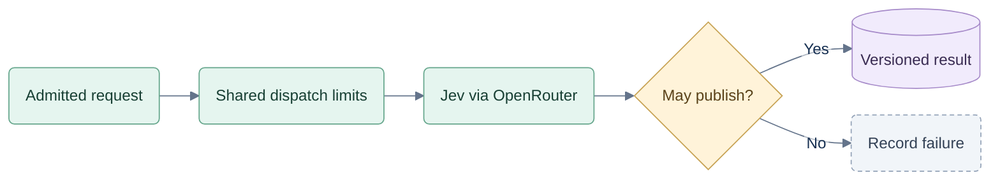

# Capacity and scaling

26 September 2026. Design extension to [07](07-hosted-architecture.md), with acceptance in [08](08-commercial-testing.md). No capacity benchmark or deployment has been performed. Keep TypeScript/Node; make capacity a measured property of the whole service.

## S01 — What we are sizing

The owner's requirement is thousands of simultaneous players and growth beyond the first 100,000 users. Account count, daily active users, open connections and actively playing tables are different measures. We model both 100,000 accounts with a measured active fraction and a future stress target of 100,000 simultaneous players. Neither is a current capacity claim.

For V1, one active player normally owns one table with three bots. A table is durable state plus short computations when something changes. It does not require a dedicated process, thread, container, database connection or continuous tick loop. Paused tables schedule no new bot work; in-flight preparation may finish without advancing play. Later human multiplayer needs a separate workload model.

## S02 — Retain the stack; scale separate workloads

Recommend one modular TypeScript codebase with independently deployable API and worker pools. A larger single server is useful for an early baseline but is not the growth plan. Splitting every component into a microservice or introducing a distributed actor framework now would add operations and coordination without evidence of a need.

Proposed dispatch view; completion follows A04–A05. Bot preparation and live advancement remain distinct.

Queues are initially PostgreSQL-backed; the diagram does not mandate another product. Shadow results follow their existing non-public path. Every worker result retains the authorization/publication controls in A04–A05. Persisting a prepared bot result does not play its card: the separate authorized advance request preserves pacing and pause behavior.

| Work | Initial scaling rule |
|---|---|
| API, legal moves, scoring and seat views | Multiple stateless replicas behind a load balancer. No sticky session required for correctness; shared durable state determines the accepted revision. |
| CPU-heavy bot/coach analysis | Bounded worker pools outside the API process, independently sized. Reserve bot capacity so review or shadow bursts cannot stop ordinary play. |
| Provider calls | Async dispatch with separate in-flight, request and spend limits. Waiting for Jev must not occupy a CPU worker or database connection. |
| Static interface/demo | CDN cache; zero live game/analysis work for demo visitors. |

Use pooled Node worker threads for CPU-intensive JavaScript rather than creating one per request. Async I/O already suits provider waits. [Node worker documentation](https://nodejs.org/docs/latest-v24.x/api/worker_threads.html)

## S03 — Workload arithmetic, not server-count guesses

Illustrative ordinary-play assumption: each active player plays one human card every **10 seconds**, with three bot cards and one trick collection per cycle. This is not observed player behavior. The current prepare/advance API adds three preparation requests to those five mutations.

| Active players/tables | Human plays/s | Bot decisions/s | Logical state commits/s | Base API requests/s |
|---:|---:|---:|---:|---:|
| 1,000 | 100 | 300 | 500 | 800 |
| 10,000 | 1,000 | 3,000 | 5,000 | 8,000 |
| 100,000 | 10,000 | 30,000 | 50,000 | 80,000 |

These exclude bids, passes, next-hand actions, reads, advice, polling, login, recovery and retries. One logical commit also writes command/event/snapshot/journal data: it is not one SQL statement or one disk write. Measure the real mix before sizing. Faster players and synchronized bursts need separate cases.

Use the following model in capacity reports:

- Human plays/s = active tables / mean seconds between human card plays.
- Analysis jobs/s = bot analyses + human coaching/assessment + trials + shadow, after bypasses, reuse and deduplication.
- CPU cores consumed = jobs/s × measured CPU seconds/job. Provision above this to meet latency and failure headroom.
- Provider in-flight requests ≈ provider attempts/s × mean request duration; provision/test for tail latency too.
- Storage growth = records/day × measured serialized bytes, plus snapshots, indexes, WAL, replicas and backups.

At 10,000 active tables, **3,000 bot decisions/s × 250 ms of CPU = 750 fully occupied cores**, or 1,250 cores at an illustrative 60% utilization target, before other work. If the measured average were 5 ms, the same calculation would require 25 cores at that target. Neither duration is a measured bot average; the existing 250 ms analysis limit is an experimental wall-time ceiling, not a routine CPU allocation.

This is why we must optimize and budget strategy work before promising scale. The card rules and scoring are only part of the workload.

## S04 — Keep analysis useful and bounded

Bots and coach retain the shared, observation-only strategy policy. Screen cheaply, bypass forced choices, narrow candidates and spend deeper computation where it helps. Reuse the same owned decision analysis across help levels and before/after explanations where valid; analyze an omitted human choice when assessment requires it. Never assume a high cache hit rate across unrelated private hands.

Record policy/work-budget versions, actual CPU and wall time, sample count, coverage and truncation. A faster budget profile needs its own quality evaluation; overload must not silently weaken bots or fabricate certainty. The 256-world/250 ms settings remain profiling starting points. Forced moves and ordinary bots do not call Jev under the current provider policy.

Reserve capacity for admitted game progression and recovery. Requested live coaching comes next; recap/trials have a separately admitted fair share; shadow experiments use residual capacity and stop first. Background work needs bounded age and visible pending/unavailable states, not indefinite starvation.

Admission considers queue work, useful deadline, provider capacity and spend before starting expensive work. Reject or defer work that cannot finish usefully; no charge unless a usable result reaches the existing ready boundary. Waiting and retries use the remaining application deadline. Keep the evaluated code fallback and honest provenance; never switch to another remote model or a browser engine. Under wider overload, protect existing games and temporarily reject new starts with recovery guidance.

## S05 — Database and queue boundaries

Set one database connection budget across maximum API replicas, workers and operational clients; leave recovery/admin capacity. No per-player database connection. Use bounded pools and a managed pooler or PgBouncer where appropriate. Transaction pooling has session-feature restrictions: test prepared statements, avoid session advisory locks, and do not put LISTEN consumers through that pool. Raising PostgreSQL connection limits also allocates more resources. [PostgreSQL](https://www.postgresql.org/docs/current/runtime-config-connection.html), [PgBouncer](https://www.pgbouncer.org/features.html)

Keep transactions short and locks scoped to the relevant player/session/game, or small family mutation. There is no global gameplay lock or single row incremented by every move. Lock order, first-use initialization, quota constraints and revocation remain mandatory. Read replicas may serve suitable delayed reports, never authoritative grants, quota or current game acceptance.

Append accepted events once and update a compact current snapshot atomically. Do not rewrite the entire accumulated match history after every card or repeatedly replay the whole game for a view. Use indexed access paths and bounded checkpoints; measure largest supported matches. Move closed records out of hot working sets under the existing retention policy. Time partitioning can help retention and maintenance; it does not turn one database into multiple independent write servers. [PostgreSQL partitioning](https://www.postgresql.org/docs/current/ddl-partitioning.html)

Initially claim jobs with short transactions and finite leases, then release connections/locks during CPU or provider work. PostgreSQL documents SKIP LOCKED for queue-like consumers; never use skipped rows to bypass an entitlement check. [PostgreSQL SELECT](https://www.postgresql.org/docs/current/sql-select.html)

Keep a queue adapter seam. If queue churn or polling competes with game commits, move dispatch to a managed durable queue while retaining the database outbox, job identity, idempotency and fencing. Expect redelivery, duplicate dispatch and out-of-order completion; transport delivery is not exactly-once execution or billing. [SQS delivery semantics](https://docs.aws.amazon.com/AWSSimpleQueueService/latest/SQSDeveloperGuide/standard-queues-at-least-once-delivery.html)

## S06 — Scaling and availability controls

Use at least two API replicas across failure domains for the paid service, with managed database failover and tested recovery. This is an availability baseline, not a throughput estimate. Graceful draining stops new work before a replica exits; unfinished jobs recover through durable leases. Losing one replica must not fork a game or double-consume allowance.

Scale API capacity using request latency, in-flight work, event-loop delay, memory and database wait. Scale analysis using estimated queued work per available worker, oldest-job age and completed throughput, as well as CPU. Keep warm capacity for bursts; autoscaling is not instantaneous. Increase replicas only within database/provider budgets. AWS describes deriving backlog targets from acceptable wait and processing time; the principle does not require AWS or Kubernetes. [Queue-based scaling](https://docs.aws.amazon.com/autoscaling/ec2/userguide/as-using-sqs-queue.html)

V1 can use command responses and bounded polling only while an analysis is pending; stop polling hidden/paused tables and back off on overload. Do not poll every user's full state at a fixed high frequency. If later server push is needed, size the connection tier separately, use revision-based resumption and reauthorize delivery. A live socket must not pin a database connection or bypass revocation.

Alert against the measured safe envelope, queue deadlines and spend. Publish admitted/completed/rejected work and fallback rates together so rejecting players or weakening analysis cannot disguise a capacity failure.

## S07 — OpenRouter is a separate capacity dependency

Proposed provider path; dispatch and waiting share the eight-second application budget.

More application replicas cannot manufacture provider throughput. OpenRouter documents upstream capacity errors and globally governed limits; additional keys/accounts are not a scaling strategy. The inspected Decisions contract supplies no quantified Jev throughput commitment for this app. Validate the exact endpoint/model with a bounded live experiment and obtain appropriate provider capacity before promising a large Jev workload. [Limits](https://openrouter.ai/docs/api_reference/limits), [Decisions contract](https://openrouter.ai/docs/api/api-reference/alphadecisions/submit-a-decisions-request)

For illustration, if 10% of 1,000 human decisions/s need Jev, that is 100 requests/s before retries or shadow. At two seconds mean service time, that implies about 200 in-flight calls. These are assumptions, not measured latency or guaranteed availability.

Enforce a shared dispatch budget across replicas, bounded retries and circuit breakers. Preserve the eight-second application deadline and current Jev-only contract. Charge/cost modeling counts actual provider attempts, CPU work and storage; coached-hand unlocks are the customer unit and do not measure infrastructure consumption. Provider simulation can validate our system under delays/errors, but cannot prove Jev capacity or economics. Live provider evidence is required for the Jev workload being enabled or expanded; a code-only deployment with Jev off requires no paid provider experiment.

## S08 — Growth stages and what triggers a change

| Stage | Target evidence | Topology decision |
|---|---|---|
| Local/pilot | Existing 1–100-table sweep and realistic strategy profiles | One logical service/database; separate worker execution and durable state. |
| Thousands active | 1,000 then 10,000 active-table tests, 100,000+ account records, realistic retained data | Horizontal API/worker pools, HA database, pooled connections and bounded queues. Scale instance sizes/counts from measurements. |
| Larger concurrency | Step toward 100,000 active tables as demand warrants | Optimize hot paths; externalize queue or reports only when they cause contention. Confirm provider capacity and cost separately. |
| Beyond one tested database/region | One writer approaches its measured safe limit, or geography/recovery demands it | Introduce routed data partitions/cells and regional ownership through a dedicated migration design before the limit is reached. |

Keep opaque stable IDs and repository/job adapters so storage placement can change without rewriting card rules or UI contracts. A future partition must co-locate a player's authoritative games, usage and access state, or provide an equally strong transaction design. Hashing only game IDs would split daily quota and revocation authority incorrectly. Cross-partition family changes need an explicit authoritative protocol or co-location; eventually delivered revocation messages alone do not meet A04. Do not create active-active writers for the same game. Start multi-region work from measured need, with migration/failover fencing tested first.

## S09 — Capacity evidence required before each expansion

Expand T37 and add T46–T49 in [08](08-commercial-testing.md). Test each proposed operating tier at normal load, a sustained headroom load and sudden bursts; include largest records and realistic analysis rates. A suggested evidence run is a 60-minute steady load, a 2× burst for five minutes and a four-hour retention/queue soak. Report every configured size, policy and hardware choice.

The admitted steady workload must satisfy existing latency objectives without reducing policy quality. At overload, demonstrate bounded queues/memory, explicit rejection and recovery. Kill an API and worker, exercise database failover, duplicate deliveries, revocation and provider slowdown while loaded. Show results for both permitted and denied requests; never substitute accepting an unauthorized operation to improve throughput.

Only claim a capacity tier after these tests and its cost envelope pass. There is no architectural reason to use account 100,001 as a limit, but there is also no evidence that a single database or any fixed server count can serve the 100,000-concurrent stress case today.
