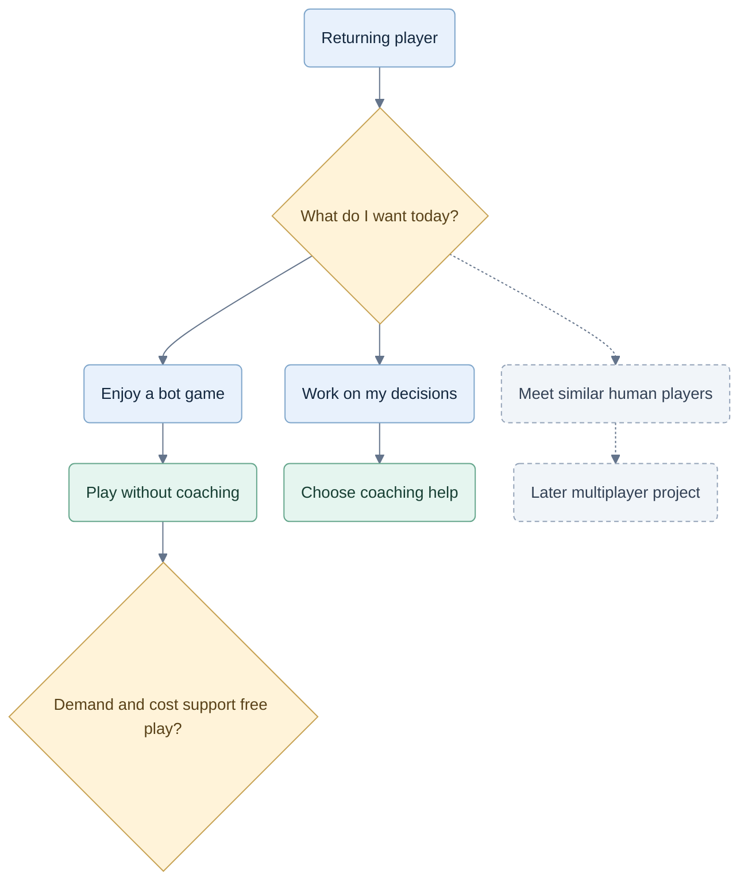
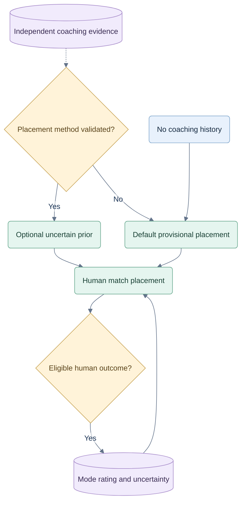

# Future play, membership and player matching

**27 September 2026 · CR-FUTURE-001 · Consideration only.** The owner asked us to consider players returning for enjoyable bots or similarly skilled human opponents after needing less coaching. This records options and future gates; it does not authorize implementation, a free tier, new prices or multiplayer. Naming is being considered separately.

The current launch offer remains the finite free example plus subscribed live play in [06](06-commercialization.md). The local implementation and its remaining hosted gates are recorded in [status](../qa/implementation/status.md). Future ideas below are not additional W00–W19 acceptance requirements.

**Owner update, 4 October — [CR-IMPL-004](decisions/CR-IMPL-004-online-demo-and-launch-readiness.md):** preparing flexible free/access-trial/paid grant policies is now part of the current implementation plan. Final launch games, tools, limits and durations remain unselected. This supersedes the categorical planning prohibition and paid-only assumptions above/F04 for offer preparation; broad free access, real-player matching, ratings and new prices remain future decisions. The demo requires online server responses.

**CR-STRAT-005:** future human play remains possible through `tableType=human-only`; current `practice-bots` always has one human and three bots. Table type is independent of game and solo/partnership competition. Human-only remains unavailable until its gates pass.

## F01 — A reason to stay after learning

**Recommendation:** preserve a path from learning to enjoyable regular play. Needing the coach less can be a successful outcome. Test whether the game itself earns repeat use before assuming either that every returning player needs coaching or that free play will fund itself.

The existing table already supports optional help. A future entry point may distinguish **Play** and **Practice with coach**, using the same table. Quiet play should have no unsolicited mistake markers, lesson prompts or purchase interruptions. Players can still explicitly request paid review after play. Bot strength and enjoyment need evaluation; neither the architecture nor the presence of Jev proves them.

## F02 — Free is an option with a cost test

| Future offer | Why consider it | What must be proved |
|---|---|---|
| Keep subscribed play; add a lower-priced play-only plan if needed | Serves people who value the bots but rarely request lessons; avoids subsidizing all play | Enough willingness to pay for play alone to justify another plan |
| **Bounded free bot play + paid coaching** | Recommended first free-play experiment after launch evidence; lets former learners keep returning | Incremental retention/conversion pays for real usage and abuse; a published limit feels usable |
| Broad free play + paid coaching; human play later | Could support a larger community and more available opponents | Sustainable heavy-user costs, operational capacity and, separately, multiplayer demand and safety |

Do not pick a free daily allowance or change the proposed 4.99/9.99/17.99 amounts yet. If introduced, a free allowance should use an understandable play unit, separate from the **coached hand** purchase unit. Prefer admission at a new hand or match boundary, with a documented finish/resume policy; do not interrupt a valid ongoing game to sell access. Limit/account rules and handling of resets or abandoned games need their own approved specification.

Paid value remains guidance, evidence and review. A higher paid tier can change coaching allowance; a play-only offer is worth adding only if it solves a demonstrated need. Revisit family value too: free base play would leave shared coaching benefits as the main reason to pay. Preserve already purchased access when changing plans. No prices, Stripe products, free grants or advertising system are created by this plan.

Track **incremental net subscription revenue** against **incremental bot/server/storage, support, abuse and payment costs**, including any lost paid-play revenue. Measure returning play without coaching, completed games, coaching return/conversion, churn reasons and cost per active hour by cohort. Low coaching usage alone is not failure. Set the experiment's acceptable costs and stop rules before launch; no universal conversion percentage establishes viability.

## F03 — Three distinct uses of skill evidence

| Evidence | Purpose | Boundary |
|---|---|---|
| Coaching progress | Identify what to practice next | Category/context/assistance-aware evidence; no universal skill score or direct rank gain |
| Provisional placement estimate | Reduce poor initial human matches | Optional calibrated signal from eligible independent evidence; uncertain and mode-specific |
| Competitive rating | Track performance against humans | Eligible server-recorded match outcomes, uncertainty and an evaluated method for that game mode |

Microsoft's TrueSkill research illustrates why a skill estimate includes uncertainty and why outcomes/team structure matter. It does not validate our coach as a rating system, establish a minimum number of games here or select our eventual algorithm. [Primary research](https://www.microsoft.com/en-us/research/project/trueskill-ranking-system/).

Players without a subscription or coach history must have a normal provisional placement path. Purchasing help, winning against bots, repeating a deal, receiving assisted advice or trying alternatives cannot buy or increase competitive rating. A placement prior must be bounded, validated against later human performance and correctable by those results; no confident label from sparse evidence. Maintain separate Hearts Solo, Spades Solo and Spades Partners estimates initially. Partner assignments and premade pairs need explicit evaluation rather than treating a team win as four independent results.

Use server-owned placement attributes. PlayFab documents both caller-supplied and stored attributes, including the latter for values callers cannot be trusted to submit; this supports the boundary, not a vendor choice. [Attribute guidance](https://learn.microsoft.com/en-us/xbox/playfab/multiplayer/matchmaking/ticket-attributes).

## F04 — Necessary design implications

These are constraints for a future proposal, not a request to add abstractions or unused tables now.

| Area | Preserve now | Change only if that future is approved |
|---|---|---|
| Access and billing | The operation-specific play/coaching/read policies in A04; current live play requires paid coverage | Permit an explicit server-issued free play grant. Keep identity, play access, coaching access and ranked eligibility distinct. A paid-state boolean must not become a rule of the card engine. |
| Coaching and expiry | Explicit hand activation, honest assessment and saved-result access | Coach expiry may stop new analysis while a valid free/play-only grant permits play. Define downgrade, free-limit and in-flight work behavior before migration. Current expiry rules still apply today. |
| Bots and computation | Shared observation-only strategy; ordinary bots run in code | Evaluate bot styles/difficulty and any Jev-assisted bot mode separately. Free play neither requires nor authorizes a Jev call on every turn. No hidden-card advantage, manufactured losses or silent weakening to sell coaching. |
| Table and replay | Low-text cues and current-game review | Human games require shared deadlines, reconnect/abandonment rules and delayed review. One player's pause or trial cannot pause other players or reveal live secrets. Clearly identify bot seats. |
| Competitive integrity | Assistance provenance and immutable accepted outcomes | No platform live coaching in ranked matches; no coach endpoint accepting live ranked positions. Cooperative teaching, if offered, needs explicit all-player agreement and unranked status. Blocking our tools cannot guarantee absence of external help. |
| Records and privacy | Internal game records, scoped retention and compact learning profiles | Add minimal rating/eligibility records and participant access policies. Do not expose private coaching or introduce an old-game archive as a side effect. Rating records need deletion/correction rules. |
| Multiplayer ownership | Authoritative rules, observations, revisions and worker boundaries | Replace the single human owner's access/scheduling assumptions with seat-specific participants and one match authority. A payer or host cannot read another player's hand or lessons. This is a separate migration, not a flag on the current solo service. |
| Matching and community | Three game-mode seams; no matchmaking infrastructure now | Pilot a small set of queues before widening modes/regions. Balance wait time, skill, uncertainty and partner composition. Add reporting/blocking, disconnect handling and collusion review; chat, spectators and tournaments remain separate options. |

Free human play could increase the pool of available opponents, but registered-user count does not establish that pool. Queue rules constrain who can match; widening skill/latency bounds can reduce waits at a quality cost. Start with demand measured by mode and time of day, not many empty queues or guaranteed “same-level” promises. This is our design inference from [PlayFab queue/rule guidance](https://learn.microsoft.com/en-us/xbox/playfab/multiplayer/matchmaking/config-queues).

## F05 — Capacity and economics change by play mix

At the same active-player count, four humans at one table may need fewer bot computations than four separate human-versus-bot tables. They add fan-out, presence, reconnects, shared scheduling and abuse operations. Multiplayer is therefore a different workload, not automatically a cheaper service. Model bot-only, mixed-seat and all-human tables separately, including coaching/review and any fallback bots.

A free tier needs a service-cost ceiling, admission limits and controlled enrollment before broad release. Keep capacity reserved for already admitted games and entitled coaching. Stop background experiments first; reduce new admissions before silently lowering playing quality. Measure CPU work, bytes/records retained, connection delivery and provider attempts independently of customer hand allowances.

The account-based co-location proposal in S08 is specific to solo practice. A future shared match needs one authoritative home, seat-bound access, an explicit protocol for player grants across partitions and revocation/failover fencing. Do not copy that game into four independently writable player partitions. Existing TypeScript/Node/PostgreSQL boundaries remain useful; this consideration requires no new stack, queue vendor or microservices now.

## F06 — Future feature order and decision gates

| Step | Question to resolve | Evidence before expanding |
|---|---|---|
| Learn from the current product | Do people return for enjoyable bots with coaching off? | Interviews and consented usage/cost analysis; distinguish learning success from dissatisfaction |
| Evaluate a free-play pilot | Does bounded free play improve sustainable retention? | Approved offer/limits, capacity budget, conversion/cannibalization comparison and clear cancellation/expiry behavior |
| Test human play privately | Can we run reliable, fair four-seat games? | All three mode rules remain supported; start the human pilot in the mode with demonstrated demand. Validate seats, deadlines, recovery, privacy and reporting before public queues |
| Validate placement and ranked play | Can people find fair matches without buying coaching? | Held-out predictive/calibration checks, uncertainty/cold-start and partner tests, wait-time study and assistance/abuse checks; include coach-history and no-history players |
| Expand access or queues | Do demand and economics justify more? | Measured quality, completion, cost, queue health and operational capacity at each tier |

Future acceptance must cover free-grant expiry/retry abuse, paid-to-free transitions, no coaching without entitlement, no paid placement advantage, no rating from bots/trials/assisted outcomes, and cross-seat privacy/revocation. Extend T03/T06, T14, T26 and T31–T38/T46–T49 only when a specific feature is approved. These scenarios are not implemented tests or a claim that the current product supports them.

**Decision to revisit:** retain paid-only launch, offer bounded free play, or offer a paid play-only membership after demand and cost evidence. Broad free play and human matchmaking are separate decisions. Naming, new prices, rating algorithms, schemas and implementation are intentionally left to their respective future work.
