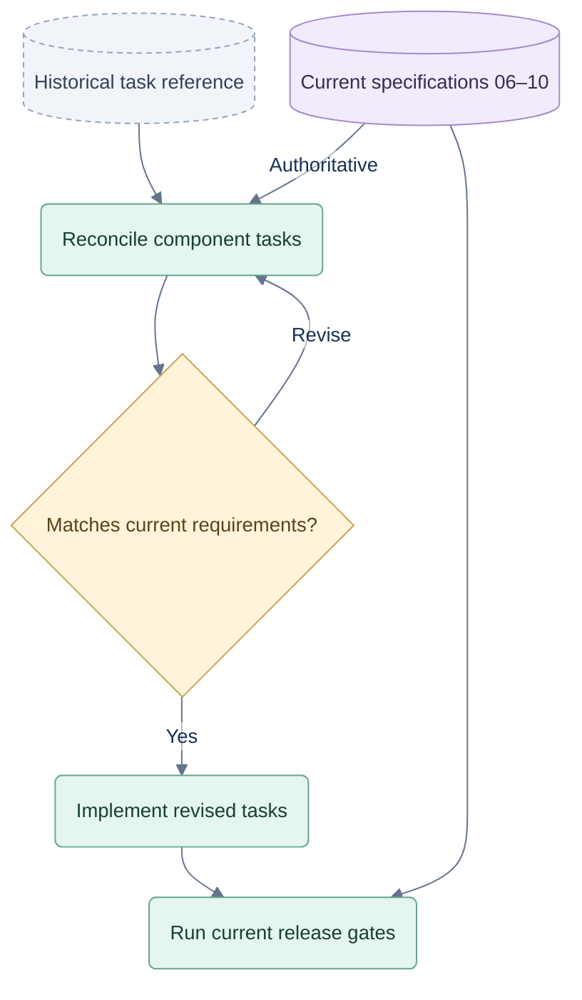

# Historical local implementation plan

**Status: reference only; do not execute as written.** The owner’s subsequent commercialization decisions are recorded in [06](06-commercialization.md), [07](07-hosted-architecture.md), [08](08-commercial-testing.md) and [09](09-delivery-and-evidence.md). They supersede this plan’s free-game tier, per-decision quota, shared/browser engine, browser-exposure trust and hosted use of local mocks/SQLite. The code examples and task breakdown below are preserved as historical context. Rewrite component tasks against the hosted design before implementation.

> **For agentic workers:** REQUIRED SUB-SKILL: Use superpowers:subagent-driven-development (recommended) or superpowers:executing-plans to implement this plan task-by-task. Steps use checkbox (`- [ ]`) syntax for tracking.

**Goal:** Build a coach that helps before decisions, offers supported feedback afterward, and lets the player revisit evidence or try another card without changing the live game.

**Architecture:** Keep usable React game interactions; styling can evolve. A local service owns state and records, a shared strategy serves bots and coach, and review reconstructs decisions or creates isolated sampled trials. A worker evaluates candidates and a small adapter calls OpenRouter; explanations remain predicate-backed templates.

**Tech Stack:** Existing React 19/TypeScript/Vite; Node 24.19+, built-in HTTP/fetch/SQLite, existing Node tests; Playwright for consequential browser flows.

**Spec:** [01 Views](01-product-and-views.md), [02 Games](02-games-and-decisions.md), [03 Runtime](03-local-runtime.md), [04 Coaching](04-coaching-and-evidence.md), [05 V1 setup](05-v1-setup.md), [06 Access](06-access-and-subscriptions.md).

## How to use this historical plan



Defer to current specifications [06](06-commercialization.md), [07](07-hosted-architecture.md), [08](08-commercial-testing.md), [09](09-delivery-and-evidence.md) and [10](10-capacity-and-scaling.md). This diagram does not reinstate the historical free-play, per-decision allowance or browser-authority rules below.

## Global Constraints

- All project artifacts remain under `C:\repos\test-jev`.
- Full games: Hearts solo, Spades solo, Spades partners; four seats each.
- Preserve usable game interactions and responsive access; styling can change.
- Every started game is stored internally. No player-facing game archive.
- Review earlier tricks/hands in the current game and the just-completed match; alternative trials never alter live state, scores or independent-progress evidence.
- Jev is the only remote strategic model.
- Local V1 uses a test player, mock subscriptions and no cloud deployment/live billing. Commercial subscriptions require a hosted authenticated backend; enabled Jev experiments require OpenRouter access.
- Full games stay free. Coaching access, provider budgets and learning exposure are separate server records.
- Keep the web app and shared API; no separate native game implementations are planned.
- Node 24.19+; request `typesafe/jev-1.13` through OpenRouter Decisions.
- Optional help never narrows the human's legal moves or commits one for them.
- Start with `JEV_MODE=off`. Shadow results never affect visible advice, applied actions or human grades. Promotion is evidence-gated by mode/phase.
- Compare bidding A and B before considering adaptive C; research does not validate the prototype's coefficients.

## Review Focus

1. Different hidden deals with identical player information produce identical observations and seeded local analyses — tasks 1/2.
2. Pause, replay, reload or a late response cannot replace the live game, duplicate an action or contaminate another decision — tasks 3/4/5/6A.
3. Structurally valid but impossible saves cannot enter play — tasks 1/4.
4. Memory, post-action feedback and practice trials cannot be recorded as later independent progress — tasks 5/6/6A.
5. A sensible non-shortlisted choice, unlucky outcome or favorable simulated alternative cannot establish a fabricated mistake — tasks 2/6/6A.

## File map and sequence

All paths below are relative to `C:\repos\test-jev\web`. Coaching behavior is the priority; a visual redesign is not a prerequisite.

| Task | Files and responsibility |
|---|---|
| 1 | `shared/engine.ts`, `shared/contracts.ts`, `shared/observations.ts`; `src/game.ts` compatibility re-export; rule/knowledge tests. |
| 2 | `server/strategy/{tactics,probability,bidding,candidates,worker}.ts`, `server/evaluation/bidding.ts`; shared observation-only decisions and A/B comparison. |
| 3 | `server/providers/openrouter.ts`; Jev transport and validation. |
| 4 | `server/{repository,session-service,http,main}.ts`, `server/schema.sql`; local lifecycle, HTTP and records. |
| 4A | `server/access/{identity,policy,usage}.ts`; player ownership, mock entitlements and atomic coaching unlocks. |
| 5 | `src/{api,useSession,coach,storage}.ts`, `src/App.tsx`, `src/styles.css`; connect existing views and exposure. |
| 6 | `server/coaching/{assessment,progress,recap}.ts`; evidence and concise reflection. |
| 6A | `server/coaching/review.ts`, `src/ReviewPanel.tsx`; post-action markers, original replay and isolated alternative-card trials. |
| 7 | `server/evaluation/run.ts`, `qa/fixtures/`, `qa/ACCEPTANCE.md`; paired evaluation and device pilot. |

Tasks 2 and 3 can proceed independently after task 1. Task 4 uses both; task 4A adds access boundaries; task 5 connects them to the UI; task 6 uses recorded decisions and task 2; task 6A adds actionable review. Deliver original replay before alternative trials and enable live markers only once review works. Each task ends with targeted checks passing before integration. The folder currently has no Git repository; do not invent commits as completed work.

### Task 1 — Freeze rules and isolate player knowledge

**Files:** create the three `shared/` files, `tests/observations.test.ts`, `tests/fixtures.ts`; extend `tests/game.test.ts` and `tests/storage.test.ts`; modify `src/game.ts` to re-export the engine.

**Interfaces:** `createSession(mode:Mode, seed:number):SessionState`; `observe(state:SessionState, seat:Seat):DecisionObservation`; `applyAction(state:SessionState, action:GameAction, passBundles?:[Card[],Card[],Card[],Card[]]):SessionState`; `validateState(value:unknown):value is SessionState`. A pass requires all four validated bundles, including the matching human selection. Define the spec's shared contracts here before downstream work. Keep existing engine exports compatible.

- [ ] Add failing rule cases: Q♠ leaves hearts unbroken; Hearts/solo/team terminal ties continue; failed solo Nil crossing ten bags; partner bid 4/tricks 3 + failed Nil/tricks 1 + bags 9 scores −240/bags 0. Add complete valid terminal fixtures, not only partial scoring objects.
- [ ] Add observation fixtures from legal seeded play. Hidden-hand permutation preserves hand sizes, known voids and passed-card holdings. Assert identity:

```ts
const state = createSession('spades-solo', 41);
const altered = structuredClone(state);
[altered.hands[1], altered.hands[3]] = [altered.hands[3], altered.hands[1]];
assert.deepEqual(observe(state, 0), observe(altered, 0));
```

- [ ] Run `node --test --test-isolation=none tests/observations.test.ts tests/game.test.ts`; new contracts should fail before implementation.
- [ ] Preserve engine rules; add versions, structured actions and all-seat private pass records. Generate every bundle from the unchanged pre-pass state, then exchange together. Advance revision once per accepted transition.
- [ ] Validate historical legality, derived broken flags, scores and terminal winners. Before any play, setting either broken flag true must fail validation. Preserve snapshot-only legacy status when replay data is incomplete.
- [ ] Run the two suites plus `tests/storage.test.ts`; all old and new cases pass. Confirm no observation contains `seed`, seed-derived IDs, other hands or private passes belonging to another seat. Pre-pass public fields must not identify the 2♣ holder.

### Task 2 — Build the shared hybrid strategy

**Files:** create strategy files from the map, `server/strategy/types.ts`, `server/tests/strategy.test.ts`. Task 5 switches the UI to this service strategy; existing browser helpers remain compatibility code until then.

**Interfaces:** `legalActions(obs:DecisionObservation):GameAction[]`; `analyze(obs:DecisionObservation, budget:AnalysisBudget):Promise<DecisionAnalysis>`. `AnalysisBudget={seed:number,maxWorlds:number,maxMs:number|null}`; null time means fixed-count evaluation. Time covers the complete local analysis, not just world generation. Record full legal actions, per-action coverage, local choice, sampler/bidder/opponent-policy versions and actual sampling evidence.

- [ ] Add tests for 286 distinct Hearts triples, all 14 bids, forced legal play, sole shortlisted-but-not-forced action, incoming cards undoing a void, and the live Nil-cover regression with H2/HA.
- [ ] Pin action identity and forced classification:

```ts
const obs = observe(createSession('hearts', 41), 0);
assert.equal(legalActions(obs).length, 286);
assert.equal(new Set(legalActions(obs).map(a =>
  a.kind === 'pass' ? [...a.cards].sort().join(',') : '')).size, 286);
```

- [ ] Run `node --test --test-isolation=none server/tests/strategy.test.ts`; confirm missing pipeline fails.
- [ ] Implement one tactical policy for bots and coach, removing separate pass rankings/Nil-cover rules. Validate uniform feasible sampling frequencies against exactly enumerated small states, as well as holdings/void/card-count constraints. Share worlds across actions; simulated actors use only their own observations. Include incoming passes, score horizon and uncertainty; run within the worker budget.
- [ ] Preserve the current bidder as an unvalidated named baseline. Implement A's contextual features and calibration path, with separate Nil estimates; record data provenance and policy versions. Implement B's candidate-bid rollouts using the exact scorer and policies responding to each candidate bid. Never use one bid's observed tricks as labels for all bids.
- [ ] Add a bidding evaluation runner with separate development/calibration/test deal sets, grouped by originating deal. Freeze downstream playing-policy versions, rotate seats and compare solo/team separately across contract/Nil/bag/endgame cases and multiple opponent families. Check calibration as well as score/contract outcomes. Store run manifests and results under `../data/evaluations/`; add `evaluate:bidding` to `package.json`.
- [ ] Select A or B from held-out evidence and latency. Add adaptive C only after a separate comparison shows value over both. Unsupported probabilities remain unavailable; fitted coefficients retain provenance. Data generated by bots does not establish calibration for human play.
- [ ] Screen every legal action, then allocate deeper analysis to competitive/uncertain plans. Begin with at most 12 diverse candidates; preserve near-ties and competing objectives. Treat this cap as a pilot. Compare a deliberately omitted human action using independent evaluation and alternate-policy checks. Record partial coverage, forced actions and one-candidate model bypasses distinctly.
- [ ] Run strategy and rule suites. Assert seeded analysis is hidden-hand invariant; a feasible sample never violates known holdings/voids/card counts; fixed-count replay matches. A partner's live Nil is covered even after the positive contract is made.

### Task 3 — Add the OpenRouter adapter

**Files:** create `server/providers/openrouter.ts`, `server/tests/openrouter.test.ts`, `server/tests/fixtures/jev-response.json`, `.env.local.example`.

**Interface:** `selectWithJev(obs:DecisionObservation, candidates:Candidate[], signal:AbortSignal):Promise<ProviderOutcome>`. Define `ProviderOutcome` as success `{kind:'selected',candidateId,requestedModel,returnedModel,metadata}` or failure `{kind:'unavailable',code,retryable,attempts}`; metadata contains nullable request/provider/usage and timings.

- [ ] Mock fetch; assert the exact endpoint, Bearer header, release ID and Choice structure. Test malformed JSON, missing question, unknown choice, invalid distribution, wrong model, 401/402, 429 with Retry-After, 503, 524 and client timeout.
- [ ] Run `node --test --test-isolation=none server/tests/openrouter.test.ts`; confirm adapter missing/incorrect failures.
- [ ] Implement raw Decisions transport and runtime response validation. Read the environment server-side. Save requested/resolved model separately. Apply the 8-second deadline and at most one eligible retry; no automatic timeout retry.
- [ ] Add the setup guide's `off`/`shadow`/`recommend` configuration and request cap. Test zero calls in `off` or with cap zero; shadow failures/choices cannot alter applied advice, actions or assessments. The service in task 4 persists cap consumption by experiment ID, including retries. Require a recorded promotion result for enabled recommendation modes/phases; no automatic promotion or cache reuse from shadow as live advice.
- [ ] Pin the wire discriminator independently of model confidence:

```ts
assert.equal(sentBody.model, 'typesafe/jev-1.13');
assert.equal(sentBody.questions.move.type, 'choice');
assert.deepEqual(Object.keys(sentBody.questions.move.criteria).sort(), candidateIds.sort());
```

`sentBody` is the mock's parsed request body; `candidateIds` comes from its two legal candidate fixtures.
- [ ] Run adapter tests. Unknown/invalid choices never yield an action. Missing usage remains null. No key appears in fixtures or logs. Live provider execution belongs to task 7.

### Task 4 — Make accepted games durable

**Files:** create the service files from the map, `server/tests/{repository,session-service,http}.test.ts`, `scripts/dev.mjs`, `server/tsconfig.json`; modify `package.json`, `vite.config.ts`, `.gitignore`.

**Interfaces:** `SessionService.start(mode,commandId,expectedActiveGameId):SessionView`; `submit(envelope,action,exposures):Promise<SessionView>`; `prepare(gameId,revision):Promise<string>`; `advance(envelope,preparedIdOrKind):Promise<SessionView>`; `view():SessionView|null`. `MutationEnvelope={commandId:string,gameId:string,expectedRevision:number}`. Advice/recap endpoints compose strategy/coaching without mutating game state.

- [ ] Add in-memory SQLite tests: duplicate command once, conflicting duplicate content rejected, stale revision 409, crash after commit/before response, game replacement preserves abandoned record, completed record remains current, and transaction failure leaves state unchanged.
- [ ] Create tables `games`, `commands`, `events`, `snapshots`, `analyses`, `exposures`, `assessments`, `current_game`, `preferences`, `experiments`, `provider_attempts`. Uniquely index command/exposure IDs. Bind values in prepared statements; wrap command/event/snapshot/current-pointer writes in one transaction. Keep local, shadow/provider and applied choices separate. Reserve provider attempts atomically against the experiment cap; restart cannot reset it.
- [ ] Implement only the API in spec 03, including persisted coach preferences. Validate Host/Origin/JSON, action ownership and active-game identity. Prepare bot decisions without applying them. Hold async Hearts bot-pass choices against one pre-pass observation, then accept the whole exchange atomically.
- [ ] Add restart/replay tests through bid, pass, mid-trick, hand-end, match-end and hand 2. Store recorded model responses for replay; never call Jev while replaying.
- [ ] Add idempotent legacy import to the repository: retain original browser records; reject impossible flags/results; mark missing command trails snapshot-only. Test importing the same game twice and recovering a valid current snapshot.
- [ ] Add scripts: `dev` launches service and Vite; `dev:lan` exposes only Vite; `test:all` runs `tests/*.test.ts server/tests/*.test.ts` with Node's single-process runner; `typecheck` checks browser/shared and server configurations. Add server-only env loading and ignore local secrets/DB files.
- [ ] Run `npm run test:all` and `npm run typecheck`. Kill/restart the service after an accepted command; view/revision/exposure must match the committed record. Inspect a response to confirm hidden hands/seed are absent.

### Task 4A — Protect free play and meter coaching

**Files:** create `server/access/{identity,policy,usage}.ts`, `server/tests/access.test.ts`; modify `shared/contracts.ts`, `server/{http,repository,schema.sql}`. Keep live billing and hosted login out of this local task.

**Interfaces:** `resolvePlayer(request:Request):PlayerId`; `getAccess(playerId:PlayerId,decisionId:string):CoachAccess`; `reserve(playerId:PlayerId,gameId:string,decisionId:string,requestId:string):CoachingUnlock`; `finalize(reservationId:string,resultId:string):CoachingUnlock`; `release(reservationId:string):void`. `PlayerId` is an opaque string; the server supplies a persisted local identity. Implement the access and unlock contracts from specs 03/06.

- [ ] Add failing tests for two requests competing for the last daily unit; duplicate requests/help levels/review reusing one unlock; day rollover; changing a local clock/plan; failed work releasing a reservation; saved result plus lost response; ownership mismatch and service restart.
- [ ] Run `node --test --test-isolation=none server/tests/access.test.ts`. Implement transactional reserve/ready/release accounting with unique player/game/decision identity and server-defined periods. Browser exposure events never debit quota.
- [ ] Add mock free, limited-five and unlimited entitlements. Local development defaults to mock full access; fixtures can simulate expiry and exhaustion. Preserve usage on upgrades/downgrades. Provider modes and experiment request caps never grant entitlement or reset usage.
- [ ] Scope current-game pointers, preferences, progress, reviews and unlocks to the resolved player. Test a second mock player cannot read another player's game or access coaching by editing request ownership/plan fields.
- [ ] Guard advice, analytical recap/review and trial endpoints, including caches; keep actions, ordinary bots, scores, saving, basic notes and original factual replay available. Return server access/remaining/reset information for the UI. Existing stored unlocked evidence remains readable in current-game scope.
- [ ] Verify automatic limited-plan markers, shadow work and failed delivery consume zero units; repeated valid coaching consumes one. Bound repeated trial computation without surprise extra decision charges. Test `off` does not mean free paid-coach access.
- [ ] Run access tests with repository/HTTP suites. Record commercial deployment requirements in spec 06; no checkout, subscription purchase, cloud provisioning or mobile-store submission occurs here.

### Task 5 — Connect the existing UX

**Files:** modify view/client files from the map, `tests/storage.test.ts`; create `e2e/table.spec.ts`, `playwright.config.ts`; add `@playwright/test` and `test:ui` script.

**Interface:** `useSession()` exposes `{view,pending,error,submit,requestAdvice,pause,resume}`. `view` is `SessionView|null`; submit uses `GameAction`, requestAdvice takes 1/2/3. Advice state is idle/pending/ready/unavailable with originating decision ID. UI exposure events are idempotent and persisted at display, not request.

- [ ] Add browser scenarios for duplicate double-tap plays, prepared cards never auto-playing, advice resolved after another move/new game, pause during bot preparation, reload after displayed suggestion, notes viewed on an opponent turn, and storage failure preserving selection.
- [ ] Replace browser authority with service projections. Keep temporary card/bid selection in the client; clear only after acceptance or confirmed decision change. Import old saves once before normal hydration. Treat backend unavailable as reconnect state, never a silent new browser game.
- [ ] Preserve usable interactions and dialogs; treat screenshots as references, not a fixed theme. Render pending/failure text in coach/status areas. Keep facts accessible and legal play enabled during advice. Use current decision ID before rendering any response.
- [ ] Verify `off`/`shadow` show the same local suggestions with no provider loading/errors. After promotion, label a displayed fallback “Local suggestion”; never present it as Jev's. Shadow work cannot delay normal bot preparation or legal human actions.
- [ ] Add server-confirmed coach access and allowance states. One explicit limited-plan unlock covers all help levels; exhausted access never interrupts gameplay. Automatic markers cannot spend limited allowance. Keep original playback and previously unlocked material readable; guided review previews new-unlock count. Test free, limited, exhausted and expired mock plans.
- [ ] Record highest semantic help exposure, including prescriptive cues and automatic nudges. Rename recap usage copy to “help shown” where appropriate. Exclude forced actions and rejected commands from decision totals.
- [ ] Implement the Notes additions and solo-Spades nudge triggers. Preserve the existing coaching and 1×/1.2×/1.4× speed settings; no model picker or archive route. Do not advance a prepared bot while paused/backgrounded/portrait; refetch on resume.
- [ ] Run `npm run test:all`, `npm run test:ui`, `npm run typecheck`, `npm run build`. At 667×375 and iPad portrait confirm selectable cards, reachable coaching action, focus restoration, reduced motion and no overflow. Styling changes must retain these behaviors.

### Task 6 — Add measured reflection and progress

**Files:** create coaching files from the map, `server/tests/{assessment,progress,recap}.test.ts`; connect existing recap in `src/App.tsx`.

**Interfaces:** `assess(obs:DecisionObservation, analysis:DecisionAnalysis, chosen:GameAction, exposures:Exposure[]):Promise<Assessment>`; `summarizeProgress(records:Assessment[]):ProgressSummary`; `buildRecap(view:SessionView, records:Assessment[]):Recap`. Define `ProgressSummary={mode,category,eligible,acceptable,review,coverage,trend}` and `Recap={strength,reviewMoment,nextFocus,progress,assessmentStatus}`, with nullable text/evidence items. Assessments retain hand, freshness, opportunity class and version metadata from spec 04.

- [ ] Add contrasting cases: reasonable action loses; winning action was risky; omitted choice is sound; uncertain estimates abstain; forced action excluded; an exposed hint remains assisted after reload; memory on an opponent's turn disqualifies later independent evidence. Post-action review preserves the original choice's exposure classification while recording instruction for later choices; trial decisions are excluded.
- [ ] Implement independent evaluation and materiality gates; enable sampling-based categories only for an assessor version with a passing held-out audit from task 7, including alternate-policy/stronger-reference checks. Sampling confidence alone does not establish correctness. Until then, retain experimental grades internally and show factual feedback. Store not-assessed explicitly; material evaluator disagreement abstains. Exact predicate-backed consequences may be assessed earlier.
- [ ] Implement descriptive counts with two pilot 20-opportunity windows, minimum three hands per window and version/context separation. Default to “Building evidence.” Test sparse evidence, assistance, changed assessor version and coverage. Any later “Improving” label needs a validated method accounting for correlated decisions within hands; ordinary opportunity-level Wilson bounds are insufficient.
- [ ] Render at most one strength/review/focus in the current recap. Expose concise decision-time evidence on expansion; omit unsupported/filler praise. Keep score and usage distinct from progress. Pending/partial assessment never disables Next hand.
- [ ] Run `node --test --test-isolation=none server/tests/assessment.test.ts server/tests/progress.test.ts server/tests/recap.test.ts` and the recap browser flow. No test may grade by actual hidden deal or Jev agreement.

### Task 6A — Make feedback actionable through review

**Files:** create `server/coaching/review.ts`, `server/tests/review.test.ts`, `server/tests/fixtures/review.ts`, `src/ReviewPanel.tsx`, `e2e/review.spec.ts`; modify `shared/contracts.ts`, `server/{http,repository,schema.sql}`, `src/{App.tsx,api.ts,useSession.ts,styles.css}` and recap output.

**Interfaces:** `loadReview(gameId:string,decisionId:string,step:number):ReviewView`; `createTrial(review:ReviewCase,alternative:Extract<GameAction,{kind:'play'}>,trialId:string):Promise<ReviewTrial>`. Define ReviewCase/View/Trial from spec 03; use `decisionId` and `parentDecisionId` consistently. Review indexes and HTTP guards resolve against the current-game pointer.

- [ ] Construct complete legal fixtures: a reviewed move followed by further real play; an earlier completed hand; a reasonable losing choice; an alternative that changes the next legal response. Test before implementation with `node --test --test-isolation=none server/tests/review.test.ts`.
- [ ] Implement read-only reconstruction from accepted events, original observations and evidence references. Mask hidden information at each frame; cap playback at the live pause boundary. Missing event trails return replay-unavailable. Original playback makes zero provider calls.
- [ ] Add current-game review endpoints and a review panel with Original play, step navigation, evidence highlight, alternative comparison and Return to table. Allow earlier hands; retain match review until next game. Keep double-click/Enter live play semantics and existing speed settings intact.
- [ ] Add Try another card through the end of one trick. Build an independent world from the original observation, recompute each simulated actor's action and label Possible continuation. Do not use actual hidden holdings or scripted original future cards. Store trials separately; enforce trial-ID deduplication and unchanged live revision, accepted events and scores.
- [ ] Pin immutability with the legal fixture exports `reviewCase` and `alternative` from `server/tests/fixtures/review.ts`:

```ts
const original = structuredClone(reviewCase);
const trial = await createTrial(reviewCase, alternative, 'trial-1');
assert.deepEqual(reviewCase, original);
assert.equal(trial.parentDecisionId, reviewCase.decisionId);
```

- [ ] Add service-level tests comparing the live snapshot, revision and accepted-action count before/after a trial. Changing actual concealed holdings while preserving the original observation cannot change a fixed-seed trial. A single better trial outcome cannot upgrade a review grade.
- [ ] Reuse the reviewed decision's coaching unlock. Gate analysis/trials server-side, leave factual playback free, and test direct URL/cache access cannot bypass entitlement. Reopening an unlocked moment on another day never spends a second unit.
- [ ] Add the quiet Worth a look marker only in occasional-nudge mode. Share the existing cue budget, keep one unresolved marker, and attach delayed assessments to their original hand/trick. When-I-ask and After-the-hand queue findings without unsolicited live markers. No automatic pause, replacement-card reveal or undo.
- [ ] Record marker/review/trial exposure against both source decision and affected live hand. Test reload, dismissed markers, mode changes and subsequent decisions; never relabel the original action as assisted retroactively or count practice as progress.
- [ ] Browser-test opening review after bots have advanced, returning to the latest live position with valid selection, background/portrait suspension, restart into the real paused game, concurrent-tab reconciliation, and starting a new game while review is open. Prior-game review then becomes unavailable; its internal records remain.
- [ ] Run `npm run test:all`, `npm run test:ui`, `npm run typecheck`, `npm run build`. On landscape phone and iPad, distinguish Original/Possible continuation, operate step controls with keyboard/touch, skip review and continue the real game. Publish neither categorical criticism nor live markers without their evidence gates and working review destination.

### Task 7 — Establish integration and coaching acceptance

**Files:** create evaluation runner and `qa/fixtures/` legal scenario records; write `qa/ACCEPTANCE.md`; update `README.md` and `qa/VERIFICATION.md` with actual results.

- [ ] Build all eight spec 04 scenarios from complete legal states, including contrasting outcomes, paused review and alternative trials. Keep scenario construction separate from the evaluator it checks.
- [ ] Add `npm run evaluate -- --mode all --seeds 100 --rotate-seats --output ../data/evaluations/pipeline.json`; treat 100 seeds as a smoke budget, not sufficient evidence. Compare three arms: full-reference code, shortlisted code, Jev on that same shortlist. Use fixed offline work budgets, held-out deals and multiple opponent policies. Separate shortlist loss from Jev effect; record calibration, coverage, score/contract/Nil/bag results, clustered uncertainty, latency/cost and bypass/fallback rates. Group related seats/hands from a game in statistical reporting. Label policy/model changes and report mixed/fallback behavior separately.
- [ ] Run mocked integration first. Then use a configured server-side OpenRouter key for a small live smoke run: all three modes, both play and setup decisions, actual response validation, resolved model, latency/usage, and controlled client timeout. Never test retries by generating unnecessary paid traffic.
- [ ] Predeclare the experiment's request/cost limits and benefit, reliability and latency criteria before held-out evaluation. Start live integration in shadow. Shadow logs alone do not establish outcome benefit; promotion to requested recommendations requires the controlled three-arm results for each enabled mode/phase. Store the promotion report; otherwise remain local/shadow.
- [ ] Run the eight-scenario UI pilot and physical iPhone/iPad/Android checks from specs 01/04. Check that players can explain the evidence, distinguish hindsight from decision quality and return from a trial without expecting the live result to change. Record observations and limitations; do not describe emulator screenshots as hardware results.
- [ ] Run final `npm run test:all`, `npm run test:ui`, `npm run typecheck`, `npm run build`. Verify every game retained internally, no browser archive, no secret in build output and no unrecorded fallback.
- [ ] Verify the free-play boundary under exhausted allowance, mock payment failure and expired entitlement. Concurrent requests cannot exceed the configured daily allowance. Report provider cost, customer decision usage and actual learning exposure separately.
- [ ] Report three outcomes separately: software correctness, Jev's measured added value, and evidence of useful coaching. If the latter two are inconclusive, keep the working app and honest factual feedback; do not invent a success claim.

## Completion boundary

This plan defines the next pipeline implementation; its new tests and live/device checks are future work. The preceding prototype verification recorded 36 passing tests. This V1 documentation update does not connect OpenRouter or implement the service, bidding comparison or assessment modules. Existing heuristic behavior remains until its replacement is evaluated.

Before commercial release, replace local identity/mock entitlements with hosted authentication and verified billing events; test renewal, cancellation, delayed/out-of-order events and cross-device ownership. Select prices, billing provider and published fair-use limits from measured costs. Keep that deployment phase separate from the local implementation above. Future mobile packaging reuses the web app/API and validates store purchase requirements; no native game rewrite is planned.
