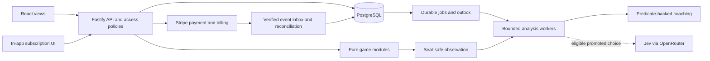

# Tricks Coach Monorepo Implementation Plan

> **For agentic workers:** REQUIRED SUB-SKILL: Use superpowers:subagent-driven-development or superpowers:executing-plans to implement this plan task-by-task after the owner initiates the build. Steps use checkbox (`- [ ]`) syntax for tracking. Do not treat this planning request as build authorization.

**Goal:** Turn the existing three-mode browser prototype into a reliable, server-authoritative Tricks Coach application with useful coaching, current-game review, authenticated membership, in-app subscription management and Stripe payments.

**Architecture:** One TypeScript monorepo organized as a modular application. Preserve the React/Vite views; move private game, strategy, coaching, access and records into a Node/Fastify service backed by PostgreSQL. Use bounded workers from the same codebase for expensive analysis; public contracts are generated from one schema source.

**Tech Stack:** Existing React/TypeScript/Vite; supported Node 24 and Fastify 5; PostgreSQL; managed identity; Stripe Checkout/Billing; native fetch for optional OpenRouter Jev; existing Node/tsx tests plus fast-check and Playwright. Resolve compatible maintained versions and commit one lockfile during W00; historical version strings are not a new dependency audit.

**Spec:** [Current specification index](README.md), [owner decision CR-IMPL-001](decisions/CR-IMPL-001-monorepo-and-stripe.md), [product/views](01-product-and-views.md), [games/decisions](02-games-and-decisions.md), [coaching](04-coaching-and-evidence.md), [hosted architecture](07-hosted-architecture.md), [commercial acceptance](08-commercial-testing.md).

**Status:** Planning only, 27 September 2026. All W00–W19 checkboxes are future work. This plan supersedes the execution sequence in the [historical local plan](2026-09-26-implementation-plan.md); that file and the original pack remain preserved.

**Agent entry point:** [IMPLEMENTATION-START-HERE.md](IMPLEMENTATION-START-HERE.md). Use the [requirements and test specification](implementation/requirements-and-tests.md) for stable behavior IDs, fixtures, assertions and test ownership. The existing UX is accepted as good enough to start; implementation is not waiting for a visual redesign.

## B2C product focus and proportional engineering

Tricks Coach is a consumer product for individual people learning to play Hearts and Spades well. A family plan is a consumer payment relationship. Product success means useful, understandable guidance during real games, easy practice and review, and a simple subscription experience. The initial audience already knows basic rules; this clarification does not add a beginner curriculum.

Preserve the existing experience and deliver a playable server-backed hand early. Security and durable payment/game records protect consumer trust; they are not a reason to build enterprise product features. Do not add organizations, workspaces, corporate tenants, SAML/SCIM, configurable RBAC, enterprise administration/reporting, custom invoicing or procurement flows.

Start with one application and PostgreSQL. Use a small jobs table/outbox and explicit functions, not a workflow platform, event bus, generic repository hierarchy or dependency-injection framework. Start a bounded local worker with the same app command. Keep separately scalable entrypoints without provisioning a fleet during initial development. The inherited paid-launch capacity/availability checks belong to W19; higher growth tiers are later measured work. No multi-region, Kubernetes, sharding or microservice rollout is part of the first usable product slice.

## Global Constraints

- All project artifacts remain under `C:\repos\test-jev`.
- Full games: Hearts solo, Spades solo, Spades partners; four seats each.
- Preserve the existing table, dialogs and responsive layouts.
- Jev is the only remote strategic model. No runtime LLM coach, model cascade, vector store or generated teaching prose.
- Rules, arithmetic, legal actions, trick winners, score, features, permissions and state transitions are code.
- Strategy, bots, simulations, assessment and provider calls consume seat-safe observations, never actual concealed holdings.
- Every started game is stored internally. No player-facing game archive.
- Optional help never narrows the human's legal moves or commits one for them.
- Start with `JEV_MODE=off`. Shadow results never affect visible advice, applied actions or human grades.
- Public unpaid access is only the finite authored demo. Live play requires coverage; coaching additionally requires the appropriate hand unlock and work permission.
- State changes are authorized, revision-checked, idempotent and durably recorded. No transaction or database connection remains held during provider calls or CPU analysis.
- Subscription management is in the app; payments use Stripe. The server owns offers, purchases, coverage and allowance.
- Card art, teaching text and layout must be original or clearly licensed. Keep semantic cards and simple avatars; no 3D, image generation or avatar subsystem.
- All public behavior has a requirement ID, acceptance evidence and a changelog entry. Planned checks are never reported as passed.

## Review Focus

1. Different concealed deals that give the player identical knowledge must produce identical observations and fixed-seed analysis, including private Hearts passing — W02, W03, W05, W13.
2. A request can commit before its response is lost; retries, two tabs and delayed jobs must never duplicate a move, charge or result — W04, W06, W09, W10, W15.
3. Expiry, family removal and security revocation can race with cached reads and worker publication; the current authority must win — W09, W10, W15, W16.
4. A prepared bot answer, replay frame or sampled continuation must never become an unintended live move after pause/reload/rotation — W06, W07, W13.
5. Unknown assistance delivery, omitted candidate analysis or a good decision with a bad outcome must not produce fabricated independence, mistakes or progress — W10–W13, W17.

## 1. Source authority and artifact coverage

The owner explicitly chose the latest planning baseline, retaining earlier safeguards, and selected Stripe. [CR-IMPL-001](decisions/CR-IMPL-001-monorepo-and-stripe.md) records the reason, alternatives, compatibility, affected checks and approval. Future conflicts follow: latest explicit owner direction → numbered change record → current normative rules → current schemas and semantic invariants → design → examples. Record a contradiction before relying on either interpretation.

| Artifact family | How to use it in implementation |
|---|---|
| `planning/01`–`05` | Current views, rules, observation-only strategy, coaching, review, runtime and Jev activation. Read full files, not diagrams alone. |
| `planning/06-commercialization.md`, `07`, `08`, `09`, `10` | Membership, server authority, T01–T49, stage gates, capacity and launch dependencies. Later hosted rules override local-harness shortcuts. |
| `planning/brand-and-domain.md` | BRAND-01–03: Tricks Coach public name; retain Jev technical identifiers; verify domain setup separately. |
| `planning/security/` | Use hardening report, context/hashes, proposal, diagrams and implementation handoff for route policies, publication fences, cache authorization and abuse limits. These are design evidence, not a completed security audit. |
| `web/src`, `web/tests`, `web/package*.json` | Preserve useful interactions and audited rule fixtures; inspect and extract code deliberately. Current code is browser-authoritative and is not the commercial architecture. |
| `web/qa/UI-V1.md`, `VERIFICATION.md`, screenshots and browser logs | UI regression references. Use `ui-v1-desktop.png`, `ui-v1-phone.png`, `ui-v1-ipad.png`, `ui-v1-settings-phone.png` as the latest visual baseline. Older images explain history. |
| `planning/evidence/` and `planning/DIAGRAMS.md` | Baseline hashes and diagram validation/provenance. Rendering a diagram or capturing a screenshot does not validate the proposed backend. |
| Original `docs/01`–`12`, `README.md`, `PLAN-OVERVIEW.md`, `AGENTS.md`, `prompts/` | Retain pure reducers, module boundaries, explicit competition, safe projections, original content and disciplined evidence. Scope, transport, UX and deployment choices listed below are superseded. |
| Original `contracts/`, `examples/`, `qa/`, `research/` | Preserve as historical source material. Reuse scoring cases and semantic invariants after checking them against current rules; translate into the new schemas rather than keeping competing public DTOs. Synthetic Jev examples remain synthetic. |
| `docs/RESEARCH.md`, `REVIEW.md`, `HYBRID-DECISIONS.md`, `COACH-EXPERIENCE.md`, `JEV-TEST.md` | Supporting research, critiques and intermediate design. Use their evidence and open questions; current numbered planning files govern conflicts. |
| `reference/chats/`, `MIGRATION.md`, `PACKAGE-MANIFEST.json`, changelogs | Decision provenance and original-package integrity. The old migration statement that application tests were not performed predates later prototype QA. No Git repository exists at planning time. |
| `planning/2026-09-26-implementation-plan.md`, `06-access-and-subscriptions.md` | Historical plan and moved-spec pointer, respectively. Do not execute obsolete free-play, per-decision billing or browser-engine instructions. |
| `web/dist`, `tsconfig.tsbuildinfo`, dependencies | Generated outputs or tooling, not product authority. Rebuild and inspect final assets at release. |

### Conflicts resolved for this plan

| Earlier artifact says | Target decision |
|---|---|
| Spades partnership only; twelve drills; guest/free play | Three current modes; paid live play; fixed public demo; no drill catalog or beginner curriculum. |
| Jev chooses every non-forced action; no runtime simulation/shortlisting | Shared local code policy serves normal bots/coach; optional Jev via off → shadow → gated recommend. Analyze all legal actions locally; retain full human choice. |
| Direct TypeSafe endpoint, `answers.action`, 4-second deadline, 1e-6 sum tolerance | Current OpenRouter Decisions contract, `answers.move`, 8-second total deadline, 0.02 tolerance. Verify current provider behavior in W17; no silent normalization or model substitution. |
| Single-replica SQLite hosted service | PostgreSQL is the production and integration target. Local-only SQLite is optional, not required by this plan. Paid deployment meets current availability/capacity gates. |
| Root contracts, `stateVersion`, compass-indexed seats | New active schemas under `web/shared`; `revision`; seats 0=South, 1=West, 2=North, 3=East with explicit competition. Old examples need explicit translation. |
| Phone portrait gameplay | Current landscape phone table gate; account/login/billing remain portrait-friendly. |
| Retry branches of the actual hidden deal | Current review uses immutable original playback; alternative-card trials sample solely from the original observation and end at the trick. |
| Provider choice/portal decision remains open | Stripe selected. In-app subscription management, with Stripe collecting payments. |

Additional defects to avoid carrying forward: duplicate ADR-013/014 identifiers in the imported decision document; current view text references six coaching scenarios while the coaching document lists eight; and “atomic trick scoring” versus visible completed-trick collection needs an explicit event contract. W01 records fresh IDs; W02 requires four-card trick/scoring once, with `collect-trick` a subsequent presentation-stage transition that cannot score again. Acceptance covers all eight coaching scenarios.

### Existing evidence and reuse limits

- Read-only inspection during this planning pass found the original **56 manifest files** unchanged and the **7 files** in the commercial baseline manifest matching their recorded hashes.
- The 26 September evidence records **38 prototype tests passed, 0 failed, 0 skipped**. These were not rerun for this plan. Their scope is the existing local engine/coach/storage, not hosted access, Stripe or Jev.
- Prototype UI QA records Chromium journeys and emulated touch/keyboard checks. Physical iPhone/iPad/Android and VoiceOver/TalkBack evidence remains outstanding.
- `App.tsx` currently receives all hands; `getAdvice` accepts full `GameState`; the seed is not production dealing; prose event messages omit structured bid/pass details. Those boundaries must change before hosted use.
- No production service, schema generation pipeline, real identity integration, payment lifecycle, provider promotion, load capacity or learning improvement is claimed. No commit reference is available because this folder has no `.git`.

## 2. Keep the monorepo simple

Retain the current `web/` location. Use one root npm workspace containing it, one root lockfile and one CI pipeline. Inside `web/`, folders express domain boundaries; do not turn every folder into a separately published package. Use the same source revision and build for API and worker roles.

```text
test-jev/
  package.json                 private npm workspace; root command forwarding
  package-lock.json            one dependency lockfile after W00 migration
  compose.yaml                 local PostgreSQL and health check
  .github/workflows/ci.yml      build/test pipeline when Git hosting exists
  web/
    package.json
    src/
      app/                     routes, layout, session coordination
      features/{table,coach,review,demo,account,subscription,family}/
      components/table/        semantic cards, seats, scores, public zones
      api/                     generated-client integration; no game authority
      styles.css               preserve/adapt current visual language
    public/demo/               finite versioned frame graph and original copy
    shared/
      schemas/                 canonical public JSON schemas only
      openapi.yaml             API paths referring to the same JSON schemas
      generated/               generated DTOs/validators/client types
      display/                 suit labels and safe formatting only
    server/
      game/{kernel,spades,hearts,schemas}/
      observations/            safe projection dispatch and validation
      strategy/                tactics, sampler, candidates, bidding
      coaching/                templates, assessment, assistance, review
      access/                  identity, sessions, grants, usage, family
      billing/                 Stripe adapter, purchases, reconciliation
      records/{migrations,repositories}/
      jobs/                    durable leases, outbox and worker entrypoints
      providers/               OpenRouter transport and strict validation
      http/                    typed routes and default-deny policy registry
      evaluation/              offline comparisons and promotion evidence
      main.ts                  API composition root
      worker-main.ts           worker composition root from the same build
      tests/                   server, domain and integration tests
    tests/                     original prototype tests during migration
    e2e/                       browser journeys
    scripts/                   generation, import/artifact checks, test runner
  tests/fixtures/solo-module/   non-trick individual seam, never in catalog
  qa/implementation/           new evidence; original qa files stay intact
  data/evaluations/             ignored raw runs; publish redacted summaries
  planning/                    source specifications and change records
  contracts/, docs/, examples/  preserved historical specification pack
```

**Dependency rules:** browser → public generated DTOs/display only. HTTP → application services → pure domain and explicit adapters. Strategy/coaching/provider → `DecisionObservation`, never the private aggregate. Records and jobs orchestrate persistence, not game rules. Hearts/Spades own rule semantics; the kernel owns four seats, competition partitions, lifecycle and registered capabilities. Import checks and bundle analysis enforce these rules.



The diagram describes flows, not permission to share full state. CPU and provider work run outside transactions. A single local command starts the app and workers. Early development can use one host; paid service uses at least two API replicas and separately bounded worker execution as required by current capacity specifications. This is one application with deployment roles, not a microservice project.

## 3. Patterns and principles to preserve

| Pattern/principle | Apply it here | Concrete enforcement |
|---|---|---|
| Modular monolith; small shared kernel | Cohesive game, coaching, access and billing folders with explicit exports. | No generic partner/bid/trump/52-card requirement in the kernel; test-only individual module passes the platform flow. |
| Functional core, imperative shell | Reducers/scoring/projections are pure; services supply randomness, clocks, storage and I/O. | Fixed input/action replay is identical; domain tests require no network or wall clock. |
| Ports and adapters | Narrow interfaces for identity, Stripe, Jev, repositories and jobs. | Deterministic provider/failure fixtures; no framework/database types in rule modules; no generic DI container required. |
| Explicit state machines and discriminated unions | Game phases, job status, hand unlocks, billing operations and review modes are separate. | Exhaustive switches; impossible transitions fail; outages do not become game-rule phases. |
| Schema-first boundary contracts | One public schema tree generates types and validators. Private state/event schemas stay server-only. | Regeneration drift check; strict unknown-field rejection; domain types never alias HTTP DTOs. |
| Commands separated from safe reads | Mutations accept intent plus revision; views are allowlisted projections. | Clients cannot submit trusted snapshots, scores, owners, seeds or entitlements. No heavyweight CQRS framework. |
| Immutable event journal plus compact snapshots | Persist accepted commands/events/snapshot atomically; replay recorded choices. | No remote re-query during original playback; no rewrite of original advice or rescoring under newer rules. |
| Optimistic concurrency and idempotency | Expected revision and scoped command IDs with canonical payload digest. | Same command applies once; changed-payload reuse conflicts; two writers cannot consume one revision. |
| Transactional outbox/inbox | Essential records and job intent commit together; Stripe events enter a deduplicated inbox. | Crash-point tests; at-least-once dispatch with idempotent effects, never an “exactly once” delivery promise. |
| Leases and fencing | Control leases, reservation/job epochs and current access generations. | Old workers cannot publish after expiry/revocation; prepare does not advance the table. |
| Least privilege and default deny | Every route, cache hit and result publication checks the relevant current authority. | Direct-HTTP access matrix across owners, members, payers, unpaid, expired and revoked sessions. |
| Information-set isolation | Allowlist observations; sample plausible worlds from that knowledge only. | Hidden-hand metamorphic tests across input, facts, seeded analysis, replay, logs and provider payloads. |
| One decision policy, independent assessment | Bots and coach share tactics; assessment needs separately audited evidence. | Full-reference/shortlist/Jev comparison; no model-agreement grade or outcome hindsight. |
| Separate ledgers for separate meanings | Customer coached hands, provider cost, assistance and progress are different records. | Provider failure does not itself charge a hand; missing display acknowledgement cannot prove independence. |
| Progressive disclosure and user agency | Notice → Consider → Suggestion; optional review; full legal actions. | Advice never plays a move, auto-escalates or blocks Next hand. |
| Composition over premature abstraction | Trusted build-time game modules, small functions and explicit dependencies. | No arbitrary JSON rule language, runtime plugins, agent framework, generic billing engine or native rewrite. |
| Measured optimization | Profile CPU/DB/queue/provider separately. | No default microservices, Redis, Kubernetes, sharding or worker-language rewrite; changes require measured need. |

Apply strict TypeScript and `unknown` plus validation at boundaries; do not introduce unchecked `any`. Prefer focused files with one responsibility, local React state and a typed session hook over a new global-state framework. Reuse patterns where semantics match; do not deduplicate independent permission checks that protect different publication stages.

## 4. Frozen interface decisions before parallel feature work

W01 turns these design contracts into schemas and generated declarations. Names in task packets refer to that generated surface; do not hand-maintain another DTO copy. HTTP `revision` advances once per accepted authoritative transition; private accepted events carry sequence numbers and schema versions. Advice, preferences and job status have separate revisions/IDs where needed.

| Surface | Required contract |
|---|---|
| Game catalog | `Mode = 'hearts' \| 'spades-solo' \| 'spades-partners'`; explicit competition; capability validation; unsupported configuration rejected. Public catalog excludes test modules. |
| Game command | `{commandId, gameId, expectedRevision, controlLeaseToken, action}`; `action` is the current bid/play/pass union. Actor and owner come from authenticated server state. Server canonicalizes against legal actions. |
| Start/advance | Start includes expected active-game identity; advance names a prepared decision or collect-trick/next-hand intent. A prepared ID is not authority and cannot carry a trusted action payload. |
| Human view | `SessionView`: own cards, permitted pass knowledge, public game state, legal actions, revision, access summary and job status. No seed, private state, raw event log or hidden future. |
| Safe strategy input | Immutable `DecisionObservation`, stable candidate IDs, exact facts and explicit uncertain estimates; exclude transport/player IDs from the final provider projection. |
| Analysis | `DecisionAnalysis` records full legal set, shortlist, coverage, local/Jev/applied choices separately, source, policy/work-budget versions and sampling evidence. |
| Progress/assistance | Issued guidance, requested-but-not-ready, delivery-unknown, optional display report and later independent eligibility remain distinct. |
| Access | `CoachAccess` and `CoachedHandUnlock` carry current coverage, hand identity, period, reservation state and fencing; caller cannot override them. |
| Review | `ReviewCase`, `ReviewView`, `ReviewTrial` separate source decision, live pause revision, original replay and simulated continuation. |
| Billing | `SubscriptionView`, `OfferView`, `ChangePreview`, `BillingOperationView`: server-owned offer versions, amount/currency/tax disclosure, effective date, pending/confirmed/failed status. Opaque operation IDs; no card details. |
| Family | Seat/invitation views contain assignment and billing role information only; never a member's private gameplay. |
| Errors | Closed codes for unauthenticated/forbidden, stale revision, lease lost, quota exhausted, invalid command, pending payment and service unavailable. Safe current view only where authorized. |

Retain current `/api/session`, actions/prepare/advance/advice/preferences, hand-unlock and review paths from [03](03-local-runtime.md). Add documented auth/account, subscription, family and Stripe webhook paths in W01/W14; no unclassified route may register. Sensitive schemas use `additionalProperties: false`, no coercion and no removal of extra fields. Response serialization is an additional guard, not a substitute for explicit projection.

The private kernel is generic over registered module state/action types. The production schema union contains only the three shipped modes. The non-trick test module uses its own test registry/schema union; it must not require fake bid/play/pass fields or widen the public catalog.

W01 also defines `PlayerContext`, `AccessPolicy` and the clock/transaction ports. W04 creates minimal persisted player/access-generation/fixture-grant rows and a development-only context resolver so commands are owned and policy-checked from their first test. W09 adds real managed identity, cookie sessions and full control-transfer policies; it does not retrofit ownership onto previously unowned games.

Server-only persistent entities: players/sessions/access generations/control leases; versioned games/deals/commands/events/snapshots/current pointers; jobs/outbox/analyses/assistance/assessments/trials; usage periods/hand unlocks; billing accounts/purchases/subscriptions/plan versions/grants/Stripe inbox; family seats/invites/history. Use focused migrations as their owning feature is introduced, not one speculative mega-schema.

## 5. Milestones and critical path

`Wxx` identifies work packets. `CGx` below means the current commercial gate in planning/08, not the original pack's unrelated G0–G4. No phase is complete solely because its UI looks finished.

| Milestone | Packets | Independently reviewable outcome |
|---|---|---|
| M0 — Reproducible baseline/contracts | W00–W01 | Workspace commands, source baseline, rule/version decisions and generated DTO freeze. |
| M1 — Correct server game | W02–W04 | Three modes, safe observations, durable commands/replay on PostgreSQL. |
| M2 — Playable service and finite demo | W05A, W06–W08 | Shared local policy, durable jobs, existing UI connected to safe views, finite public demo; W05B evidence can proceed separately. |
| M3 — Account and coaching authority | W09–W11, including W09A | Real identity, ownership, consumer data controls, allowance races, recorded assistance and useful factual guidance. |
| M4 — Review and evaluation | W12–W13, W17 | Audited assessment, immutable current-game review, isolated trials; optional Jev remains gated. |
| M5 — Subscriptions and family | W14–W16 | In-app subscription management, Stripe sandbox lifecycle and private family membership. |
| M6 — Release evidence | W18–W19 | Invited pilot, security/device/load/recovery evidence, then commercial activation gates. |

**Critical path:** W00 → W01 → W02/W03 → W04 → W06/W07 → W09 → W10 → W11/W13 → W18 → W19. W05 supplies bots/coach; start a named simple code policy first and evaluate deeper strategy within that packet. W12 categorical grades and W17 Jev promotion are conditional capabilities: inconclusive evidence leaves factual coaching/local play working. Stripe and family can proceed alongside review once identity/access/contracts are stable, then converge at W18.

W05 has two explicit checkpoints: **W05A** is the shared observation-only baseline, full legal enumeration and essential tactical regressions; **W05B** adds validated sampling, bidding comparison and offline evidence. W06/W07 can integrate after W05A. W12 and rollout-based W13 trials depend on W05B. Do not hold the first playable consumer slice for a long strategy experiment.

**Parallel ownership after W01:** domain/observation worker (W02–W03/W05); service/access worker (W04/W06/W09–W10); UI worker (W07–W08/W14); integrator owns schemas, change records and combined evidence. Coaching, billing and QA can take freed slots. A consumer may use generated safe fixtures, but no UI/backend agent independently invents DTOs. Integrate one vertical path before adding more parallel branches.

**Early consumer checkpoint, before commercial activation:** on the existing table, finish a hand, request or reject concise help, open original evidence, return to the unchanged game and explain one tradeoff. W07 proves play; W11 and W13's original-replay checkpoint prove the learning loop. Explicit local mock access can support this checkpoint while real identity/Stripe work proceeds. It does not declare hosted access or CG1 complete prematurely.

**Review discipline for every packet:** write the meaningful failing checks first; run to observe the expected failure; implement the smallest cohesive change; rerun targeted and required integration checks; record requirement IDs, source revision/hashes and evidence; commit a focused change once a repository exists. Do not create mirror tests for trivial formatting. Retain original fixtures and failure seeds.

### Planned command contract

Commands below are deliverables of W00/the owning packet, **not commands available today or checks already run**. Root scripts forward into the `web` workspace. Targeted examples use workspace commands directly so path resolution is explicit.

| Command | Required purpose |
|---|---|
| `npm ci` | Reproducible install from the root lockfile. |
| `npm run dev` / `npm run dev:lan` | API + workers + Vite; LAN exposes only Vite, server remains loopback locally. |
| `npm run db:up` / `npm run db:migrate` | Local PostgreSQL and repeatable migrations; test database isolated from development. |
| `npm run contracts:generate` / `npm run contracts:check` | Generate DTOs/validators/OpenAPI artifacts; fail on drift or unsupported schema semantics. |
| `npm run typecheck` / `npm run lint:boundaries` | Strict browser/server checks and enforced import graph. |
| `npm --workspace web run test:unit -- server/tests/rules.test.ts` | `test:unit` invokes `tsx --test`; explicit paths are relative to `web/`. |
| `npm run test:all` / `npm run test:integration` | Discover the whole unit/property suite; separately run real-PostgreSQL cases. |
| `npm run test:ui` / `npm run build` / `npm run check:artifacts` | Playwright, production build, then inspect all public chunks/maps/routes. |
| `npm run evaluate:bidding` / `npm run evaluate:strategy` / `npm run evaluate:jev` | Versioned offline evaluation; Jev live execution requires an explicit bounded experiment. |
| `npm run test:stripe` / `npm run test:capacity` | Sandbox payment lifecycle; isolated load/recovery harness with declared workload. |

Keep current `web` checks until migrated with equivalent assertions. Do not report the new command suite as runnable until its scripts and fixtures exist.

## 6. Work packets

Paths below are relative to the repository. Interface signatures are proposed implementation interfaces to freeze in W01, not claims that the functions already exist. Test examples specify observable behavior. Each packet creates its named fixtures/harness in the stated test file or support folder; fixture states must be produced by legal action sequences, not impossible partial objects.

### W00 — Establish the build baseline and workspace

**Requirements:** IMPL-01–02; evidence discipline. **Depends on:** owner initiating the build.

**Files:** create root `package.json`, `.gitignore`, `compose.yaml`; modify `web/package.json` and TypeScript configs; migrate the existing dependency lock into one root `package-lock.json`; create `web/scripts/{test-all,test-integration,check-boundaries}.mjs`, `qa/implementation/{baseline,status}.md` and CI configuration when hosting exists.

**Produces:** the command contract above, separate browser/server compilation, isolated test database configuration and source/hash baseline.

- [ ] Recheck all 56 original manifest entries and current code hashes. Preserve unrelated changes. Initialize/version the project when the build begins; no commit is available from this planning pass.
- [ ] Run existing `npm test` and `npm run build` from `web`; record runtime, exact output and failures before refactoring. Resolve supported dependency patches/advisories at execution time.
- [ ] Introduce the workspace without renaming `web` or changing game behavior. Exclude `.env*` secrets, local databases, raw player/evaluation data, build output and dependencies from commits; keep redacted evidence.
- [ ] Implement `test-integration.mjs` with explicit `--suite` comma-separated selection mapped to existing test files; unknown/missing suites fail, never silently pass. Add later scripts only when their owning runner exists. An unimplemented required command reports not-run, not a passing stub.
- [ ] Create import checks that reject `src -> server` and server re-exports through `shared`; a deliberately forbidden fixture must fail, then the clean tree must pass.
- [ ] Verify root install, build and existing tests; document startup/shutdown/migration/reset instructions using test-only reset targets. Commit `chore: establish Tricks Coach workspace`.

### W01 — Freeze schemas, versions and semantic contracts

**Requirements:** IMPL-01–02, A02–A04, T36/T44. **Depends on:** W00.

**Files:** create `web/shared/schemas/{game,session,command,coaching,review,access,billing,family}.schema.json`, `web/shared/openapi.yaml`, `web/shared/generated/`, `web/server/game/schemas/{state,event}.schema.json`, `web/scripts/generate-contracts.mjs`, `web/server/tests/contracts.test.ts`, `planning/decisions/CR-IMPL-002-contract-freeze.md`.

**Produces:** the interface surface in section 4; registered game/version/capability manifest; generated TypeScript and runtime validators from canonical JSON schemas. OpenAPI references these schemas instead of duplicating DTO bodies.

- [ ] Translate current runtime tables into schemas and explicit lifecycle diagrams. Freeze Hearts sealed passing, numeric-seat mapping, `revision`, trick completion/collection and current-game scope. The private event union must contain complete bid, pass commitment/exchange, play, trick and score data with visibility policies.
- [ ] Choose a lossless generation path; prove recursive refs, closed unions, required/null fields and unknown-field rejection with generated-type and runtime fixtures. If a generator cannot preserve a semantic constraint, add one named post-schema validator, not another DTO definition.
- [ ] Add the negative boundary check below, including nested `otherHands`, ownership, plan, seed and coercible values:

```ts
// In contracts.test.ts: actionBody is a complete valid fixture defined here.
assert.equal(validateActionBody(actionBody), true);
assert.equal(validateActionBody({ ...actionBody, seed: 73 }), false);
assert.equal(validateActionBody({ ...actionBody, expectedRevision: '1' }), false);
```

- [ ] Add the route policy inventory including planned subscription/family operations. Record legacy contract mappings and every resolved semantic conflict. No imported historical schema is changed.
- [ ] Run `npm run contracts:generate`, `npm run contracts:check`, `npm run typecheck` and `npm --workspace web run test:unit -- server/tests/contracts.test.ts`. Review and commit the freeze before parallel consumers begin.

### W02 — Extract and verify all three rule engines

**Requirements:** current rules in planning/02; preserved R-01–R-08 semantics where compatible; T05/T09/T30. **Depends on:** W01.

**Files:** create `web/server/game/kernel/{types,registry,lifecycle}.ts`, `web/server/game/spades/{rules,reducer,score}.ts`, `web/server/game/hearts/{rules,reducer,score}.ts`, `web/server/game/{deal,replay}.ts`, `web/server/tests/{rules,replay,module-seam}.test.ts`, `tests/fixtures/solo-module/`; use existing `web/src/game.ts` and `web/tests/game.test.ts` as extraction inputs.

**Interfaces:** `createGame(config: GameConfig, deal: Deal): PrivateGame`; `legalActions(state: PrivateGame, actor: Seat): GameAction[]`; `applyAction(state: PrivateGame, action: AcceptedAction): Transition`; `replay(deal: Deal, events: PrivateEvent[]): PrivateGame`. `Transition` contains immutable next state and structured events; these types are private domain types, defined in kernel and module files.

- [ ] Port rule fixtures before moving code. Add all 12 original scoring goldens, solo Nil/bag equivalents, Hearts first-trick restrictions, Q♠ not breaking Hearts, moon scoring, dealer/pass rotation, all tied-terminal cases and per-mode competitor winners.
- [ ] Prove 52-card conservation, 13 tricks, follow-suit legality and rejected-action immutability using fixed and property tests; print/store failing seeds. Explicitly assert the Nil regression:

```ts
// scoreCompetitor(input) is exported by spades/score.ts; result includes delta/bags.
assert.deepEqual(scoreCompetitor({ bids: [4, 0], tricks: [3, 1], oldBags: 9 }),
  { delta: -240, bags: 0 });
```

- [ ] Implement production CSPRNG dealing and independent opaque IDs in the service shell; inject recorded deals into the pure engine. Persist real deal material privately, never rely on a 32-bit seed for production secrecy.
- [ ] Resolve the fourth card/trick scoring once; keep completed trick visible until authorized collection. Implement private Hearts pass commitments from the unchanged pre-exchange deal and one atomic reveal/exchange. Generic lifecycle/capabilities must allow sealed passing explicitly, not claim sequential turns are sufficient.
- [ ] Run `npm --workspace web run test:unit -- server/tests/rules.test.ts server/tests/replay.test.ts server/tests/module-seam.test.ts`. Replay must equal the original state; test-only individual module works without bid/trump/trick assumptions and is absent from the catalog. Commit rule extraction independently of UI replacement.

### W03 — Enforce observation and serialization isolation

**Requirements:** A01/A03, T03–T04/T29. **Depends on:** W02.

**Files:** create `web/server/observations/{observe,project-view,project-event,provider-state}.ts`, `web/server/tests/{observations,serialization}.test.ts`, `web/server/tests/support/information-sets.ts`.

**Interfaces:** `observe(state: PrivateGame, seat: Seat): DecisionObservation`; `projectView(state: PrivateGame, viewer: Seat, status: ViewStatus): SessionView`; `projectEvent(event: PrivateEvent, viewer: Seat): PublicEvent | null`; `toProviderState(observation: DecisionObservation, analysis: DecisionAnalysis): ProviderState`.

- [ ] Build complete legal information-set pairs whose concealed assignments differ but respect known voids/pass holdings. Enumerate tiny pairs exhaustively where possible. Before pass reveal, public turn/leader fields cannot identify the 2♣ holder.
- [ ] Assert structural equality and sensitive-field exclusion, including errors/replay/provider paths:

```ts
// equivalentDeals(seat) returns legal states a/b with the same permitted knowledge.
const { a, b, seat, status } = equivalentDeals(0);
assert.deepEqual(observe(a, seat), observe(b, seat));
assert.deepEqual(projectView(a, seat, status), projectView(b, seat, status));
```

- [ ] Construct safe outputs by explicit field selection; reject unexpected sensitive input. Preserve own outgoing/incoming pass knowledge without combining seat-private data. No aggregate object reaches strategy or the provider signature.
- [ ] Create canary leak fixtures for logs, job status, export errors and late advice. Keep provider payloads semantic and free of identity/seed/private digests.
- [ ] Run `npm --workspace web run test:unit -- server/tests/observations.test.ts server/tests/serialization.test.ts` and boundary checks; commit the safe projection boundary.

### W04 — Persist authoritative commands and replay

**Requirements:** A03/A04/A07, T05/T09/T27/T32/T38. **Depends on:** W02–W03.

**Files:** create `web/server/records/migrations/001-games.sql`, `repositories/{players,games,commands,events,outbox}.ts`, `web/server/access/{context,development-resolver,policy-port}.ts`, `web/server/game/session-service.ts`, `web/server/http/session-routes.ts`, `web/server/tests/{commands,persistence,journal}.test.ts`.

**Interfaces:** `SessionService.start(context, input): Promise<SessionView>`; `SessionService.submit(context, command): Promise<CommandReceipt>`; `SessionService.view(context): Promise<SessionView | null>`. `context` is verified server request context; `CommandReceipt` is an immutable accepted-result reference plus revision, projected only after read authorization.

- [ ] Use real isolated PostgreSQL tests for duplicate UUID/same payload, conflicting reuse, stale revision, two concurrent writers, crash after commit/before delivery and essential journal failure.
- [ ] Create minimal owned player/access-generation/fixture-grant and control-fence records before games, plus the outbox table in this migration. Development resolver still enforces player/resource ownership and current fixture coverage; hosted startup rejects it. W09 replaces the resolver and expands session policies; W06 consumes the already transactional outbox.
- [ ] Atomically persist command digest, accepted events, compact snapshot, current-game pointer and outbox intent. Increment revision once per accepted transition; rejected input changes nothing. Use a consistent scoped lock order and bounded whole-transaction retries.
- [ ] Assert the externally observable retry rule:

```ts
// ownedGameHarness() owns an isolated database and a complete legal command.
const h = await ownedGameHarness();
const first = await h.submit(h.command);
const retry = await h.submit(h.command);
assert.equal(retry.revision, first.revision);
assert.equal(await h.acceptedCommandCount(h.command.commandId), 1);
```

- [ ] Store all started/completed/abandoned games internally. Replace current game only with the explicit expected pointer; legacy browser saves never enter hosted authority. Unsupported stored versions fail closed/read-only; incomplete old events yield replay unavailable.
- [ ] Run `npm run test:integration -- --suite commands,persistence,journal`, restart mid-bid/pass/trick/hand and reconstruct original replay with zero provider calls. Record DB version and migration/restore instructions; commit durable commands.

### W05 — Unify local strategy and evaluate bidding

**Requirements:** planning/02, P01, T04/T30/T37. **Depends on:** W03; can overlap W04.

**Files:** create `web/server/strategy/{types,tactics,candidates,sampler,rollouts,bidding,policy}.ts`, `web/server/evaluation/{bidding,strategy}.ts`, `web/server/tests/{strategy,sampler,bidding}.test.ts`.

**Interfaces:** `analyze(observation: DecisionObservation, budget: AnalysisBudget): DecisionAnalysis`; `AnalysisBudget = {seed: number, maxWorlds: number, maxMs: number | null, profileVersion: string}`. Fixed-count offline mode uses `maxMs: null`; production work records actual coverage and truncation.

- [ ] Move a named, explicitly uncalibrated baseline policy into the service and make bots/coach use it. Cover live partner Nil even after the contract is met; solo mode has no partner objective.
- [ ] Enumerate all legal candidates: 14 bids, all 286 three-card passes at a 13-card pass decision, and all legal plays. Stable triple IDs canonicalize card order. A shortlist of one is `code`, only a legal set of one is `forced`.
- [ ] Add probability tests for feasible worlds AND frequencies against exact small-state enumeration. Compare all actions on common worlds; simulated actors see their own observations. Test incoming passes undoing planned voids, queen protection/moon plans, and hidden-hand invariance of seeded analysis.
- [ ] Profile the initial 12-candidate shortlist and at most 256 worlds/250 ms for the entire analysis, not just sampling. Preserve strong/near-tied/different-objective plans, record partial per-action coverage and use fixed work counts offline. These are tunable pilot budgets, not accepted quality or throughput claims; all 286 passes stay in local screening and human legal choice.
- [ ] Add calibrated contextual bidding A and constrained-rollout B as isolated evaluable policies. Separate development/calibration/test deals by originating deal; freeze playing/opponent versions; report solo/team separately. Select the simplest supported policy. C is considered only if it beats both with justified cost. No unvalidated coefficient becomes a probability.
- [ ] Run `npm --workspace web run test:unit -- server/tests/strategy.test.ts server/tests/sampler.test.ts server/tests/bidding.test.ts`, then `npm run evaluate:bidding -- --manifest data/evaluations/bidding-manifest.json`. Create that manifest with splits, budgets and acceptance criteria before execution. Record inconclusive results honestly; normal play can retain the named baseline without claims of calibrated strength.

### W06 — Add durable jobs, bounded workers and pause-safe preparation

**Requirements:** A05/A10, S02–S07, T13–T14/T46–T49. **Depends on:** W04 and W05A; deeper policy can follow without changing the job interface.

**Files:** create `web/server/jobs/{queue,leases,outbox,analysis-worker,provider-dispatch}.ts`, `web/server/worker-main.ts`, `records/migrations/002-jobs.sql`, `web/server/tests/{jobs,pause,deadlines}.test.ts`.

**Interfaces:** `prepareDecision(context, gameId, revision): Promise<PreparedDecisionRef>`; `advancePrepared(context, command): Promise<CommandReceipt>`; `claimJob(): Promise<LeasedJob | null>`; `publishResult(lease, result): Promise<PublicationOutcome>`. Canonical analysis reuse identity includes owner/game/decision/purpose, observation and candidate digests, rule/feature/policy/work-budget/prompt/model versions and execution mode. Publication validates fencing/access/current applicability through W04's policy port, then W09's real session implementation.

- [ ] Test process death/redelivery/out-of-order completion, lease expiry, changed revision and pause during preparation. A saved prepared answer cannot itself commit gameplay:

```ts
// botJobHarness() creates an owned legal bot-turn fixture and isolated database.
const h = await botJobHarness();
const before = await h.currentRevision();
await h.prepareAndFinishBot();
assert.equal(await h.currentRevision(), before);
await h.authorizedAdvance();
assert.equal(await h.currentRevision(), before + 1);
```

- [ ] Claim in short transactions; run CPU work in a reusable bounded thread pool; release CPU threads/connections while awaiting Jev. Persist logical jobs/outbox with effects rather than relying on in-memory queues.
- [ ] Separate gameplay capacity, requested coaching/review and residual shadow work. Bound queue size/age, retries, memory and account/global work budgets. Shadow stops first; overload cannot silently change the evaluated strategy version.
- [ ] Propagate one admission deadline, including queue/preparation/retry time. Recheck permission before dispatch and publication. HTTP disconnect, work expiry, sign-out and security revocation have different documented outcomes.
- [ ] Prove switching shadow to recommend cannot reuse a shadow result as visible advice. Saturating shadow must not create a foreground wait on shadow completion or shadow-specific UI; measure foreground latency against the declared workload budget rather than asserting identical wall-clock timing.
- [ ] Run `npm run test:integration -- --suite jobs,pause,deadlines`; prove no transaction stays open across worker/provider waits, including a delayed fixture. Commit durable worker execution.

### W07 — Connect the existing table to safe server views

**Requirements:** planning/01, BRAND-01–03, T03/T09/T32/T39. **Depends on:** W01, W04, W06; UI fixtures can begin after W01.

**Files:** refactor `web/src/App.tsx` into `app/` and `features/table/`; create `src/api/{client,useSession}.ts`, `components/table/{Card,Seat,ScoreBoard}.tsx`, `e2e/{table,pause,recovery}.spec.ts`; adapt `styles.css`, `storage.ts` and `vite.config.ts`.

**Interfaces:** `useSession()` exposes only generated views, typed mutation status and commands; local selection/help-panel/animation state is separate from accepted game state.

- [ ] Capture visual and behavior baselines at desktop, iPad portrait/landscape and 667×375 landscape phone. Preserve blue table, four simple avatars, right coach and hand below; update public name to Tricks Coach.
- [ ] Retain the table-only rotation gate at width below 700 CSS pixels and height greater than width, safe-area/visible-viewport handling and at least 44 CSS pixels of exposed card target at 667-pixel landscape width. Legality, selection, suggestion and winner marks must differ beyond color.
- [ ] Remove browser engine/coach imports and aggregate storage from the production path. Keep preferences locally as convenience, synchronize through the service, and clear private view state on sign-out. An old prototype route must not remain publicly reachable.
- [ ] Retain on-turn double-click/tap play, off-turn preparation without autoplay, Space/select and Enter/play, all legal options, bid/pass confirmation and received-card markers. Server rechecks every action; duplicate input results in one accepted command.
- [ ] Preserve 900/2100 ms baseline pacing divided by 1/1.2/1.4; pause/background/dialog/review/rotation cancel stale timers. Resume refetches and uses a fresh delay. Network loss keeps last confirmed view and retries the same command ID after ambiguity.
- [ ] Run `npm run test:ui -- --project=chromium e2e/table.spec.ts e2e/pause.spec.ts e2e/recovery.spec.ts`, `npm run build`, `npm run check:artifacts`. Include keyboard/focus/inert/reduced-motion checks; reserve physical-device claims for W18.

### W08 — Deliver the finite demo and member entry routes

**Requirements:** P01–P02, T01–T03/T39, BRAND-01. **Depends on:** W01; can overlap W02–W07.

**Files:** create `web/public/demo/{manifest,frames}.json`, `web/src/features/demo/{DemoPlayer,DemoEnd}.tsx`, `web/src/features/account/PlanEntry.tsx`, `web/server/tests/demo.test.ts`, `web/e2e/demo.spec.ts`.

**Interfaces:** versioned `DemoGraph` contains only authored nodes/edges, permitted safe frames and teaching copy; `DemoPlayer` performs finite navigation, never analysis or engine execution.

- [ ] Author a meaningful choice → evidence → original replay → sample alternative path with optional finite branches; label it Example game. Give the player finish/replay controls and a clear membership entry.
- [ ] Validate every edge/node, terminal state and reachable branch. Replay/incognito/clock/storage manipulation always returns the same finite content.
- [ ] Assert all demo branches produce **zero** live engine/evaluator/provider calls and no customer quota/progress records. Invented positions/seeds/node IDs cannot become dynamic analysis requests.
- [ ] Preserve offer selection across sign-in; login/account/plan routes work in phone portrait and are outside the table rotation gate. Prices stay unpublished until W19 approvals.
- [ ] Run `npm --workspace web run test:unit -- server/tests/demo.test.ts`, `npm run test:ui -- e2e/demo.spec.ts`, build/artifact checks; commit demo and entry flow.

### W09 — Implement real identity, route authorization and control leases

**Requirements:** A02/A04/A08, T06–T10/T33/T36/T43–T45. **Depends on:** W04; mock fixtures may precede vendor selection, hosted acceptance may not.

**Files:** create `web/server/access/{identity,sessions,policy,grants,control-leases}.ts`, `records/migrations/003-identity.sql`, `http/{route-registry,auth-routes}.ts`, `src/features/account/`, `server/tests/{access,revocation,route-policy}.test.ts`.

**Interfaces:** `authenticate(request): Promise<VerifiedSession>`; `authorize(session, operation, resource): Promise<AccessDecision>`; `transferControl(session, expectedLease): Promise<ControlLease>`. Server derives player ID from verified issuer/subject and its own opaque session.

- [ ] Select managed identity based on tested email-code/social login, recovery, deletion, data location and cost; no homemade password system. Configure secure HTTP-only cookies, CSRF, origin/host checks, rotation/revocation and trusted proxy rules.
- [ ] Declare a policy on every route; registering an unclassified protected route fails. Test direct HTTP across two players/families, unpaid/expired/revoked sessions, payer/member distinctions, cache hits, conditional reads and copied IDs.
- [ ] Serialize acceptance/publication against current access/session generations. No stale positive permission cache; a security revocation fences unfinished work. Ordinary sign-out may allow already-authorized recovery work but cannot serve it through the old session.
- [ ] Enforce one active control lease/table per player with explicit device transfer and lease fencing; concurrent tabs reconcile. Hosted startup rejects mock identities/full-access flags. Bound login/recovery/rejected-request costs across replicas; behavioral detection starts in observation mode.
- [ ] Run `npm run test:integration -- --suite access,revocation,route-policy` and login/recovery UI flow with real staging identity. Fixture-only identity evidence cannot complete CG2.

### W09A — Add small consumer data controls

**Requirements:** A07, T29; consumer account recovery/privacy. **Depends on:** W09 and versioned record repositories; completes before W18. This is an account feature, not an enterprise admin system.

**Files:** create `web/server/access/account-data.ts`, `web/server/records/{retention,account-export}.ts`, `web/server/jobs/account-deletion.ts`, `web/server/http/account-data-routes.ts`, `web/src/features/account/DataControls.tsx`, `server/tests/account-data.test.ts` and the narrowly required migration.

**Interfaces:** `requestAccountExport(context): Promise<OwnedExportRef>`; `requestAccountDeletion(context, requestId): Promise<DeletionStatus>`; `applyRetention(policyVersion, clock): Promise<RetentionRun>`. All exports use authenticated owned delivery; queue/job and private-data projection checks still apply.

- [ ] Test owner-only export/deletion, payer denial, repeated requests and deletion racing with advice/game acceptance. Revoke sessions/access and fence outstanding work before account erasure proceeds.
- [ ] Define a versioned record-class retention policy: private deals/events/analysis/assistance/derived progress follow the approved deletion schedule; required minimal payment/accounting evidence is separately restricted and retained only under the approved policy. Provider billing retention and subscription cancellation are explained explicitly; deleting local app data must not silently leave an unwanted renewing subscription.
- [ ] Implement scoped export, deletion/retention jobs and clear account status/recovery UI. No public reusable export link, raw hidden opponents' records or family-payer export authority. Raw dealing material and secrets are not general telemetry.
- [ ] Exercise a short synthetic policy in test, verifying erasure, derived-data cleanup, fenced late jobs, replay after partial job failure and preserved minimal accounting references. Production policy durations/notices remain the W19 owner/compliance decision; no invented legal retention interval.
- [ ] Run `npm run test:integration -- --suite account-data` and account data-controls browser checks. Record unresolved production-policy activation as blocked while implementation/fixture evidence remains explicit.

### W10 — Build coached-hand accounting and access-aware publication

**Requirements:** P03–P04, A05/A07, T11–T17/T26–T29. **Depends on:** W06, W09.

**Files:** create `web/server/access/{usage,hand-unlocks}.ts`, `records/migrations/004-coaching-usage.sql`, `http/coaching-access-routes.ts`, `web/server/tests/{usage,publication,assistance}.test.ts`.

**Interfaces:** `reserveHand(context, request): Promise<HandReservation>`; `finalizeHand(reservation, result): Promise<CoachedHandUnlock>`; `releaseHand(reservation, reason): Promise<void>`; `readSavedCoaching(context, resultId): Promise<SavedCoachingView>`.

- [ ] Lock an existing player/access row before first-use initialization; enforce unique player/game/hand and player/period records. Reserve against `used + reserved`; one expensive coaching job/active coached hand per player. Unlimited still has ownership, concurrency and unlock records.
- [ ] Before serving first usable coaching, atomically save result/issued guidance and `reserved → ready`. A failed/unusable/stale first result releases exactly once; saved results recover after lost responses without another unit.
- [ ] Test 50 concurrent requests over at least two API processes for one remaining unit, both with and without pre-existing usage rows. Assert one success and bounded used/reserved totals; also test midnight completion in the original period, restarts and plan/family changes.
- [ ] Separate customer hand usage, provider attempts and assistance issued/display-reported. Automatic markers/shadow never spend a limited unit. A missing display callback cannot erase assistance. Saved covered material remains readable after expiry; new work does not.
- [ ] Run `npm run test:integration -- --suite usage,publication,assistance`, with crash/fencing/revocation fixtures and database journal failure. Commit accounting only with real PostgreSQL race evidence.

### W11 — Implement progressive coaching and factual recaps

**Requirements:** P01/P04, planning/04, T11/T16–T17/T26/T30–T31. **Depends on:** W05A, W07, W10 for factual/baseline advice; W05B only for its evaluated estimates.

**Files:** create `web/server/coaching/{advice,templates,exposure,recap}.ts`, `web/src/features/coach/{CoachPanel,HandUnlock,TableNotes,HandRecap}.tsx`, `server/tests/coaching.test.ts`, `e2e/coaching.spec.ts`.

**Interfaces:** `getAdvice(context, decisionId, requestedLevel): Promise<AdviceView>`; `recordIssuedGuidance(context, content): Promise<ExposureRef>`; `getRecap(context, handId): Promise<RecapView>`. New coaching uses frozen observation and unlocked-hand/current coverage; ordinary score recap/Next hand and factual replay do not require a coaching unit. Saved previously covered coaching uses its separate owner-read policy. No path consults actual concealed state for advice.

- [ ] Use Notice/Consider/A suggestion plus direct suggestion, predicate-backed copy, requested help depth and explicit local/Jev source. Begin with exact facts; unsupported grades remain absent.
- [ ] Preserve the short-copy pilot budgets: heading 6 words, cue 18, context/suggestion 35, with optional expansion. Use the current panel and dialogs; do not introduce a chat interface or separate learning dashboard.
- [ ] Implement pending/ready/close-alternatives/unavailable/stale states; dismiss/help never commits an action. Keep facts and legal play responsive during analysis. No shadow-specific UI, loading state, error or wait; test foreground latency under bounded shadow load.
- [ ] Track meaningful optional memory as assistance, including notes during opponent turns; distinguish unplayed cards from unknown cards. Hide a suggested card until Suggestion. Settings cannot erase prior exposure.
- [ ] Extend Table notes with expandable played ranks, current-hand trick history and own outgoing/incoming pass memory, labelling public evidence and private pass knowledge separately. Test an exhausted active member can still see the ordinary score recap and continue play without a coaching unlock.
- [ ] Enforce asked/nudges/after preference, one cue per decision and initial three-trick gap, no forced/weak/repeated nudges. Locked limited hands show only neutral availability until explicit unlock. Recap has at most one supported strength/review/focus and never blocks Next hand.
- [ ] Run `npm --workspace web run test:unit -- server/tests/coaching.test.ts` and `npm run test:ui -- e2e/coaching.spec.ts`. Test the advice/factual portions of scenarios 1–6 with recorded seeds; W13 owns original/trial review and W18 runs all eight together. Defer live review markers until W13 has a working destination.

### W12 — Audit assessment and descriptive progress

**Requirements:** P01, A07/A08, T30–T31/T34/T40. **Depends on:** W05B, W10–W11; exact-fact abstaining behavior can be implemented before empirical evaluation completes.

**Files:** create `web/server/coaching/{assessment,progress}.ts`, `web/server/evaluation/assessment.ts`, `server/tests/{assessment,progress,rating-boundary}.test.ts`, `qa/implementation/assessment-audit.md`.

**Interfaces:** `assess(observation, acceptedAction, evidence): Assessment`; `deriveProgress(records: EligibleAssessment[]): ProgressSummary`. Policy version, context, category, coverage and assistance are required inputs.

- [ ] Evaluate the actual chosen action even if omitted from the shortlist. Test good-choice/bad-outcome, defensible alternatives, unfinished-trick uncertainty and exact consequences independently of Jev choices.
- [ ] Use supported/reasonable/review/not-assessed states. Sampling-based categorical feedback needs held-out audit, non-overlapping uncertainty, materiality and alternate-policy/exact-reference checks. Pilot score gaps are 1 Hearts penalty point or 10 Spades points, not validated truths.
- [ ] Assert material evaluator disagreement or missing coverage yields `not-assessed`. “Mistake” requires proof under decision-time information; do not infer forgotten/careless mental causes.
- [ ] Derive counts from fresh independent opportunities; exclude forced/trial/replayed/assisted/unknown-delivery cases. Two 20-opportunity windows each span at least three hands; keep version/context boundaries and coverage. Default to counts/Building evidence. “Improving” needs a separate cluster-aware validated trend method. No competitive rating endpoint.
- [ ] Create `data/evaluations/assessment-manifest.json` with grouped splits, policy/reference versions, seed/work budget, uncertainty/materiality rules and pass/abstain criteria before the audit. Run `npm --workspace web run test:unit -- server/tests/assessment.test.ts server/tests/progress.test.ts server/tests/rating-boundary.test.ts`, then the W12-created `npm run evaluate:assessment -- --manifest data/evaluations/assessment-manifest.json`. Preserve abstentions and disagreement examples. A failed/inconclusive audit disables categorical feedback, not basic play or factual coaching.

### W13 — Deliver immutable review, then isolated trials

**Requirements:** planning/04, T16/T30–T32. **Depends on:** W04, W07, W10–W11 for original replay; W05B additionally for sampled trials. W12 gates markers/grades.

**Files:** create `web/server/coaching/{review,trials}.ts`, `records/migrations/005-review.sql`, `http/review-routes.ts`, `web/src/features/review/ReviewPanel.tsx`, `server/tests/{review,trials}.test.ts`, `e2e/review.spec.ts`.

**Interfaces:** `loadReview(context, decisionId, step, pauseRevision): Promise<ReviewView>`; `createTrial(context, trialRequest): Promise<ReviewTrial>`. A trial request includes a legal alternative card and unique trial ID; no concealed deal or client-supplied observation.

- [ ] First implement original event replay up to the live pause boundary, including previous hands/current completed match. Reconstruct Your choice/What you knew from the original observation; attach supporting event references. Missing event trails return replay unavailable.
- [ ] Add compact hand/trick navigation, decision evidence highlighting and Return to table; restore selection only if still valid after refetch. Match review previews distinct locked hands requiring new coaching and lets the player select/confirm them; no batch silently spends units. Begin with up to three useful review moments, while allowing other accepted decisions to be inspected.
- [ ] Scope every query to the owned current game. Factual playback and saved coaching use separate read policies from new analysis. A new game ends prior-game review access without deleting internal records.
- [ ] Add a separate sampled-world trial through the end of one trick. Subsequent actors use their own observations; original future actions are not replayed after divergence. Bids/passes get comparisons, not a full alternative-hand UI.
- [ ] Test immutability and information safety: live snapshot/revision/accepted count unchanged before/after trial; same original observation plus fixed seed gives same trial despite altered actual hidden deal; a favorable sample cannot upgrade a grade. Record exposure on the source decision and affected live hand separately.
- [ ] Run `npm run test:integration -- --suite review,trials` and `npm run test:ui -- e2e/review.spec.ts` for late findings, another tab advancing, reload into paused live state, previous-hand review and new-game replacement. Enable one quiet marker only after review and W12 evidence work; retain Original/Possible continuation labels.

### W14 — Build in-app subscription management

**Requirements:** SUB-01/SUB-03, P03–P05, T17–T18/T20/T25/T39. **Depends on:** W01, W09–W10; uses fixture BillingPort until W15.

**Files:** create `web/src/features/subscription/{SubscriptionPage,PlanSelector,ChangeConfirmation,BillingStatus}.tsx`, `web/server/billing/{types,catalog,subscription-service}.ts`, `web/server/http/subscription-routes.ts`, `web/e2e/subscription.spec.ts`.

**Interfaces:** `BillingPort.getSubscription(billingAccountId): Promise<SubscriptionView>`; `previewChange(context, offerId): Promise<ChangePreview>`; `requestChange(context, previewId, requestId): Promise<BillingOperationView>`. Server owns offer versions; preview includes amount due now, currency, tax treatment, next renewal and effective date.

- [ ] Add portrait-friendly in-app plan/status/allowance/reset/paid-through UI, upgrade/downgrade, cancellation and resume-renewal controls where eligible. Keep account/data/billing-repair access after expiry.
- [ ] Preserve selected offer through login; display paid-by relationship for family members. A payer-only operation cannot be authorized by another member. Explain pending confirmation without offering a duplicate payment.
- [ ] Show a server-created change preview and require user confirmation. Upgrades retain old tier until required payment confirms; downgrades schedule at renewal; cancellation retains paid-through access. Exact effective date and amount must be visible.
- [ ] Use fixture states for active/limited/exhausted/expired/pending/failed/canceling subscriptions. No display constant grants access and no price is published before currency/offer approval. Stripe owns payment collection; ordinary management stays here.
- [ ] Run `npm run test:ui -- e2e/subscription.spec.ts`; test keyboard/focus, phone portrait, saved table on checkout return and interrupted/failed change. Commit the UI/service contract, clearly labelling fixture evidence until W15 integration.

### W15 — Integrate Stripe payments and reconcile entitlements

**Requirements:** SUB-02–03, P05/P07/P08, A06, T18–T20/T25/T43. **Depends on:** W09, W14.

**Files:** create `web/server/billing/{stripe,checkout,webhook,reconcile,purchases}.ts`, `records/migrations/006-billing.sql`, `http/stripe-routes.ts`, `server/tests/{billing,billing-races}.test.ts`, `qa/implementation/stripe-sandbox.md`.

**Interfaces:** Stripe implements `BillingPort`; `createCheckout(context, offerId, requestId): Promise<CheckoutView>`; `receiveStripeEvent(rawBody, signature): Promise<void>`; `reconcileSubscription(subscriptionId): Promise<CoverageChange>`. Checkout carries a server-bound purchase/account/beneficiary/environment, not browser authority.

- [ ] Pin Stripe API/SDK/webhook versions at implementation time. Use Stripe-hosted Checkout as the initial payment UI; the app never receives raw payment details. Optional Stripe screens may handle payment-method updates/invoices without replacing the in-app management flow.
- [ ] Persist purchase intent before external calls; use provider idempotency keys and recover ambiguous outcomes. Verify raw-body webhook signatures, deduplicate event IDs and durably enqueue reconciliation before acknowledgement. Do not hold a DB transaction across Stripe calls.
- [ ] Reconcile current subscription/payment coverage under per-subscription concurrency control; verify customer, beneficiary, environment, offer, price and currency. Handle duplicates, missing/out-of-order/same-second events. A success URL cannot activate membership; periodic reconciliation repairs missed events.
- [ ] Sandbox-test required payment authentication, pending upgrades, decline, renewal during upgrade, cancel/resume/downgrade, refunds/disputes and Stripe outage. Keep known paid-through coverage; do not invent renewal or resurrect revoked coverage. Preserve daily usage across changes. Store billing operations and app entitlements separately.
- [ ] Run `npm run test:stripe` and billing-race integration checks. Record redacted Stripe test IDs, versions and results. No live charge or live-price creation is part of implementation verification before W19's activation gate.

Stripe references checked for this plan: [Checkout](https://docs.stripe.com/payments/checkout/build-subscriptions), [subscription changes](https://docs.stripe.com/billing/subscriptions/change), [webhooks](https://docs.stripe.com/webhooks). Reverify concrete API fields/version behavior during W15. App management uses server-side subscription changes; Stripe event delivery requires verified, duplicate-safe handling. These sources do not settle the app's tax/country policy.

### W16 — Add family billing relationships without sharing player data

**Requirements:** SUB-04, P06, A06, T21–T24. **Depends on:** W09–W10, W14; W15 provides integrated coverage.

**Files:** create `web/server/access/{family,invitations}.ts`, `records/migrations/007-family.sql`, `http/family-routes.ts`, `src/features/family/{FamilyPage,InviteAcceptance}.tsx`, `server/tests/family.test.ts`, `e2e/family.spec.ts`.

**Interfaces:** `inviteMember(context, seatClass, verifiedInvitee): Promise<InvitationView>`; `acceptInvite(context, token): Promise<MembershipView>`; `removeMember(context, assignmentId): Promise<void>`. Every member retains an independent player identity and allowance.

- [ ] Version the proposed five-person/payer-inclusive composition: three unlimited and two limited seats. Reserved invites and accepted period-held assignments occupy capacity. Confirm household/group and seat-hold semantics at the pilot decision gate, before public sale.
- [ ] Test last-seat races, expiry, wrong verified account, reused token, corrected unaccepted invite and period-held removed member. Unique constraints and scoped locks enforce capacity; a held slot grants no active access.
- [ ] Serialize removal with game advancement/result publication; use strongest remaining valid grant without stacking/resetting daily allowance. Existing individual subscribers receive an explicit double-billing choice, never an automatic cancellation.
- [ ] Show payer seat/billing controls and member Paid by copy; direct-HTTP tests forbid private game/coaching/export access to the payer. Leaving preserves member identity and records.
- [ ] Run `npm run test:integration -- --suite family` and `npm run test:ui -- e2e/family.spec.ts`. Family remains feature-flagged if its gates fail; do not advertise an unavailable family offer.

### W17 — Verify Jev transport, then measure optional value

**Requirements:** planning/02–05, S07, T30/T49. **Depends on:** W03, W05–W06; mocked adapter work may start immediately after W01.

**Files:** create `web/server/providers/{openrouter,validate-result}.ts`, `web/server/evaluation/{jev,experiments,promotion}.ts`, `server/tests/{openrouter,shadow}.test.ts`, server-only `.env.local.example`, `qa/implementation/jev-evaluation.md`.

**Interfaces:** `selectWithJev(observation, candidates, remainingDeadline, signal): Promise<ProviderOutcome>`; `ProviderOutcome` is selected or unavailable with requested/resolved model, nullable usage/cost and provenance. `PromotionRecord` lists permitted modes/phases, exact versions and predeclared results.

- [ ] Mock the current `POST https://openrouter.ai/api/alpha/decisions`, release `typesafe/jev-1.13`, one `move` choice with `criteria`. Strictly validate choice membership, complete probability keys, finite range/unit sum within 0.02, confidence and model allowlist. Preserve missing usage as unknown; do not fabricate or repair distributions.
- [ ] Test malformed responses, unknown choice/model, 401/402, 429/503 Retry-After, timeout and exhausted caps. At most one eligible definite-response retry fits the same eight-second admission deadline; no automatic timeout/auth/credit/invalid-input retry. Every attempt counts durably toward the experiment cap.
- [ ] Prove off/zero cap sends no requests; shadow choices/failures cannot change UI, bot action or assessment, or introduce a foreground dependency on shadow completion. Test latency within declared budgets under shadow saturation. One legal action is forced; one shortlisted action is a local bypass. No model fallback. Requested unavailable Jev advice can show a separately labelled validated Local suggestion.
- [ ] Run mocked tests first. Use only an already provisioned server secret for a bounded live smoke trial; absent credentials means live checks blocked, not failed or passed. Verify endpoint/model behavior with actual observations and record redacted evidence.
- [ ] Run the predeclared full-reference code → shortlisted code → same-shortlist Jev comparison with grouped held-out deals, seat rotation, multiple policies and separate mode/phase results. Record shortlist loss, benefit, coverage, calibration, bypass/fallback, cost and latency. Promote only supported requested advice; normal bots remain local. Jev-controlled bots require a separate experiment decision. Code-only launch does not require promotion.

### W18 — Complete integrated product, security and pilot evidence

**Requirements:** CG1/CG2, T01–T34/T36–T49 as applicable; all eight coaching scenarios. **Depends on:** W07–W16 including W09A; W17 live evidence only if enabling Jev.

**Files:** create `web/e2e/{journeys,accessibility,account-recovery}.spec.ts`, `web/server/tests/{failure-injection,artifact-policy}.test.ts`, `web/scripts/{check-artifacts,load}.mjs`, `qa/implementation/{acceptance-matrix,pilot,capacity,recovery}.md`.

**Produces:** per-ID passed/failed/blocked/not-run evidence, exact source/runtime/DB/browser versions, commands, seeds, screenshots, redacted results and known defects.

- [ ] Run the full unit/property/integration/UI/build/artifact suite. Inspect chunks, maps, service-worker caches and alternate deployment routes; scan logs with canary secrets. Mutate one route guard in a controlled test and prove the authorization suite detects it.
- [ ] Exercise live-game/review/allowance/Stripe sandbox journeys under lost responses, pause/reload, two devices, revoked sessions and dependency outages. Use two API processes and real PostgreSQL for concurrency; UI-disabled buttons are not security evidence.
- [ ] Complete maintained Chromium/Firefox/WebKit checks, then physical iPhone/iPad Safari and Android Chrome plus screen-reader testing. Record actual devices/versions; emulator results remain labelled emulated. Account/billing stays usable in portrait.
- [ ] Run a 10–15 experienced-player pilot over at least three separate days, including a small family group. Observe allowance comprehension, useful/rejected advice, evidence explanation, voluntary return and account management. Treat this as qualitative evidence, not a conversion or learning-effect claim.
- [ ] Run the initial 1/10/100-table load sweep, backup restore and process-crash tests. Report API/action/bot-ready p95/p99, CPU budgets, queue ages, DB locks/pools/WAL, actual RPO/RTO and cost. Resolve gate blockers, publish the evidence matrix and commit the pilot milestone.

### W19 — Prepare and activate a measured paid release

**Requirements:** CG3, P07–P08, S01–S09, BRAND-02; T18–T20/T25/T37–T49 and regression. **Depends on:** W18 and the specific owner/vendor decisions below.

**Files:** create `web/Dockerfile`, deployment role/config documentation, operational runbooks and `qa/implementation/release-report.md`; extend CI, migrations and capacity fixtures. Infrastructure credentials remain in server secret stores.

**Produces:** reproducible build/deploy, verified Stripe live configuration, documented supported market/offer, measured operating envelope and rollback procedure. Production activation is a separate explicit action after reviewable evidence.

- [ ] Finalize currency/prices/tax display, family policy, fair-use terms, enabled countries, incorporation/payment account readiness, retention/deletion/support notices and identity/hosting/region. Keep Stripe selected; these decisions do not reopen a second-provider search.
- [ ] Deploy one versioned codebase as static web/API/worker roles with same-origin `/api`, HTTPS/CSP, private DB/admin access, bounded shared limits, two API replicas across failure domains and managed DB failover. Verify `trickscoach.com` DNS/TLS/expected app after the owner's domain setup; do not assume it is complete.
- [ ] Demonstrate at least 1,000 active tables or the higher projected launch peak, with realistic retained data/100,000+ account records, heavy/family usage, bursts and failure tests. Suggested runs: 60-minute steady load, five-minute 2× burst and four-hour soak. Report admitted/completed/rejected work; do not weaken quality or permissions to hit numbers.
- [ ] Regress Stripe subscription/payment lifecycle, recovery and coverage on production-ready configuration. Verify rollout/rollback against compatible schema versions; unsafe rollback pauses new work rather than restoring browser authority. Reconcile payment environment/price IDs before activation.
- [ ] Present a release report with CG1/CG2/CG3 evidence, known defects, capacity/cost and owner-dependent blockers. Enable only verified offers/features; keep Jev off if unpromoted. Later 10,000/100,000 active-table expansion uses CG5 with new evidence. PvP/rating/store distribution use separate future plans, not unfinished tasks in this release.

## 7. Acceptance traceability and release gates

Canonical definitions remain in [planning/08](08-commercial-testing.md); this table assigns ownership without rewriting their meaning.

| Acceptance IDs | Primary packets | Evidence that matters |
|---|---|---|
| T01–T03 | W03, W07–W08, W18 | Exhaustive finite demo, zero live evaluation, production import/chunk/route inspection. |
| T04–T05 | W02–W03, W05, W13 | Knowledge invariance, production shuffle path, safe replay and trial outputs. |
| T06–T10 | W04, W09, W18 | Direct HTTP ownership, concurrency/control, server authority and recovery. |
| T11–T17 | W06, W10–W11, W13 | Hand identity, first-use/last-unit PostgreSQL races, crash/fencing/midnight/access boundaries. |
| T18–T20 | W14–W15, W19 | Stripe sandbox/activation lifecycle; in-app management; no premature or resurrected access. |
| T21–T24 | W09–W10, W16 | Seat races, payer privacy, removal/publication races, individual/family coverage continuity. |
| T25 | W14–W15, W19 | Approved offers/currency, accurate checkout/proration, supported countries/methods. |
| T26–T29 | W03–W04, W09A, W10–W11, W18–W19 | Required journal vs optional analytics, conservative assistance, owned-data export/deletion/retention and sensitive-data checks. |
| T30–T32 | W05, W11–W13, W17–W18 | Decision-time evidence, abstention, assistance and live/replay/trial separation. |
| T33–T34 | W09, W12, W18 | Measured false positives, recoverable abuse limits, no competitive rating intake. |
| T35 | Deferred PvP plan | Explicitly not applicable to this training release; do not mark passed. |
| T36 | W00–W01, W09, W18 | Hosted mock rejection and default-deny route mutation check. |
| T37–T38 | W06, W18–W19 | Real workload, independent pool limits, crash/backup recovery and measured capacity. |
| T39–T40 | W07–W08, W11, W13–W16, W18 | Complete journeys, physical-device/accessibility evidence and qualitative pilot. |
| T41–T42 | W15, W18–W19 | Heavy-use economics, approved country/tax/privacy requirements and published terms. |
| T43–T45 | W01, W06, W09–W10, W15–W18 | Route/cache/publication authority, strict JSON/identity/proxy validation and shared budgets. |
| T46–T49 | W06, W09–W10, W15, W17–W19 | Replicas, priority isolation, DB failover/data size, global provider cap/deadline evidence. |
| IMPL-01–04 | W00–W04, W07, all reviews | One monorepo, frozen schema source, preserved historical pack, agent-ready handoff, B2C focus and accepted UX. |
| SUB-01–04 | W09–W10, W14–W16 | In-app management, Stripe payment, server coverage and payer/member privacy. |
| BRAND-01–03 | W07–W08, W14, W19 | Correct public name; technical Jev identifiers preserved; domain verified separately. |

**CG1 — Server-owned prototype:** T01–T05, T09, T30–T32, T36. Complete safe server slice, finite demo, current-game review and bounded trial behavior with explicit local mock grants if needed. Categorical assessment may abstain; hidden-information and immutability checks must pass.

**CG2 — Authenticated hosted pilot:** current planning/08 G2 checks on real identity/PostgreSQL at declared pilot load; no real customer charges. Complete family checks before including the family offer. Physical-device/pilot work must have actual evidence or remain blocked/not-run.

**CG3 — Paid launch:** verified Stripe lifecycle, approved offers/markets/terms, sustainable economics, CG1/CG2 regression and capacity evidence at least 1,000 active tables. No unauthorized paid result, hidden-hand leak, illegal transition, repeatable quota race, stale revoked access or fabricated independence is tolerable.

**CG5 — Growth:** measure 10,000 and later 100,000 active tables before claiming those capacities. **CG4 — Future PvP:** separate scope and rating/fairness design. The order of these labels follows the existing spec; neither is required to build the initial paid training application.

The original provider-fit G0 intent survives in W17 as a live-integration gate only for enabled Jev. The original deterministic G1 intent survives in W02–W04. Do not claim those historical gates complete from fixtures or confuse them with commercial CG1/CG2.

## 8. Decisions and risks that remain, with deadlines

| Decision/risk | Resolve by | Work that can proceed meanwhile |
|---|---|---|
| Managed identity vendor, hosting vendor and region | Before real W09/CG2 environment | Adapter contract, safe domain and fixture access tests. |
| Exact currency/prices and Stripe offer IDs | Before W19 live prices/public sales | Versioned catalog, fixture UI and Stripe sandbox. Proposed 4.99/9.99/17.99 values are not approved prices. |
| Hand unit/reset/family composition and reassignment usability | W18 pilot, then before sale | Implement configurable/versioned proposed one-hand unit, UTC reset and five-seat composition; preserve accounting tests. |
| Upgrade/proration/renewal/retention/support disclosures | Before W19 commercial confirmation | Server previews and paid-through semantics; sandbox exceptional states. |
| Family means household or invited group | Before family offer is public | Separate identities, role privacy, seat constraints and pilot with invitees. |
| Stripe account/seller readiness, enabled countries and applicable tax/privacy obligations | Before payment activation | Technical integration and evidence collection; no legal/tax promise inferred from Stripe selection. |
| Bidding/assessment/Jev added value | W05/W12/W17 evidence gates | Named local baseline and factual coaching; abstain on unsupported claims. |
| Exact browser/device support and safe capacity | W18/W19 measurements | Existing responsive UI; bounded workloads; no promise about every old browser or 100,000 active users. |
| Domain setup | W19 verification | Local/staging builds and branding. |

These decisions block their dependent activation steps, not planning or independent development. Do not repeatedly ask the owner to reapprove the selected product scope, monorepo or Stripe.

## 9. Definition of done and handoff

Each packet ends with a small reviewable diff and executable instructions. The milestone report must include:

```text
Milestone / work packets:
Implemented requirement IDs:
Commit(s), or source hashes if version control is unavailable:
Exact commands and environment versions:
Passed:
Failed:
Blocked (dependency and reason):
Not run:
Provider mode and requested / observed resolved model:
Stripe environment and tested lifecycle paths:
Evidence paths and retained failure seeds:
Known defects / disabled capabilities:
Next unfinished milestone:
```

CI progresses from schema generation/type/import checks → deterministic/property tests → real-DB integration → build/artifact checks → browser journeys. Live provider, Stripe activation, physical devices, user pilot and capacity/recovery have separate controlled evidence. A successful unit build cannot stand in for them.

The first build action is **W00**, followed by the **W01 contract freeze**. Begin domain/provider fixture work early; preserve the current views while replacing their authority. Do not start by redesigning the UI, activating payments or building scale infrastructure beyond the current evidence gate.

**Planning completion boundary:** this document and CR-IMPL-001 define the intended implementation; application code remains unchanged. Documentation checks and artifact hashes can be verified now. No new application tests, hosted enforcement, Stripe payments, live Jev results, deployment or capacity have been completed by this plan.

The documentation-only link, packet, placeholder and preservation checks are recorded in [planning validation evidence](evidence/implementation-plan-validation-2026-09-27.json). This is separate from all future implementation acceptance.
