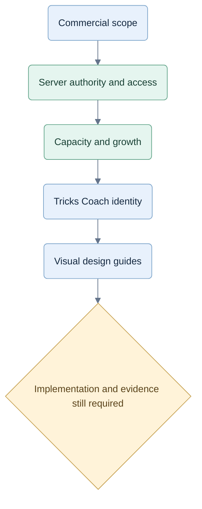

# Planning changes

## 2026-09-27 — Agent-ready B2C monorepo implementation plan

Recorded the owner's current-baseline, simple-monorepo, existing-UX and Stripe decisions in [CR-IMPL-001](decisions/CR-IMPL-001-monorepo-and-stripe.md). Tricks Coach remains a B2C product to learn to play well; no enterprise product features are added. Subscription management is in-app and payments use Stripe.

Added [implementation entry point](IMPLEMENTATION-START-HERE.md), [W00–W19 implementation plan](2026-09-27-monorepo-implementation-plan.md) and [requirement/test specification](implementation/requirements-and-tests.md), covering file ownership, interfaces, dependencies, design patterns, fixture assertions, preserved UX, current commercial gates and evidence reporting. The plan reconciles historical conflicts and introduces IMPL-01–04, SUB-01–04 and traceable RULE/KNOW/UX/STRAT/COACH IDs for existing specified behavior.

This is documentation work only. Original pack and prototype code are preserved. The historical 38-test result is labelled historical; no new application, hosted, live Jev, Stripe, hardware, pilot or load checks are claimed.

## Visual change map

These stages describe documentation revisions; they do not assert that the service is implemented.

## 2026-09-26 — Mermaid design diagrams

Added 34 concise visual summaries across 29 authored planning, research, prototype and review documents. Standardized the existing architecture/security diagrams, added accessible titles/descriptions and a [diagram index](DIAGRAMS.md) with a rendered gallery. All diagrams passed local rendering checks with networking disabled. Historical and proposed flows retain explicit status. The diagrams explain existing decisions; original imported files, exported chats and application code are preserved.

## 2026-09-26 — Tricks Coach name and domain

Recorded the owner's selection of **Tricks Coach** and **trickscoach.com** in [CR-BRAND-001](brand-and-domain.md), with requirements BRAND-01–03, rationale, alternatives and compatibility. Updated current project, product, architecture, delivery and prototype documentation. The owner will add the domain to Vercel manually on 26 September 2026; setup completion remains unverified.

This change updates documents only. Jev retains its technical model/provider meaning; app code, technical identifiers and the original v0.2 pack are unchanged. Application branding and live-domain checks remain follow-up work; no runtime test or deployment result is claimed.

## 2026-09-26 — Concurrent users and growth

Added `10-capacity-and-scaling.md`: separate account counts from active tables, quantify an illustrative workload, and scale API, CPU analysis and Jev dispatch independently. Added connection budgets, compact snapshots, queue evolution, failover/backpressure and a future ownership-preserving partition path. Clarified that the 250 ms analysis limit is not a routine bot CPU allocation and the eight-second Jev application deadline includes queue time.

Expanded planned tests from 45 to 49, with a 1,000-active-table paid-launch evidence floor and progressive 10,000/100,000 targets. These are proposed gates, not measured capacities. No product code, infrastructure or live provider test was created.

## 2026-09-26 — Reverse engineering and subscription protection

Researched browser/Wasm/worker/key limitations against primary guidance and inspected the local prototype. Retained React/TypeScript, Node/Fastify and PostgreSQL; compared browser-owned and server-owned execution in `security/`. Added the operation access matrix, cache/revocation rules, strict schema configuration, first-use transaction protection, payment identity binding and calibrated abuse controls. Preserved the fixed demo and coached-hand subscription model; clarified factual replay versus new coaching. Acceptance design now has 45 cases.

Added evidence hashes, comparable diagrams and a proposed implementation plan. These are design artifacts; no product code, deployed enforcement or security test result is claimed.

## 2026-09-26 — Commercial product and hosted trust boundary

Recorded the owner's demo-only unpaid access, worldwide target market, provisional monthly individual/family offers, incorporation after testing and later store/PvP phases. Added `06-commercialization.md`, `07-hosted-architecture.md`, `08-commercial-testing.md` and `09-delivery-and-evidence.md`.

Replaced the old free-game and decision-quota assumptions with paid full play and a proposed coached-hand allowance. Specified server-only engine/coach, secure dealing, authenticated ownership, transactional usage and required server records. Separated optional analytics, reported display and competitive rating from trusted service state. Added 42 planned acceptance scenarios and recorded 38 existing prototype tests passing.

The current prototype remains unchanged. New requirements are not represented as implemented or tested. Earlier imported v0.2 documentation and its integrity manifest are preserved.
