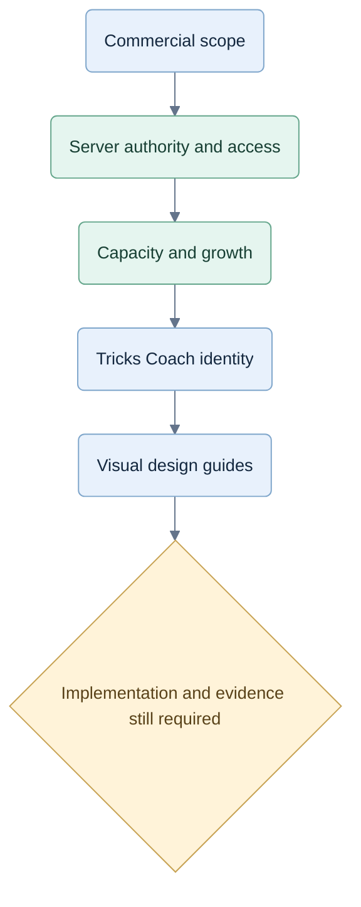

# Planning changes

## 2026-09-29 — Scenario coverage and future Jev evaluations

[CR-STRAT-008](decisions/CR-STRAT-008-coverage-and-evaluation.md), EV-01–08, reviews the design against experienced-player learning, concise coaching and credible bots. Added six compound child scenarios, independent discovery and a broader first acceptance batch. The diamond sequence remains one development family. Per-game scenario foundations are maintained through versioned counterexamples; no exhaustive coverage or fixed probability per scenario is claimed.

The [evaluation plan](../docs/superpowers/plans/2026-09-29-scenario-and-jev-evaluation.md) separates local scenario play, direct full-legal-set Jev, analysis-assisted Jev and shortlist loss. It specifies event calibration, blind labels, grouped holdouts, complete matches, failure reporting, provider gates and unaided transfer. [Review evidence](../qa/implementation/scenario-coverage-review.md). Documentation only; no strategy implementation, provider request or new strength/learning result.

## 2026-09-29 — Partnership inference guide and plan

[CR-STRAT-007](decisions/CR-STRAT-007-partnership-inference-guide.md) adds 60 authored scenario recipes with observations, alternative explanations, proposed decisions, exceptions and coach cues. The A♦–Q♦ example is checked against four complete legal deals with identical player observations. The plan extends typed game packs with evidence, revisable hypotheses, explicit conflicts, scenario rubrics and real cue bindings; other games reuse the authoring structure with their own rules. [Five documentation checks passed](../qa/implementation/partnership-guide-validation.md). No production strategy or provider activation changed; playing strength remains unproven for the proposed tactics.
## 2026-09-29 — Clarify the original multi-game contract

Updated [document 12](../docs/12-multi-game-extensibility.md) for the owner-confirmed three-mode scope: a game may support individual competition, partnership competition or both through validated variants. It now names Hearts Solo, Spades Solo and Spades Partners, preserves their frozen profiles, and requires variant-specific scoring, coaching and evaluation evidence. Added a current-scope pointer to the original [README](../README.md). Documentation only; no rule, schema, runtime policy or historical record changed.

## 2026-09-29 — Spades reasoning and retained analysis

[CR-STRAT-005](12-spades-reasoning.md) records the owner instruction: table type preserves future four-human play; current practice has one human and three bots; setup says **three trained players**; end-game results replace live notes; every human decision retains safe analysis regardless of cues. Solo tactics feed a partnership objective/exception layer shared by bots and coach. Rules/scoring are unchanged. [Implementation evidence](../qa/implementation/SPADES-REASONING-REPORT.md).

## 2026-09-28 — Selected Cardford visual direction

Recorded [CR-BRAND-003](brand-and-domain.md) and created the [Open Hand SVG family and design guide](brand/cardford/DESIGN-GUIDE.md). The selected banner keeps only **Card games. Your way**, without a final period. Ten SVGs parsed and rendered; [validation](brand/cardford/VALIDATION.md) distinguishes those checks from app integration or domain verification. A capitalization difference between the selected artwork and the app display name remains open before publication.

## 2026-09-28 — CardFord name

[CR-BRAND-002](brand-and-domain.md) supersedes the earlier product name. Current product and implementation entry points use CardFord. The earlier `trickscoach.com` plan is unverified and is not treated as a CardFord domain choice. No technical identifier, schema URI or deployment changes.

## 2026-09-27 — Future play and membership consideration

Recorded [CR-FUTURE-001](11-future-play-and-membership.md): people may return for enjoyable bots after needing less coaching, or later for human matches. Compared paid-only/play-only, bounded free and broad free access; recommend evaluating bounded free play against retention, cost and lost paid revenue before committing. Kept coaching progress, provisional placement and competitive rating distinct, including a fair path without coach history.

Linked implications for access, pricing/family value, UX, capacity, shared-match ownership and future feature gates. Added two Mermaid diagrams. Current paid launch, W00–W19, application behavior and naming decisions are unaffected; no free tier, rating service, payment product or multiplayer was built. Research links support design considerations, not demand or capacity claims.

## 2026-09-27 — Visual cues and shorter practice copy

Implemented the owner's cue-first table update in [CR-UX-004](decisions/CR-UX-004-table-cues.md), requirements UX-13–16. Removed repeated visible turn, lead, objective and broken-suit sentences; kept accessible announcements and numeric player counts. Unavailable cards use grey faces and a lock driven by server legal actions. Last trick now stays at the left with seat positions and a winner mark, without visible player names or a notes request.

Shortened game/settings/notes/recap/review copy and made extra explanation expandable with keyboard access. Play again continues the current match after a hand and restarts the same mode after match completion. Rules, scoring, contracts and stored coaching content are unchanged. See [actual verification results](../qa/implementation/ui-cues-acceptance.md) for checks, provider mode, screenshots and remaining limits.

## 2026-09-27 — Local V1 implemented and hosted

Implemented the owner-authorized local cycle in [CR-IMPL-003](decisions/CR-IMPL-003-local-build.md): one npm monorepo, generated public contracts, server-owned three-mode rules, PostgreSQL persistence, command/control fences, observation-only local play and coaching, current-game review, isolated sampled continuations, in-app subscription/family fixtures and account data controls. Preserved the accepted table experience. Added local launch/stop, isolated test database and backup/restore scripts. No pipeline, remote push or public deployment was added.

Requirement groups: LOCAL-01–05, IMPL-01–04, RULE-01–09, KNOW-01–03, UX-01–12, STRAT-01–04, COACH-01–03/07–08 and SUB-01–04. These identify affected behavior, not blanket completion of every acceptance target. Strategy assessment/promotion, hosted identity, full Stripe orchestration and paid-launch evidence remain partial or blocked as recorded in [the acceptance report](../qa/implementation/LOCAL-V1-REPORT.md).

Integration evidence includes contract freeze `878cf07`, domain `d8b6b42`, durable service `b24ac05`, billing/family `e6b9b1b`, sampler `e8ede9d`, UI `c79dabb`/`11504dc`, provider ledger `ba3e333`, load smoke `1779684` and Stripe management primitives `c6e924a`. Final root integration `4145972` fixes family plan selection, saved-result access after expiry, stale trial publication, strict read queries, browser request recovery and bounded provider waits. Final checks: 140 service/rule tests, 18 browser checks and 2 boundary tests passed. One live Jev request reached the configured snapshot but failed response validation; no retry or promotion. Check [status](../qa/implementation/status.md) and [LOCAL-README](../LOCAL-README.md) for commands, evidence and remaining work.

## 2026-09-27 — Agent-ready B2C monorepo implementation plan

Recorded the owner's current-baseline, simple-monorepo, existing-UX and Stripe decisions in [CR-IMPL-001](decisions/CR-IMPL-001-monorepo-and-stripe.md). Tricks Coach remains a B2C product to learn to play well; no enterprise product features are added. Subscription management is in-app and payments use Stripe.

Added [implementation entry point](IMPLEMENTATION-START-HERE.md), [W00–W19 implementation plan](2026-09-27-monorepo-implementation-plan.md) and [requirement/test specification](implementation/requirements-and-tests.md), covering file ownership, interfaces, dependencies, design patterns, fixture assertions, preserved UX, current commercial gates and evidence reporting. The plan reconciles historical conflicts and introduces IMPL-01–04, SUB-01–04 and traceable RULE/KNOW/UX/STRAT/COACH IDs for existing specified behavior.

This is documentation work only. Original pack and prototype code are preserved. The historical 38-test result is labelled historical; no new application, hosted, live Jev, Stripe, hardware, pilot or load checks are claimed.

## Visual change map

These stages describe documentation revisions; they do not assert that the service is implemented.

## 2026-09-29 — Typed game reasoning candidate

Recorded owner approval of approach A in [CR-STRAT-006](decisions/CR-STRAT-006-typed-game-reasoning.md). Added static per-game pack routing, a 26-family Spades casebook, private selection traces, contextual bids, exact projected-score helpers, bounded late-hand continuations, and limited partnership Nil, signal and entry reasoning. Local tests, build and browser play passed; [implementation evidence](../qa/implementation/TYPED-REASONING-IMPLEMENTATION.md) records a negative baseline-style partnership slice and unfinished independent review. No Jev call or hosted release occurred.

## 2026-09-26 — Mermaid design diagrams

Added 34 concise visual summaries across 29 authored planning, research, prototype and review documents. Standardized the existing architecture/security diagrams, added accessible titles/descriptions and a [diagram index](DIAGRAMS.md) with a rendered gallery. All diagrams passed local rendering checks with networking disabled. Historical and proposed flows retain explicit status. The diagrams explain existing decisions; original imported files, exported chats and application code are preserved.

## 2026-09-26 — Tricks Coach name and domain

Recorded the owner's selection of **Tricks Coach** and **trickscoach.com** in [CR-BRAND-001](brand-and-domain.md), with requirements BRAND-01–03, rationale, alternatives and compatibility. Updated current project, product, architecture, delivery and prototype documentation. The owner will add the domain to Vercel manually on 26 September 2026; setup completion remains unverified.

This change updates documents only. Jev retains its technical model/provider meaning; app code, technical identifiers and the original v0.2 pack are unchanged. Application branding and live-domain checks remain follow-up work; no runtime test or deployment result is claimed.

## 2026-09-26 — Concurrent users and growth

Added `10-capacity-and-scaling.md`: separate account counts from active tables, quantify an illustrative workload, and scale API, CPU analysis and Jev dispatch independently. Added connection budgets, compact snapshots, queue evolution, failover/backpressure and a future ownership-preserving partition path. Clarified that the 250 ms analysis limit is not a routine bot CPU allocation and the eight-second Jev application deadline includes queue time.

Expanded planned tests from 45 to 49, with a 1,000-active-table paid-launch evidence floor and progressive 10,000/100,000 targets. These are proposed gates, not measured capacities. No product code, infrastructure or live provider test was created.

## 2026-09-26 — Reverse engineering and subscription protection

Researched browser/Wasm/worker/key limitations against primary guidance and inspected the local prototype. Retained React/TypeScript, Node/Fastify and PostgreSQL; compared browser-owned and server-owned execution in `security/`. Added the operation access matrix, cache/revocation rules, strict schema configuration, first-use transaction protection, payment identity binding and calibrated abuse controls. Preserved the fixed demo and coached-hand subscription model; clarified factual replay versus new coaching. Acceptance design now has 45 cases.

Added evidence hashes, comparable diagrams and a proposed implementation plan. These are design artifacts; no product code, deployed enforcement or security test result is claimed.

## 2026-09-26 — Commercial product and hosted trust boundary

Recorded the owner's demo-only unpaid access, worldwide target market, provisional monthly individual/family offers, incorporation after testing and later store/PvP phases. Added `06-commercialization.md`, `07-hosted-architecture.md`, `08-commercial-testing.md` and `09-delivery-and-evidence.md`.

Replaced the old free-game and decision-quota assumptions with paid full play and a proposed coached-hand allowance. Specified server-only engine/coach, secure dealing, authenticated ownership, transactional usage and required server records. Separated optional analytics, reported display and competitive rating from trusted service state. Added 42 planned acceptance scenarios and recorded 38 existing prototype tests passing.

The current prototype remains unchanged. New requirements are not represented as implemented or tested. Earlier imported v0.2 documentation and its integrity manifest are preserved.

## 2026-09-27 — Authorized local implementation and deployment handoff

Added [local build cycle](LOCAL-V1-BUILD-CYCLE.md), [deployment guide](DEPLOYMENT-GUIDE.md) and [CR-IMPL-003](decisions/CR-IMPL-003-local-build.md), recording the owner's local implementation, worktree/review, Podman, no-push and no-pipeline direction. Requirements LOCAL-01–05 cover schema-first integration, explicit local fixtures, honest completion gates and server-only credentials. Preserve existing B2C UX and three game modes; hosted Stripe/identity, optional Jev and paid-launch evidence remain separately identified.

Documentation only: commands for future scripts are labelled planned, the coordinator-reported 38-test/build baseline is not a new test run, and no credential contents, product code, deployment or payment/provider execution were created by this documentation change.
