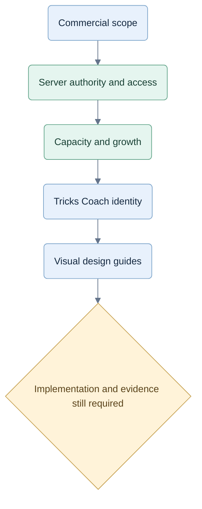

# Planning changes

## 2026-10-06 — M04F history performance and test cost

The owner requested an explanation of long tests and the next work. [M04F](implementation/multi-game/m04f-execution.md) starts with a retained-evidence audit, focused checks, two measured integrity-preserving optimizations and finite native database diagnostics. [Evidence](../qa/implementation/multi-game/m04f/status.md) separates reducer/replay improvements from complete prepared-service readiness. Preserve old failed/censored captures. Full resource workload, normal Spades matches and the earlier PostgreSQL cause remain activation gates.

## 2026-10-06 — M04E complete local platform/client integration

The owner authorized M04E. The [execution packet](implementation/multi-game/m04e-execution.md) and [verification report](../qa/implementation/multi-game/m04e/status.md) distinguish the implemented Go/React experience, scoped functional acceptance and full default activation. Document closed platform/account/review contracts, game-owned presentation, original progressive coaching/review, durable actor-safe continuations, account permissions, exact pending recovery and forward migration 010. Add explicit native `start:go` instructions and retain the V1 reference for historical records. Replay-validated reachable terminal fixtures cover the final lifecycle; censored normal Spades matches and source-reviewed cumulative-history costs remain resource gates. The earlier native PostgreSQL timeout cause also remains unresolved; later passing suites cannot close it. M05 reasoning, human evidence, hosting, live identity/payments/providers and native packages keep their separate gates.

## 2026-10-06 — M04D demo/backend offer acceptance

[M04D acceptance](../qa/implementation/multi-game/m04d/status.md) passes the MG-15 Go-authored online demo and MG-16 exact-target configurable access backend, including real Go/React browser checks, normal/race Go suites and preserved Node/contracts/source regressions. Document independent coaching after play expiry for an owned unit, atomic once-per-identity commercial trials, original allowance/unlock receipts, immutable purchased terms, saved-delivery source revocation and forward migration 009's legacy reservation backfill. The launch policy remains empty; local demonstration offers and the M04C fixture constructor are explicit separate modes. React demo has no offline graph and can use optional Go `--web web/dist` at `#demo`; normal game/account paths remain on Node, whose demo reports unavailable. Update the next slice to M04E: complete platform/client envelope and preserved three-mode journeys. Overall M04, hosted identity/payments, live Jev, human evidence and native packaging remain open; the prior native PostgreSQL cause is unresolved.

## 2026-10-06 — M04C local service and remaining integration

The owner authorized the next step after M04B. [M04C](../qa/implementation/multi-game/m04c/status.md) connects the original Go policies and V2 sessions to local authentication/control, durable preparation, saved advice, atomic recovery and owner erasure. Its independent review and native acceptance retain the unresolved PostgreSQL timeout observations without changing limits. Add explicit native run instructions and the registered local-service contract; original app behavior and historical readers remain separate. Next is M04D authored online demo/exact-target offers in Go, then complete platform/client integration and preserved-UI acceptance. Full M04, hosted activation, human evaluation and strategic promotion remain open.

## 2026-10-06 — M04B original policies and registered sessions

The owner authorized M04B. [Acceptance evidence](../qa/implementation/multi-game/m04b/status.md) records exact original bot/coach output, registered V2 lifecycle/preparation, independent import-boundary checks and native verification. Review removed redundant internal observation serialization/state copies, preserved original numeric/Unicode semantics and kept optional saved policies explicitly unavailable for new execution. M04C now owns authenticated durable service composition, full original prepared analysis/advice publication and receipt-first recovery; the platform/client, demo/access and real journey gates remain open. The current UI and TypeScript service remain active; no hosting, strategy promotion or provider activation.

## 2026-10-06 — M04A Hearts prerequisite and integration sequence

The owner authorized the next M04 step. Review found the Go Hearts adapter could offer its first play but could not execute it. [M04A evidence](../qa/implementation/multi-game/m04/status.md) now accepts the complete original rules/observation/storage port. The [execution sequence](implementation/multi-game/m04-execution.md) makes original policy execution, V2 session/platform envelopes, access/demo and actual Go service/client recovery explicit prerequisites to activation. Go + PostgreSQL remains the single replacement backend; Node remains frontend tooling and the temporary original service/reference. Keep the reproduced native database timeout follow-up visible; the unchanged rerun passed without relaxing limits. No UI redesign or completed-M04 claim.

## 2026-10-06 — Comparison closeout and M03 durable records

The owner authorized comparison cleanup, local environment selection and M03. Native Windows is now the default for subsequent local work; the historical Podman test container was stopped and its data retained. [Cleanup inventory and M03 evidence](../qa/implementation/multi-game/m03/status.md) distinguish completed checks from later activation. The [private record contract](implementation/multi-game/private-records.md) freezes versioned metadata, replay, decisions, work attempts, recovery and access-unit/allowance behavior. Go implements this responsibility under CR-ARCH-003; the old TypeScript file list remains a regression reference. M04 owns HTTP/client activation and the offer resolver; full game/policy parity, hosting, providers and human evaluation keep their separate gates.

## 2026-10-06 UTC — Native Windows performance correction before M03

[CR-ARCH-004](decisions/CR-ARCH-004-native-windows-performance.md) records the owner's request to settle the Node/Go comparison and native Windows toolchain before advancing. The old M02A workers both ran in Linux/WSL, but their matching outputs concealed repeated Go JSON decoding, validation, projection and frame encoding. Keep that evidence historical. Added native setup, same-source Go version control, immutable typed state boundaries, and an independently reviewed comparison protocol; the [new report](../qa/implementation/multi-game/performance-windows/report.md) supplies measurements and verification. Go 1.26.8 replaces 1.27.1 for current Windows work after the latter repeatedly crashed during CPU profiling. Go/PostgreSQL remains the backend direction; no production activation, UI redesign, strategy promotion or hosting work.

## 2026-10-05 — M02A compatibility gate passed

The owner authorized the next unblocking implementation after urgent repairs. [M02A evidence](../qa/implementation/multi-game/m02a/status.md) records frozen Go/public contracts, independent supported-game replay, a complete Partners hand through HTTP/PostgreSQL, bounded cancellation/admission and matched-work measurements. Go met the local limits but was slower than the optimized Node reference; profiling remains explicit follow-up work. M03 durable records/replay is next. The TypeScript app, React UI, policy pins, six SQL migrations and original evidence remain preserved; production activation, human reviews and hosting stay deferred.

## 2026-10-05 — Urgent current-system repairs before the Go slice

[CR-FIX-001](decisions/CR-FIX-001-urgent-system-repairs.md) records the owner's instruction to close urgent gaps first. Added UR-01–06: exact charged-rollout caps, strict active V1 load/save validation, durable immutable preparation receipts and authorization fences, owned accepted-command/trial reconciliation, bounded persistent client recovery and provider deadline/accounting fencing. Identity reads no longer depend on a readable active game; detected account switches invalidate prior table/review state. [Execution evidence](../qa/implementation/multi-game/urgent-repairs/status.md) retains initial failures, repairs, independent review and final checks. Forward migration 006 adds preparation attempts; original rules, policy/default pins, first five migrations and evaluation archives remain preserved. The remaining M02A work is Go/PostgreSQL contracts and one compatibility slice. Complete historical records, V2 activation, CPU isolation and larger resource checks remain planned; hosting, live providers and human evaluation stay deferred.

## 2026-10-05 — System review and Go/PostgreSQL backend direction

[CR-ARCH-003](decisions/CR-ARCH-003-backend-stack-and-system-readiness.md) replaces the old Node-only prescription with a Go/PostgreSQL target, Rust as an evidence-backed alternative, and the [M02A compatibility gate](implementation/multi-game/backend-readiness.md). Preserves the current React UI and completed M00–M02 evidence. The [review](../qa/implementation/multi-game/system-review-2026-10-05.md) records a reproduced terminal-root work-cap defect plus concrete persistence, prepared-result, replay, recovery and growth gaps. Added SYS-01–12 acceptance and strengthened M03–M05 dependencies/tests. Hosting and other nonfunctional implementation remain deferred and indexed. Documentation and one pure defect probe only; no backend port, runtime fix, strategy/default change, provider call, deployment or new full-suite acceptance.

## 2026-10-04 — Online demo, configurable launch offers and frontend reuse

[CR-IMPL-004](decisions/CR-IMPL-004-online-demo-and-launch-readiness.md) records the owner's four notes. Updated the main plan and active access/architecture/test guidance: server-required demo transitions; game/variant-scoped free/access-trial/paid grants with separate coaching limits; one React frontend with a later Capacitor assessment; basic reliability/recovery/usability before capacity/native work. Added [MG-15–18 and execution files/tests](implementation/multi-game/launch-access-and-client.md). Final offers/native builds remain unselected. Documentation only; existing demo/access code and runtime defaults are unchanged.

## 2026-10-04 — Detailed multi-game reasoning implementation plan

Added the [M00–M12 plan](../docs/superpowers/plans/2026-10-04-multi-game-reasoning-implementation.md) and four implementation packets: typed production modules, actor-safe continuation planning, maintained cases/source ledger, standard-game profiles and independent evaluation. Preserves current Hearts/Spades play, policy/history versions, atomic Hearts passing and selected Jawaker Trix rules. Two independent agents reviewed the plan; unresolved Tarneeb profile choices gate only that branch. [Planning verification](../qa/plans/2026-10-04-multi-game-plan-review.md) distinguishes documentation checks from future tests. No game code, defaults, provider activation or strategy-strength claims changed.

## 2026-10-04 — Select Jawaker as the Trix rules authority

The owner selected Jawaker's standard Trix and Trix Complex rules, including Jack-centered card layout. Research references, architecture notes and implementation prerequisites now use this as the sole planned Trix layout; the seven-centered Waraq description is rejected and no alternate layout mode is planned. This updates design guidance only; there is no Trix engine to change yet.

## 2026-10-04 — Multi-game architecture interview and plan prerequisites

Added the [two-agent interview packet](research/2026-10-04-card-game-architecture-interview/README.md): inspected production versus documented seams, preserved questions/answers/challenge, researched Tarneeb/Trix profile differences, and proposed typed boundaries, algorithm comparisons and acceptance prerequisites. This is investigation input for a later implementation plan, not new approved runtime behavior. Corrected the expanded-batch README's eight-complete claim to match saved evidence: three complete, three partial and two unstarted hands. Raw records, game code, provider settings and defaults are unchanged.

## 2026-09-30 — Expanded two-suit scenario collection

Owner authorized continuing beyond the initial pilot. The [two-suit batch](../qa/experiments/2026-09-30-two-suit-batch/README.md) freezes six authored hands: three companion distributions paired across Solo and Partners, with Maya's same five top spades and eight hearts. Fresh text-only player contexts receive only seat information. Saved records and audits distinguish complete, incomplete and not-run episodes. New review material separates valid actions, invalid explanations and equivalent choices. This is offline development evidence; runtime policy and provider activation are unchanged. No Jev calls or strength/probability claims are implied.

## 2026-09-30 — Authored-deal scenario research

The owner requested primary research and text-only player simulations on deliberate Solo and Partners deals. The [scenario lab](../qa/experiments/2026-09-30-agent-scenario-lab/README.md) stores the protocol, separate player packets, exact responses, production-engine replay checks and review candidates. The [follow-up plan](../qa/experiments/2026-09-30-agent-scenario-lab/follow-up-plan.md) refines the existing evaluation work. Runtime behavior, defaults and provider activation are unchanged; no Jev call is part of this experiment. These records support scenario discovery, not claims of strategic strength or validated probabilities. See the lab results for completed checks and limits.

## 2026-09-29 — Game plan layer and strength gate

[CR-STRAT-009](decisions/CR-STRAT-009-game-plan-and-strength-gate.md) records the owner request to improve bot and coaching quality with a game plan that is generic across four-seat individual and partnership games. It freezes `spades-tactics-2.1.0` as baseline D0, adds selectable Spades plan profiles 3.0.0 to 3.4.0, a case store for the six partial families, and a strength gate that reports Solo and Partners separately. [Design](../docs/superpowers/specs/2026-09-29-game-plan-and-strength-gate.md). The live default policy, Hearts behaviour, rules and scoring are unchanged. No Jev request was made. Promotion of any profile needs human-reviewed labels or a written waiver, and owner approval.

## 2026-09-29 — Scenario coverage and future Jev evaluations

[CR-STRAT-008](decisions/CR-STRAT-008-coverage-and-evaluation.md), EV-01–08, reviews the design against experienced-player learning, concise coaching and credible bots. Added six compound child scenarios, independent discovery and a broader first acceptance batch. The diamond sequence remains one development family. Per-game scenario foundations are maintained through versioned counterexamples; no exhaustive coverage or fixed probability per scenario is claimed.

The [evaluation plan](../docs/superpowers/plans/2026-09-29-scenario-and-jev-evaluation.md) separates local scenario play, direct full-legal-set Jev, analysis-assisted Jev and shortlist loss. It specifies event calibration, blind labels, grouped holdouts, complete matches, failure reporting, provider gates and unaided transfer. [Review evidence](../qa/implementation/scenario-coverage-review.md). Documentation only; no strategy implementation, provider request or new strength/learning result.

## 2026-09-29 — Partnership inference guide and plan

[CR-STRAT-007](decisions/CR-STRAT-007-partnership-inference-guide.md) adds 60 authored scenario recipes with observations, alternative explanations, proposed decisions, exceptions and coach cues. The A♦–Q♦ example is checked against four complete legal deals with identical player observations. The plan extends typed game packs with evidence, revisable hypotheses, explicit conflicts, scenario rubrics and real cue bindings; other games reuse the authoring structure with their own rules. [Five documentation checks passed](../qa/implementation/partnership-guide-validation.md). No production strategy or provider activation changed; playing strength remains unproven for the proposed tactics.
## 2026-09-29 — Clarify the original multi-game contract

Updated [document 12](../docs/12-multi-game-extensibility.md) for the owner-confirmed three-mode scope: a game may support individual competition, partnership competition or both through validated variants. It now names Hearts Solo, Spades Solo and Spades Partners, preserves their frozen profiles, and requires variant-specific scoring, coaching and evaluation evidence. Added a current-scope pointer to the original [README](../README.md). Documentation only; no rule, schema, runtime policy or historical record changed.

## 2026-09-29 — Spades reasoning and retained analysis

[CR-STRAT-005](12-spades-reasoning.md) records the owner instruction: table type preserves future four-human play; current practice has one human and three bots; setup says **three trained players**; end-game results replace live notes; every human decision retains safe analysis regardless of cues. Solo tactics feed a partnership objective/exception layer shared by bots and coach. Rules/scoring are unchanged. [Implementation evidence](../qa/implementation/SPADES-REASONING-REPORT.md).

## 2026-09-28 — Selected Cardford visual direction

Recorded [CR-BRAND-003](brand-and-domain.md) and created the [Open Hand SVG family and design guide](brand/cardford/DESIGN-GUIDE.md). The selected banner keeps only **Card games. Your way**, without a final period. Ten SVGs parsed and rendered; [validation](brand/cardford/VALIDATION.md) distinguishes those checks from app integration or domain verification. A capitalization difference between the selected artwork and the app display name remains open before publication.

## 2026-09-28 — CardFord name

[CR-BRAND-002](brand-and-domain.md) supersedes the earlier product name. Current product and implementation entry points use CardFord. The earlier `trickscoach.com` plan is unverified and is not treated as a CardFord domain choice. No technical identifier, schema URI or deployment changes.

## 2026-09-27 — Future play and membership consideration

Recorded [CR-FUTURE-001](11-future-play-and-membership.md): people may return for enjoyable bots after needing less coaching, or later for human matches. Compared paid-only/play-only, bounded free and broad free access; recommend evaluating bounded free play against retention, cost and lost paid revenue before committing. Kept coaching progress, provisional placement and competitive rating distinct, including a fair path without coach history.

Linked implications for access, pricing/family value, UX, capacity, shared-match ownership and future feature gates. Added two Mermaid diagrams. Current paid launch, W00–W19, application behavior and naming decisions are unaffected; no free tier, rating service, payment product or multiplayer was built. Research links support design considerations, not demand or capacity claims.

## 2026-09-27 — Visual cues and shorter practice copy

Implemented the owner's cue-first table update in [CR-UX-004](decisions/CR-UX-004-table-cues.md), requirements UX-13–16. Removed repeated visible turn, lead, objective and broken-suit sentences; kept accessible announcements and numeric player counts. Unavailable cards use grey faces and a lock driven by server legal actions. Last trick now stays at the left with seat positions and a winner mark, without visible player names or a notes request.

Shortened game/settings/notes/recap/review copy and made extra explanation expandable with keyboard access. Play again continues the current match after a hand and restarts the same mode after match completion. Rules, scoring, contracts and stored coaching content are unchanged. See [actual verification results](../qa/implementation/ui-cues-acceptance.md) for checks, provider mode, screenshots and remaining limits.

## 2026-09-27 — Local V1 implemented and hosted

Implemented the owner-authorized local cycle in [CR-IMPL-003](decisions/CR-IMPL-003-local-build.md): one npm monorepo, generated public contracts, server-owned three-mode rules, PostgreSQL persistence, command/control fences, observation-only local play and coaching, current-game review, isolated sampled continuations, in-app subscription/family fixtures and account data controls. Preserved the accepted table experience. Added local launch/stop, isolated test database and backup/restore scripts. No pipeline, remote push or public deployment was added.

Requirement groups: LOCAL-01–05, IMPL-01–04, RULE-01–09, KNOW-01–03, UX-01–12, STRAT-01–04, COACH-01–03/07–08 and SUB-01–04. These identify affected behavior, not blanket completion of every acceptance target. Strategy assessment/promotion, hosted identity, full Stripe orchestration and paid-launch evidence remain partial or blocked as recorded in [the acceptance report](../qa/implementation/LOCAL-V1-REPORT.md).

Integration evidence includes contract freeze `878cf07`, domain `d8b6b42`, durable service `b24ac05`, billing/family `e6b9b1b`, sampler `e8ede9d`, UI `c79dabb`/`11504dc`, provider ledger `ba3e333`, load smoke `1779684` and Stripe management primitives `c6e924a`. Final root integration `4145972` fixes family plan selection, saved-result access after expiry, stale trial publication, strict read queries, browser request recovery and bounded provider waits. Final checks: 140 service/rule tests, 18 browser checks and 2 boundary tests passed. One live Jev request reached the configured snapshot but failed response validation; no retry or promotion. Check [status](../qa/implementation/status.md) and [LOCAL-README](../LOCAL-README.md) for commands, evidence and remaining work.

## 2026-09-27 — Agent-ready B2C monorepo implementation plan

Recorded the owner's current-baseline, simple-monorepo, existing-UX and Stripe decisions in [CR-IMPL-001](decisions/CR-IMPL-001-monorepo-and-stripe.md). Tricks Coach remains a B2C product to learn to play well; no enterprise product features are added. Subscription management is in-app and payments use Stripe.

Added [implementation entry point](IMPLEMENTATION-START-HERE.md), [W00–W19 implementation plan](2026-09-27-monorepo-implementation-plan.md) and [requirement/test specification](implementation/requirements-and-tests.md), covering file ownership, interfaces, dependencies, design patterns, fixture assertions, preserved UX, current commercial gates and evidence reporting. The plan reconciles historical conflicts and introduces IMPL-01–04, SUB-01–04 and traceable RULE/KNOW/UX/STRAT/COACH IDs for existing specified behavior.

This is documentation work only. Original pack and prototype code are preserved. The historical 38-test result is labelled historical; no new application, hosted, live Jev, Stripe, hardware, pilot or load checks are claimed.

## Visual change map

These stages describe documentation revisions; they do not assert that the service is implemented.

## 2026-09-29 — Typed game reasoning candidate

Recorded owner approval of approach A in [CR-STRAT-006](decisions/CR-STRAT-006-typed-game-reasoning.md). Added static per-game pack routing, a 26-family Spades casebook, private selection traces, contextual bids, exact projected-score helpers, bounded late-hand continuations, and limited partnership Nil, signal and entry reasoning. Local tests, build and browser play passed; [implementation evidence](../qa/implementation/TYPED-REASONING-IMPLEMENTATION.md) records a negative baseline-style partnership slice and unfinished independent review. No Jev call or hosted release occurred.

## 2026-09-26 — Mermaid design diagrams

Added 34 concise visual summaries across 29 authored planning, research, prototype and review documents. Standardized the existing architecture/security diagrams, added accessible titles/descriptions and a [diagram index](DIAGRAMS.md) with a rendered gallery. All diagrams passed local rendering checks with networking disabled. Historical and proposed flows retain explicit status. The diagrams explain existing decisions; original imported files, exported chats and application code are preserved.

## 2026-09-26 — Tricks Coach name and domain

Recorded the owner's selection of **Tricks Coach** and **trickscoach.com** in [CR-BRAND-001](brand-and-domain.md), with requirements BRAND-01–03, rationale, alternatives and compatibility. Updated current project, product, architecture, delivery and prototype documentation. The owner will add the domain to Vercel manually on 26 September 2026; setup completion remains unverified.

This change updates documents only. Jev retains its technical model/provider meaning; app code, technical identifiers and the original v0.2 pack are unchanged. Application branding and live-domain checks remain follow-up work; no runtime test or deployment result is claimed.

## 2026-09-26 — Concurrent users and growth

Added `10-capacity-and-scaling.md`: separate account counts from active tables, quantify an illustrative workload, and scale API, CPU analysis and Jev dispatch independently. Added connection budgets, compact snapshots, queue evolution, failover/backpressure and a future ownership-preserving partition path. Clarified that the 250 ms analysis limit is not a routine bot CPU allocation and the eight-second Jev application deadline includes queue time.

Expanded planned tests from 45 to 49, with a 1,000-active-table paid-launch evidence floor and progressive 10,000/100,000 targets. These are proposed gates, not measured capacities. No product code, infrastructure or live provider test was created.

## 2026-09-26 — Reverse engineering and subscription protection

Researched browser/Wasm/worker/key limitations against primary guidance and inspected the local prototype. Retained React/TypeScript, Node/Fastify and PostgreSQL; compared browser-owned and server-owned execution in `security/`. Added the operation access matrix, cache/revocation rules, strict schema configuration, first-use transaction protection, payment identity binding and calibrated abuse controls. Preserved the fixed demo and coached-hand subscription model; clarified factual replay versus new coaching. Acceptance design now has 45 cases.

Added evidence hashes, comparable diagrams and a proposed implementation plan. These are design artifacts; no product code, deployed enforcement or security test result is claimed.

## 2026-09-26 — Commercial product and hosted trust boundary

Recorded the owner's demo-only unpaid access, worldwide target market, provisional monthly individual/family offers, incorporation after testing and later store/PvP phases. Added `06-commercialization.md`, `07-hosted-architecture.md`, `08-commercial-testing.md` and `09-delivery-and-evidence.md`.

Replaced the old free-game and decision-quota assumptions with paid full play and a proposed coached-hand allowance. Specified server-only engine/coach, secure dealing, authenticated ownership, transactional usage and required server records. Separated optional analytics, reported display and competitive rating from trusted service state. Added 42 planned acceptance scenarios and recorded 38 existing prototype tests passing.

The current prototype remains unchanged. New requirements are not represented as implemented or tested. Earlier imported v0.2 documentation and its integrity manifest are preserved.

## 2026-09-27 — Authorized local implementation and deployment handoff

Added [local build cycle](LOCAL-V1-BUILD-CYCLE.md), [deployment guide](DEPLOYMENT-GUIDE.md) and [CR-IMPL-003](decisions/CR-IMPL-003-local-build.md), recording the owner's local implementation, worktree/review, Podman, no-push and no-pipeline direction. Requirements LOCAL-01–05 cover schema-first integration, explicit local fixtures, honest completion gates and server-only credentials. Preserve existing B2C UX and three game modes; hosted Stripe/identity, optional Jev and paid-launch evidence remain separately identified.

Documentation only: commands for future scripts are labelled planned, the coordinator-reported 38-test/build baseline is not a new test run, and no credential contents, product code, deployment or payment/provider execution were created by this documentation change.
