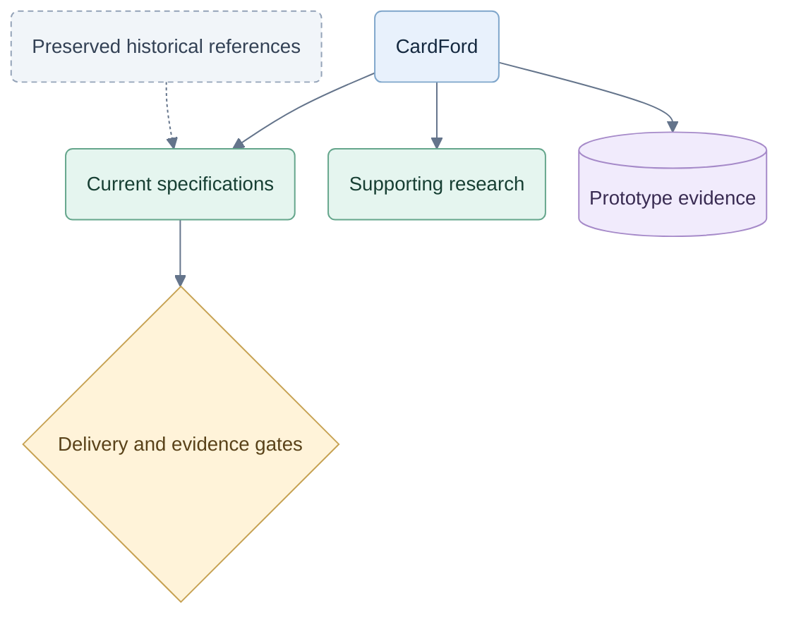

# Diagram index — CardFord

Each authored document now has an editable Mermaid visual summary. Open the linked document to see the diagram beside its requirements. A diagram clarifies the text; it does not approve a proposal or establish a test result.

## Visual map

## Current specifications

| Document | Diagram focus |
|---|---|
| [Project entry](../JEV-TEST.md) | Product direction and the learning experience |
| [Specification index](README.md) | Reading order |
| [Product and views](01-product-and-views.md) | Player journey and table interactions |
| [Games and decisions](02-games-and-decisions.md) | Knowledge, tactics, probabilities and Jev |
| [Service and OpenRouter](03-local-runtime.md) | Runtime boundaries and provider modes |
| [Coaching and evidence](04-coaching-and-evidence.md) | Help, feedback, review and independent progress |
| [V1 setup](05-v1-setup.md) | Build and activation gates |
| [Product and subscriptions](06-commercialization.md) | Demo, membership and coached-hand use |
| [Moved access page](06-access-and-subscriptions.md) | Route to the current access specification |
| [Hosted architecture](07-hosted-architecture.md) | Trust boundary and protected work |
| [Commercial test gates](08-commercial-testing.md) | Evidence required before release |
| [Delivery and evidence](09-delivery-and-evidence.md) | Staged delivery and later expansion |
| [Capacity and scaling](10-capacity-and-scaling.md) | Separate workloads and measured growth |
| [Future play and membership](11-future-play-and-membership.md) | Reasons to return and fair provisional placement; consideration only |
| [Brand and domain](brand-and-domain.md) | Approved identity and pending domain verification |
| [Planning changelog](CHANGELOG.md) | How the design has developed |

## Security and implementation

| Document | Diagram focus |
|---|---|
| [Security review](security/hardening.md) | Why service authority is recommended |
| [Evidence context](security/context.md) | Evidence, inference and proposed controls |
| [Architecture alternatives](security/proposals/subscription-boundary.md) | Current prototype, browser-engine option and server-authority option |
| [Server implementation handoff](security/implementation/server-authority.md) | Work-package dependencies and acceptance |
| [Historical local plan](2026-09-26-implementation-plan.md) | Earlier work sequence and current governing specs |

The three security alternatives also have standalone Mermaid sources: [current prototype](security/diagrams/subscription-boundary-before.mmd), [browser engine](security/diagrams/subscription-boundary-browser-engine-after.mmd), and [server authority](security/diagrams/subscription-boundary-server-authority-after.mmd). These mirror the embedded diagrams. The [structured security record](security/hardening.json) remains machine-readable and links to those visual counterparts.

## Supporting research and prototype evidence

| Document | Diagram focus |
|---|---|
| [Necessary changes](../docs/REVIEW.md) | Preserve the useful foundation; resolve contradictions |
| [Hybrid decisions](../docs/HYBRID-DECISIONS.md) | Combine tactics, deduction, probability and Jev |
| [Coaching analysis](../docs/COACH-EXPERIENCE.md) | Progressive help and reflection |
| [Research notes](../docs/RESEARCH.md) | From source evidence to a tested design |
| [Web prototype](../web/README.md) | What runs locally today |
| [Prototype verification](../web/qa/VERIFICATION.md) | Completed checks versus remaining device validation |
| [UI update](../web/qa/UI-V1.md) | Card preparation, play and feedback |
| [Project provenance](../MIGRATION.md) | Original pack, source discussions and authored design |

The imported v0.2 pack and exported chats remain historical sources. Their original contents and manifest are preserved. Machine-readable contracts, fixtures, hashes and code are explained by the linked documents rather than modified to contain diagram syntax.

## Shared style

| Treatment | Meaning |
|---|---|
| Blue rounded box | Player interaction, product surface or reading destination |
| Green rounded box | Processing, analysis or implementation work |
| Purple cylinder/box | Stored state, records or evidence |
| Amber diamond | Decision, permission or evidence gate |
| Grey dashed box | Historical, deferred or explicitly pending work |

Use short labels, a clear reading direction and no more than ten nodes per diagram. Split independent flows rather than shrinking a crowded chart. Labels and shapes carry meaning as well as color. Every chart includes an accessible title and description; styling is embedded so it travels with copied Mermaid text. [Mermaid theming](https://mermaid.js.org/config/theming.html), [accessible diagrams](https://mermaid.js.org/config/accessibility.html).

Renderer appearance can vary across Markdown viewers; the Mermaid source remains editable.

## Rendered review

The **26 September snapshot** contains 34 diagrams across 29 authored documents, rendered successfully with Mermaid 11.12.1. Browse that [visual gallery](evidence/diagram-review.html) or inspect its [validation record](evidence/diagram-validation.json). The gallery includes the editable source for each diagram; later documents are not covered by that snapshot.

Validation ran locally with browser networking disabled. All three standalone security diagrams match their embedded versions, and all 56 original manifest files retain their recorded hashes. Application tests were not run for this documentation update.

The **27 September future-play addition** has its own [two-diagram preview](evidence/future-play-review.html) and [validation record](evidence/future-play-validation.json). Both rendered successfully with the same offline settings; this scoped check does not claim coverage of other later documents.
