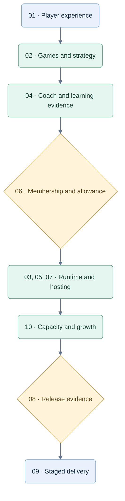

# CardFord V1 specifications

**CardFord** is the current owner-approved product name. The earlier `trickscoach.com` domain plan is unverified; a CardFord domain has not been chosen. [Naming decision and setup status](brand-and-domain.md).

Implementation target, grounded in the playable [web application](../web/README.md). On 27 September 2026 the owner confirmed the planning baseline with earlier safeguards retained, a simple monorepo, the existing UX, a B2C learning product, in-app subscription management and Stripe payments. [CR-IMPL-001](decisions/CR-IMPL-001-monorepo-and-stripe.md) records that authority and its compatibility effects. Earlier analysis remains supporting research; the original pack is preserved.

**For implementation agents:** start at [IMPLEMENTATION-START-HERE.md](IMPLEMENTATION-START-HERE.md), then use the [multi-game plan](../docs/superpowers/plans/2026-10-04-multi-game-reasoning-implementation.md) and [backend readiness/M02A](implementation/multi-game/backend-readiness.md). M00–M02 have recorded acceptance; [CR-ARCH-003](decisions/CR-ARCH-003-backend-stack-and-system-readiness.md) makes Go/PostgreSQL the preferred replacement target while the TypeScript service remains the working reference and React/Vite is preserved. Next implementation is M02A, not a restart of W00. This turn is review/planning only. See [local run instructions](../LOCAL-README.md), [current milestone evidence](../qa/implementation/multi-game/status.md), [local-build evidence](../qa/implementation/status.md) and the later [deployment guide](DEPLOYMENT-GUIDE.md). Hosted/paid-launch gates remain unfinished.

| Read | Purpose |
|---|---|
| [Multi-game reasoning implementation plan](../docs/superpowers/plans/2026-10-04-multi-game-reasoning-implementation.md) | Completed M00–M02 foundations; M02A then remaining production migration, maintained cases, Tarneeb/Trix and independent evaluation. |
| [Backend stack decision](decisions/CR-ARCH-003-backend-stack-and-system-readiness.md) | Go/PostgreSQL preferred target, TypeScript reference, preserved frontend and bounded compatibility gate; no replacement service implemented. |
| [Backend readiness and system acceptance](implementation/multi-game/backend-readiness.md) | M02A execution packet, replacement responsibilities, SYS-01–12 acceptance and deferred hosting/NFR work. |
| [Launch access and client readiness](implementation/multi-game/launch-access-and-client.md) | Online demo, configurable game/coaching grants, React/Capacitor reuse recommendation and basic quality; MG-15–18. |
| [Card-game architecture interview](research/2026-10-04-card-game-architecture-interview/README.md) | Two-agent review of implementation/evidence and Tarneeb/Trix architecture; input for the multi-game plan. |
| [Implementation handoff](IMPLEMENTATION-START-HERE.md) | Fresh-agent reading order, task selection, preserved B2C UX and evidence reporting. |
| [Local-build and release plan](2026-09-27-monorepo-implementation-plan.md) | W00–W19 reference for original build, Stripe and release gates; backend-language assumptions superseded by CR-ARCH-003. |
| [Requirements and tests](implementation/requirements-and-tests.md) | Stable IDs, named fixtures and concrete rule/UX/service/payment assertions. |
| [01 — Product and views](01-product-and-views.md) | Preserve the coded experience; define missing interactions. |
| [Brand and domain](brand-and-domain.md) | Current naming decision, selected visual direction, previous domain plan and unverified setup. |
| [Cardford design guide and SVGs](brand/cardford/DESIGN-GUIDE.md) | Selected Open Hand artwork, reusable assets, usage rules and validation. |
| [12 — Spades reasoning](12-spades-reasoning.md) | Table types, solo core, partnership overlays, scenarios and saved analysis. |
| [Partnership reasoning guide](../docs/superpowers/specs/2026-09-29-spades-partnership-reasoning-guide.md) | 60 foundation recipes plus six compound children, counterexamples and linked implementation plan. |
| [Scenario coverage review](../docs/superpowers/specs/2026-09-29-scenario-coverage-and-success.md) | Product success, systematic discovery, probability meanings and protection against overfitting. |
| [Scenario and Jev evaluation plan](../docs/superpowers/plans/2026-09-29-scenario-and-jev-evaluation.md) | Future deterministic/direct-Jev/hybrid comparisons, calibration, complete matches and unaided learning. |
| [Authored-deal scenario lab](../qa/experiments/2026-09-30-agent-scenario-lab/README.md) | Offline reasoning-agent pilot, reusable player/observer templates, raw decisions, research and proposed next evaluations. |
| [Two-suit scenario batch](../qa/experiments/2026-09-30-two-suit-batch/README.md) | Six authored Solo/Partners fixtures with fixed Maya cards, saved player decisions, explicit completion status and public-information fact checks. |
| [02 — Games and decisions](02-games-and-decisions.md) | Exact rules, player knowledge, tactics, probabilities and Jev's role. |
| [03 — Local runtime](03-local-runtime.md) | OpenRouter, state ownership, persistence and failures. |
| [04 — Coaching and evidence](04-coaching-and-evidence.md) | Assistance, feedback, mistake categories and progress. |
| [05 — V1 setup](05-v1-setup.md) | Current versus planned runtime, configuration, experiments and activation gates. |
| [06 — Product and subscriptions](06-commercialization.md) | Fixed demo, member-only play, proposed individual/family plans and worldwide selling. |
| [07 — Hosted architecture](07-hosted-architecture.md) | Server-only engine/coach, identity, usage, recording and competitive boundaries. |
| [08 — Commercial test gates](08-commercial-testing.md) | 49 planned acceptance cases and actual prototype baseline evidence. |
| [09 — Delivery and evidence](09-delivery-and-evidence.md) | Work split, changed decisions, dependencies and remaining launch choices. |
| [10 — Capacity and scaling](10-capacity-and-scaling.md) | Concurrent-player workload, independent scaling, database/provider limits and growth gates. |
| [11 — Future play and membership](11-future-play-and-membership.md) | Consideration only: free/play-only offers, enjoyable bots, human matching and rating boundaries; no change to launch scope. |
| [Security research and plan](security/hardening.md) | Stack decision, browser/Wasm limits, access protection and abuse detection. |
| [Historical local plan](2026-09-26-implementation-plan.md) | Earlier rule/strategy/review task reference; revise before execution. |
| [Planning changelog](CHANGELOG.md) | Later changes without editing the original v0.2 pack. |
| [Diagram index and style](DIAGRAMS.md) | Visual summaries across the authored documents, with a consistent Mermaid style. |

## Read the design visually

Suggested reading order; this is a document map, not a runtime sequence.

Later numbered decisions resolve conflicts in earlier documents: CR-IMPL-004 governs configurable launch access and online demo; CR-ARCH-003 governs the replacement backend. Prices and session/family details remain labelled proposals; capacity tiers require measured evidence.

## Fixed direction

- Full games: Hearts solo, Spades solo, Spades partners; four seats each.
- Players know the basic rules. Help improves decisions during real play.
- Preserve the existing table, dialogs and responsive layouts.
- Jev runs through OpenRouter when enabled; ordinary play currently uses code with Jev off. Go/PostgreSQL is the preferred replacement backend, subject to M02A; the current TypeScript service remains the reference. Hosting and managed identity activation are later work.
- Demo transitions require the application server. Versioned free/access-trial/paid offers may select games/variants and coaching limits; final launch values remain undecided. Browser edits confer no access. [CR-IMPL-004](decisions/CR-IMPL-004-online-demo-and-launch-readiness.md).
- Required action/usage records are written by the server. Optional analytics and client display reports cannot prove integrity.
- Every started game is stored internally. No player-facing game archive.
- All project artifacts remain under `C:\repos\test-jev`.

## What exists today

The React/Vite app uses a TypeScript authoritative service and PostgreSQL for private game state, commands and records. Hearts Solo, Spades Solo and Spades Partners have local code coaching, score recaps, current-game replay, isolated sampled continuations and fixture account/subscription/family controls. Browser-local engine/storage modules and the 38-test [prototype UI report](../web/qa/UI-V1.md) are historical references, not current authority.

[M02 evidence](../qa/implementation/multi-game/m02/status.md) records completed game-owned TypeScript extraction, 449/449 Linux/WSL acceptance and separate Windows contracts/typecheck/build checks, with platform limitations retained. V2 persistence/service/client activation, online demo and configurable offers are still pending. M02A now gates the replacement backend. Jev is off; hosted login/payments, strategy-strength and learning claims remain unverified. The [system review](../qa/implementation/multi-game/system-review-2026-10-05.md) distinguishes defects from planned work.

## Changes justified by the review

Retain the UX and use the existing service as the migration reference. M02A freezes portable contracts and a bounded Go compatibility slice; M03–M06 then prove durable records, service integration, recovery and complete journeys. Hosting and advanced operational implementation follow functional delivery. Code retains the complete Hearts pass set; the current provider contract marks its 286 choices unsupported rather than truncating them for Jev. Separate assistance from independent improvement. Replace generic tips only when supported feedback exists.

Compare calibrated contextual bidding (A) with constrained-deal rollouts (B) before selecting a strategy; adaptive A/B (C) must justify its complexity. Bots and coach share one observation-only policy. V1 starts code-only, then evaluates Jev in shadow. A three-arm comparison separates shortlist loss from Jev benefit before requested suggestions are promoted. Monte Carlo confidence and provider confidence cannot validate human grades by themselves.

Numerical sampling, cue and assessment defaults are initial test settings, not research-established constants. Adjust them through the stated acceptance checks without changing product scope.
