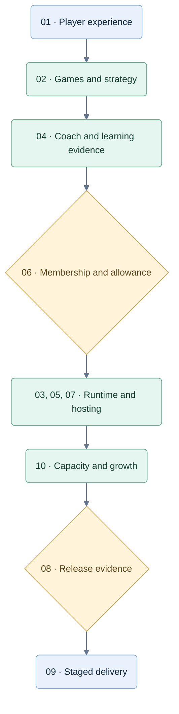

# Tricks Coach V1 specifications

**Tricks Coach** is the owner-approved product name; **trickscoach.com** is the chosen primary domain. The owner will add it to Vercel manually on 26 September 2026; completion is unverified. [Naming decision and setup status](brand-and-domain.md).

Implementation target, grounded in the playable [web prototype](../web/README.md). On 27 September 2026 the owner confirmed the latest planning baseline with earlier safeguards retained, a simple monorepo, the existing UX, a B2C learning product, in-app subscription management and Stripe payments. [CR-IMPL-001](decisions/CR-IMPL-001-monorepo-and-stripe.md) records that authority and its compatibility effects. Earlier analysis remains supporting research; the original pack is preserved.

**For implementation agents:** start at [IMPLEMENTATION-START-HERE.md](IMPLEMENTATION-START-HERE.md), then use the [current implementation plan](2026-09-27-monorepo-implementation-plan.md) and [requirements/test specification](implementation/requirements-and-tests.md). These files define future work, not completed application features.

| Read | Purpose |
|---|---|
| [Implementation handoff](IMPLEMENTATION-START-HERE.md) | Fresh-agent reading order, task selection, preserved B2C UX and evidence reporting. |
| [Current monorepo plan](2026-09-27-monorepo-implementation-plan.md) | W00–W19 files, interfaces, dependencies, patterns, tests, Stripe and release gates. |
| [Requirements and tests](implementation/requirements-and-tests.md) | Stable IDs, named fixtures and concrete rule/UX/service/payment assertions. |
| [01 — Product and views](01-product-and-views.md) | Preserve the coded experience; define missing interactions. |
| [Brand and domain](brand-and-domain.md) | Tricks Coach, trickscoach.com and the owner-managed Vercel setup. |
| [02 — Games and decisions](02-games-and-decisions.md) | Exact rules, player knowledge, tactics, probabilities and Jev's role. |
| [03 — Local runtime](03-local-runtime.md) | OpenRouter, state ownership, persistence and failures. |
| [04 — Coaching and evidence](04-coaching-and-evidence.md) | Assistance, feedback, mistake categories and progress. |
| [05 — V1 setup](05-v1-setup.md) | Current versus planned runtime, configuration, experiments and activation gates. |
| [06 — Product and subscriptions](06-commercialization.md) | Fixed demo, member-only play, proposed individual/family plans and worldwide selling. |
| [07 — Hosted architecture](07-hosted-architecture.md) | Server-only engine/coach, identity, usage, recording and competitive boundaries. |
| [08 — Commercial test gates](08-commercial-testing.md) | 49 planned acceptance cases and actual prototype baseline evidence. |
| [09 — Delivery and evidence](09-delivery-and-evidence.md) | Work split, changed decisions, dependencies and remaining launch choices. |
| [10 — Capacity and scaling](10-capacity-and-scaling.md) | Concurrent-player workload, independent scaling, database/provider limits and growth gates. |
| [Security research and plan](security/hardening.md) | Stack decision, browser/Wasm limits, access protection and abuse detection. |
| [Historical local plan](2026-09-26-implementation-plan.md) | Earlier rule/strategy/review task reference; revise before execution. |
| [Planning changelog](CHANGELOG.md) | Later changes without editing the original v0.2 pack. |
| [Diagram index and style](DIAGRAMS.md) | Visual summaries across the authored documents, with a consistent Mermaid style. |

## Read the design visually

Suggested reading order; this is a document map, not a runtime sequence.

The latest commercial decisions in 06–10 supersede conflicting local/free-play assumptions. They are specifications, not implemented capabilities. Prices and session/family details are labelled proposals; capacity tiers require measured evidence.

## Fixed direction

- Full games: Hearts solo, Spades solo, Spades partners; four seats each.
- Players know the basic rules. Help improves decisions during real play.
- Preserve the existing table, dialogs and responsive layouts.
- Jev runs through OpenRouter when enabled. Local rule/coach testing comes first; commercial play uses a hosted authoritative Node service and authenticated membership.
- Unpaid access is only a finite authored demo. Proposed paid plans meter coached hands; browser edits cannot confer server access.
- Required action/usage records are written by the server. Optional analytics and client display reports cannot prove integrity.
- Every started game is stored internally. No player-facing game archive.
- All project artifacts remain under `C:\repos\test-jev`.

## What exists today

React/Vite game views, working local rules, simple bots, optional coaching, current-game recovery and browser-local internal records. The [UI update](../web/qa/UI-V1.md) adds concise copy, off-turn card preparation/on-turn double-tap play and persistent speed settings, with 38 passing tests and browser checks. These are existing app checks, not results for the planned pipeline.

Jev, probability evaluation, service-backed records and learning assessment are planned work. This V1 specification update does not activate a service or make live Jev requests. The original pack remains reference material.

## Changes justified by the review

Retain the UX; add a local authoritative service, structured decision records, asynchronous advice and evidence-based recaps. Compare whole Hearts pass plans locally before shortlisting for Jev. Separate assistance from independent improvement. Replace generic tips only when supported feedback exists.

Compare calibrated contextual bidding (A) with constrained-deal rollouts (B) before selecting a strategy; adaptive A/B (C) must justify its complexity. Bots and coach share one observation-only policy. V1 starts code-only, then evaluates Jev in shadow. A three-arm comparison separates shortlist loss from Jev benefit before requested suggestions are promoted. Monte Carlo confidence and provider confidence cannot validate human grades by themselves.

Numerical sampling, cue and assessment defaults are initial test settings, not research-established constants. Adjust them through the stated acceptance checks without changing product scope.
