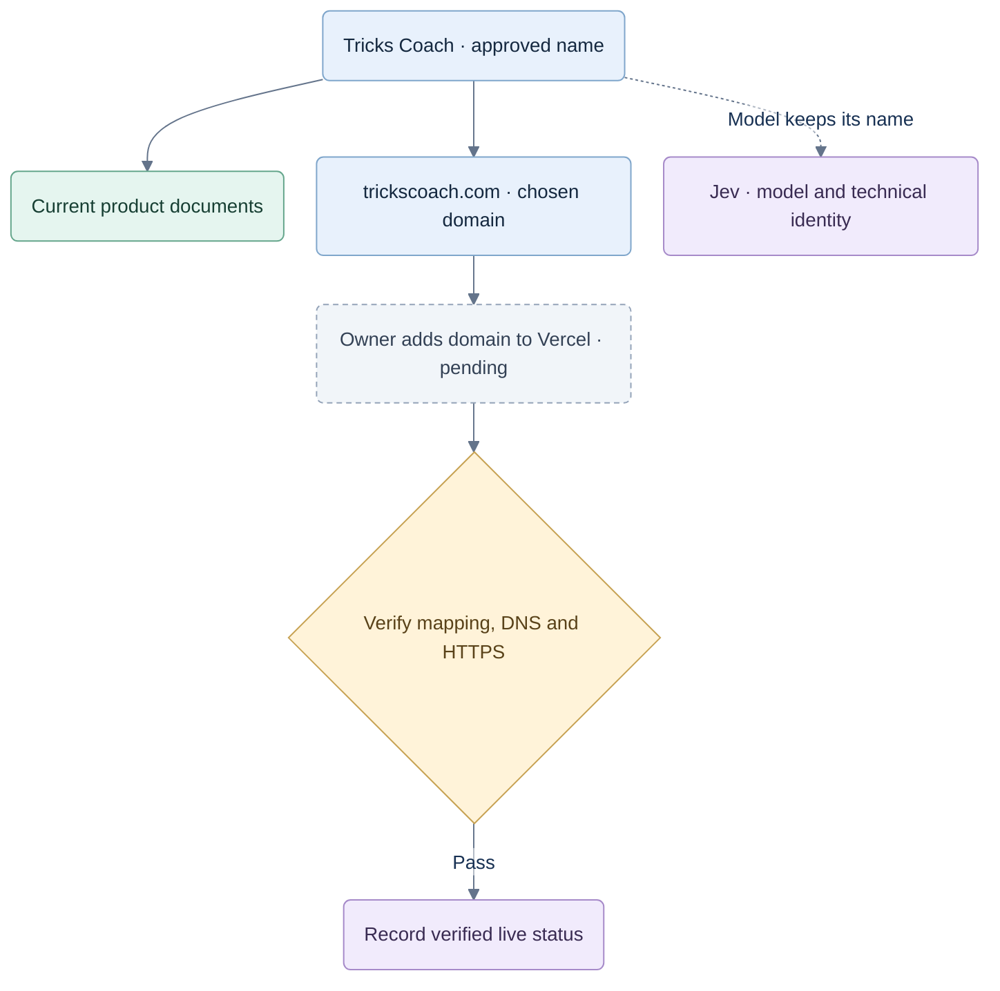

# CardFord — brand and domain

## CR-BRAND-002 — CardFord product name

**Owner approved: 28 September 2026.** Use **CardFord** as the product name in the live site, browser title and current product documentation. This supersedes the product-name requirement BRAND-01 below. The earlier **Tricks Coach** decision remains below as historical context. The owner did not select a replacement domain in this request: `trickscoach.com` remains a historical planned domain, with setup unverified, and is not presented as a CardFord domain decision. No domain, DNS, deployment, package, persisted identifier, schema URI, game rule or provider change is authorized by this name change.

**BRAND-04 acceptance:** the current app surfaces and accessible picker name show CardFord; the browser title and generated API title show CardFord; no visible app surface shows the former product name. Build, generated-contract check and browser checks pass. The original name, domain history and immutable evidence may retain the former spelling.

Alternative: rename every technical identifier and domain string. Rejected because it risks breaking contracts and implies domain ownership that has not been established. Compatibility impact is public display copy and metadata only; no migration is needed. Evidence: [branding acceptance](../qa/implementation/cardford-brand-acceptance.md).

## CR-BRAND-003 — Selected visual identity

**Owner selected: 28 September 2026.** The owner chose the first Cardford “Open Hand” direction: three fanned playing cards with a red diamond, a prominent full-word name and the motto **Card games. Your way**. The owner then removed the extra banner headline and the final period after “way.” The [selected board](cardford-open-hand-selected.png), [vector asset set](brand/cardford/DESIGN-GUIDE.md), [decision log](brand/cardford/DECISION-LOG.md) and [validation log](brand/cardford/VALIDATION.md) record the result.

| Requirement | Decision and evidence |
|---|---|
| BRAND-05 — Visual mark | Use the selected three-card symbol and full-word logo, with the documented primary, reverse, one-color, app-icon and stamp forms. Ten SVGs parse and render; compare them with the selected raster board before publishing. |
| BRAND-06 — Motto and banner | Exact motto: **Card games. Your way**. The banner has no second headline. Text checks found no removed headline or terminal motto period in the SVG set. |
| BRAND-07 — Usage | Follow the [design guide](brand/cardford/DESIGN-GUIDE.md) for palette, type, spacing, accessibility and responsive use. The fixed header and banner SVGs are visual examples; application integration is separate. |

Reason: cards make the category clear without tying the product to coaching or to one game's rules. Alternatives shown were a four-suit seal and a card-corner monogram; the owner chose the fanned-card direction. This change adds artwork and guidance only. Rules, scoring, contracts, provider behavior, persisted identifiers and domain configuration are unaffected. App-store, trademark, domain and deployment checks are not implied.

**Open spelling defect:** the selected artwork says **Cardford**, while CR-BRAND-002 and the current app display copy say **CardFord**. The owner has been asked which capitalization should be final. Do not ship a mismatched wordmark and app name; align the SVGs, raster board and guide after the choice is confirmed.

## Historical decision — superseded product name

## CR-BRAND-001 — Product identity

**Owner approved: 26 September 2026.** The owner selected **Tricks Coach** and **trickscoach.com**, and will add the domain to Vercel manually today (26 September 2026).

| Requirement | Decision |
|---|---|
| BRAND-01 — Product name | Use **Tricks Coach**, with a space and plural **Tricks**, in current product documentation and future public-facing copy. |
| BRAND-02 — Domain | Use **trickscoach.com** as the chosen primary domain. Vercel setup is owner-managed and pending confirmation. |
| BRAND-03 — Technical identity | Keep **Jev** for the strategic model/provider. Existing workspace paths, package identifiers, configuration keys, storage names and historical records retain their technical names. |

Reason: short, familiar words make coaching explicit and avoid a technical or invented spelling. The product serves adults learning to make stronger card-game decisions. The name supports the planned multi-game product; “Tricks” does not restrict future games to trick-taking games.

Alternatives considered: the earlier Card Coach/jev-test working labels and singular Trick Coach. The owner's selected spelling is **Tricks Coach**. No tagline, logo or additional domain has been approved by this decision.

Compatibility: this is a product-naming decision. Rules, scoring, game scope, model integration, public contracts and stored data are unchanged. The original v0.2 specification pack, its manifest and historical evidence remain preserved; their old working titles are historical, not the current brand.

## Historical domain handoff

At the time of CR-BRAND-001, the name was approved. Domain setup and live verification were not confirmed. The following diagram records that earlier plan, not the current CardFord domain decision.

- **Pending — owner action, planned 26 September 2026:** add `trickscoach.com` to the intended Vercel project manually.
- **Not run — after setup:** confirm the intended project/domain mapping, DNS resolution, HTTPS certificate and expected site response.

The owner's selection and planned setup do not establish registration, ownership, DNS propagation or a live deployment. This documentation update performs no Vercel changes. Selecting Vercel for domain setup does not resolve the remaining API/database hosting vendor and region choices in [07](07-hosted-architecture.md).

## Acceptance and implementation boundary

Documentation acceptance: the current entry points, product specification and delivery record use the exact name/domain, identify manual setup as pending, and preserve Jev's technical meaning. Check local document links and the original package hashes.

**Passed on 26 September 2026:** exact name/domain checks across all nine updated documents; all 67 relative document links resolve; all 56 original manifest-listed files match their SHA-256 entries. The nine files under `web/src` and `web/tests` also match their pre-edit hashes. No Git repository is present in this workspace, so no commit reference is available.

Application/UI branding and live-domain verification are not implemented or tested by this documentation change. Existing application test results elsewhere remain historical evidence, not a test run for this decision. Delivery follow-up is tracked in [09](09-delivery-and-evidence.md).
