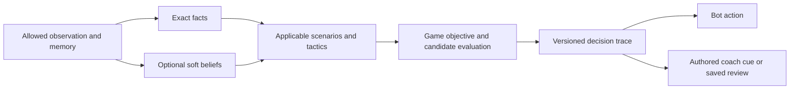

# Game reasoning: two approaches for review

**29 September 2026 · Approach A approved by owner · Inspected commit `934c5c5`.**

## Recommendation

Choose **A: typed game packs with a structured scenario catalog**. It gives developers inspectable files, reproducible decisions and a clear correction process using the current TypeScript stack. Keep **B: compiled decision tables** as an alternative when repeated authoring across games justifies a compiler.

Both approaches support the same strategic improvements below. Moving rules into configuration does not itself make bots stronger. This proposal adds no application code and does not activate Jev.

| | A — Typed game packs | B — Compiled decision tables |
|---|---|---|
| Authoring | Small TypeScript tactic functions; validated catalog, cases and authored cue files | Validated data declares conditions/effects using registered, typed game operators |
| Review | Ordinary code review plus generated scenario/case/decision reports | Table review plus compiler diagnostics and source-mapped decision reports |
| Complex plans | Direct code for bidding, beliefs and multi-turn search | Same code operators; tables compose bounded conditions and effects |
| Changes | Developer edits a tactic, cases and evidence together | Existing operators can be recombined through data; new semantics still need code |
| Cost/risk | Lower migration cost; enforce boundaries to prevent another large function | Additional schema, compiler, operator compatibility, diagnostics and migration work |
| Future editor | A catalog/trace viewer is straightforward; editing logic remains developer work | A constrained editor is easier once the format is stable |
| Fit now | **Recommended** | Useful later if non-coders repeatedly need to author existing kinds of tactics |

B would remain a **build-time authoring format inside trusted game modules**: finite conditions, typed arguments and named effects. Reject arbitrary expressions, loops, scripts, dynamic imports and runtime uploads. Rules, legal actions, scoring, inference algorithms and search stay in code. This preserves the existing prohibition on a universal game scripting language; expanding beyond these limits requires a new scope decision.

## What the investigation established

The [current design](../12-spades-reasoning.md#delivery-boundary-for-this-change) already identifies six unfinished strategic families. The [decision specification](../02-games-and-decisions.md#bidding-options-and-selection-gate) already plans contextual bidding, constrained simulation and independent Jev evaluation. Preserve that work; the missing pieces are implementation, maintainable authoring and convincing evidence.

| Finding | Evidence and implication |
|---|---|
| Correctness evidence is substantial; partnership strength is unproven | [Recorded results](../../qa/implementation/SPADES-REASONING-REPORT.md): 182 tests and 512 hands. Partnership mean margin changes are +3.55 with one changed seat and +0.35 with both teammates changed; own-score changes are −2.88 and −4.60. These are exploratory results. |
| Coverage is narrower than raw counts suggest | The [saved comparison](../../qa/implementation/spades-reasoning-comparison.json) has **24 distinct deal seeds**, reused across seats/teams. Stored partnership outcomes contain **no double-Nil team hands**. Scenario tags record occurrence, not correct tactical resolution. P04 can be tagged during bidding simply because the partner bid Nil. |
| The module seam is not production integration | [Registry](../../web/server/game/kernel/registry.ts) is exercised by the [toy seam test](../../web/server/tests/module-seam.test.ts); [game service](../../web/server/http/game-service.ts) directly imports concrete game, observation and strategy functions. |
| Reasoning is coupled | [Spades policy](../../web/server/strategy/spades.ts) combines scenario detection, prose, weights and selection. [Shared facts](../../web/server/strategy/types.ts) contain Nil/bags/trump. [Dispatch](../../web/server/strategy/index.ts) uses a Spades policy version for Hearts too. |
| Debugging lacks a complete decision trace | Saved analysis preserves reasons and advice, but omits the ranking contributions/conflict resolution that selected the action. |

The other implemented heuristic families also need independent quality evidence. Finishing the six partial families alone cannot establish mastery.

## Common design for both approaches



| Shared infrastructure | Owned by each game and variant |
|---|---|
| Registration, schema/reference checks, versioned records | Rules, legal actions, permitted knowledge and exact deductions |
| Execution budgets, stable ordering, worker scheduling | Beliefs, signals, scoring, match objectives and tactical priorities |
| Trace format, template rendering, safe projections | Scenario definitions, candidate evaluators and teaching content |
| Fixture runner, grouped comparisons, reports | Strategic labels, opponent styles and acceptance metrics |

The shared layer understands evidence categories—**exact, heuristic, sampled estimate, unsupported**—without knowing what Nil, trump or a good score means. Spades retains a solo tactical base with partnership objectives/exceptions applied **before** selection. Other games choose their own structure.

### Proposed files and records

Illustrative layout; these files are not being created now:

```text
web/server/games/<game>/reasoning/
  manifest.ts             # variants, registrations, versions
  catalog.json            # scenario definitions and references
  knowledge.ts            # exact deductions with evidence
  beliefs.ts              # optional, uncertain interpretations
  tactics/<family>.ts     # small candidate evaluators (A)
  tables/<family>.json    # alternative compiled authoring (B)
  objectives.ts           # hand/match utility and tradeoffs
  resolve.ts              # explicit interaction and selection policy
  content.json            # concise authored cues and advice
  cases/<family>/*.json   # reachable histories and independent labels
```

Use one authoritative schema per data format with generated types/validation. Typed registrations bind catalog entries to code; generated documentation is never a second source of truth.

A **scenario** describes a situation; a **tactic** proposes a response; a **case** is a concrete test. Keep them distinct:

| Record | Required reviewable content |
|---|---|
| Scenario | Namespaced ID, game/variant/phase, observable trigger, exclusions, unknowns, dependencies, conflicting objectives, source and linked cases |
| Tactic | Applicability, candidate effects/comparisons, evidence kind, exceptions, resolver interaction and version |
| Case | Rule profile, legal starting deal/history, acting seat, dataset group, expected facts, acceptable alternatives, forbidden claims, label author/method/version |
| Evidence status | Recognition tested, tactic implemented, independently reviewed, benchmarked, released—separate fields |

Example: `spades.partners.control.unbeaten-high-card` can record that the partner won with a king. It cannot locate the unseen ace. A legal lower play may be deliberate. The cue can say: **“Partner won this trick; the ace is still unlocated.”** A later discard on a spade lead proves a spade void; a side-suit discard alone does not.

### How decisions remain reproducible and inspectable

1. Freeze the acting player's allowed observation, including legitimate retained private knowledge. UI cues never change it.
2. Derive exact facts with links to public events or own cards. Soft signals carry assumptions and contrary evidence; they never remove legally feasible hands.
3. Evaluate applicable tactics against the complete legal set. The game resolver records which competing objectives prevailed. A preference never makes a legal card illegal.
4. Use exhaustive evaluation only for tractable information sets. Otherwise use seeded, bounded continuations, with common sampled worlds across candidates and each simulated actor's own information history.
5. Save observation reference/hash, all component versions, matched and rejected predicates, candidate contributions, conflict resolution, tie break, seed/work counts, assumptions and limitations. Render coach text only from supported claims in that trace.

The small-state verifier is exact only for its declared feasible worlds, information histories, objective and continuation policies or solution concept. Distinguish worst-case guarantees from expected values under an assumed distribution. Enumerating hidden deals alone cannot certify optimal partnership play.

For identical observation, versions, seed and fixed work budget, require identical local output. Live deadlines can interrupt work: save completed work counts and an explicit fallback. Missing/inconsistent knowledge yields a conservative legal choice and an uncertainty statement. Sampling never creates certainty from an unobserved outcome.

Expensive evaluation belongs in the existing worker model, outside database transactions. Commit results against decision/revision identity; stale results cannot affect live play. Freeze the designated original analysis/advice even when unseen. Later deeper analysis is a separately labeled record, never a replacement for historical advice.

## Remaining Spades work and how to evaluate it

These are proposed implementation methods, not solved algorithms or validated coefficients.

| Family | Proposed work | Cases required before claiming coverage | Coach focus |
|---|---|---|---|
| **S13 Contextual bidding** | Compare the already specified lightweight contextual bidder with constrained-deal rollouts. Use seat, earlier bids, bags and score; model Nil separately. Simulate later bidding and play in rollout comparisons. | Same own hand with different public bids/scores; partner Nil/positive bid; risky Nil; first/last bidder. Cross old/new bidding with old/new play, then evaluate the joint policy. | “Your team still needs…”; explain assumptions without invented success percentages. |
| **S14 Match/endgame** | Exact scorer and terminal win/tie/loss; bounded remaining-hand plans. Nonterminal continuation value stays an explicitly evaluated approximation. | Securing a match vs maximizing hand points; tied leaders; tenth bag; small endings with unknown ownership. | Match consequence and uncertainty, rather than simply taking another trick. |
| **S12 Opponent contracts** | Compare setting opponents, forcing bags and fulfilling our own obligations through the same objective. | A set worth taking a bag; attack that endangers our contract; deliberate bags opponents can avoid. | What the extra trick changes for both sides. |
| **P04 Double Nil** | Compare saving both, sacrificing either, and recovery after a failure; include both bonuses and bag consequences. | Reachable cases where both survive, one must fail, or either sacrifice has different future consequences; unknown cases remain ungraded. | Which Nil is threatened and what covering costs. |
| **P08 Signals** | Begin with exact constraints. Add separately validated, policy-conditioned interpretations of voluntary plays. Declare any convention; unknown partners have no assumed convention. | Forced vs voluntary discard/high-low; conflicting signals; conventional/unfamiliar partners; a king winning with the ace in different feasible hands. | “May suggest…” plus contrary possibilities. Never “partner must have…” without proof. |
| **P11 Entries/transfers** | Evaluate sequences that preserve an entry, surrender/transfer lead, develop a suit or retain a ruff; test overruff and trump depletion. | Cashing a winner strands partner; overtaking destroys an entry; drawing trump removes a ruff; apparent transfer lets an opponent win. | Next lead and resources needed later. |

Contextual bidding research supports evaluating public context and Nil separately; it does not validate our coefficients. [Bidding in Spades](https://arxiv.org/html/1912.11323v2)

Search is a candidate tool for these families. The commercial Spades study documents problems with random continuations, Nil play, partner resources and biased sampling. [AIIDE study](https://edpowley.com/academic/papers/aiide13.pdf)

Do not solve sampled full deals as if all players see them and call that optimal advice. Future choices must respect indistinguishable information states; independently optimized hidden worlds can produce impossible plans (“strategy fusion”). Information-set search addresses parts of this problem, not every inference or coordination issue. [ISMCTS](https://eprints.whiterose.ac.uk/id/eprint/75048/1/CowlingPowleyWhitehouse2012.pdf), [imperfect-information analysis](https://cdn.aaai.org/AAAI/1998/AAAI98-071.pdf)

### Jev's place

Keep the current code baseline and existing off/shadow/recommend gates. A promoted Jev selector could compare the same legal candidates and supplied evidence; it supplies neither rules nor authored explanations. Compare full-reference code, shortlisted code and Jev on that same shortlist to isolate each contribution. Jev-controlled bots remain a separate experiment.

Fresh remote calls are not guaranteed reproducible; saved request/result replay is. Choice concentration is not a calibrated probability of a winning move, successful Nil or card ownership. Any outcome estimate needs separate calibration and held-out evaluation. [TypeSafe confidence](https://docs.typesafe.ai/confidence), [calibration research](https://proceedings.mlr.press/v70/guo17a.html)

## Implementation sequence after approach approval

| Stage | Deliverable and exit evidence |
|---|---|
| **1. Contracts and casebook** | Approved change record, requirement IDs and schemas. Convert all 26 Spades families into a catalog; mark actual evidence status. Add adversarial cases for the six gaps and an independent labeling rubric. |
| **2. Behavior-preserving extraction** | Wire typed game adapters through the actual service, strategy, coaching and persistence. Move current tactics into packs; give Hearts its own policy identity. Frozen-corpus action/fact/advice parity, historical readability and existing regression gates pass. |
| **3. Objectives and small endings** | Traceable conflict resolver; exact small information-set verifier; S14/S12/P04 cases. Demonstrate both actions and explanations, including counterexamples. |
| **4. Bidding and longer plans** | Compare the specified bidding methods, then add bounded P11 planning. Fresh grouped complete-match comparisons, Nil/bag/contract slices and measured execution budgets. |
| **5. Soft signals** | Add P08 only where evidence improves decisions across partner styles. Check retraction, misleading signals and hard-constraint precedence. |
| **6. Release evidence and portability** | Joint policy and coaching evaluation; end-to-end module test through real application paths. Use Hearts to validate separate reasoning ownership, then a structurally different game when its own scope is approved. Optional Jev investigation stays separately gated. |

Numeric strength targets and sample sizes should be agreed **before** the final evaluation, using pilot variance and the intended product claim. Present evidence does not supply a defensible mastery threshold.

### Repeatable authoring and correction workflow

For each game: freeze its rule/visibility profile → identify phases, objectives and competing obligations → define scenarios and counterexamples → implement small tactics → independently label cases → benchmark → release a versioned pack.

Derive coverage from **phase × objective × turn/seat role × known/unknown information × resources × conflicting obligations**. Use exhaustive small cases, boundary cases and targeted combinations; retain generator seeds. A finite catalog cannot enumerate all play. Unmatched situations still receive a legal fallback, with unsupported strategy left ungraded.

Generate a maintainer report linking **requirement → scenario → fact/tactic → case → evidence → cue**. A suspected bad move becomes a frozen decision case. Review the trace, correct the smallest responsible component, run its consumers/conflicts plus information-safety checks, inspect changed decisions, then publish or roll back a pack version. Original saved advice remains readable.

Required evaluation layers:

- **Facts and safety:** reachable histories, forced/ambiguous cases, hidden-hand permutations with identical observations, actor-specific simulation invariance, seat rotations and sample-frequency checks against small exact sets.
- **Tactics and explanations:** positive/negative/boundary cases, conflicting obligations, independently labeled acceptable alternatives, forbidden claims and cue fidelity. Missing labels stay ungraded.
- **Strength:** fresh full matches, one changed seat and both changed teammates, mixed teammate/opponent styles, old/new bidding-play combinations, separate Solo/Partners and Nil/bag/endgame outcomes. Group rotations, related cases and continuations together; never tune on the final holdout.
- **Learning and operation:** experienced-player tests on fresh unaided decisions, separate memory/strategy assistance, latency/resource/fallback rates and quiet/live/review consistency. Coached wins do not demonstrate learning.

## Reuse for other games

The process is reusable; strategy and visibility remain game-specific. Existing platform scope is **four seats, individual competitors or two pairs**. A folder format cannot automatically supply different seat counts, card instances, auctions, draw piles, simultaneous choices or control permissions.

| Game example | Reused | Separately designed |
|---|---|---|
| Hearts | Catalog, exact/soft evidence, traces, evaluation workflow | Passing memory, penalty/moon goals, individual match objective; no partner/trump assumptions. [Rules](https://bicyclecards.com/how-to-play/hearts) |
| Bridge | Same authoring and evidence process | Auction/conventions, contract scoring, public dummy and declarer control; explicit engine/visibility/UI extensions. [ACBL](https://www.acbl.org/learn/) |
| UNO | Same versioning, candidate/trace and evaluation infrastructure | Duplicate card instances, draw/discard zones, color choices, skip/reverse; freeze a specific four-player edition. [Mattel rules](https://service.mattel.com/instruction_sheets/UNO%20Basic%20IS.pdf) |

Separate game state, information state and observation interfaces are an established useful pattern; adopting OpenSpiel itself is not proposed. [Official interface](https://github.com/google-deepmind/open_spiel/blob/master/open_spiel/spiel.h)

**Parked idea:** versioned bot difficulty/style profiles and a private catalog/trace editor. Profiles could vary planning budget or validated style while preserving identical legality and information access. Coach strength can remain higher than an easier bot's; UI cue settings never change analysis depth. Any editor should produce reviewed, tested pack changes, not immediately mutate live rules.

## Review decision and evidence boundary

**Select A or B before implementation.** Recommendation: A, followed by stages 1–2; retain B's possible editor benefit without building its compiler now.

This investigation used three independent research/audit agents, repository inspection and primary research. Application tests and benchmark hands were **not rerun**; counts above refer to the existing evidence at `934c5c5`. No runtime code, rules, provider settings or existing specifications were changed. Recorded implementation evidence used local code with Jev off; this investigation made no provider requests and observed no model ID.
