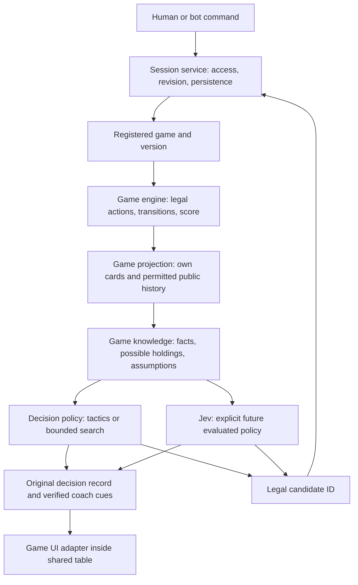

# Architecture and algorithm recommendations

Interview synthesis, 4 October 2026. Proposed decisions for the later main plan; existing rule profiles and runtime model restrictions remain authoritative.

## Recommendation and alternatives

| Approach | Appropriate use | Conclusion |
|---|---|---|
| Extract production game modules | Coupling can be removed while preserving reducers and reliable service infrastructure | Preferred starting point |
| Replace selected engine/planner boundaries | A reachable new-game case needs fake Spades fields, false terminal states or unsafe information to fit the API | Allowed after demonstrating that incompatibility |
| Rewrite the entire application | Evidence shows ownership, persistence and service orchestration prevent required behavior | Not justified today |

Preserve deterministic reducers where correct, generated transport contracts, ownership/revision/idempotency checks, durable jobs and immutable original advice. Folder rearrangement is insufficient: the registered module must be the real production dispatcher. No microservices, runtime plugin loader, universal rule language or new runtime model framework is needed.

## Responsibility map

The shared shell owns four seat identities, controller/access configuration, competitor partitions, lifecycle, commands and evidence storage. The game owns deck/ranks, turn order, phases, legal actions, observations, deductions, sampling constraints, scoring, ranking, objectives and table controls. Human versus machine is controller data; teammate versus opponent is competition data. Neither changes who may see private cards.

Use typed module schemas with a common envelope and generated closed public unions. Avoid an unchecked JSON blob and a universal state carrying every game's fields. Sealed decisions need a declared pending-actor/reveal capability; today's Hearts implementation is not proof of generic simultaneous-turn support.

Trick strength and layout adjacency are separate phase-specific operations. A universal `cardRank` cannot safely determine both. Trix uses Ace-high trick ranking and the selected Jawaker layout order: Jack anchors each suit; Queens and Kings extend upward to Ace, while 10 through 2 extend downward. Waraq's conflicting seven-centered layout is not supported. See [08](08-standard-rule-reconciliation.md).

## Decisions need a declared goal and horizon

Treat auction, trump choice, contract choice, trick play and layout as distinct module phases. Separate “waiting for a player,” “automatic transition” and “finished” from those phase names. Record the objective, competitor payoff vector, comparison rule and horizon for each decision.

Spades can prioritize making a bid or avoiding a bag penalty; Tarneeb must use its own commitments and score; Trix may compare current penalties, finishing order and the remaining kingdom choices. A future deal is a new chance event under the chosen profile, not reuse of today's cards. More distant forecasts must name their assumed future deal distribution and continuation policy. The platform must not assume that taking a trick or maximizing one immediate score is always good.

Retain common-world comparisons, work accounting and trace arithmetic from the existing planner. Its `defaultMove(world)`, round-terminal utility and fixed stance require review/replacement before claiming safe multi-phase planning. Budget exhaustion, unresolved comparison and fallback remain explicit; search cannot label unsearched actions inferior.

## Knowledge and simulated play

Keep three separate outputs:

1. **Facts:** proven by rules and visible events, with evidence references.
2. **Possible holdings:** all states consistent with those facts.
3. **Assumptions:** versioned beliefs about bidding, discards, cooperation and opponent style.

For a sampled continuation, only the simulation referee holds the complete synthetic world. It projects the acting seat's observation; that seat's policy receives only that observation and its own allowed memory. Partners never share private plans. Tests must compare indistinguishable inputs across different hidden holdings and public-reveal timelines. Hypothetical worlds never include the actual concealed deal.

Uniform feasible sampling is a declared prior, not an observed frequency of how humans hold or play cards. Adding soft bid/signal weights requires separately evaluated assumptions, not new certainty. Exact negative facts and uncertain intentions stay game-owned.

## Algorithm choices: experiment before promotion

[OpenSpiel's official concepts](https://openspiel.readthedocs.io/en/latest/concepts.html) separate game descriptions, state transitions, legal actions, chance and player information. Adopt those separations as a design reference; adding OpenSpiel as a runtime dependency is not proposed.

| Candidate | What it supplies | Limit and selection condition |
|---|---|---|
| Typed tactical rules | Inspectable tactics and faithful explanations | Brittle if exceptions/objectives are missing; establish the baseline |
| Flat sampled continuations | Compares future outcomes under named feasible worlds and policies | Sensitive to beliefs, horizon and continuation quality; retain where held-out gains justify cost |
| Information-set tree search | Shares future decisions across states the actor cannot distinguish | Investigate when flat rollouts exhibit a specific planning failure; require information and compute gates |
| CFR or learned policy | Potential research comparisons for selected tractable formulations | No universal four-player/partner guarantee; no new runtime model authorized |
| Jev | Sole permitted runtime strategic model, when explicitly enabled and evaluated | Agreement/confidence is not strength or calibrated winning probability |

[Cowling, Powley and Whitehouse's ISMCTS paper](https://eprints.whiterose.ac.uk/id/eprint/75048/1/CowlingPowleyWhitehouse2012.pdf) explains strategy fusion: choosing a different future action in each sampled perfect-information world can describe an impossible player policy. Actor-safe rollouts are necessary but do not automatically solve this search issue. The paper also reports game-dependent overhead and performance; it does not establish ISMCTS as strongest for Tarneeb or Trix.

[The original CFR paper](https://poker.cs.ualberta.ca/publications/NIPS07-cfr.pdf) establishes its equilibrium result for two-player zero-sum settings. Four individual competitors and partners with separate private information do not automatically satisfy that setting. Shared score does not make a partnership one player with a shared hand.

Bots and coach should consume the same safe analysis and versioned tactics. Coach wording explains the chosen action with checked facts, exceptions and uncertainty; cue visibility does not alter analysis. Difficulty may later select a reviewed policy/budget profile. A future maintainer backend can edit approved configurations, but a runtime scripting editor is unnecessary now.

Published strategy prose enters the case catalog as a hypothesis with a counterexample, not as an exact fact or measured probability. The [strategy checks](08-standard-rule-reconciliation.md#strategy-admission-tests) illustrate why this admission gate is necessary.
